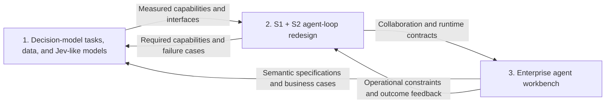

# NGA — Next Generation Agent

[GitHub](https://github.com/chaosxingxc-orion/nga) · [GitCode mirror](https://gitcode.com/xingchao_ml/nga) · [Synchronization status](https://github.com/chaosxingxc-orion/nga/actions/workflows/sync-gitcode.yml)

GitHub is the canonical repository. GitCode receives automated branch, tag and commit synchronization; see the [mirror operations guide](.github/GITCODE-MIRROR.md).

**NGA develops a new enterprise-agent approach through three projects: Jev-like decision models, System 1 + System 2 agent loops, and an enterprise agent workbench. Idempotent decisions and business outcomes, replayable and auditable execution, and business configurability are the shared objectives.**

The preceding generation of agent frameworks centers on an **agentic model**: the model plans, executes actions, reflects on observations, and replans through an **agent loop**. NGA starts from a production concern: generative reconsideration can change a consequential decision even when its business basis has not changed. The project treats this instability as a central barrier to using agents in enterprise core processes.

The research direction starts from the required business behavior. The [survey](survey/README.md) and its [PDF](survey/nga-survey.pdf) identify useful evidence, defects, and gaps in Jev-class research. They inform task definition and controlled comparisons; published architectures and benchmarks do not determine NGA's objectives.

Start with the [NGA overall design](design/nga-overall-design.md) for the program and established principles, then [07 — NGA Architecture and Minimum Java SDK Proposal](achitecture%20design/07-nga-architecture-proposal.md) for the single current architecture and implementation scope. **These are design objectives and proposed mechanisms, not demonstrated runtime guarantees.**

NGA is organized across **three lifecycle states — development, runtime, and operations — and four responsibility planes — user, runtime, management, and control**. **Agent evolution is the integrating whole across the planes and states**: business experience informs versioned improvements to models, semantics, capabilities, workflows, and their controls. Each plane participates in all three states; operations includes business performance and improvement, not only infrastructure maintenance. The three repository projects below are a separate work organization.

**openJiuwen remains NGA's engineering foundation.** The proposed first framework deliverable is an **embeddable Java SDK + openJiuwen adapter + Spring Boot Starter**, with a credit reference application and conformance suite. It reuses existing execution capabilities and adds explicit decision, effect, recovery and replay contracts. The architecture proposal includes pinned source evidence, compatibility limits and the acceptance gate; a full workbench is not required for this first delivery.

## Three projects and how they connect

| Project | Objective | Main outputs |
| --- | --- | --- |
| **1. Decision-model research and engineering** | Translate decision and business-result idempotence requirements into measurable academic tasks, synthesize data, and design and develop a Jev-like model. | Task definitions, evaluation protocols, synthetic datasets with provenance, reproduction baselines, model designs/checkpoints, and typed-readout interfaces. |
| **2. S1 + S2 agent-loop redesign** | Use available Jev-class capabilities to redesign the agent loop, then incorporate validated improvements from project 1. | Collaboration mechanisms, component contracts, adoption/execution boundaries, recovery behavior, and end-to-end evaluations. |
| **3. Enterprise agent workbench** | Turn the approach into a concrete enterprise product and manage business semantics through knowledge engineering. | Task and capability management, governed semantic specifications, execution/adoption controls, exception handling, and traceability/reconstruction interfaces. |

These are connected projects, not three sequential completion gates. Project 2 can start from currently available Jev capabilities. Project 3 can establish its V0 from the existing enterprise architecture design while S1 + S2 collaboration is developed and gradually integrated. Reproduction belongs to project 1; it is a baseline and engineering starting point, not a separate top-level project or the final objective.

### 1. Define the task, build the data, develop the model

The model's central requirements are **decision consistency** and **business-configurable development**. It should apply supplied business definitions to evidence, preserve decisions across irrelevant variation, and change them when the rule or relevant facts require a distinction. The work must define these properties as falsifiable tasks before choosing a training recipe or architecture.

Data synthesis should vary the rules as well as the cases: equivalent cases under one rule, competing rules over the same case, relevant changes, boundary cases, and explicit unresolved outcomes. Held-out rule families and independent checks must distinguish reading the supplied specification from memorizing labels or a generator's grammar. Project 3 ultimately owns the business semantic specifications; research can begin with explicitly reviewed and versioned task specifications.

Jev engineering reproduction establishes a path through **data preparation, training objectives, inference/readout, and evaluation**. Reproducing a recipe, matching a benchmark, and reproducing native typed readout remain separate milestones. Existing work starts with small Qwen-family decoders: `Qwen3-0.6B` is an attention-only control, and the proposal explores the Qwen3.5 0.8B, 2B, 4B, and 9B ladder. These research choices do not freeze NGA's final model architecture.

The current model proposal investigates `boolean`, `nominal`, and `ordinal` levels with `exclusive` or `stackable` candidate sets and an input order of **task definition → input → candidate branches**. Evaluation covers accuracy floors, definition following, semantic consistency, discrimination, unknown handling, and usable cost. A model improvement contributes to business-result idempotence; it cannot by itself prevent duplicate external effects.

### 2. Redesign the agent loop around S1 + S2 collaboration

**S1** contributes typed semantic judgments. **S2** contributes generative reasoning, planning, evidence requests, and adaptation. **The framework** validates contracts, controls adoption and execution, maintains state, and preserves the trace from evidence to outcome.

S2 proposes plans and revisions; the framework controls whether and when they become effective. S1 observations inform the registered decision policy. Neither model can publish business rules, enlarge its authority, or replace adopted history on its own.

The placement of S1 remains an engineering question: routing, monitoring, evidence selection, intermediate-state evaluation, and final readout have different requirements. Compare candidate loops on task success, cost per successful outcome, latency, semantic consistency, duplicate-effect prevention, and recovery. A cheaper isolated judgment does not establish a better agent.

The first SDK scope makes five capabilities concrete: task/version binding, decision adoption, qualified business effects, durable waiting/recovery, and audit/executable replay. The Starter assembles these within a Spring Boot host; openJiuwen retains graph/loop execution ownership. Module names and implementation choices are proposed, and no SDK artifacts are published yet. See the [minimum delivery contract](achitecture%20design/07-nga-architecture-proposal.md#1-architecture-decision-and-first-deliverable).

### 3. Build the enterprise workbench and govern semantics

The workbench turns enterprise requirements into maintained business contracts and usable task, execution, review, and accountability workflows. **Knowledge engineering in this third project owns the management of semantic gray areas.** Business experts need a way to define terms, units, time windows, boundaries, precedence, coverage, and exception behavior, then review, publish, version, and revise those specifications.

The objective is that decision execution never silently invents a missing convention. Ambiguous rules, uncovered cases, missing evidence, and model uncertainty must lead to declared handling rather than an improvised business answer. An unresolved state is distinct from a business rejection unless the published policy explicitly equates them. Model detection and framework handling of these states still require work in projects 1 and 2; specification governance belongs to project 3.

**The supplied enterprise architecture remains the V0 source baseline.** The current proposal organizes the workbench by three states and four planes, with agent evolution connecting them. Capability contracts, bounded authority, context provenance, and adoption/accountability remain useful foundations; inherited assumptions are corrected where counterexamples invalidate them. S1 + S2, Graph, Loop, and Workflow designs evolve on openJiuwen. Prefer reuse, configuration and adapters before custom implementation; necessary NGA components must remain replaceable through explicit contracts. Specific compatible versions, supporting technologies and unvalidated mechanisms remain open.

## Decision idempotence and traceability

| Goal | Meaning | Main responsibility |
| --- | --- | --- |
| **Business-semantic consistency** | Equivalent cases under the same rule should receive the same decision; relevant fact or rule changes should cause the required distinctions. | S1 capability and the framework's decision policy. |
| **Repeated-request idempotence** | Retries and recovery reuse an adopted decision for the same identified request. | Framework identity, adoption, and state management. |
| **Action idempotence** | Retrying one business operation should not duplicate its effects. | Framework plus external tool/resource support or an explicit reconciliation path. |
| **Traceability** | Reconstruct the evidence, versions, authority, adoption, and execution that produced an outcome. | Framework records and preserved artifacts. |
| **Replayability** | Inspect history and replay control behavior from preserved definitions and recorded model/tool/event inputs without live effects. | Framework capture and isolated replay execution. |
| **Auditability** | Examine the actual business basis, authority, transitions, effects, revisions, and evidence integrity. | Framework records and workbench access, integrity, review, and retention controls. |

Caching the same request does not prove semantic consistency. Historical reconstruction, re-evaluation under new versions, and action compensation are separate operations. A new evaluation must not silently rewrite history or repeat an external business operation.

## Architecture and implementation scope

The [overall design document](design/nga-overall-design.md) records the program scope and established principles. The [canonical architecture proposal](achitecture%20design/07-nga-architecture-proposal.md) defines the minimum Java SDK, public contracts, object model, control boundaries, execution/recovery behavior and acceptance requirements.

The proposal composes Jev judgment, bounded Agent Loops and reusable Workflows on the existing Graph engine. It distinguishes historical inspection, executable control replay, candidate reevaluation and live recovery, and includes a complete credit lifecycle plus fifteen minimum acceptance cases.

The [architecture workspace](achitecture%20design/README.md) contains the current 07 Proposal and the two preserved V0 references. Exploratory iterations are retained locally and in Git history rather than presented as competing current proposals. Architecture analysis assumes the required Jev-like capability within its supported scope; this is not a claim that the research model has passed its gates.

| Design area | Current proposal |
| --- | --- |
| **SDK and hosting** | Three artifacts, one Spring Boot reference application and a conformance suite; reuse openJiuwen execution. |
| **Models and control** | Jev supplies typed judgment; S2 supplies bounded reasoning/proposals; framework contracts govern adoption and effects. |
| **Identity and recovery** | Preserve task, decision and business-request identities across retries and replanning; qualify durable waits and provider-specific recovery. |
| **Audit and evolution** | Retain required evidence, replay without live effects, and connect attributed cases to independently evaluated releases. |
| **Deferred product scope** | Full graphical workbench, marketplace and distributed orchestration follow the minimum SDK. |

openJiuwen is the established engineering base, with the public Java line as the current analysis reference. Before accepting the implementation, qualify the exact dependency matrix, durable storage/continuation integration, semantic fixture/provider guarantees, public schemas and deployment assumptions. These choices are tracked in the proposal; the documentation does not amend model-research protocols or claim the SDK is already available.

## What is in the repository today

This is an active research and engineering repository. Most existing code and experiment records belong to project 1. Project 2 and project 3 currently have design foundations; the integrated loop and enterprise workbench remain to be implemented and evaluated. The three-project scope is a program organization, not a claim that three complete implementations or directory trees already exist.

| Area | Contents and entry point |
| --- | --- |
| **Overall design** | Program vision, three projects, research boundaries and established principles in [`design/nga-overall-design.md`](design/nga-overall-design.md). |
| **Architecture proposal** | Canonical SDK scope, openJiuwen reuse, S1/S2/framework contracts, credit lifecycle, diagrams and acceptance gate in [07 — Architecture Proposal](achitecture%20design/07-nga-architecture-proposal.md); original V0 inputs remain in the [architecture workspace](achitecture%20design/README.md). |
| **Survey** | Nine analytical chapters covering Jev-class models, semantics, consistency, business value, fast/slow cooperation, and limitations. Start with [`survey/README.md`](survey/README.md); a [PDF](survey/nga-survey.pdf) is also available. |
| **Research plan** | R0–R8 hypotheses, work packages, dependencies, and decision gates. See the [proposal](proposal/00-research-proposal.md) and [four-direction work plan](proposal/01-work-plan-four-directions.md). |
| **Tasks and protocols** | Data builders, manifests, frozen protocols and amendments, and result documents in [`experiments/`](experiments/README.md). |
| **Baseline code** | Prompt rendering, candidate scoring, splits, threshold fitting, paired metrics, and reporting in [`experiments/r0_baseline/`](experiments/r0_baseline/). |
| **SFT code snapshots** | Data preparation, training, evaluation, and launchers in [`experiments/r3_sft/`](experiments/r3_sft/README.md). Its `r1_code` directory means SFT round 1, not proposal round R1. |
| **Experiment records** | Purpose, hypothesis, setup, results, and verdict for each recorded experiment in [`wiki/`](wiki/README.md). |
| **Operational tools** | Monitoring digests, anomaly flags, and model-copy verification in [`tools/`](tools/README.md). |

### Recorded progress and current limits

The following describes the committed experiment records, rather than live server state:

- **R0:** an untuned readout baseline has been run and [reported](experiments/R0-BASELINE-RESULTS.md). An erratum is pending, but not for the reason first recorded: the scorer-padding diagnosis was **withdrawn** on 2026-10-30 (`experiments/R3-SFT-PREREG.md` §14.6 item 5). At float32 with HF32 matmul disabled, left padding moves scores by ≤ 1e-4 nats with zero argmax changes; what those published numbers actually carry is bf16 batch-composition noise, which reaches 2.6 accuracy points against decision bars of 1.0. They still cannot serve as the R0 side of new comparisons, on that corrected ground. This run uses **candidate-label token log-probabilities**, and does not demonstrate a native typed-readout head or a typed-readout advantage.
- **Control checkpoint:** [F1](wiki/F1-fetch-qwen3-0.6b.md) records the Qwen3-0.6B checkpoint as fetched and verified. That record does not contain the hybrid-versus-attention experiment result.
- **First SFT round:** the [R3 protocol](experiments/R3-SFT-PREREG.md) is frozen with amendments. [K0](wiki/K0-untuned-readout.md) and [W1](wiki/W1-wave1-first-weight-updates.md) remain marked **planned**. Scorer-admissibility measurements and the recorded efficiency prerequisites must be completed before the relevant runs of record.
- **Research gates:** G1 (consistency measurement), G2 (definition following), and G3 (business-author configurability) are evidence requirements in the proposal. The present records do not establish that they have passed. R3's permitted pre-G1 accuracy SFT cannot be used to claim a consistency result or a gate pass outside its registered scope.

## Working principles

- Keep repository artifacts, model prompts, comments, and commit messages in **English**.
- Treat proposed capabilities and architecture choices as falsifiable hypotheses. State the shortcut or degenerate solution an experiment must exclude.
- Pair every invariance objective with a discrimination test, and report accuracy floors and degenerate baselines alongside consistency.
- Register metrics, splits, thresholds, and decision lines before running. Make protocol changes through explicit amendments.
- Write experiment purpose, hypothesis, and setup before launch; add results and verdicts from the run's own artifacts afterward.
- Keep the survey analytical, system design in `design/`, research work plans in `proposal/`, and experiment protocols and evidence in `experiments/` and `wiki/`.

Experiments use the existing Linux / Ascend NPU environment and shared storage. Model weights, datasets, generated task files, checkpoints, and full run outputs are held outside Git. The R3 code in this repository is a snapshot of working copies on shared storage; reconcile versions and record provenance before editing or launching. A local training environment is not required to read or contribute to the project documentation.

For detailed research and run conventions, see [`CLAUDE.md`](CLAUDE.md), the [experiment guide](experiments/README.md), and the [wiki rules](wiki/README.md). The pre-registrations govern experimental claims; this README introduces the project and does not amend them.
