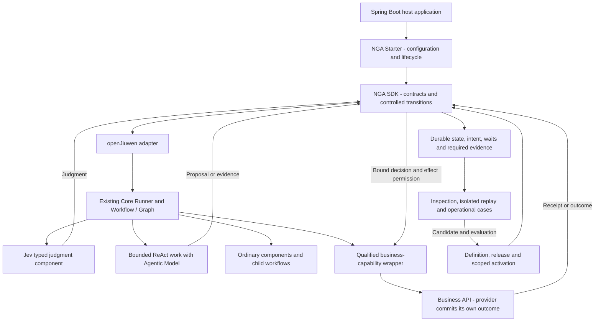

# NGA Architecture and Minimum Java SDK Proposal

> Updated: 2026-10-31 (America/New_York).
> Role: the canonical architecture proposal for collaborators and implementers.
> Status: established requirements plus a concrete implementation target. The SDK, integration guarantees and acceptance results described here are not yet implemented or verified.
> Program context: [NGA overall design](../design/nga-overall-design.md). Original V0 inputs: [architecture brief](05-architecture-brief-and-decisions.md) and [diagrams](06-architecture-diagrams-md.md).

## 1. Architecture decision and first deliverable

**Build an embeddable NGA Java SDK on openJiuwen, with a Spring Boot Starter, an openJiuwen adapter, and one complete credit-decision reference application.** The first deliverable proves a useful decision lifecycle, including restart recovery and executable control replay. A server that starts or a graph that answers once is insufficient.

NGA combines **Jev/S1 typed semantic judgment**, **Agentic Model/S2 reasoning and planning**, and **framework-controlled adoption and execution**. openJiuwen supplies the execution foundation. NGA adds the contracts needed to make decisions consistent, repeated requests idempotent, business effects accountable, and improvements governed.

### Established requirements

- openJiuwen remains the engineering base; the public Java implementation is the current integration reference.
- Reuse existing components first. Necessary NGA development must be componentized and pluggable, with explicit compatibility and authority boundaries.
- Organize the architecture by **three states** (development, runtime, operations), **four planes** (user, runtime, management, control), and **one integrating whole** (agent evolution).
- Preserve decision consistency, request/effect idempotence, replay, audit and business configurability. These are distinct obligations.
- Invoke qualified business APIs. Existing IT systems own their domain records, internal rules and business commits.
- Control primitives must support configuration, import, composition and customer implementations. Business semantic specifications belong to the workbench/knowledge-engineering lifecycle.

### Implementation target proposed here

Use three Java artifacts and two verification assets, not a service per architectural object:

| Deliverable | Responsibility | First-release boundary |
| --- | --- | --- |
| `nga-sdk` | Public task/release/audit contracts, deterministic transition coordination, decision/request identity and extension interfaces. | Plain Java core; no required Spring, HTTP server, UI or openJiuwen types in its public API. No new graph scheduler. |
| `nga-openjiuwen` | Bind SDK contracts to existing Java Core Workflow/Graph, ReAct, tools, sessions and checkpoints. | One qualified openJiuwen integration. Java Runtime hosting is optional integration, not a second mandatory server. |
| `nga-spring-boot-starter` | Assemble configuration, the adapter, supplied model/business/storage providers and lifecycle ownership. | A small starter may include its auto-configuration initially; split it only when dependency or release needs justify another artifact. |
| Credit reference application | Demonstrate define → activate → execute/wait → inspect/replay → improve. | One Spring Boot application, a simulated business provider and injectable Jev/S2 services. UI can be minimal or absent. |
| Conformance and failure fixtures | Test component replacement, ordinary outcomes, repeated commands, crashes, waits, permissions and replay. | An executable engineering gate; fixtures using model doubles do not certify real-model consistency. |

These names are proposed artifact boundaries, not already published packages. The implementation should begin with this scope; full workbench construction is not a prerequisite.

## 2. Runtime composition and ownership

The diagram assigns responsibilities; it does not require separate services or databases. **openJiuwen owns execution scheduling within an admitted scope; NGA owns eligibility and authoritative NGA transitions.** Neither should independently advance the same work. A timer adapter can wake an admitted continuation without becoming another workflow engine.

The first supported operating profile is one host process per owned execution scope, with durable restart and duplicate-command handling. It must reject conflicting ownership or deployment configurations outside that profile. Multi-instance scheduling, cross-region availability and transparent live checkpoint migration require later qualification; a single-process profile still needs durable conflict checks and a restart protocol.

### Spring Boot integration contract

The starter is a convenience assembly layer. Applications can construct the plain SDK directly; Spring applications inject its public services. Auto-configuration should use explicit imports, class/property conditions and replaceable default beans. The host supplies credentials and qualified providers. This follows Spring Boot's [custom auto-configuration guidance][spring-boot]; it does not imply support for every Boot version.

Configure the scope, release selection, provider bindings, persistence, timeout/budget policies and execution mode. Explicitly distinguish a development profile from a live-effect profile. Live-effect startup must reject missing durability, authority or business-capability requirements instead of silently falling back to in-memory defaults.

Assign exactly one lifecycle owner to Runner, connections and workers. Owned resources start/stop with the host; borrowed resources remain with their owner. Startup recovery restores recorded waits and unresolved intents before permitting conflicting work. Shutdown stops new admissions and preserves continuations; it does not report outstanding provider calls as canceled.

For hosting inside existing **openJiuwen Java Runtime**, preserve controller → ServeOrchestrator → AgentHandler → Core Runner and compose NGA binding/enforcement at those boundaries. Do not create another HTTP stack or start a second Runner. An ordinary Spring Boot host can instead embed the Core adapter directly. Only one host path must be qualified for the first reference application. [Runtime architecture][runtime-readme], [AgentHandler interface][handler].

Pin one tested Java/Core/Boot dependency matrix before implementation acceptance. The inspected Java Runtime POM declares Core `0.1.17` and Spring Boot `4.0.7`; that is source evidence, not a recommendation to combine arbitrary latest versions or a claim that this integration has passed tests. [Runtime POM][runtime-pom].

## 3. Minimum SDK contracts

The SDK must make the following behavior concrete. Package and interface names may change; their responsibilities must not disappear into model prompts or callback conventions.

| Surface | Minimum operations and results | Control boundary |
| --- | --- | --- |
| Definition/release service | Register a definition, seal exact dependencies, associate evaluation evidence, request scoped activation/withdrawal; return immutable references and activation receipts. | Candidate registration is not permission to run. Activation uses current authority and expected generation. |
| Task service | Start/resume with caller request identity, submit evidence, inspect state and request a supported intervention. | Same-key/different-material-content is a conflict. A conversation ID, restart or graph node ID does not define business intent. |
| Runtime integration | Submit typed judgments/proposals, admit a transition, bind a business operation, ingest correlated observations and resume a wait. | These are trusted integration ports, not unrestricted public setters for approval or provider status. |
| Audit/replay service | Read lineage, export required evidence and execute an isolated replay or a separately identified reevaluation. | Replay cannot dispatch live effects, activate releases or overwrite history. |
| Case/evolution support | Record a symptom, evidence and attribution; associate recovery or a candidate/evaluation/new release. | A complaint is not automatically a training label, and an optimizer cannot publish its own change. |

Every mutating command carries scope/principal context, command identity, material payload identity and expected relevant generation. Results distinguish accepted/pending, committed, duplicate, conflict, rejected and unresolved. Same command identity with unchanged material content resolves the original receipt; changed content does not silently replace it. Provider observations retain source/correlation and are distinct from commands.

### Internal minimum

1. **Task and version binding:** resolve an eligible activation, bind actual dependencies, and maintain task/decision/request identities across attempts and children.
2. **Decision and transition coordinator:** validate typed observations, applicable semantics, evidence and authority; commit adoption or a declared unresolved route.
3. **Business-effect boundary:** bind the exact operation and payload to the adopted decision, enforce current permission and preserve request continuity.
4. **Continuation coordinator:** persist waits/deadlines and process observations, retries and recovery under the capability contract.
5. **Evidence and replay support:** retain required inputs/artifacts/receipts and run the same control path with recorded nondeterministic inputs and effects disabled.

These can be modules in one library. They do not constitute another general-purpose agent framework or require a custom database, queue or policy engine.

### Required extension ports

| Port family | Contract that a supplied implementation must satisfy |
| --- | --- |
| Model/capability providers | Jev returns typed judgment, unknown state and actual basis/model/readout references; S2 returns attributable proposals/evidence. Generative output is not a substitute for a native typed readout. |
| Business capability adapter | Declared business meaning, fixed request binding, outcome mapping, wait/query and supported retry/cancel/compensation behavior. |
| State/evidence/artifact storage | Durable authoritative transitions, command deduplication, expected-generation checks, intent/wait records and retained content. Define the atomic unit and recovery behavior explicitly. Multiple ports may share one existing store. |
| Authority provider | Current identity/scope, delegated permissions, budget and revocation checks; decision versions do not preserve revoked rights. |
| Continuation driver | Correlated event/timer delivery, duplicate detection and restart recovery; a sleeping thread is not a durable wait contract. |
| Primitive/component registry | Versioned configuration, package imports, custom handlers/states/events, capability declaration and compatibility validation. |

Ship one concrete durable storage/continuation integration for the reference application using existing infrastructure. Interfaces alone are not a completed implementation. In-memory substitutes are acceptable for isolated tests, not as evidence for restart or live-effect guarantees. Replacing a provider through a Spring bean changes implementation, not the authority or idempotence contract it must satisfy.

## 4. One whole, three states and four planes

The three states are concurrent lifecycle activities, not three deployment environments. Four planes are responsibility boundaries, not four roles, products or services. Agent evolution coordinates all of them and has no privileged bypass.

| Plane | Development | Runtime | Operations |
| --- | --- | --- | --- |
| User | Express goals, review semantic specifications/examples and inspect candidate behavior. | Initiate tasks, provide evidence and exercise authorized approvals/interventions. | Inspect outcomes, report problems, review recovery and improvements. |
| Management | Maintain definitions, assets, primitive packages, manifests and evaluation evidence. | Resolve the exact registered dependencies consumed by active tasks. | Maintain cases, release history, ownership and retained evidence. |
| Control | Admit evaluations and publication; isolate effects and enforce compatibility. | Admit tasks, judgments, transitions and effects; enforce authority, identity and budgets. | Admit intervention, replay mode, withdrawal, migration and promotion. |
| Runtime | Execute simulations, model comparisons and integration checks. | Execute admitted S1/S2 work, workflows, tools and continuations. | Execute authorized diagnosis, recovery, replay and evaluation. |

The minimum SDK realizes these cells through APIs, configuration and the reference application; it need not deliver a graphical workbench. Management stores a publication proposal; control determines whether activation becomes effective. Both responsibilities may execute in the same Spring service. A user may author and publish when actual policy permits; plane separation does not impose a universal two-person or four-person approval process.

Evolution follows **observed outcome → attributed case → improvement hypothesis → candidate → independent evaluation → authorized activation → observed effect**. Immediate recovery of T1 and reusable improvement of L1 are separate paths. Changes may concern semantics, evidence, Jev, S2 prompts, workflow, primitive, integration or UI; do not assume every failure requires model training.

## 5. Jev, Agentic Model, Graph and Workflow

| Participant or structure | Responsibility | Limit |
| --- | --- | --- |
| Jev / S1 | Apply a supplied semantic specification to evidence and emit a typed judgment, including unresolved outcomes. | No rule publication, authority expansion, history rewrite or direct business commit. |
| Agentic Model / S2 | Investigate, plan, request evidence, recognize candidate workflows and propose revisions/explanations. | No unilateral change to an adopted decision, fixed request, live policy or effective release. |
| Framework | Bind versions/basis, validate and adopt judgments, admit transitions/effects, preserve identities, and enforce recovery/replay contracts. | No invented business conventions or recreation of hidden provider rules. |
| Graph | Represent executable dependencies and permitted transitions; openJiuwen executes them. | Graph validity alone does not prove authority, mandatory checks or effect safety. |
| Workflow | Provide a versioned, reusable execution unit with input/output, authority, effects, completion and recovery contracts. | Completion cannot hide untracked child effects or unresolved recovery. |
| Agent Loop | Perform bounded adaptive work using existing ReAct capabilities and qualified tool/workflow access. | It is not required inside every node and cannot bypass the enclosing task/effect contract. |

A semantic branch uses **fixed basis → Jev observation → policy validation/adoption → recorded allowed transition**. Its router consumes the admitted result rather than rerunning Jev whenever an edge is inspected. Mechanical checks, arithmetic, joins and timers use deterministic code. Jev should perform substantive delegated semantic work, not merely decorate a rule engine with scores.

S2 can discover a registered workflow and propose its use; the framework resolves its exact version, arguments and authority before execution. The first SDK supports registered workflow composition and bounded replanning. Arbitrary generated executable graphs and automatic promotion of a successful trace into a reusable workflow are outside the first target.

A child workflow/loop inherits constrained authority, keeps its own execution identity and links to T1/J1/D1/B1. Retry or resume must not regenerate business identities. One task may contain several questions and requests. Task ownership, execution dependencies, evidence sharing and authorization delegation are different relationships, even if a simple fixture draws them as one tree.

## 6. Core objects, identity and handoffs

| Object | Minimum retained information | Mutation and authority |
| --- | --- | --- |
| AgentDefinition `AG1/AD1` | Owner/scope, business objective and completion promise, delegated questions, semantic/capability requirements, behavior/configuration references. | Drafts can change under authority; sealed revisions are immutable. |
| ReleaseManifest `L1` | Exact definition/model/readout/semantic/graph/primitive/adapter/context/interaction artifacts and dependency compatibility. | Seal content before qualification. Evaluation and lifecycle records reference it separately; do not make the manifest hash depend on its future evaluation result. |
| ActivationBinding `ACT1` | Scope, L1, expected/new generation, readiness, effective conditions, current authorization and active-task policy. | Control admits effective activation. Catalog labels and mutable routing aliases are projections, not independent permission. |
| Task `T1` | Caller intent and identity, completion contract, ACT1/L1, actual dependencies, state generation, decisions, operations, waits/children and recovery ownership. | Effective transitions are controlled. A worker exit or timeout does not determine the business outcome. |
| OperationalCase `CASE1` | Report, raw evidence, attributed findings/hypotheses, affected versions/tasks, recovery and candidate/evaluation/release links. | Recording or closing a case cannot alter provider facts or orphan outstanding recovery. |
| Decision question/revision `J1/D1` | Question identity, normalized facts/provenance/reference time, specification/model/readout/policy versions, typed observation and adoption receipt. | A changed material basis creates a linked revision. Same result does not imply same revision. |
| Business request `B1` | Target capability/provider/scope, fixed material payload, adopted basis, idempotency/correlation identity, attempts and provider observations. | Retries preserve B1. A new decision or plan does not automatically authorize B2. |

Native conversation, A2A task, graph run, checkpoint and provider application identifiers are mapped to these objects, not silently equated with them. Same task means admitted continuity of intent, not identical text or customer. Two independently admitted tasks may legitimately have identical inputs; the provider still applies its own shared business constraints.

| Change | Handling |
| --- | --- |
| Duplicate submission, technical retry or restart | Resolve T1/D1/B1 and append execution attempts as needed; do not create fresh intent. |
| Equivalent evidence representation | Preserve the decision where declared equivalence covers meaning, provenance and validity; retain the new artifact's provenance. |
| Admitted new material evidence | Create D2 at the declared decision boundary, even if the answer stays the same. Preserve D1; handle existing B1 by its actual phase. |
| Rule publication | New publication alone does not migrate T1. Apply explicit applicability/validity policy; preserve versions or admit a hold/migration/reevaluation. |
| S2 replans without changing business meaning | Create a plan revision; retain identities, completed work and protected obligations. |
| S2 changes the question, target, evidence requirements or reference time | Treat as a semantic/scope change needing admission, not merely a layout edit. |
| Independent new intent | Admit a new task and its own decision/request identities under its contract. |

For time-window rules, bind the decision reference time. A technical retry tomorrow must not silently redefine “past six months.” Evidence occurrence time, arrival time and evaluation time remain distinct.

Seven handoff families connect the objects: **RegisterCandidate**, **EvaluateCandidate**, **ActivateRelease**, **StartOrResumeTask**, **AdmitAndObserveWork**, **OperateTask**, and **RecordCaseAndProposeChange**. They can be ordinary in-process calls. Commands carry authority and expected state; runtime/provider observations carry provenance; receipts expose the actual committed or pending result. Do not collapse these distinctions into one generic status update.

## 7. Business APIs, effects and durable continuations

NGA calls meaningful business operations rather than arbitrary field writes. The provider owns its internal credit limit, risk constraints, transactions and authoritative outcomes. It may delegate a defined semantic decision to Jev or retain the entire decision itself; the integration must state which. NGA does not inspect or reproduce hidden banking internals.

Every qualified capability declares:

| Contract area | Required meaning |
| --- | --- |
| Inputs and effect | Business purpose, provider/scope, required authority, fixed material fields, preconditions and delegated judgment. |
| Completion | Distinguish accepted/pending, terminal approval/refusal, partial effect and unresolved status; identify response, query or event evidence. |
| Idempotence | Key scope and binding, deduplication retention, same-key/different-payload handling and replayed responses. A client key alone gives no server guarantee. |
| Timing and retry | Local wait versus provider deadline, permitted redelivery, status availability, retry limits and one budget owner across nested layers. |
| Cancellation/compensation | Supported phases and confirmations, native or qualified composition, remaining effects and partial-failure recovery. Unsupported behavior is explicit. |
| Evidence/lifecycle | Correlation/authenticity/ordering of observations, retained records, compatibility for active calls and recovery ownership. |

Normal execution is **admit → persist fixed intent → invoke → await the declared result → record → continue**. A synchronous terminal result satisfies Await immediately; asynchronous acceptance establishes a correlated wait. New evidence is retained for the next declared boundary unless an explicit user request or published interruption policy admits another path.

Default primitive families are transition admission, invocation, observation, Await, Timer and child/join. Retry, Cancel and Compensate are controlled compositions, not unconditional powers over the provider. Imported implementations may add industry-specific states/events while preserving identity, authority, evidence and effect rules.

| Event/action | Framework behavior | Model participation |
| --- | --- | --- |
| Wait or deadline | Persist correlation, predicate, deadline and continuation version; resume once under recorded event ordering. | None for mechanical waiting. |
| Retry | Keep B1/payload and remaining budget; redeliver only under the provider's qualified contract. | S2 may diagnose; it cannot reset the retry budget or create B2 to bypass uncertainty. |
| Cancel | Admit a separate supported cancel request, await its result, and retain remaining obligations. | Models may propose a request, not report cancellation before confirmation. |
| Compensate | Run an admitted native/composed recovery procedure, retaining each outcome and partial progress. | S2 may propose a procedure; Jev may answer defined semantic conditions. Framework validates and executes. |
| Unknown business meaning | Route according to the published unresolved-case policy. | S1 may report unknown; S2 may gather evidence. Neither may invent missing policy. |

A local timeout, disconnected stream, interrupted thread, session reset or lost engine step is not proof of provider failure or cancellation. Maintain independent execution, delivery, provider-outcome and recovery states. Cancel-requested differs from cancel-confirmed; compensation need not restore the exact original state or be atomic.

### Commit and recovery boundary

Commit a consequential NGA transition with its mandatory evidence and B1 intent through one defined durable protocol. Before dispatch, validate the final normalized payload and current authority after all permitted Rail/tool transformations. Replaying or resuming a node cannot skip that check. Business writes from nested workflows, direct tools and remote calls must reach the same qualified effect boundary.

No atomic transaction with the external provider is assumed. If a crash occurs after dispatch but before the receipt/checkpoint is saved, recover the recorded intent and use the qualified query/wait/idempotent-retry path. If the provider offers no safe resolution mechanism, retain an unresolved obligation instead of blindly resending. Persist deadline/event consumption and continuation advancement so duplicate delivery cannot cause duplicate logical completion.

Engine checkpoints and NGA authoritative records need an explicit reconciliation protocol; do not assume two independent writes are atomic. Execution may resume from an older checkpoint while checking the committed operation identity before any effect. Required audit failure blocks the affected consequential transition; ordinary telemetry failure need not stop unrelated computation.

## 8. Trust, evidence, audit and replay

Permissions derive from actual enterprise authority. Child authority cannot exceed admitted parent scope. Reversible operations also need enforcement; the SDK's in-process wrappers do not protect against arbitrary malicious code that can bypass them. Qualify resource-side permissions, gateways or process isolation where the threat model requires them. The first SDK profile must state its trusted-host assumptions.

Pin content while rechecking applicable live authority. Budget accounting distinguishes cumulative tokens/cost/calls from elapsed time and concurrent occupancy; parallel costs are not generally their maximum. Explicitly allocate or atomically enforce budgets across children and retry layers. Context visibility and shared conclusions follow declared edges/scope, not ambient access. Sealed conclusions are immutable; isolated contexts alone do not prove independent judgments or eliminate common-source bias.

Retain actual consumed evidence and its provenance/freshness/visibility, semantic specifications, model/readout/policy versions, plans and executable artifacts, S1/S2 observations, arbitration order, adoptions, fixed requests, attempts, provider receipts and interventions. A hash is an integrity reference, not retrievable replay content. Explanations are views of evidence; do not fabricate reasons for branches never evaluated.

| Mode | Behavior and effect authority |
| --- | --- |
| Historical inspection | Reconstruct retained history and expose missing evidence; no live effects. |
| Executable control replay | Run preserved control/graph definitions with recorded model/tool/time/event inputs; compare transitions and intents; live effects disabled. |
| Candidate reevaluation | Substitute declared versions/basis in an isolated run, record intended differences, preserve original history. |
| Live recovery | Continue the actual task with its original identities, current rights and qualified provider recovery contract. |

Faithfully replaying a past error can pass historical fidelity while failing business-contract conformance. Fresh model inference is a separate reproducibility/consistency evaluation. Neither a trace viewer nor identical generated text proves executable control replay.

Retention, access, integrity and corrections are part of the evidence contract. Append-only records alone do not prove tamper resistance. The first fixture declares its retention horizon and retained artifacts; enterprise retention/security requirements need qualification before deployment.

## 9. Customer extension and component reuse

Use this order: **reuse → configure → adapt/compose → contribute a missing public extension → implement an isolated NGA component**. A custom component must identify the existing alternative, concrete gap, state owner, failure behavior, compatibility/exit path and acceptance evidence. This is design discipline, not a new approval ceremony.

Primitive packages declare identity/version, configuration schema and ranges, inputs/outputs, states/events, effects/authority/bounds, handler/runtime requirements, checkpoint format, replay behavior and tests. Configuration, import, composition and a custom handler are all supported extension routes. Imported code cannot make itself an authorization root. A successful workflow trace becomes a candidate only after generalization, qualification and publication.

Qualification covers final payload binding, namespace isolation, duplicate command/event handling, effect mediation, budget/retry continuity, restart, replay and version migration. Replacing a component does not promise hot-swapping active checkpoint state. Retain old implementations for active tasks or admit an explicit compatible migration.

### Public openJiuwen evidence and reuse mapping

The following are pinned source-inspection baselines from 2026-10-30, not runtime test results or selected production releases:

| Area | Existing capability and proposed use | Limit to preserve |
| --- | --- | --- |
| Java Core `46673c6`, declared `0.1.17` | Reuse Workflow components/connections, PregelGraph execution and ReAct/AbilityManager. [POM][core-pom], [Workflow][workflow], [Graph][pregel], [ReAct][react], [abilities][ability]. | No new execution engine; compiled structure alone does not prove admitted immutable meaning. |
| Rails and tools | Reuse invocation/model/tool hooks and business tool implementations. [Rail][rail], [Tool][tool]. | Rails can rewrite arguments; enforce final payload binding and cover non-ReAct invocation paths. |
| Checkpointer/recovery | Reuse provider registration, durable backend integration and recovery hooks. [Factory][checkpointer-factory], [recovery][step-recovery]. | Factory fallback is in-memory; durable waiting and provider-result reconciliation require explicit qualification. |
| StepJournal | Reuse step observation/export. [Interface][step-journal]. | Its contract allows audit-tail loss and non-blocking storage failure. It cannot be the sole mandatory decision/effect record. |
| Java Runtime `a6d6216`, declared `0.1.4` | Reuse optional server/orchestrator/Handler integration and outbound controls. [POM][runtime-pom], [architecture][runtime-readme], [executor][external-executor]. | Runtime Manager is planned. Do not assume the complete NGA control plane already exists. Avoid independent retry loops. |
| Studio `5d5ef53` | Reuse authoring/assets/management and UI when the bridge is qualified. [Architecture][studio-architecture]. | Current Studio combines Java management with Python runtime/builder. Java execution compatibility is not automatic; full Studio integration is deferred from SDK minimum. |
| Evolution tools | Reuse applicable evaluation/artifact mechanisms. [Evaluator][evaluator], [EvolutionStore][evolution-store]. | They do not automatically implement Jev's consistency protocol, operational attribution or release authority. |

The original V0's useful capability-contract, bounded-authority, controlled-sharing and accountability concepts survive in this proposal. Its original claims of implemented checks belong to that source context. Corrected boundaries include continuous authorization, budget-dimension accounting, separate business-effect idempotence, explicit evolution admission and distinct ownership/dependency graphs.

## 10. Credit reference application

The expert's example includes a USD 50,000 grant above an asset threshold with a recent-overdue condition, a USD 10,000 grant below another threshold, and an overdue-based veto. Before execution, the fixture must explicitly define units/currency, strict or inclusive boundaries, the meaning of overdue duration, reference time, precedence and uncovered cases. This proposal does not invent those conventions or implement bank-wide exposure accounting.

1. **Define:** register AG1/AD1, reviewed R1, evidence requirements, Jev/readout, a bounded S2 evidence workflow, API1 and the waiting primitive. Record the fixture's resolved semantics and supported scope.
2. **Qualify/activate:** seal L1 before EV1; test valid grants/refusal, unresolved cases and recovery. Admit scoped ACT1/G1 under current authority. A catalog “published” label alone is insufficient.
3. **Start:** a repeated caller request resolves T1; a separate admitted intent gets another task. Bind ACT1/L1 and J1's material basis/reference time. S2 may collect missing evidence; Jev judges the delegated question.
4. **Adopt:** validate the typed observation and applicable policy. Commit D1 or the declared unresolved route. A USD 50,000 grant under the reviewed specification is a local adopted decision, not proof that the external provider has granted credit.
5. **Execute/wait:** bind B1 to the qualified operation, exact amount and authority. Persist intent, invoke, retain acceptance/operation reference, and await the terminal response. The provider applies its own internal constraints. Duplicate attempts retain B1.
6. **Handle changes:** before adoption, S2 can revise drafts and gather evidence within scope. After adoption, changes require a linked revision and admission. During an outstanding B1, default to waiting; new evidence is recorded for the next boundary. Explicit cancellation/recovery depends on supported APIs and never edits B1 in place.
7. **Operate:** preserve the provider outcome and task completion evidence. CASE1 can diagnose “accepted displayed as approved” by comparing raw receipt, status mapping and UI. This does not imply Jev failure or authorize resubmitting the application.
8. **Evolve:** produce AD2/L2 for the supported cause, evaluate the intended distinction and unchanged invariants, then admit ACT2 for new work. T1 keeps its actual dependencies or an explicit migration. Release withdrawal does not reverse credit already granted.

The reference application provides these management, runtime and operations actions through simple callable interfaces or test commands. A full visual workbench can later consume the same contracts.

## 11. Minimum acceptance gate

The first release is accepted only with a runnable reference application, one qualified durable integration and evidence for the cases below. These are requirements, not reported results.

| ID | Required demonstration |
| --- | --- |
| M01 | Boot host starts with one SDK/Runner lifecycle owner; a custom provider bean overrides the default. Unsupported live-effect configuration is rejected; plain-Java construction remains possible. |
| M02 | Useful grant/refusal and explicit unresolved paths work; equivalent cases preserve decisions and material differences produce the required distinction. Report real-model qualification separately from fixture doubles. |
| M03 | Duplicate/concurrent commands return the same task/receipt; changed content under the same command conflicts; independent legitimate intent remains possible. |
| M04 | Replan, model retry, child-workflow resume and restart retain T1/J1/D1/B1 where required; an admitted changed basis creates a linked revision. |
| M05 | Rule publication, activation readiness and generation conflict cannot silently migrate active tasks; current revocation can block a still-pinned task's next effect. |
| M06 | A Rail rewrites an amount after an earlier check: final dispatch blocks the mismatch. Direct workflow/tool/remote paths cannot bypass the qualified effect boundary. |
| M07 | Crash before dispatch and after provider acceptance but before receipt/checkpoint produce correct recovery without duplicate business effects under the provider's declared guarantees. Unsupported recovery remains explicit. |
| M08 | Asynchronous Await survives restart; duplicate/late events and deadline races yield one controlled continuation with truthful provider status. |
| M09 | Timeout/disconnect/local cancel does not become provider failure; supported cancellation has a separate request/confirmation and unsupported cancellation is reported accurately. |
| M10 | A qualified compensation fixture retains completed steps and reports partial recovery; the no-reversal fixture rejects tasks that require an unavailable guarantee. |
| M11 | Nested Rail/outbound/task retries share a declared budget and B1; child permissions/budgets cannot increase and context sharing follows declared scope. |
| M12 | Required evidence remains durable despite telemetry loss; failure to record a consequential intent prevents that effect. Restart reconciles engine checkpoint and authoritative state differences. |
| M13 | Executable replay reproduces recorded transitions/adoptions/intents without live model, business or publication effects; altered amount/branch/artifact and missing evidence are detected. |
| M14 | A customer-configured/imported primitive and one custom handler execute through the same contracts; incompatible checkpoint/version replacement is rejected or explicitly migrated. |
| M15 | The complete CASE1 → candidate → evaluation → activation path fixes a status-mapping defect while preserving D1/B1 and old replay. Candidate policy cannot authorize its own publication. |

Report completion/usefulness, semantic consistency and discrimination, duplicate-effect behavior, evidence completeness, recovery, latency and cost. A system that always refuses or caches every answer without understanding changed rules does not pass.

Model readiness is a separate gate: architecture analysis assumes the required Jev capability within its supported scope. Framework tests with deterministic doubles prove control behavior, not semantic generalization or the repository's research gates.

## 12. Implementation sequence and remaining decisions

| Increment | Concrete output | Exit condition |
| --- | --- | --- |
| 1. Contracts and baseline | Module skeleton, public service/port schemas, one pinned dependency matrix, authoritative state/effect protocol and fixtures. | The state owner and every business-effect path are identified; persistence/provider capabilities meet the chosen profile. |
| 2. Executable vertical slice | Three artifacts, a Boot credit host, real openJiuwen Graph/ReAct integration, model ports, durable wait/recovery and replay. | Ordinary and adversarial SDK cases execute, including crashes and no-live-effect replay. No workbench dependency. |
| 3. Lifecycle and extension qualification | Scoped release activation, case/improvement path, imported/custom primitive and compatibility checks. | M01–M15 evidence is complete with limits and real-model qualifications identified. |
| 4. Enterprise expansion | Qualified Studio/enterprise interfaces, more business APIs, broader primitive library and distributed operation where needed. | Each added capability retains the same conformance and migration obligations. |

Before implementation acceptance, resolve only the choices that affect this minimum:

1. **Compatibility:** exact Java/Core/Boot artifact versions and the first host path; optional Java Runtime/Studio bridges have separate compatibility scopes.
2. **Persistence/continuation:** the first existing durable backend and event/timer adapter, atomic transition/evidence unit, restart ownership and retention horizon.
3. **Semantic fixture:** authoritative credit-specification conventions, delegated decision scope, provider guarantees and explicit useful-model thresholds.
4. **Public schemas:** stable IDs/envelopes, supported primitive packaging/checkpoint format and boundaries of safe replacement.
5. **Qualification/deployment:** trusted-host assumptions, mandatory resource-side enforcement, operational targets and the evidence needed before any live business use.

Full graphical workbench, multi-tenant commercial administration, capability marketplace, automatic live topology generation, multi-region orchestration and universal cross-engine/checkpoint migration are deferred. Their interface obligations remain represented without requiring their products in the first SDK.

Maintain this file in place as the architecture proposal. Put implementation evidence beside the code/tests when they exist; keep exploratory iterations local rather than publishing another numbered architecture draft. Original V0 references remain contextual inputs, not competing current proposals.

<!-- Pinned upstream references; linked next to the supported claims above. -->
[spring-boot]: https://docs.spring.io/spring-boot/reference/features/developing-auto-configuration.html
[core-pom]: https://github.com/openJiuwen-ai/agent-core-java/blob/46673c69333a702d74923ca03caf7e0649132286/pom.xml
[workflow]: https://github.com/openJiuwen-ai/agent-core-java/blob/46673c69333a702d74923ca03caf7e0649132286/core/src/main/java/com/openjiuwen/core/workflow/Workflow.java
[pregel]: https://github.com/openJiuwen-ai/agent-core-java/blob/46673c69333a702d74923ca03caf7e0649132286/core/src/main/java/com/openjiuwen/core/graph/PregelGraph.java
[react]: https://github.com/openJiuwen-ai/agent-core-java/blob/46673c69333a702d74923ca03caf7e0649132286/core/src/main/java/com/openjiuwen/core/singleagent/agents/ReActAgent.java
[ability]: https://github.com/openJiuwen-ai/agent-core-java/blob/46673c69333a702d74923ca03caf7e0649132286/core/src/main/java/com/openjiuwen/core/singleagent/AbilityManager.java
[rail]: https://github.com/openJiuwen-ai/agent-core-java/blob/46673c69333a702d74923ca03caf7e0649132286/core/src/main/java/com/openjiuwen/core/singleagent/rail/AgentRail.java
[tool]: https://github.com/openJiuwen-ai/agent-core-java/blob/46673c69333a702d74923ca03caf7e0649132286/core/src/main/java/com/openjiuwen/core/foundation/tool/Tool.java
[checkpointer-factory]: https://github.com/openJiuwen-ai/agent-core-java/blob/46673c69333a702d74923ca03caf7e0649132286/core/src/main/java/com/openjiuwen/core/session/checkpointer/CheckpointerFactory.java
[step-recovery]: https://github.com/openJiuwen-ai/agent-core-java/blob/46673c69333a702d74923ca03caf7e0649132286/core/src/main/java/com/openjiuwen/core/session/checkpointer/step/StepCheckpointRecoveryService.java
[step-journal]: https://github.com/openJiuwen-ai/agent-core-java/blob/46673c69333a702d74923ca03caf7e0649132286/core/src/main/java/com/openjiuwen/core/session/checkpointer/step/StepJournal.java
[runtime-pom]: https://github.com/openJiuwen-ai/agent-runtime-java/blob/a6d6216f29914105c29565ff34054da3aff6d6f4/pom.xml
[runtime-readme]: https://github.com/openJiuwen-ai/agent-runtime-java/blob/a6d6216f29914105c29565ff34054da3aff6d6f4/README.md
[handler]: https://github.com/openJiuwen-ai/agent-runtime-java/blob/a6d6216f29914105c29565ff34054da3aff6d6f4/service/agent-service-spec/src/main/java/com/openjiuwen/service/spec/spi/AgentHandler.java
[external-executor]: https://github.com/openJiuwen-ai/agent-runtime-java/blob/a6d6216f29914105c29565ff34054da3aff6d6f4/service/agent-service-adapters/agent-service-adapters-common/src/main/java/com/openjiuwen/service/adapters/common/external/ExternalCallExecutor.java
[studio-architecture]: https://github.com/openJiuwen-ai/agent-studio/blob/5d5ef53bdd15f88cb9b96bcabe028f4e27d62f95/docs/en/explanation/architecture-overview.md
[evaluator]: https://github.com/openJiuwen-ai/agent-core-java/blob/46673c69333a702d74923ca03caf7e0649132286/core/src/main/java/com/openjiuwen/agentevolving/evaluator/BaseEvaluator.java
[evolution-store]: https://github.com/openJiuwen-ai/agent-core-java/blob/46673c69333a702d74923ca03caf7e0649132286/core/src/main/java/com/openjiuwen/agentevolving/checkpointing/EvolutionStore.java
