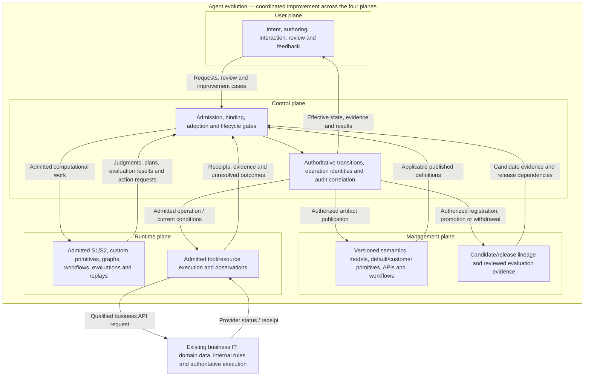
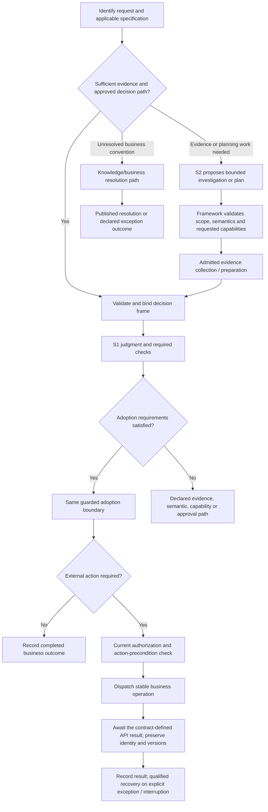
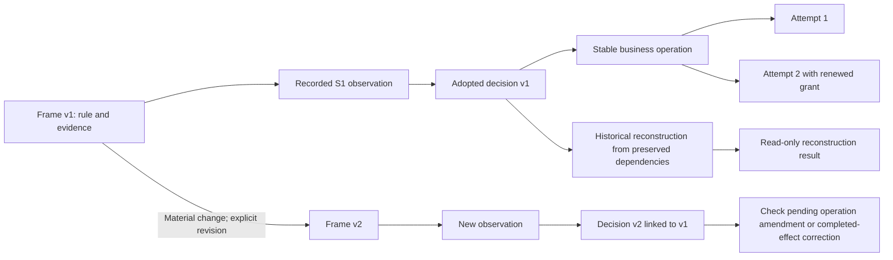
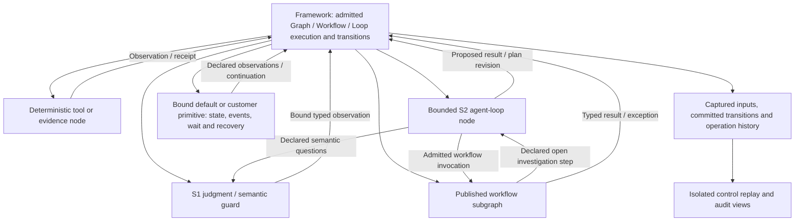
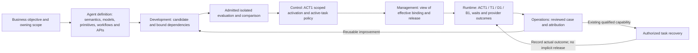

# NGA Architecture Diagrams — V0.2 Discussion Draft

> Date: 2026-10-30.
> Companion: [architecture V0.2](13-nga-architecture-v0.2.md), with the [V0 adversarial review](14-v0-adversarial-review.md). Earlier decision-contract detail remains in [V0.1](08-nga-architecture-v0.1.md).
> These diagrams show proposed logical responsibilities and transitions, not deployment topology or implemented guarantees. The original [V0 diagrams](06-architecture-diagrams-md.md) remain available for comparison.
> Integration refinement: [document 22](22-integrated-lifecycle-and-plane-review.md) connects these views to configurable/imported primitives, API waiting/recovery, maintained releases and operational improvement. Section 7 below visualizes the shared lineage and its two change paths.

For a concrete credit application, see the [complete walkthrough](10-credit-decision-walkthrough.md), including S2's change permissions before and after adoption and the race between new evidence and dispatch.

## 1. Four planes coordinated through agent evolution



The enclosure represents the integrating whole, not a fifth plane or a privileged evolution service. The planes cooperate in all three lifecycle states. User inputs and management declarations gain effect through their control contracts; runtime workers execute admitted work. The external IT boundary retains provider business authority. Logical control does not require a central round trip for every computation; this drawing does not prescribe services or physical topology.

| Plane | Development | Runtime | Operations |
| --- | --- | --- | --- |
| User | Express goals, author cases, review candidates. | Initiate tasks, supply evidence, inspect and approve/challenge. | Inspect business outcomes, resolve issues, contribute reviewed feedback. |
| Runtime | Execute tests, simulations, training/evaluation and replay. | Execute models, tools, graphs, loops and workflows. | Execute monitoring, diagnosis, replay and admitted recovery. |
| Management | Maintain definitions, candidates and evaluation artifacts. | Resolve applicable published versions and configuration. | Maintain cases, ownership, release history and rollout declarations. |
| Control | Admit development work and validate publication gates. | Enforce transitions, adoption, authority, budgets and effects. | Enforce interventions, releases, withdrawal and recovery policy. |

Evolution links **intent and outcomes → reviewed candidate → evaluation → authorized release → observed behavior** across this matrix. Version and task/decision/operation lineage preserve the relationship between improvement and past behavior. See [V0.2](13-nga-architecture-v0.2.md) for the contracts and [the review](14-v0-adversarial-review.md) for counterexamples.

## 2. Fast and S2-assisted paths



An unresolved convention does not automatically become a fresh S2 prompt or a negative business answer. A new specification or material evidence leads to an explicit frame revision. Both paths must preserve the same business semantics.

## 3. Decision and execution sequence

```mermaid
sequenceDiagram
    participant U as User / task caller
    participant F as Framework
    participant S as S1
    participant H as Durable state and history
    participant R as Execution adapter / resource

    U->>F: Business request with stable identity
    F->>H: Resolve existing request, revision and operation state
    alt Existing adopted decision
        H-->>F: Preserved decision and pending or completed action state
    else New evaluable revision
        F->>S: Bound specification and evidence frame
        S-->>F: Typed judgment for that frame
        F->>H: Validate current revision and commit one adoption
        H-->>F: Adopted decision or competing-state conflict
    end
    Note over F,H: Only a valid adopted decision can authorize its action path
    opt Action required and current checks pass
        F->>H: Record or reuse stable operation intent
        F->>R: Attempt with current authority and stable operation identity
        alt Confirmed completion
            R-->>F: Receipt bound to operation and parameters
            F->>H: Record confirmed outcome
        else Accepted or pending
            R-->>F: Correlated acceptance / provider reference
            F->>H: Preserve wait, completion predicate and actual versions
            R-->>F: Later authoritative result via supported event/status route
            F->>H: Consume result and resume admitted continuation
        else Unknown completion
            F->>H: Record unresolved attempt
            F->>R: Reconcile using supported operation lookup
            R-->>F: Confirmed, not executed, or still unresolved
            F->>H: Record result; retry only under the resource contract
        end
    end
    F-->>U: Business decision and separate execution status
```

Durable state and history are logical roles, not a selected storage product. Reconciliation capability varies by resource. The sequence does not claim that a database transaction can atomically cover an arbitrary external service.

## 4. Revisions, reconstruction, and operation identity



A new frame or model version does not automatically create a new business operation. The amendment/correction gate determines the valid relationship to pending or completed effects. Reconstruction has no dispatch edge.

## 5. Three structures, three meanings

| Structure | Purpose | Critical boundary |
| --- | --- | --- |
| Delegation lineage | Parent authority and resource envelope constrain each child. | Receiving another node's result does not grant its permissions. |
| Execution dependencies | Order, branching, bounded repetition, and readiness of work. | A plan change is admitted and versioned. |
| Evidence/decision provenance | Which source versions and judgments support each adopted decision. | A material dependency change creates the necessary reevaluation or revision. |

These structures relate through recorded identities. They need not be the same tree or require separate graph engines.

## 6. Jev, local agent loops, and workflow composition



This is a responsibility diagram, not an unbounded recursive call graph. Parent/child scope, depth, budgets, identities, and admitted transitions constrain all nesting. Model observations do not directly commit state. The [orchestration analysis](11-jev-agentic-orchestration.md) includes the detailed credit graph; the [replay/audit contract](12-replay-and-audit-contract.md) defines capture, executable replay, and divergence handling. The organization remains a proposal.

## 7. The integrating whole: maintained agent and two change paths



All three states use all four planes; the node labels emphasize each handoff rather than assigning a state to only one plane. User-plane interactions express goals, review evidence, initiate tasks and request operational action throughout. Management preserves definitions/cases, runtime performs the work, and control admits effective changes. Runtime recovery need not await a new release; a reusable change does not silently become a task-local patch. The manifest can reference independently deployed components. Customer package versions and active waits remain bound unless an explicit migration is admitted.

The [core object and handoff contract](23-core-objects-and-plane-handoffs.md) makes ACT1 an explicit scoped binding separate from immutable release content. Its object diagram and command/receipt examples distinguish catalog registration, completed evaluation and effective publication.
