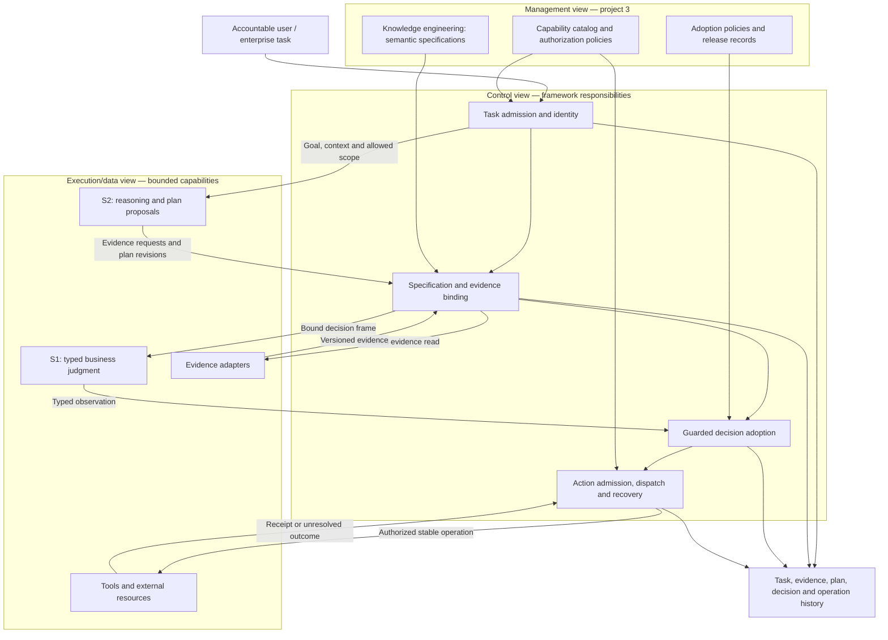
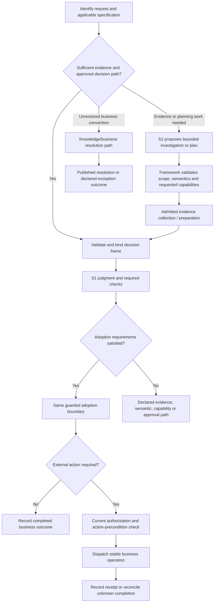
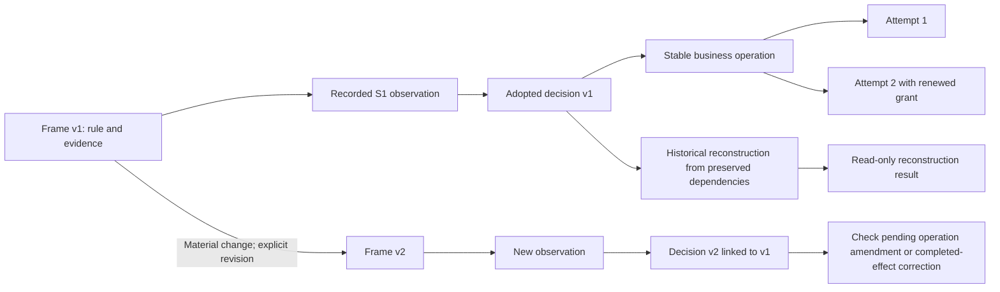

# NGA Architecture Diagrams — V0.1 Discussion Draft

> Date: 2026-10-30.
> Companion: [architecture V0.1](08-nga-architecture-v0.1.md).
> These diagrams show proposed logical responsibilities and transitions, not deployment topology or implemented guarantees. The original [V0 diagrams](06-architecture-diagrams-md.md) remain available for comparison.

## 1. Enterprise views and control authority



S1/S2 have no direct policy-publication or business-effect bypass. Plans and evidence requests entering the binding step are proposals to validate, not automatic changes to a decision frame. Views can share infrastructure.

## 2. Fast and S2-assisted paths



An unresolved convention does not automatically become a fresh S2 prompt or a negative business answer. A new specification or material evidence leads to an explicit frame revision. Both paths must preserve the same business semantics.

## 3. Decision and execution sequence

```mermaid
sequenceDiagram
    participant U as User / task caller
    participant F as Framework
    participant S as S1
    participant H as Durable state and history
    participant R as Execution adapter / resource

    U->>F: Business request with stable identity
    F->>H: Resolve existing request, revision and operation state
    alt Existing adopted decision
        H-->>F: Preserved decision and pending or completed action state
    else New evaluable revision
        F->>S: Bound specification and evidence frame
        S-->>F: Typed judgment for that frame
        F->>H: Validate current revision and commit one adoption
        H-->>F: Adopted decision or competing-state conflict
    end
    Note over F,H: Only a valid adopted decision can authorize its action path
    opt Action required and current checks pass
        F->>H: Record or reuse stable operation intent
        F->>R: Attempt with current authority and stable operation identity
        alt Confirmed completion
            R-->>F: Receipt bound to operation and parameters
            F->>H: Record confirmed outcome
        else Unknown completion
            F->>H: Record unresolved attempt
            F->>R: Reconcile using supported operation lookup
            R-->>F: Confirmed, not executed, or still unresolved
            F->>H: Record result; retry only under the resource contract
        end
    end
    F-->>U: Business decision and separate execution status
```

Durable state and history are logical roles, not a selected storage product. Reconciliation capability varies by resource. The sequence does not claim that a database transaction can atomically cover an arbitrary external service.

## 4. Revisions, reconstruction, and operation identity



A new frame or model version does not automatically create a new business operation. The amendment/correction gate determines the valid relationship to pending or completed effects. Reconstruction has no dispatch edge.

## 5. Three structures, three meanings

| Structure | Purpose | Critical boundary |
| --- | --- | --- |
| Delegation lineage | Parent authority and resource envelope constrain each child. | Receiving another node's result does not grant its permissions. |
| Execution dependencies | Order, branching, bounded repetition, and readiness of work. | A plan change is admitted and versioned. |
| Evidence/decision provenance | Which source versions and judgments support each adopted decision. | A material dependency change creates the necessary reevaluation or revision. |

These structures relate through recorded identities. They need not be the same tree or require separate graph engines.
