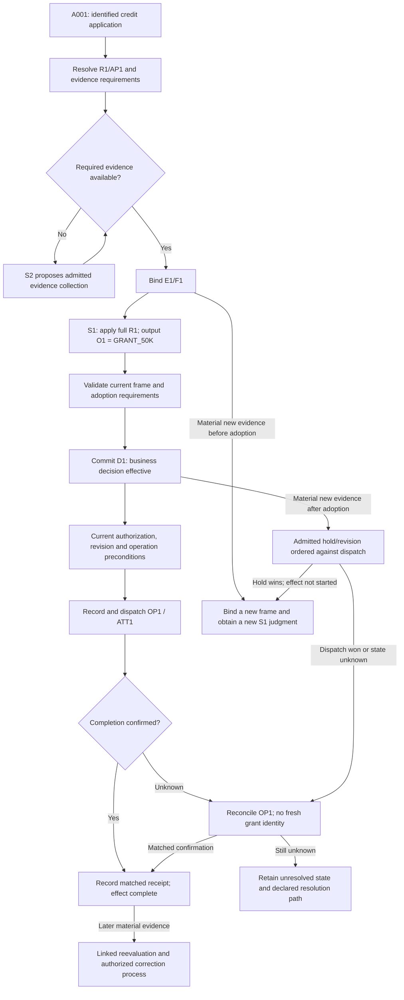

# Credit Decision Walkthrough: S1, S2, Adoption, and Recovery

> Date: 2026-10-30.
> Status: architecture walkthrough and proposed contracts for discussion; no runtime or model execution is claimed.
> Basis: the owner's credit example and [NGA architecture V0.1](08-nga-architecture-v0.1.md).
> Premise: the required Jev-like semantic decision capability is available within its declared scope.

> Follow-up: [document 17](17-credit-scope-identity-and-revision-review.md) sharpens the application/credit-relationship scope and separates decision revisions from new external effects. In particular, a post-registration refusal assessment is not proof that no credit exists, and a new adopted grant does not automatically authorize another initial registration. These refinements remain under discussion.

## 1. The two boundaries to make explicit

**Decision adoption** makes a business judgment authoritative inside NGA and eligible to support an admitted action. **External completion** confirms that the intended business effect occurred. These are different transitions.

For this walkthrough, the proposed external action is to register a USD 50,000 unsecured credit limit for one application. Cash disbursement, a later limit change, and cancellation would require their own business contracts. This operation choice is an illustrative fixture, not a finalized product requirement.

S2 can investigate and propose changes throughout a task, but its ability to change effective state is always governed. Even before adoption, it cannot silently change published business semantics or edit a bound evidence snapshot. After adoption, changing the business basis requires an explicit revision. After a confirmed effect, changing the result additionally requires a defined business correction.

## 2. Business rules and the demonstration case

Preserve the owner's three rules:

| Rule | Meaning supplied by the owner |
| --- | --- |
| Upper band | Assets above 30 million and no overdue loan in the past six months imply USD 50,000 credit. |
| Lower band | Assets below 1 million imply USD 10,000 credit. |
| Historical veto | The historical "more than three months overdue" condition denies credit regardless of asset band. |

Project 3's knowledge engineering must define the asset denomination and valuation, time windows, historical coverage, precise overdue convention, authoritative evidence, uncovered bands, and exception paths. This walkthrough assumes an illustrative published specification `R1` has resolved those conventions. It does not choose them through a model or silently amend the owner's rules.

The demonstrated facts are deliberately away from the asset cutoffs:

| Input for application A001, customer C001 | Demonstration value |
| --- | --- |
| Assets | 40 million, measured in the same approved unit as the 30-million threshold. |
| Recent overdue condition | No overdue loan in the specified six-month window, supported by the required source coverage. |
| Historical veto condition | False under R1's published definition and required historical coverage. |
| Evidence status | Sources, identity, coverage, and freshness satisfy the demonstration contract. |
| Adoption policy | Automatic adoption is permitted when the specified checks pass. A deployment requiring human approval adds a bound approval before adoption. |

Absence of an overdue entry in an arbitrary search is not evidence that the historical veto is false. The negative result must satisfy the specification's source and coverage requirements. Missing coverage sends the task to the declared evidence-gap path.

The expected outcome is `GRANT_50K`. The published outcome mapping binds that level to USD 50,000; S2 does not invent or edit the amount. The outcome names here are illustrative, not a frozen model API.

For fully structured facts and exact predicates, a deterministic rule evaluator is a useful comparison and may be sufficient for that workload. This simple example exposes control boundaries; it does not demonstrate that a model is necessary for arithmetic. S1's intended role is applying supplied business semantics to the admitted evidence, including semantic interpretation where needed.

## 3. Objects used in the trace

| Reference | Meaning |
| --- | --- |
| `A001` | One business application, with a declared tenant, customer, purpose, and accountable owner. |
| `R1 / AP1` | Published semantic specification and adoption policy. |
| `P1` | Admitted evidence-gathering or execution plan, where S2 assistance is needed. |
| `E1` | Preserved evidence manifest and source versions at the evaluation's reference time. |
| `F1` | Immutable decision frame: A001, R1, AP1, E1, requested decision, evaluation time, and relevant validity conditions. |
| `O1` | S1's typed judgment for F1, with actual model/readout/configuration references. |
| `D1` | Adopted outcome GRANT_50K and the precise evidence, observations, checks, and authority consumed. |
| `OP1` | One intended credit-limit registration for A001; bound to customer C001, USD, 50,000, target, and other material parameters. |
| `ATT1` | An execution attempt for OP1. Further attempts retain OP1. |

These are logical identities. Their encoding, schema, storage, and transport are open. The framework derives or validates them under the business contract; S2 cannot evade duplicate handling by inventing a fresh application or operation identifier.

## 4. Complete main path

| Step | S2's role | S1's role | Framework responsibility and recorded result |
| --- | --- | --- | --- |
| 1. Receive A001 | Interpret the request if needed; propose a recognized task type. | Not required for request deduplication. | Resolve owner, customer, business purpose, and material input. Look up existing application/revision/operation state before starting new work. |
| 2. Bind the business contract | Identify a candidate published specification; cannot choose an unauthorized or more favorable version. | Optional semantic task classification under a declared question. | Resolve applicable R1 and AP1 from authoritative scope/effective-version rules. Record the selection. |
| 3. Obtain evidence | Propose P1: fetch permitted asset and loan-history sources, reconcile gaps, or request additional material. | Optional typed interpretation of documents or business facts under approved definitions. | Admit each read; verify source identity, coverage, freshness, and provenance. Preserve E1. An S2 summary is not an authoritative fact merely because it sounds plausible. |
| 4. Bind F1 | May flag gaps or propose additional evidence. | May return a declared insufficiency for semantic questions within scope. | Bind the immutable frame only when its evaluation requirements are met. Material changes create a new frame rather than mutating F1. |
| 5. Judge the application | May explain the task, but cannot alter the question or veto. | Apply the full R1 to E1 and return O1 = GRANT_50K. The historical veto remains part of the evaluation. | Validate frame/output binding, supported levels, model version, required checks, and the registered adoption conditions. |
| 6. Adopt D1 | May submit a challenge or correction proposal before adoption; cannot edit O1 or declare its own approval effective. | No second identical invocation is intrinsically required. | Validate that F1 is still current and commit one D1 with its dependencies and adoption authority. Required human approval, if any, must be bound to these material inputs. |
| 7. Prepare OP1 | Propose a permitted execution plan or user-facing explanation consistent with D1. | Normally no new business judgment is needed for an unchanged decision. | Record/reuse OP1; bind material parameters to D1. Recheck current authorization, decision validity, resource conditions, and revision state. |
| 8. Execute ATT1 | Cannot bypass dispatch or change amount, customer, target, or operation identity. | Not required to determine a structured execution receipt. | Record durable intent and dispatch through the admitted execution boundary with OP1 and its supported preconditions. |
| 9. Confirm or reconcile | May assist investigation through admitted tools; cannot interpret a timeout as permission for another grant. | Only optional interpretation of unstructured material; it cannot substitute for authoritative completion evidence. | Match a receipt to OP1 and its parameters, or record unresolved completion and follow reconciliation. Return the decision and execution status separately. |

The point at step 6 is **decision effectiveness within this architecture**. It does not mean the external credit limit has already been registered. The point at step 9 is confirmed business-effect completion, if supported by resource evidence.

The framework's adoption policy consumes the S1 business judgment; it does not ask S2 to reinterpret it into a new outcome. Structural validation alone is not semantic validation. Any additional business checks must be explicit in AP1.

The main path can omit S2 when R1 and all required evidence are already available. Its decision and execution boundaries remain the same.

## 5. What S2 may change, by phase

| Proposed S2 change | Before decision adoption | Adopted, effect not yet started | Effect in flight or outcome unknown | Effect confirmed |
| --- | --- | --- | --- | --- |
| Evidence-gathering order or bounded work plan | May propose revisions inside admitted scope. | May investigate concerns; must preserve D1 and follow any revision/hold process. | May request status or reconciliation; cannot assume cancellation succeeded. | May investigate or propose a correction. |
| Material evidence or source interpretation | Submit with provenance; a changed bound basis creates a new frame and reevaluation. | Propose a revision; framework must prevent stale dispatch if the governing contract requires a hold. | Reconcile the external state before choosing an amendment or correction path. | Create a linked reevaluation; any changed effect needs a defined correction operation. |
| Rule, priority, time convention, or missing default | Propose a draft for the authorized knowledge owner; cannot change effective R1. | Same publication restriction; cannot replace R1 inside D1. | Same restriction; new policy does not undo an in-flight operation. | Same restriction; preserve historical R1 and D1. |
| Judgment, amount, customer, or other material action fields | Challenge or request reevaluation; cannot edit O1 or substitute a favorable result. | No direct mutation. A permitted amendment needs a new adopted revision and execution checks. | No new grant under a fresh key. Resolve OP1's outcome first. | No rewriting of the old effect; use an authorized correction if needed. |
| Explanation or presentation | May improve it while preserving material facts and status. | May explain D1; cannot promise a different amount or imply completion. | Must disclose unresolved execution status accurately. | May explain the receipt and history without changing them. |
| Delivery attempt or credentials | Framework controls issuance and dispatch. | Framework may create an attempt under the operation contract. | Retry only under the resource's deduplication/reconciliation contract, with OP1 preserved. | Return the recorded outcome; do not submit another grant as a retry. |

"Before adoption" is not a free-edit zone: a bound F1 or O1 is already an immutable artifact. "After adoption" is not a ban on adaptation: it changes the required path from proposal editing to explicit revision and, where necessary, correction.

Changes of execution adapter or target need review of their operation-identity and deduplication scope. The same key sent to two independent resources does not by itself prevent two effects.

## 6. Where S1 participates

The first proposed S1 insertion point for this walkthrough is the **authoritative business-judgment input to adoption**, at step 5. It is not merely a score attached to an S2 answer.

Other S1 uses are optional and require their own declared question, evidence binding, and validation:

- **Evidence interpretation:** classify or extract the meaning of an admitted source under business definitions. Keep its conclusion distinguishable from the source itself.
- **Completeness or contradiction assessment:** judge a semantic issue within a specified scope. Deterministic manifest checks and source-coverage requirements still apply.
- **Business reevaluation:** judge a new frame when a material fact or rule changes. Link the new observation to the new frame.
- **Independent verification:** only if AP1 requires a separately qualified check. Asking the same model the same question again is not automatically independent verification.

S1 is not required for identity lookup, exact state transitions, permission enforcement, operation deduplication, or checking a structured receipt. Exact amount/date calculations can use deterministic capabilities with specified semantics. Keep the S1 calls tied to business-semantic work rather than inserting a model at every gate.

If the workflow decomposes R1 into subquestions, a reviewed composition must preserve the historical veto and each condition's scope. Three correct subanswers do not prove that an arbitrary S2-generated composition implements the rule.

## 7. Retries and concurrent work

### 7.1 Repeated application

An unchanged retry of A001 while F1/D1 remain effective resolves to D1 and OP1's current status. It does not require S2 to replan or S1 to rethink the business decision.

The same client identity with materially different content is a conflict or explicit amendment. Two legitimate applications remain distinct even if their evidence and S1 outcomes are semantically equivalent. The idempotence contract needs a business identity scope; text similarity is insufficient.

### 7.2 Two workers reach adoption

Both workers may assess F1, but the adoption transition validates the current frame/revision and permits one effective D1. A losing worker reads the existing result or a defined conflict rather than dispatching independently.

If supposedly identical, correctly bound evaluations disagree, expose a model/integration-contract violation for resolution. A race winner or majority vote is not proof of correctness.

### 7.3 The external system commits, then the response is lost

A concrete recovery trace is:

| Order | Record or action | Meaning |
| --- | --- | --- |
| e1 | Record D1 and OP1's admitted intent. | The adopted decision and intended effect are identifiable before dispatch. |
| e2 | Dispatch ATT1 with OP1 and bound parameters. | One attempt; no new business identity. |
| e3 | External resource registers the limit, but the response times out. | NGA cannot yet distinguish success from failure. |
| e4 | Record OP1 as outcome unresolved. | Keep D1 intact; do not report that no credit was granted. |
| e5 | Query/reconcile through the resource's operation contract. | Use OP1 and matching parameters/receipt evidence. |
| e6 | Obtain confirmation that OP1 succeeded; record its receipt. | Complete the task without submitting a second credit registration. |

If a resource supports idempotent redelivery, another attempt uses the same OP1 and material parameters. If it establishes that execution did not occur and cannot still occur, retry may proceed under current checks. A generic "not found" from a lagging query is not sufficient proof.

Without adequate deduplication or reconciliation support, retain an unresolved state and the declared resolution path. NGA cannot manufacture an external-effect guarantee with its local ledger.

## 8. New evidence: three different branches

These branches are alternatives from different points in the main path, not events all occurring after its successful completion.

Suppose a newly discovered historical loan record satisfies R1's severe-overdue definition, while the asset and recent-window facts stay unchanged. It may be an older record outside the recent six-month window. The unchanged R1 now requires rejection.

### 8.1 Before adoption

S2 or another admitted source reports the new evidence with provenance. The framework invalidates the old frame's readiness to be adopted, preserves F1/O1 as historical artifacts, and binds E2/F2. S1 evaluates F2 and returns the veto outcome. The framework adopts that result only after its checks.

Any approval bound to F1 cannot authorize F2's different outcome or parameters. A worker still holding O1 must fail the current-frame check.

### 8.2 After D1, before dispatch

The proposed policy places a hold on a pending effect when admitted, authoritative evidence material to the decision arrives. A claim from S2 alone triggers the contract's intake/verification path; it does not acquire authority to cancel an operation.

Framework admission of the revision/hold and dispatch must be ordered against the same relevant state. If the hold is committed first, a worker using the old revision cannot start OP1. Then S1 evaluates F2; an authorized transition may adopt D2 = DENY and supersede D1 for the application. D1 remains reconstructable; its unexecuted intent is marked appropriately rather than erased.

The hold trigger, authorization to supersede, and exact validity checks are proposed business/runtime contracts still to confirm. Automatic revision is allowed only where the governing policy permits it.

If dispatch wins the race, the system must enter the in-flight reconciliation path. A local hold flag or a late cancellation request does not prove that the external action stopped. Resources that enforce revision/conditional-operation checks can provide stronger prevention; otherwise the outcome and any necessary correction must be resolved explicitly.

### 8.3 After confirmed registration

S1 can assess E2/F2 and produce a new judgment. That does not remove the existing limit.

Record the reevaluation and route it to an authorized business correction, such as a permitted limit amendment or other defined handling. The allowable correction is not specified by the original three rules and must not be invented by S2. Its operation has a distinct business purpose and identity linked to OP1, with its own adoption and execution authority.

Historical D1 and its receipt remain unchanged. If the governing policy authorizes adoption of D2, a current-application view can show D2 and the correction status with their revision links; an unadopted reevaluation remains a separate proposed result. A historical query for D1 still returns D1. The change must never be presented as an unchanged retry of the original decision.

## 9. What the framework must guarantee, and under which conditions

| Property | Framework obligation | Dependency or limit |
| --- | --- | --- |
| Semantic consistency | Bind the same approved meaning, evidence basis, and decision operator; constrain S2 rewriting and validate composition. | The assumed S1 capability and correct specification/evidence binding are necessary. A stable model alone is insufficient. |
| Decision idempotence | Reuse the adopted revision for unchanged repetition; guard concurrent adoption and explicit supersession. | Business identity, material-change, and revision semantics must be defined. |
| Business-effect idempotence | Preserve OP1 across attempts; bind parameters; reconcile uncertain completion; prevent unauthorized duplicate intents. | The resource's deduplication scope, retention, preconditions, and outcome evidence must cover the retry contract. |
| Freshness and revision safety | Order holds/revisions against dispatch and recheck required action preconditions. | External in-flight work may require resource-side enforcement or correction; a local state transition cannot recall it by itself. |
| Traceability | Preserve actual evidence/observations, versions, authority, transitions, attempts, and receipts. | Retention and access must keep the required artifacts available; hashes alone cannot reconstruct missing content. |

The framework does not obtain these guarantees merely by adding logs. State changes must enforce the invariants; the recorded history must describe the changes that actually took effect. Storage, transaction, fencing, and dispatch mechanisms remain open.

## 10. Historical reconstruction versus reevaluation

A reconstructable trace links:

`A001 → R1/AP1 + E1/F1 → O1 → checks/approval → D1 → OP1 → ATT1 → receipt`

It must answer:

- Which rule and overdue convention applied, with what source and historical coverage?
- Which evidence was available and actually consumed, and which parts were inferred?
- Which S1 output, model/readout configuration, and adoption checks made D1 effective?
- What did S2 propose, what did the framework admit, and which plan revisions mattered?
- Which actor, accountable owner, and authority supported adoption and execution?
- Which exact operation was attempted, what occurred externally, and what remains unresolved?
- Which later frame, decision, or correction supersedes or relates to the original?

**Historical reconstruction** uses the preserved observations and dependencies to explain the original adoption. It does not ask the current model to reproduce the past and does not dispatch effects.

**Reevaluation** runs a named rule/model/evidence configuration and creates a separate result. Comparing that result with D1 neither rewrites D1 nor automatically changes OP1. Hidden model reasoning is not required for either process.

The strengthened requirement also includes **executable control replay**: run the preserved controller and graph/workflow definitions with the model, tool, clock, and relevant event inputs recorded at the time, then verify the resulting transitions and operation intents without dispatching real effects. The [replay and audit contract](12-replay-and-audit-contract.md) defines the required package and divergence handling. The [orchestration analysis](11-jev-agentic-orchestration.md) places this credit case in a typed graph with semantic guards, a bounded S2 investigation loop, and executable workflow subgraphs.

## 11. Walkthrough diagram

The reconciliation-to-completion edge is taken only on a matched confirmation. Otherwise the operation remains unresolved or follows its declared retry/correction path. The diagram's successful adoption/dispatch edges are conditional; missing approvals or failed checks stop or route the task under AP1.

## 12. Proposed acceptance cases and decisions for discussion

These are design review cases, not executed tests or amendments to existing experiment protocols.

| Case | Expected result |
| --- | --- |
| Main case: 40 million, recent condition satisfied, historical veto false | One adopted GRANT_50K decision and one intended registration. |
| Lower band: 0.8 million, a recent short overdue event, historical veto false | GRANT_10K under the stated rules; do not import the upper band's six-month condition. |
| Historical veto true in either band | Deny credit, regardless of the band result. |
| Required historical coverage missing | Declared unresolved/evidence path; never silently treat the veto as false. |
| Asset cutoff or uncovered middle band | Apply only an explicitly published convention; no interpolation by S2. |
| Duplicate/concurrent request | One effective adoption and one business operation; legitimate new applications remain possible. |
| S2 changes the amount or omits the veto | The changed proposal cannot become the original decision or operation without the required specification/revision process. |
| Material evidence races with adoption/dispatch | Stale adoption/dispatch fails where enforceable; an already started effect enters reconciliation/correction. |
| Response lost after resource commit | Recover the OP1 receipt or remain unresolved; no fresh grant as a retry. |
| Historical reconstruction or model reevaluation | Preserve D1; no live external effects. |

The next architectural decisions are:

1. Confirm S1's first required role as the full business judgment feeding adoption; decide which auxiliary semantic checks are useful.
2. Define the authority and trigger for an execution hold and for superseding an adopted decision.
3. Define the application/operation identity scope and the external system's enforcement/reconciliation contract.
4. Have the knowledge/business owner settle the rule's remaining conventions and the permitted correction outcomes.

These choices refine the architecture without selecting a runtime, language, database, or token protocol.
