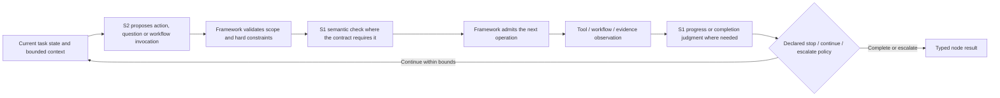
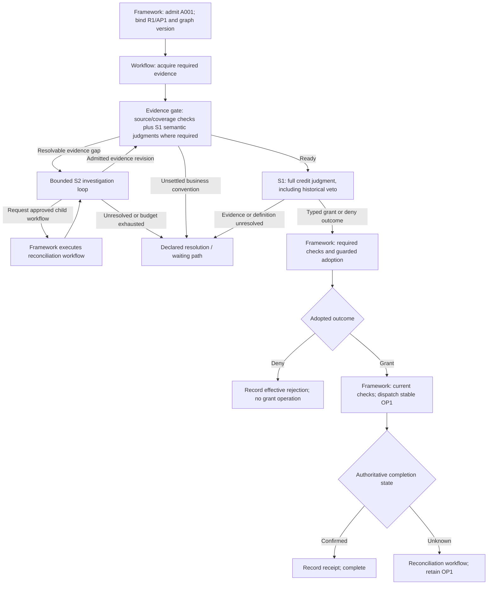

# NGA Orchestration: Combining Jev and Agentic Models

> Date: 2026-10-30.
> Status: architectural analysis and proposed reference organization, not an approved topology or implementation.
> Premise: the required Jev-like capability is available within its declared semantic scope.
> Inputs: [V0.1 architecture](08-nga-architecture-v0.1.md), [credit walkthrough](10-credit-decision-walkthrough.md), and the owner's requirements for replay and audit.
> Placement: this proposal develops runtime cooperation and its control contracts inside the broader [V0.2 three-state/four-plane architecture](13-nga-architecture-v0.2.md). Its structural and model-placement hypotheses remain subject to the [adversarial review](14-v0-adversarial-review.md).
> Follow-up: [document 15](15-graph-loop-workflow-control-review.md) distinguishes the required common execution/control contracts from the optional common graph representation, and strengthens decision-basis ownership, plan-revision identity, workflow invocation and evolution boundaries. These refinements remain under discussion.

## 1. The architectural question

The owner describes the agent loop as an architecture that exploits an agentic model's ability to plan, act, reflect, and replan, while creating the workloads that drive further model optimization. NGA needs an equivalent architecture/model feedback relationship for Jev-like judgment capabilities combined with agentic reasoning.

The proposed direction is a **versioned execution graph with typed nodes, explicit semantic judgments, bounded agent loops, and reusable workflows under one control contract**. S1 supplies frequent, business-configurable judgments; S2 generates plans, investigates exceptions, and proposes adaptations; the framework commits transitions and effects under explicit state, authority, and recovery rules.

Graph, loop, and workflow describe different aspects of this design:

- An **execution graph** describes states, work dependencies, branch conditions, bounded repetition, and admitted plan revisions. It need not be a static DAG.
- An **agent loop** is an iterative way to solve an open task using an agentic model, observations, and tools. It can occupy a node or subgraph and must expose its consequential steps to the same runtime.
- A **workflow** is a versioned, governed executable procedure with declared inputs, outputs, steps, branches, and exception behavior. A workflow instance can appear as a subgraph.

A loop can be represented by a graph, and a graph can contain loops. Drawing a graph does not by itself make decisions deterministic, idempotent, or replayable. A loop with the same contracts and captured interactions can also support replay. The proposed graph representation makes decision boundaries and composition explicit; its practical benefit still needs comparison.

The [survey's S1/S2 positions](../survey/05-system-business-goal-and-positions.md) motivate evaluating judgment placement beyond the final answer. Its [question-graph discussion](../survey/06-learning-objectives-data-and-outputs.md) also identifies composition as a separate problem. Here, an execution graph is not a claim that a decomposed semantic question graph is automatically correct, nor a claim about demonstrated current-model capability.

## 2. Alternatives to compare

| Organization | Useful property | Issue to test | Role in NGA |
| --- | --- | --- | --- |
| Agentic loop with explicit framework contracts | Flexible investigation and planning. | Whether repeated generative decisions cause avoidable cost or semantic drift; replay still needs complete interaction records. | Baseline and a possible implementation for open tasks. |
| Graph with every edge judged by S1 and every node an agent loop | Exposes a uniform outer structure. | It places model calls on mechanical transitions and generative loops inside simple work; it can also hide consequential decisions within nodes. | A candidate to compare, not the proposed default. |
| Typed graph with S1 judgments, bounded S2 loops, and executable workflow subgraphs | Assigns semantic judgment, open reasoning, and mechanical execution explicit contracts. | Composition, graph revisions, evidence binding, and runtime complexity need validation. | Proposed reference organization. |
| Fixed workflow with deterministic operations and selected S1 judgments | Clear semantics for sufficiently specified processes. | It may be sufficient for the simple credit case, but exceptions may require bounded investigation. | An essential control, not something NGA must outperform through more model calls. |

All comparisons must preserve the same business contract, access, recovery obligations, and replay/audit coverage. Success is useful business behavior at an acceptable cost, not the number of S1 calls or the presence of a graph.

## 3. Nodes are typed capabilities

| Node kind | Main role | Typical executor |
| --- | --- | --- |
| Evidence/tool operation | Fetch admitted evidence, perform exact calculations, or invoke a defined capability. | Deterministic adapter or tool. |
| Semantic judgment | Apply a published question, definitions, and output states to bounded evidence. | S1. |
| Open investigation/planning | Explore an underspecified task, gather evidence, reconcile conflicts, or propose a plan. | A bounded S2 agent loop, optionally using S1 judgments internally. |
| Workflow invocation | Instantiate and run an admitted procedure with versioned parameters. | Workflow execution through the common framework. |
| Approval/adoption | Check required conditions, wait for required approvals, and commit a decision revision. | Framework; authorized people only where the policy requires them. |
| Effect/reconciliation | Execute an adopted operation or resolve its external completion state. | Framework plus the resource's execution contract. |

These are logical contracts, not new required domain identities or services. Existing skills can implement them. A semantic judgment can be represented as an explicit node or a guard evaluation attached to a transition; either representation must preserve the judgment invocation, inputs, output, and consumption record.

## 4. Which transitions should use Jev?

Use S1 where the transition depends on **business meaning**: whether supplied material supports a declared requirement, whether evidence is contradictory, whether a proposed result satisfies a business definition, or which declared semantic condition holds.

Use deterministic control where the relevant fact is already an authoritative typed state: an operation receipt is confirmed, a permission check failed, a required dependency has not finished, a retry budget is exhausted, or an adopted outcome is the enum GRANT_50K. Do not ask a model to reinterpret a confirmed receipt or an exact enum switch.

A semantic transition has the following proposed contract:

1. Identify graph revision, node activation, business frame, question/specification version, evidence, candidate meanings, and the decision operator.
2. Obtain the bound S1 observation. Raw scores require the published interpretation/calibration policy; a high score is not permission.
3. Resolve eligible semantic branches using the declared exclusive, priority, or parallel-activation semantics.
4. Apply hard dependencies, authority, current-state, and resource constraints.
5. Commit the transition once for the current activation/revision and record the observation actually consumed.

The candidate set, priority, and unresolved path are part of the contract. If several exclusive guards match, use a published tie/priority rule or surface a conflict; if no condition is established, use a declared unresolved path. Independent scores must not silently become an arbitrary argmax.

Authorization filtering may restrict executable actions. It must not remove required business outcomes such as the historical credit veto from the semantic question itself. Changing the menu, a question's meaning, or a composition rule is a versioned semantic change.

S1 supplies the semantic basis for a jump; the framework owns the effective transition. This keeps Jev central to business decisions without making it the authority over permissions, committed state, or external effects.

## 5. S1 and S2 can cooperate inside a node

A proposed bounded investigation loop is:

S1 calls in this loop are conditional on the capability contract; mechanical checks do not need a model. A disallowed or unresolved action follows its declared route rather than being automatically admitted by the diagram.

This combination lets S2 concentrate on constructing useful candidates and investigating novel cases. S1 can repeatedly assess those candidates, relevant evidence, goal satisfaction, or stop/escalation conditions under stable definitions. The runtime maintains the task state and consumes the assessments; neither model silently edits authoritative state.

Evaluate progress at meaningful action or observation boundaries rather than assuming that every generated token needs supervision. An S1 judgment of completion is a semantic observation; hard budgets and termination limits remain independently enforced. Unknown must not produce an unlimited cycle of S2 reasoning followed by identical S1 questions.

Internal loop steps cannot be an opaque box if they can affect business behavior. Record admitted actions, questions, model outputs, evidence visibility, workflow calls, stop reasons, and their dependencies. Hidden model reasoning is not required.

## 6. Workflow capability: recognize, invoke, propose, execute

An agent loop should be able to **recognize applicable published workflows and request their execution**. The proposed boundary separates four abilities:

| Ability | Model contribution | Framework responsibility |
| --- | --- | --- |
| Recognize applicability | S2 proposes a catalog workflow and argument bindings; S1 may judge semantic fit under declared criteria. | Validate the version, scope, preconditions, authority, and material parameters. |
| Invoke | The loop returns a structured request for a workflow identity/version and inputs. | Create or resume an identified child instance; execute its admitted steps and return typed status/results. |
| Propose a new workflow or change | S2 drafts a plan/subgraph; S1 can assess specified semantic properties. | Validate structure, budgets, effects, protected business obligations, and change authority; publish through governance where required. |
| Execute | S2 may work inside a declared open step or request a permitted repair. | Schedule steps, enforce gates, checkpoint, suspend/resume, deduplicate effects, and record transitions. |

Recognizing a workflow does not mean repeatedly interpreting its prose as an informal checklist. Once admitted as an executable procedure, its steps belong to the runtime contract. A workflow found in a document is a proposal until its authority, semantics, and executable form are established.

Parent and child instances share root business identity, delegated authority, operation-deduplication rules, resource accounting, cancellation/hold semantics, and replay/audit coverage. A workflow can contain an agent-loop step; a loop can invoke a workflow. Depth, fan-out, and total budgets bound this recursion.

A child result does not automatically become the parent's adopted business decision. Resuming a child must not restart already confirmed steps under fresh operation identities. Child failures return structured conditions for a declared exception or repair path.

Published workflow templates and one-run plan revisions are distinct. S2 may propose a bounded run-level revision without gaining permission to edit the reusable workflow catalog. A structurally valid generated graph still needs to preserve mandatory decision conditions, including the credit veto, adoption boundary, and effect dependencies. S1's approval of a draft is not a general proof of semantic equivalence.

## 7. The credit case as a typed graph

Keep R1, AP1, the demonstration customer, and the unresolved-business-convention boundaries from the [credit walkthrough](10-credit-decision-walkthrough.md). The main facts still produce USD 50,000 eligibility.

The semantic labels on edges are committed under section 4's transition contract. The enum switch after adoption and the receipt-state switch are deterministic. A rejection is adopted and recorded, not merely returned by S1 and treated as effective.

This graph uses S1 both before final credit judgment and, where valuable, inside the investigation loop. The loop can invoke a history-reconciliation workflow and return new evidence; it cannot rewrite R1, omit its veto, or register credit itself.

The graph may be instantiated from a reviewed workflow or expanded inside an admitted execution envelope. Material graph changes produce an explicit run revision with a state-migration rule; new rule/evidence bases produce new decision frames. Neither kind of change erases the previous path.

Before adoption, S2 can propose new evidence, a bounded plan, or a permissible graph patch. After adoption, it uses the hold/revision process; after dispatch, it must respect unresolved completion and correction semantics. Nested workflows obey the same boundaries as the outer graph.

## 8. How this architecture directs model improvement

The framework should expose a reusable judgment contract: **question/specification + bounded evidence/state + declared candidates → typed observation**. It records where that observation changed a transition, decision, or stopping condition.

| Architectural use | Model capability to develop and measure | Necessary counterpart |
| --- | --- | --- |
| Business decision | Follow business-authored definitions and veto/precedence rules across equivalent inputs. | Relevant fact/rule changes must change the result; stable but wrong outputs fail. |
| Evidence interpretation and selection | Judge relevance, support, contradiction, and declared sufficiency in context. | Missing coverage and untrusted summaries must not become established facts. |
| Semantic routing | Select among declared meanings using the actual state and definitions. | Renamed/reordered options, irrelevant options, unseen rule families, and unresolved cases. |
| Local progress and stopping | Recognize satisfaction, remaining work, contradiction, or need for escalation under an explicit criterion. | Premature stop, endless continuation, and recovery after genuinely new evidence. |
| Workflow applicability | Determine whether task meaning and available inputs fit a published procedure. | Similar wording with different applicability, incompatible effects, or missing required inputs. |
| Decision composition | Preserve business semantics when judgments are split or consumed at several boundaries. | Direct versus decomposed outcomes; path-dependent and correlated failures. |

These are proposals to feed project 1's task/data/evaluation design, not amendments to frozen experiment protocols. Task definitions should vary across business authors and rule families, not merely add rows under one fixed template.

Collect invocation context, actual model observations, transition consumption, corrections, and eventual outcomes. A successful whole task is not automatically a correct label for every intermediate judgment. Unvisited branches and rejected alternatives do not acquire ground-truth labels from the execution log.

Ablations should remove or relocate individual S1 uses and compare against S2-only and deterministic controls. Measure task success, decision consistency, recovery, latency, cost per successful outcome, and audit/replay completeness together. More S1 calls, cheaper isolated judgments, or locally accurate guard outputs do not establish a better agent.

## 9. Proposed next decisions

1. Adopt typed nodes and explicit transition contracts as the reference organization for comparison, while keeping runtime technology open.
2. Choose the first two S1 placements to evaluate: the full credit judgment and one evidence/progress judgment with a clear semantic workload.
3. Define workflow invocation and child-instance contracts before permitting free-form generated workflows to become executable.
4. Define allowed graph/plan changes, protected business obligations, and state migration when a graph revision is admitted.
5. Require both graphical inspection and executable control replay under the [replay and audit contract](12-replay-and-audit-contract.md).

The credit graph, node organization, and S1 placements remain proposed. Replayability and auditability of the decision chain are established user requirements.
