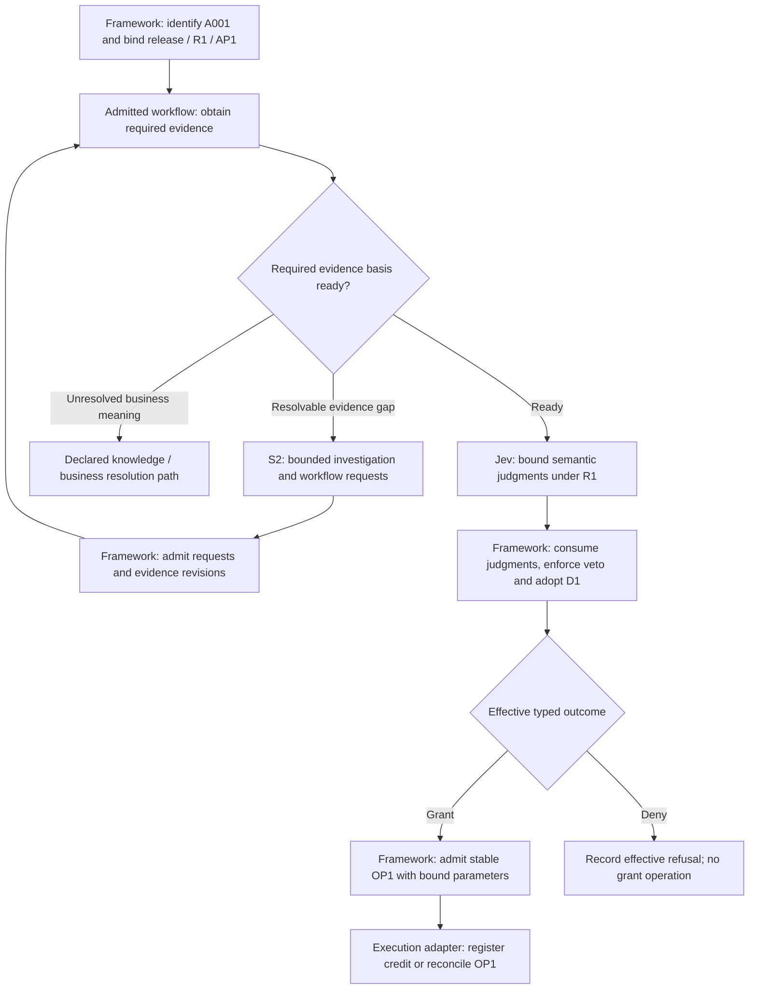

# Graph, Agent Loop, and Workflow: Adversarial Control Review

> Date: 2026-10-30.
> Status: discussion proposal extending [V0.2](13-nga-architecture-v0.2.md), [orchestration](11-jev-agentic-orchestration.md), and the [V0 review](14-v0-adversarial-review.md). No runtime implementation or executed acceptance tests are claimed.
> Premise: a Jev-like model meets the required semantic consistency and business-definition-following contract within its supported scope. This review challenges the surrounding architecture even under that favorable premise.
> Scope: three lifecycle states, four responsibility planes, and agent evolution as the integrating whole. Technologies and physical deployment remain open.

## 1. Established direction and proposals in this review

**Established owner requirements:** development/runtime/operations states; user/runtime/management/control planes; agent evolution across them; decision and business-result idempotence; replay and audit; business configurability through governed semantics. The three project work streams remain those in the [overall design](../design/nga-overall-design.md).

**Proposed refinements:** a common execution and control contract for graphs, loops, and workflows; explicit ownership of the decision basis; bounded local planning; protected business obligations; business identities independent of plan layout; and a governed path from successful investigation to reusable workflow.

**Not yet selected:** one graph representation, one execution engine, a fixed S1/S2 topology, arbitrary generated-graph execution, a fallback decision model, or implementation technologies. The acceptance cases below are requirements to test, not evidence that they already pass.

The central correction is that **a consistent model cannot compensate for an uncontrolled choice of evidence, question, candidate meanings, or procedure**. The architecture must govern how a judgment is constructed and consumed, as well as whether its final action is permitted.

## 2. These are three concepts, not three mandatory nested engines

| Concept | Meaning in NGA | What it does not establish |
| --- | --- | --- |
| **Execution graph** | An explicit representation of dependencies, activations, branches, joins, repetition and allowed revisions in a run. | Business authority, semantic correctness, idempotence or replayability merely by being a graph. |
| **Workflow** | A versioned executable procedure with an applicability contract, inputs/results, business obligations and exception/recovery behavior. Its instance may be represented as a graph or integrated through an adapter. | That every step is deterministic, or that the whole procedure needs generative reinterpretation on every run. |
| **Agent loop** | An iterative problem-solving strategy for an open subproblem: propose work, obtain admitted observations, reassess and stop or escalate within bounds. | A new source of authority, a private business ledger, or permission to hide material actions inside one node. |

A workflow can contain bounded agent loops. A loop can request a workflow. Both can be represented by or coordinated with an execution graph. A node can be a deterministic calculation, a model judgment, a wait, a tool call, an adoption boundary, or a composite capability. A node is not necessarily an agent identity.

**Proposed binding requirement: common execution semantics and control contracts. Proposed implementation hypothesis: a shared typed graph representation.** These are different commitments. Several engines may be integrated if their adapters preserve identities, authority, events, recovery and effect handling. A single engine can still violate those contracts.

Do not merge the following into one graph:

- A **semantic question graph** decomposes what must be judged and how judgments compose.
- An **execution graph** determines what work can run and which results it consumes.
- **Delegation lineage** constrains whose authority and budget can be used.
- **Evidence and revision provenance** explains which sources and judgments support a result.

They share references, not interchangeable edges. An evidence dependency does not grant access; a question edge does not dispatch a tool. The survey's question-graph proposal remains its own hypothesis, including its acknowledged composition gap ([survey §6.5.5](../survey/06-learning-objectives-data-and-outputs.md)). No literature performance claim is needed for the control corrections here.

## 3. Responsibilities and authority

| Actor or component | Positive responsibility | Effective authority boundary |
| --- | --- | --- |
| Business/knowledge owner | Define meaning, scope, source requirements, precedence, unresolved outcomes and authorized exceptions. | Publication and exception authority are explicit roles. Model-generated text cannot acquire that authority by itself. |
| **Jev / S1 judgment role** | Apply a bound question and candidate definitions to admitted evidence; return a typed observation, including unresolved behavior where specified. | Its result can be the required business basis for an automatic decision. It cannot edit the specification, commit a transition, issue permission or dispatch an effect. |
| **Agentic / S2 planning role** | Construct plans, investigate gaps, propose evidence interpretations, select candidate procedures, draft revisions and explain recorded results. | May adapt within an admitted scope, but cannot replace an adopted judgment, select a more favorable rule, or widen the scope on its own. |
| Framework runtime responsibilities | Schedule eligible work; run deterministic steps, models and child procedures; deliver observations and receipts. | Workers act under execution grants and the shared transition/effect contracts. |
| Framework control responsibilities | Bind the applicable basis; consume observations under published policy; admit revisions; commit effective transitions, adoption and operation intent; enforce scope and recovery. | Enforcement does not give the framework license to invent missing business meaning or silently choose a new outcome. |
| Framework management responsibilities | Maintain retrievable definitions, candidates, releases, ownership and lineage. | A catalog edit or a new "latest" version does not itself alter a running task or publish a release. |

S1/S2 are capability roles, not mandatory separate services or permanent privileges of a model family. An agentic model acting as a planner is not an alternative final judge merely because Jev returned unresolved. A separately qualified fallback judgment role would need an explicit policy, evaluation, typed contract and adoption path; that choice remains open.

Jev is consequently more than an advisory score attached to S2's answer. When the published decision operator requires its observation, S2 cannot reinterpret the observation into another business outcome. Conversely, model output alone is not an execution grant. Authorized overrides, if a business process supports them, must have their own attributable decision path rather than appear as model corrections.

### 3.1 A proposed cooperation cycle

At a consequential boundary: **bind the current basis → obtain the required judgment → apply the published transition/adoption policy → execute admitted work or request bounded investigation → incorporate valid new observations → continue under the same contracts**.

Use Jev for semantic work, including selected evidence-support, workflow-applicability, progress and business-outcome judgments. Use deterministic checks for exact amounts, typed receipts, completed dependencies, permissions and budget accounting. S2 can choose tactical investigation steps within its envelope without a mandatory Jev call for every step. Its material reads, calls and results still cross the execution boundary.

This cycle permits a workflow-only path, a Jev-assisted path, and an S2 investigation path. Their control obligations are the same. Which semantic boundaries benefit from Jev must be evaluated at complete-task level, not inferred from call count or the drawing.

## 4. Adversarial findings and proposed corrections

### B1. "Jev on every edge, agent loop in every node" adds two hidden decision systems

**Counterexample:** a node's S2 loop chooses the credit amount and calls the registration tool. Jev then selects its outgoing edge. The material decision and effect already happened inside the node. Meanwhile another edge asks Jev to reinterpret a confirmed typed receipt, adding unnecessary uncertainty.

**Correction:** use typed capabilities and expose every material judgment, action request and child call to the common contract. Put Jev on semantic boundaries, not mechanical transitions. The outer graph cannot retroactively authorize a hidden action.

**Acceptance:** an internal loop cannot register credit without the required adoption and operation grant; a confirmed receipt routes through the exact declared state transition without a model deciding whether it happened.

### B2. Stable Jev outputs do not imply stable end-to-end decisions

**Counterexample:** S2 supplies only the recent six-month statement in one run and full historical evidence in another. An otherwise correct Jev answers the supplied questions consistently, but the first question omits the historical veto or its source-coverage requirement. The architecturally produced decision can differ without a violation of the model's narrow contract.

**Correction:** bind question semantics, candidate meanings, required evidence coverage, source precedence, reference time and the consumption operator. S2 may propose additional evidence or questions; it cannot silently redefine the effective decision packet. A summary is a derived assertion with provenance, not a substitute for required source coverage. A published specification must require unresolved behavior when its mandatory evidence is missing.

**Acceptance:** irrelevant wording and permitted investigation-order changes preserve the outcome under the same material basis. A genuine material change creates a new basis. Missing history never silently becomes "no historical overdue." Same raw user wording at a later reference time is not automatically the same decision basis.

### B3. A valid graph structure does not prove preserved business obligations

**Counterexample:** S2 adds a faster route to the grant node; the historical-veto node still exists but is no longer required on that route. Alternatively, an asset branch finishes first and adopts a grant while the veto branch is still unresolved.

**Correction:** maintain protected obligations outside the planner's editable plan: required evidence/judgments, veto priority, decision adoption and effect dependencies. Validate all routes to a consequential effect, including exception, timeout and nested-workflow routes. An eligible grant waits for the complete required decision basis, not merely the first successful branch.

A structural check can prove that a registered gate is traversed; it cannot prove the gate's natural-language semantics are correct. Those semantics still require governed definitions and evaluation. No general automatic semantic-equivalence checker is assumed.

**Acceptance:** deleting, bypassing or weakening a required guard fails admission. A delayed veto prevents premature grant adoption. A compliant change in evidence-collection order remains admissible.

### B4. Plan revisions and retries must not create fresh business identities

**Counterexample:** operation identity is derived from `(graph_revision, node_id)`. After a timeout, S2 rewrites the plan or invokes the same registration workflow through a different child node. A new key allows the same credit registration twice.

**Correction:** distinguish business application, decision revision, business operation, node activation, child invocation and execution attempt. A structural plan change is not automatically a new business decision or operation. Reuse the business operation identity through resumption, alternate paths and retries; reject changed material parameters under the same operation identity. An intentionally new business operation needs explicit amendment/new-intent semantics and links to prior effects.

**Acceptance:** the same grant requested through two child workflows creates one admitted business effect under the resource's supported contract. A valid later amendment is possible without being mistaken for a retry. Arbitrarily similar text is not a safe business-identity function.

### B5. Workflow recognition is not workflow execution

**Counterexample:** S2 recognizes an approved procedure, paraphrases its steps and calls tools directly. A retry omits a check or restarts a completed effect. A separately configured workflow engine now implements a second meaning of the same procedure.

**Correction:** S2 requests a published workflow identity/version and bound parameters. The framework creates or resumes an identified child instance and consumes its typed result. Integrate external workflow engines through the same declared control and audit obligations. An opaque child cannot be credited with fine-grained guarantees its adapter does not expose.

**Acceptance:** duplicate child completion is consumed once; resume does not repeat confirmed effects; child work cannot acquire wider rights or fresh parent budgets. Parent cancellation requests do not imply that an in-flight external effect was canceled.

### B6. "Unknown means ask S2" is an unsafe universal fallback

**Counterexample:** the asset band is undefined in R1. S2 invents an intermediate credit amount, or repeatedly rephrases the question until Jev returns a favorable answer. Neither resolves the missing business rule.

**Correction:** distinguish evidence gaps, unresolved semantics, unsupported judgment scope and uncertain external completion using the applicable contract and diagnostic evidence. They lead respectively to bounded investigation, knowledge/business resolution, a declared fallback path, or external reconciliation. An unchanged material basis cannot be resampled until an acceptable answer appears. Any permitted retry or aggregation rule must be declared in advance.

**Acceptance:** unresolved bands stay on their declared resolution path; a timeout cannot become either confirmed failure or permission for a new grant; legitimate additional evidence can reopen evaluation through a new bound basis.

### B7. "Framework owns control" must not become one central scheduler for everything

**Counterexample:** every S2 token, local calculation and harmless step waits for a global control service. This creates unnecessary coupling and latency. The opposite extreme, giving each nested engine an independent final state, permits conflicting adoptions and grants.

**Correction:** specify one authoritative transition contract per governed object, plus bounded delegated execution. Runtime scheduling can be local or distributed; material transitions, budget accounting and effects retain their defined authority and durable correlation. Contending changes need arbitration within their shared consistency boundary, not a global order over all enterprise work.

**Acceptance:** local work proceeds within its envelope; a revoked or stale grant cannot authorize new protected effects; two workers cannot independently make conflicting revisions effective. The enforcement topology remains open.

### B8. A successful path is not automatically a reusable workflow

**Counterexample:** operations saves a successful S2 trace as the new production workflow. The trace omitted a rarely needed historical check or used a temporary source exception. The apparent optimization changes business semantics.

**Correction:** successful traces are candidate material. Identify applicability, hidden assumptions, unresolved paths, source requirements and effects; evaluate the procedure; publish and roll it out under the release contract. A cached runtime plan or persistent memory entry cannot bypass that path when it changes reusable behavior.

**Acceptance:** repeated cases can become cheaper through a qualified workflow and fewer S2 calls. The old release remains replayable, active tasks follow declared migration rules, and valid refusals remain valid under an unchanged rule.

## 5. Three states and four planes applied to these mechanisms

| Plane | Development state | Runtime state | Operations state |
| --- | --- | --- | --- |
| **User** | Business experts specify obligations and edge cases; developers review graph/workflow drafts and loop boundaries. | Users initiate tasks, provide evidence and perform authorized approvals/challenges; status distinguishes adopted decision from external completion. | Owners investigate exceptions and outcomes, review proposed workflow improvements and resolve business-semantic issues. |
| **Runtime** | Execute model comparisons, workflow simulations, loop/graph composition checks and isolated replay. | Run admitted graph activations, deterministic procedures, Jev judgments and bounded S2 work; return observations and receipts. | Run permitted diagnosis, historical replay, candidate reevaluation and separately admitted live recovery. |
| **Management** | Maintain semantic contracts, workflow templates, loop envelopes, capabilities, candidate graphs and release dependencies. | Resolve pinned definitions and actual artifact versions; maintain discoverable capability and workflow contracts. | Maintain reviewed cases, lineage, applicability limits, evaluation evidence, release history and retirement declarations. |
| **Control** | Enforce evaluation isolation, protected obligations and candidate publication conditions. | Bind the decision basis; admit workflow calls and plan patches; arbitrate adoption; enforce authority, budgets, effects and recovery. | Enforce holds, authorized exceptions, release promotion/withdrawal, active-task migration and replay/live-effect separation. |

These cells are responsibilities, not twelve mandatory services. All four planes participate in each lifecycle state. Jev and agentic models may assist work in every state, but model assistance does not transfer the relevant plane's authority to the model.

**Agent evolution integrates the matrix:** operational cases → attributed hypothesis → candidate model, semantic, workflow or loop change → development evaluation → authorized release → observed runtime behavior. The scope of evolution includes reducing unnecessary open reasoning by making a recurring process explicit and reusable. It also includes retiring a workflow whose applicability assumptions no longer hold. It does not require a fifth plane or a privileged self-modification loop.

## 6. Proposed logical interfaces

The names below describe contracts, not selected RPCs, schemas or storage tables.

| Interface | Material binding | Result and authority |
| --- | --- | --- |
| **Judge** | Decision/question identity; specification and candidate meanings; admitted evidence and reference time; model/readout identity; consumption-policy version. | Typed observation and declared unresolved status, with source references where supported. It is neither an adopted decision nor a tool grant. |
| **ProposeWork** | Task and current revision; goal/acceptance criteria; available capabilities; permitted scope and remaining budget. | Typed proposal: action request, workflow call, evidence update, plan patch, completion candidate or escalation. It cannot write effective state. |
| **InvokeWorkflow** | Parent/root business identities; stable child-call identity; workflow version; immutable material parameters; authority and budget delegation. | Created/resumed child identity and typed status/result. Retry the call identity; do not manufacture a new child to bypass recovery. |
| **AdmitPlanPatch** | Expected plan/state revision; proposed patch; affected dependencies and obligations; handling of active work. | Admitted new plan revision, or rejection/hold with reasons. No rewriting of completed work or adopted decisions. |
| **AdoptDecision** | Current business frame; required observations and checks; applicable adoption policy; bound approval/override when required. | One effective decision for the eligible revision, or the existing result/conflict/stale-basis outcome. A plan patch alone is not a decision amendment. |
| **ExecuteOperation** | Stable business operation and attempt identities; adopted decision; immutable effect parameters; current rights and resource preconditions. | Confirmed, failed or unresolved completion with authoritative evidence. The caller cannot turn timeout into a new operation identity. |
| **ProposeRelease / PromoteRelease** | Candidate manifest; applicability; evaluated evidence; authorized promotion policy; rollout and active-task handling. | Candidate registration is separate from effective publication/routing. Promotion can be automated under declared authority; universal human approval is not required. |

All material invocations and consumed results need correlation and dependency versions. Runtime scheduling and model internal computation do not require new user approval at every step. Historical replay uses recorded visible S1/S2 outputs and external observations; hidden internal chain of thought is not required. Recompute the controller's decisions during control replay rather than merely replaying its recorded conclusions ([replay contract](12-replay-and-audit-contract.md)).

## 7. Credit example: preserving control while changing the procedure

Use only the illustrative R1/AP1 and A001 fixture from [document 10](10-credit-decision-walkthrough.md): assets of 40 million in the approved unit, no recent overdue condition, complete required historical coverage, no historical veto, and an expected USD 50,000 outcome. The convention choices and uncovered asset bands remain governed business definitions, not new choices made here.

Not every arrow is a Jev call. Unresolved Jev judgments go to their declared resolution path rather than being adopted as a grant. The evidence gate combines source/coverage checks with only those semantic assessments the contract requires. For fully authoritative structured predicates, deterministic evaluation may suffice; the example does not prove a model is necessary for arithmetic.

| Moment | S2 may propose | Protected boundary |
| --- | --- | --- |
| Before a frame is bound | Evidence-gathering order, applicable published workflows, bounded investigation. | Cannot omit required history, rewrite R1, change candidate meanings or treat its summary as authoritative evidence. |
| Frame bound, decision not adopted | New evidence, a challenge, or an admissible plan patch. | Existing frame/observations remain immutable. Material basis changes require a new frame; plan layout changes alone do not imply new business identity. |
| D1 adopted, OP1 not dispatched | Explanation, investigation, hold/revision request. | Cannot edit the amount or reopen D1 by rephrasing the question. A justified material revision goes through the declared hold and new adoption path. |
| OP1 dispatched, outcome unresolved | Status inquiry and reconciliation workflow. | Replanning cannot reset OP1. Parent cancellation is not proof of external cancellation. |
| OP1 confirmed | Explanation, linked reevaluation and a proposed authorized correction. | Preserve the confirmed effect; model improvement or deployment rollback cannot undo it. |

If S2 discovers a four-month historical overdue record under R1's settled convention, the new evidence must be admitted and consumed by the required decision policy. Jev supplies the relevant semantic judgment where needed. Before dispatch, a valid hold/revision can prevent a stale grant; after dispatch, first establish OP1's actual completion and follow the correction contract. The model cannot pretend the old grant never happened.

The whole lifecycle then continues: operations attributes repeated evidence gaps; development proposes a better history-acquisition workflow; management registers its artifacts and evaluation; control admits its release. New tasks may use that release. A001's original dependencies and effect identities remain intact.

## 8. Idempotence and replay obligations

Keep four properties separate:

1. **Semantic consistency:** the required judgment is stable across the specified equivalent inputs and changes under relevant distinctions. This is the favorable Jev premise, not something a decision cache proves.
2. **Basis and path discipline:** equivalent admitted procedures operating on the same material basis preserve the protected business result, or report the specified unresolved outcome when requirements are incomplete. Different legal evidence orders need not yield identical traces. Establishing semantic equivalence is itself a governed obligation, not a hash comparison.
3. **Adoption idempotence:** duplicate or competing attempts under the same eligible business revision cannot make conflicting decisions effective. A legitimately changed basis follows an explicit revision; it is not suppressed forever by a request cache.
4. **Effect idempotence:** retries, child restarts and plan revisions preserve the intended operation and material parameters. The external resource must provide the required deduplication/conditional-execution/reconciliation support. A graph cannot manufacture an exactly-once guarantee from a resource with an unobservable, non-idempotent operation.

Replay adds a separate obligation: preserve the actual inputs, admitted plan revisions, consumed judgments, child invocations, transition ordering where relevant, operations and receipts. Historical replay must not call the current model as a substitute for the past result or execute real credit operations. Reevaluation of a changed procedure is a separate experiment; unvisited paths need identified fixtures or an explicit coverage limit.

## 9. Proposed engineering increments and acceptance evidence

| Priority | Deliverable | Adversarial acceptance cases |
| --- | --- | --- |
| **1. Common execution boundary** | Frame, proposal, workflow-child, transition, adoption and operation contracts; owners and effective authority. | Hidden tool call, duplicate child completion, wider child authority, stale revision and altered effect payload are rejected or explicitly reconciled. |
| **2. Protected decision basis** | Versioned evidence requirements, candidate/priority semantics, unresolved routes and protected graph obligations. | Omitted historical evidence, favorable candidate filtering, bypassed veto, delayed parallel veto and answer-shopping cannot produce an unauthorized grant. |
| **3. Composable runtime and replay** | Workflow/loop adapters, stable business identities, bound plan patches, recovery and isolated executable control replay. | Two plan shapes retain one OP1; lost acknowledgement does not create a new grant; replay reports missing evidence or a changed consumed result. |
| **4. Three-state evolution slice** | Reviewed cases, candidate workflows/models, evaluated release manifest, rollout and active-task handling. | A successful but incomplete trace cannot auto-publish; new release/rollback preserves historical D1 and external OP1. |
| **5. Architectural comparison** | Comparable complete-task evaluations under the same business, authority and replay contract. | Compare deterministic workflow, governed agent loop, and typed graph with selected S1 placements. Include open evidence gaps and changed rule families, not only the easy structured example. |

Record both invariance cases and required distinctions. A system that always refuses, never finishes, or freezes an obsolete decision is not a successful idempotent architecture. Evaluate correct completion, valid refusal, unresolved routing, latency/cost, recovery, and audit completeness together. These proposed architecture cases do not amend the repository's frozen model experiment protocols.

## 10. Open decisions for the next discussion

The [architecture discussion register](16-architecture-discussion-register.md) expands these six directions into stable question IDs, alternatives, proposed starting positions and closure evidence. All remain open until explicitly decided.

1. **Graph commitment:** require only the shared contracts initially, or also select a common graph representation? What adapter evidence is sufficient for an existing workflow engine?
2. **S2 adaptation envelope:** proposed starting point is registered workflow composition and bounded subgraph patches, with protected obligations immutable. What business case requires broader generated structure?
3. **Jev placement:** prioritize a business-judgment boundary and one genuine evidence/applicability boundary. Which additional placement improves complete-task results enough to justify its complexity?
4. **Identity and equivalence:** what makes two requests the same business application, and which material changes create a new decision revision versus an execution-plan revision?
5. **Unresolved and override policy:** which evidence gaps can be investigated, which semantic issues return to knowledge engineering, and which explicitly authorized exceptions or alternate judges are permitted?
6. **Evolution admission:** what evidence and applicability limits qualify a recurring agent-loop trace to become a reusable workflow, and how are in-flight tasks handled?

The proposed architectural direction is to govern the full path from **meaning and evidence → judgment and plan → effective decision → external effect → evaluated improvement**. Jev, agentic models and reusable procedures provide different capabilities along that path. The framework establishes their composition and control boundaries without claiming that one representation or model topology has already won.
