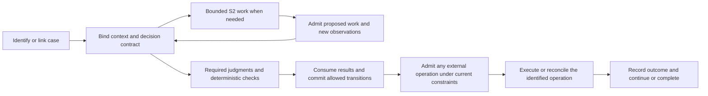

# NGA: Framework Logic First, Case Coverage Second

> Date: 2026-10-30.
> Owner-established direction: design NGA's general logic first, then challenge it against different cases; do not require detailed banking semantics to be settled before continuing framework design.
> Status: the methodological correction is established. The logical core, interfaces and coverage expectations below remain design proposals, not implemented guarantees.
> Context: [V0.2](13-nga-architecture-v0.2.md), [orchestration control review](15-graph-loop-workflow-control-review.md), [discussion register](16-architecture-discussion-register.md), and the corrected [credit-specific discussion](17-credit-scope-identity-and-revision-review.md).

## 1. Correction to the preceding discussion

Document 17 went too far in treating a choice of credit-relationship scope as a prerequisite for architecture work. The owner clarified that business domains have different underlying rules. In the supplied counterexample, independent credit cases can draw against an overall preapproved allowance, with a combined limit constraining them. This is a user-supplied coverage example, not a claim here about banking practice generally or a selected banking implementation.

The architectural lesson is narrower and reusable:

**Repeated execution of one case, a genuinely new case, and several cases governed by a shared constraint are different situations.**

The framework must represent those distinctions without hardcoding "one case per customer/product" or "every new case grants an independent unrestricted amount." Detailed credit allocation, exposure accounting, agreement structure and correction rules are deferred. We need enough explicit fixture assumptions to test an architectural property, not a complete banking specification before designing the framework.

The working method is: **propose a small logical core → state its invariants and configurable contracts → challenge it with diverse cases → revise the core where a real gap appears**. A successful single case does not establish generality.

## 2. Separate the stable core from configurable business meaning

| Framework responsibility | Supplied through a versioned business/capability contract |
| --- | --- |
| Create/link a case under admitted identity rules and preserve its lineage. | What business intent constitutes a new case, how a request resumes one, and which cases are related. |
| Bind a decision purpose, material basis, actual observations and adopted revision. | Questions, definitions, outcome meanings, relevant evidence, equivalence/materiality and validity rules. |
| Execute and revise admitted plans while preserving protected obligations. | Applicable workflows, allowed adaptations, required guards and completion criteria. |
| Bind an operation to its intended effect, material parameters, attempts and receipts. | The action's business meaning, target resource and supported execution/recovery contract. |
| Apply declared constraints at their relevant consistency/enforcement boundary. | Constraint scope, authoritative state, business predicate and the outcome when admission fails. |
| Preserve attributable history, replay boundaries and release continuity. | Required retention/access scope, rollout applicability and business-specific recovery procedures. |

Business configurability is not permission to bypass the core. A configured workflow cannot mint fresh identities to evade duplicate handling, treat unknown completion as success, acquire extra authority, or rewrite adopted history.

Nor should the core simply execute arbitrary business code and assume its guarantees follow. Integrations must declare which invariants they can enforce and expose enough evidence for the claimed audit/replay scope. Missing resource capabilities limit the guarantee.

## 3. Minimal logical distinctions

These are proposed concepts, not mandatory tables, classes or independent services:

1. **Case:** an admitted unit of business intent and its lifecycle. A submission, model invocation or graph node is not automatically a new case.
2. **Decision:** a named question within a case, evaluated against a bound basis, with observations distinct from adopted revisions.
3. **Plan:** the admitted organization of work, represented or integrated through Graph, Workflow and Agent Loop contracts. A changed plan need not change the case or decision basis.
4. **Operation:** one intended external effect with immutable material parameters, separately identifiable attempts and authoritative outcomes.
5. **Constraint context:** references to applicable case-local or shared business constraints, their authoritative state and enforcement contracts. It does not merge the affected cases into one identity.

Their definitions and execution artifacts are linked through the existing agent/release lineage in V0.2. Model calls, evidence observations, approvals and receipts remain identifiable records around these concepts.

Two distinct cases may have identical input content and semantic judgments. They still require separate admitted case histories. Conversely, repeated delivery with a different transport identifier may belong to the same case. The business identity contract resolves this; a framework-wide text similarity heuristic does not.

## 4. Proposed invariants

| Invariant | What it rules out |
| --- | --- |
| **Identity continuity** | Retries, replanning and child restarts cannot silently create new business entitlement. Legitimate new cases remain possible. |
| **Bound judgment basis** | S2 cannot change an effective question, required evidence or candidate meaning without the appropriate version/revision path. |
| **Explicit effectiveness** | A model observation, proposed plan, adopted decision and executed effect cannot stand in for one another. |
| **Protected execution** | Consequential work crosses the declared authority, constraint and effect boundaries, including inside nested loops/workflows. |
| **Operation continuity** | One intended effect is not performed again merely because another attempt, plan or decision revision exists. New effects need their own admitted purpose. |
| **Shared-constraint correctness** | Case-local success does not establish that jointly constrained work is admissible. Enforce the declared shared condition at the relevant commit boundary. |
| **Historical continuity** | Revisions, recovery and releases append attributable changes; historical replay cannot create live effects or replace missing inputs with new guesses. |

Shared-constraint correctness needs an authoritative enforcement contract, not only a favorable model judgment or two independent reads of the same snapshot. The actual coordination, reservation or conditional-update mechanism remains open. NGA must state a weaker guarantee or refuse unsupported automatic execution where no adequate mechanism exists.

Duplicate handling and constraint consumption must agree: a completed operation returns its recorded outcome rather than consuming capacity again. A genuinely new operation is evaluated against the current applicable constraint. The same request must not be relabeled as a new refusal merely because its own successful execution reduced remaining capacity.

## 5. Jev, agentic models and the execution structure

| Element | Role in the logical core |
| --- | --- |
| **Jev / S1** | Apply business-configurable semantic definitions to a bound context and produce typed judgments. These can drive business decisions, routing, workflow applicability or evidence/progress assessment where appropriate. |
| **Agentic model / S2** | Construct candidate plans, investigate gaps and propose adaptations inside its admitted scope. It cannot make a proposal effective or enlarge that scope by itself. |
| **Framework** | Bind context and versions, consume observations under policy, admit plans and effects, commit effective state, preserve identities, recover and expose audit evidence. |
| **Graph** | Express dependencies and effective control paths where useful; a shared representation remains a hypothesis rather than the source of authority. |
| **Workflow** | Supply a reusable, versioned procedure with applicability, completion and recovery contracts. |
| **Agent Loop** | Solve an open subproblem through bounded iterative planning and observations, including requests to invoke workflows. |

The general cycle is:

This is a logical cycle, not a mandatory service call sequence. Cases requiring no external operation can complete at their declared decision boundary. Unresolved or failed checks follow explicit paths. A shared constraint may participate in business judgment, final admission or both, according to its contract; an earlier semantic result never substitutes for current enforcement of a changing resource condition.

Jev therefore remains central to configurable semantic decision-making. Exact counters, typed execution receipts and concurrency arbitration do not become model decisions simply because the model can discuss them.

## 6. A small case portfolio to challenge the design

These are proposed coverage fixtures, not executed tests. The amounts and capacities in a fixture are inputs, not framework constants.

| Case | What the fixture tests | Expected architectural behavior |
| --- | --- | --- |
| **C1: repeat one unchanged request** | Case/decision/effect idempotence | Resolve the same case and eligible revision; return or reconcile the same operation without duplicating its effect. |
| **C2: admit a genuinely new, similar case** | Idempotence without suppressing legitimate new work | Permit a separate case under its identity policy; similar customer/product/text alone does not merge it with C1. |
| **C3: two independent cases share a limit** | Cross-case consistency and concurrency | Admit both when the declared constraint permits; when their joint effects exceed the allowance, prevent a violating commit under the authoritative contract. The configured policy determines wait/refusal/other handling. |
| **C4: relevant evidence or an applicable rule changes** | Revision without historical rewrite | Admit a new basis and permitted decision revision; do not automatically create another external effect. |
| **C5: S2 changes the plan or invokes a child workflow** | Structural flexibility without identity/authority escape | Preserve business identities and protected obligations; materially changed meaning requires its own admission path. |
| **C6: an external effect occurs but its response is lost** | Recovery at the uncertainty boundary | Preserve operation identity and unresolved status; reconcile before any conflicting replacement. State the resource-dependent guarantee. |
| **C7: a different domain shares the same constraint shape** | Whether the core is overfitted to credit | Substitute inventory, a spending budget or another capacity constraint through the declared contract; do not add banking-specific branches to the core. |
| **C8: operations evaluates and promotes an improvement** | Three-state evolution and replay | Run an isolated comparison, preserve original history and effect identities, then use the authorized release path for new/live work. |

The owner's preapproved-total example motivates C2/C3: several new cases can be legitimate while their joint effects remain bounded. This observation does not choose a credit-accounting design. C7 checks whether the same logical boundary works elsewhere.

Case variation should include positive counterparts: both independent cases fit and succeed; one relevant input change correctly changes a result; an unchanged retry returns the original successful outcome even if current capacity is now lower. A design that blocks everything cannot pass.

## 7. Fit within three states and four planes

Development defines the core contracts, candidate business packages and coverage fixtures. Runtime binds a package and executes admitted cases. Operations reconstructs outcomes, handles authorized interventions and turns observed failures into evaluated improvements.

Across each state, the user plane expresses intent and inspects results; management maintains definitions, versions and provenance; runtime performs computation and admitted work; control governs effective transitions, access and effects. Agent evolution connects these responsibilities through candidate/evaluation/release lineage; it has no bypass around them.

Business-specific rules can change independently of the stable core only within the declared compatibility and release contract. A case counterexample may instead show that the core is missing a necessary distinction, such as shared-constraint admission. That is a reason to refine the architecture, not to hardcode the example's banking rules into it.

## 8. Immediate design work and what stays deferred

Next specify the logical requests/results for case admission/linking, bound judgment, plan/child invocation, decision adoption, operation admission/execution and shared-constraint enforcement. For each, identify its authority, identity continuity, observable failure states and replay obligations. Reuse the proposed interfaces in document 15 rather than starting a separate competing runtime contract.

Then walk C1–C8 through those contracts and revise gaps. This is the next discussion unit; no detailed banking answer is required to begin it. The engine, persistence, protocol and model-serving choices remain open. Production domain semantics and resource capability evidence must eventually be supplied before claiming coverage for a real deployment.
