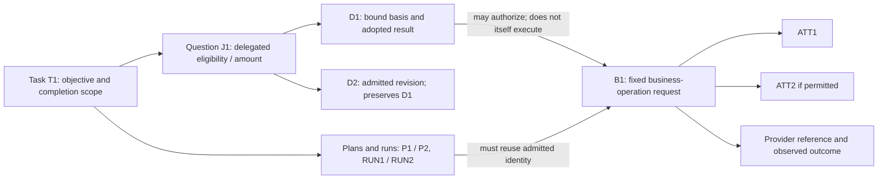

# AQ-01 / AQ-02: Task, Decision and Business-Request Identity

> Date: 2026-10-30.
> Status: proposed answers and adversarial design cases. AQ-01 and AQ-02 remain OPEN; this document does not claim implementation or executed integration tests.
> Established working boundary: NGA invokes business capabilities; the business system owns its domain records, internal rules and authoritative execution. This discussion follows the owner's acceptance of that boundary and does not design the provider's internals.
> Context: [discussion register](16-architecture-discussion-register.md), [earlier credit review](17-credit-scope-identity-and-revision-review.md), [general core](18-framework-core-and-case-coverage.md), and [business-system boundary](19-business-system-capability-boundary.md).

> Owner correction on execution order: the normal path can use a framework `wait_for_api_response` primitive. Do not assume that a dispatched request is continuously reconsidered or replaced whenever new evidence arrives. Explicit interruption, cancellation and reversal depend on the provider's capabilities or a qualified composition of those capabilities. The refinements below make waiting the baseline and retain concurrent revision only as an explicitly enabled branch.

## 1. AQ-01: define the task's promised outcome before executing it

A task is an admitted unit of work toward an identified objective, under a declared scope, authority and completion contract. A conversation, graph execution, model call or business-system application is not automatically that unit.

For this credit fixture, T1 promises to **prepare the identified application, perform an explicitly delegated eligibility/amount judgment, submit the permitted business request when appropriate, and report its authoritative terminal outcome**. The delegated judgment uses the existing illustrative conventions: assets of 40 million in the specified unit, complete qualifying evidence, no recent overdue condition and no historical veto produce USD 50,000. The provider's operation is an illustrative qualified application-submission capability; it accepts the required decision artifact and returns status. It is not a direct instruction to change a credit field.

Delegation is an assumption of this fixture, not a claim that every credit API accepts an externally made decision. If the provider owns the whole judgment, NGA submits the required inputs and records the provider's decision instead. The identity and recovery distinctions below still apply.

### 1.1 Completion belongs to the task contract

| Observed situation | T1's state and truthful report |
| --- | --- |
| Required evidence or meaning is unresolved | Waiting/resolution; no invented approval or refusal. |
| The delegated judgment is an adopted refusal and the contract permits local completion without submission | Complete the delegated refusal path; do not claim that the provider rejected an application it never received. |
| The provider acknowledges receipt or returns pending | Waiting for the declared terminal outcome; accepted is not approved or completed. |
| The provider confirms a terminal approval/completion | Complete with the provider's exact outcome semantics and references. Do not infer an additional action such as disbursement. |
| The provider confirms a terminal rejection | Complete the application-processing task with a rejected business outcome. Task completion does not mean approval. |
| Delivery or provider completion is unknown | Reconciliation remains owned and visible; no completed-business-outcome claim. |
| A worker stops, the user withdraws, or local authority is revoked | Stop further unauthorized work, but preserve and resolve outstanding request uncertainty through an authorized route. |

A different task may promise only submission and receipt, and finish at that boundary. It must declare that promise in advance and report it accurately, rather than weaken its completion criterion after a timeout. A managed handoff can end a worker's responsibility if the contract names the receiving recovery owner and preserves the unresolved request; it does not establish an external result.

After T1 closes, a later challenge normally starts a linked review task T2 with its own purpose. Reopening T1 is an alternative only under an explicit lifecycle policy that preserves the earlier closure. Neither approach silently resubmits its original request.

## 2. AQ-02: three identities, with revisions and attempts underneath

| Identity | Meaning | Continuity rule |
| --- | --- | --- |
| **Task T1** | The admitted objective in its principal/tenant, target and completion scope. | Evidence supplements, allowed scope amendments, new plans and restarts can continue T1. A genuinely new objective or independent application intent needs separately admitted work, typically T2. |
| **Decision question J1; decision revision D1** | J1 is a particular delegated question/occurrence in T1. D1 binds that question to its basis and records observations and any adopted result. | Retrying computation does not create a new authoritative revision. An admitted material change of basis produces D2 under J1; a new question/purpose produces a different J. |
| **Business request B1** | One admitted invocation of a provider capability for a particular business-operation intent, with a fixed target and material request. | Delivery attempts, runtime restarts and pure replanning preserve B1. A different operation or material request needs an explicitly admitted successor/amendment, not another attempt of B1. |

These are logical concepts, not selected database schemas. Here B1 is the business-operation request called OP1 in earlier documents, not an HTTP packet. A transport attempt has its own identifier ATT1, ATT2, and so on. Plan P1/P2, run RUN1/RUN2, model observation O1/O2 and provider references are also recorded, but none can mint new business intent on its own.

One task may contain multiple questions and multiple business requests. One decision may support several distinct authorized operations; a request may depend on several decisions. Task completion does not follow merely because one decision or request is complete.

### 2.1 Same task means admitted continuity of intent

Use an authorized task/resume reference or an upstream intent key to resolve T1. The initial create-task command itself needs duplicate handling, so a lost response does not create T2 on redelivery. Scope identity by the applicable principal/tenant and capability contract; possession of an identifier alone does not grant access.

The same customer, text or payload is not proof of the same task: the user can legitimately initiate another application with identical inputs. Conversely, another chat, channel, child agent or run is not proof of new intent. If continuity cannot be established, use a declared resolution path before a consequential submission; S2 must not invent either a merge or a new application simply to continue.

NGA's task identifier and the provider's application identifier remain distinct. Several tasks may explicitly concern one provider application, such as preparation and later review. They must link to its known request/outcome history and must not each independently submit the same operation. Unrelated tasks are not merged merely because they concern the same customer.

An allowed amendment to an unfinished application can remain T1, while changing its decision revision and, if needed, its business request. The task contract defines allowed scope amendments. Material input change is not universally a new task, and an unchanged task ID does not make all input changes harmless.

### 2.2 Same question is not the same decision revision

For D1, bind at least:

- T1/J1 and the delegated question's scope and purpose;
- the applicable semantic specification, candidate meanings and adoption policy;
- admitted evidence and required coverage, provenance, reference time and validity;
- the qualified model/readout and other consumed judgment dependencies;
- the actual observations, adoption authority and effective-state history.

The wording of the explanation and the graph node that runs the model are not decision identity. Two decisions both saying USD 50,000 are not necessarily the same revision: different admitted facts or rules may justify the same answer. Conversely, another rendering of the same evidence can preserve D1 where the declared equivalence contract allows it. A newer source timestamp or different provenance can matter even when a value is unchanged.

An immutable decision revision has at most one adopted result. Within a question's current adoption scope, the framework prevents conflicting authoritative revisions; a permitted supersession records which revision is current rather than deleting the previous one. D2 may be evaluated while D1's applicability is held or superseded according to policy; creating a candidate D2 does not itself adopt it. Repeated model observations remain distinguishable from authoritative decisions. If supposedly equivalent observations conflict, record a consistency violation and follow the declared exception route; do not hide it by choosing a favorable output or by treating a cache hit as proof of model consistency.

Historical lookup of D1 always returns D1 and its history. A current-status lookup may show D2 or a hold. These are different queries. Semantic consistency across equivalent inputs is a model/contract property; replaying an existing adopted result is framework idempotence. Both matter and neither proves the other.

### 2.3 Same business request means the same admitted operation

B1 binds its operation intent, provider/capability and version, target, business principal/authority scope, and immutable material parameters. The caller's idempotency identity and any provider-assigned application/operation reference are mapped to that record. A hash can detect conflicting content but does not establish whether two intents are the same.

An unadmitted S2 draft may change. Once B1 is admitted, its material request is fixed; ATT2 cannot carry a different amount under B1's identity. Transport timestamps, tracing metadata or refreshed authentication credentials may differ only where the capability contract treats them as non-material and authority remains valid.

A new decision revision is not permission to generate B2. If its changed evidence/decision artifact must appear in the actual provider request, that can make the request materially different even when the amount is unchanged. Use the provider's declared amendment/replacement route and preserve B1. If all material request parameters remain unchanged, reauthorization under D2 is possible only under an explicit binding policy, without rewriting what authorized any earlier dispatch.

Retry scope includes the provider, operation and supported retention window. The same key sent to another provider is not proof of duplicate suppression. Returning a known result is different from sending the request again. An unresolved request outside the provider's supported recovery contract remains unresolved; changing its key does not repair that gap.

A status lookup is a separate read invocation linked to B1; it is not another delivery attempt of the original submission. A cancellation or amendment is also its own qualified operation with a reference to B1. Correlation does not mean reusing the submission's idempotency key for a different operation.

## 3. Changes: classify what changed before allocating a new identity

| Event | Task | Decision handling | Business-request handling |
| --- | --- | --- | --- |
| Duplicate user submission or resume | Resolve T1 | Reuse the appropriate historical/current status without unmarked reevaluation | Return/reconcile B1; no new submission. |
| Equivalent representation of the same admitted evidence | Keep T1 | Keep D1 when governed equivalence covers meaning, provenance and validity; retain the new artifact's trace | No new operation. |
| New material evidence is admitted | Usually T1 | Bind D2; do not overwrite D1, even if the outcome stays USD 50,000 | Apply the phase-specific rules below; D2 does not automatically create B2. |
| A rule is published but is not applicable to T1 | Keep T1 | Keep the eligible version binding | Continue only if live authorization and validity still permit it. |
| A changed rule applies to T1 | Keep T1 unless the task's purpose itself changes | Hold/migrate/reevaluate under the published applicability policy | Do not silently edit or resend B1; inspect its actual phase. |
| S2 changes evidence-collection order or a workflow layout | Keep T1 | Keep D1 if its protected meaning/basis remains unchanged; create P2 | Preserve B1 and completed work across nodes/children. |
| S2 changes the decision question, required sources, target or reference time | Resolve scope explicitly | Admit the semantic/evidence/question change; it is not merely P2 | Recheck dependencies and the actual operation; no identity reset by plan patch. |
| Model computation fails and is retried | Keep T1 | Same bound revision, another invocation record under the retry policy | No new operation follows from another model attempt. |
| Business-call response is lost | Keep T1 | Preserve D1; timeout is neither new credit evidence nor a refusal | Keep B1, record uncertainty, query/reconcile or retry only as supported. |
| Qualified model/readout release changes | Keep T1 | Comparison stays non-authoritative; live migration, if required, binds an explicit new evaluation/revision | No new request entitlement. |
| Independent application intent is explicitly admitted | Usually new T2 | Own questions and basis, even with identical input/outcome | Its own admitted operation may be legitimate; the provider applies its domain checks. |

For NGA-governed rules, publication, applicability to active tasks and execution validity are separate. For rules private to the provider, NGA consumes its declared contract/version changes and response; it neither reconstructs hidden rules nor fabricates a new Jev revision simply because the provider returns a rejection.

The reference time of "past six months" is bound in D1. A technical retry on another day does not silently move it. If a freshness policy requires a new reference time, that is an explicit refreshed basis. Evidence event time, arrival time and decision reference time must not be conflated. A late-discovered old fact can affect the original scope; a later-occurring fact can instead concern a new review scope.

## 4. Normal waiting, explicit interruption and qualified recovery

### 4.1 Wait is the normal continuation boundary

For the proposed primitive families, API contract fields and Graph/Workflow expression of this boundary, see [document 21](21-runtime-primitives-and-capability-contracts.md). It develops the mechanisms below without closing AQ-01/AQ-02 or selecting an engine.

The baseline is **adopt D1 → dispatch fixed B1 → wait for the contract-defined result → record that result → resume dependent work**. A pending call does not require an S2 planning loop or a new Jev judgment on each clock tick.

`wait_for_api_response` is a proposed framework event/time primitive. Its logical contract includes:

| Part | Required meaning |
| --- | --- |
| Wait target | B1 and the correlated provider operation/reference, not whichever response happens to arrive next. |
| Completion predicate | The contract-defined response or terminal state. A synchronous terminal response can satisfy it immediately; an asynchronous receipt can instead establish a longer wait. |
| Continuation | The admitted next transition, with D1/B1 lineage preserved. Only dependent work needs to wait; unrelated work may continue. |
| Clock policy | A declared deadline, scheduled status check or escalation policy where needed. A local deadline expiring is a timer event, not proof that the provider rejected, canceled or never executed B1. |
| Restart and event handling | Preserve the wait and its correlation across worker restarts; retain a response that arrives before the continuation suspends, and prevent duplicate or late events from causing duplicate continuation or another submission. |
| Interrupt policy | Which explicit user requests or published control events may interrupt waiting, and which qualified handler may run. Interrupting the wait does not itself cancel the provider operation. |

The implementation can suspend a continuation rather than occupy a model or worker continuously; no particular scheduler or workflow engine is selected here. Status polling, callbacks or an awaited synchronous response are integration choices under the same logical contract.

By proposed default, incoming evidence is recorded while the dependent path waits. It does not automatically activate D2 or mutate B1. Process it at the next declared decision/review boundary, or enter an explicit interruption path if the configured policy requires one. This is an execution policy, not permission to discard relevant evidence or ignore live authority changes.

If a final API response reliably reaches the wait, the earlier lost-acknowledgement scenario does not arise. If the response path fails or the process restarts, durable waiting and the provider's status/retry contract determine recovery. Waiting solves orchestration order; it does not manufacture a missing provider result. Uncertainty is a bounded exception route, not the default operating model.

### 4.2 Apply a requested or policy-required change at the actual phase

The following matrix applies when a change is explicitly admitted under the interruption/revision policy. Mere arrival of another document does not trigger every row automatically.

| Phase when an applicable material change is admitted | Required NGA behavior |
| --- | --- |
| Before decision adoption | Prevent a stale observation from adopting against the superseded basis; evaluate the admitted new basis. |
| D1 adopted, no B1 admitted yet | Preserve D1, apply the hold/revision policy and form a request only from eligible authority. |
| B1 admitted, demonstrably not dispatched | Arbitrate hold/revision against dispatch. Retain B1 only if its material request and binding remain valid; otherwise retire its dispatch authority and admit a linked replacement as permitted. Old workers must no longer be able to send it. |
| B1 dispatched, in flight, pending or outcome unknown | Normally remain in the declared wait. If explicit interruption permits investigation/D2, keep it separate from B1's outcome; use supported status, cancellation or amendment operations before any conflicting replacement. |
| B1 terminal outcome confirmed | Preserve the original request and receipt. A changed judgment can support a separate, authorized review/correction request; it does not rewrite the provider outcome or rerun initial submission. |

NGA needs to arbitrate its own basis/hold/dispatch transitions, not the provider's internal transactions. If dispatch won that local race, treat the external request as potentially active until the provider's contract resolves it. A local canceled flag, a cancellation request, or a lagging "not found" response is not by itself proof of non-execution.

A potentially important incoming fact may trigger a provisional hold under an authorized intake policy before it is verified. That hold is not an adopted credit refusal. S2 cannot suppress a relevant incoming artifact merely to preserve D1, and an unverified assertion cannot silently rewrite it. Which sources/materiality checks and provisional holds are authorized remains an explicit AQ-04/AQ-06 dependency.

### 4.3 Cancellation and reversal come from a capability contract

Distinguish **stopping local waiting**, **canceling a pending provider operation**, and **reversing/compensating an already completed operation**. These may have different interfaces, permissions and outcomes.

| Provider capability | NGA handling |
| --- | --- |
| Native cancellation of pending work | Invoke the authorized cancellation operation and wait for its result. Cancellation requested, cancellation confirmed and original operation completed are different states; handle the provider's declared completion/cancellation race. |
| Native reversal, withdrawal or amendment after completion | Invoke that operation under its own preconditions and authority, preserving the original receipt. Its promised result determines what was reversed. |
| No single reversal API, but exposed operations can achieve an approved recovery outcome | Register a composite capability/workflow with forward and compensating steps, prerequisites, permitted triggers, completion evidence and failure handling. It may expose a unified recovery interface to NGA. |
| No qualified native or composable recovery path | Declare the operation non-reversible under the available contract. A task that requires reversibility must stop or change its plan before dispatch; do not fabricate rollback through direct field writes. |

Composition must establish the promised business outcome using supported interfaces. A superficially opposite action is not necessarily an inverse. Some effects may remain, and compensation itself can fail. Record the intended recovery outcome, any limits, intermediate progress and a retry/resolution path; do not advertise atomic rollback unless the provider/composition actually guarantees it. This distinction is supported by the [Compensating Transaction pattern](https://learn.microsoft.com/en-us/azure/architecture/patterns/compensating-transaction), which describes application-specific compensation that may not restore the original state and may itself need recovery.

Each cancellation or compensation operation has its own identity and attempts linked to B1. Retrying that recovery operation preserves its identity; it neither reuses B1's key for different content nor erases B1's history. A generic compensation recipe cannot be inferred from an API's name or S2's explanation.

In development, qualify native and composite capabilities, including their waiting, cancellation and compensation contracts. At runtime, the framework executes admitted waits and recovery workflows. S2 can propose a suitable registered recovery path; any new composition must pass its admission contract rather than invent reversibility during an incident. Jev participates only where a delegated semantic judgment is needed, not to decide whether a typed receipt arrived or a timer expired. Operations can inspect unresolved waits and failed compensation with their recorded references.

## 5. Walk the credit example through adversarial branches

### 5.1 Baseline

1. Admit T1 for the application-processing objective and completion scope; bind its authorized caller and intent reference.
2. Under question J1 and the fixture's specification R1, bind evidence E1 and time t0. Jev supplies a typed observation; the framework adopts D1 = USD 50,000 if the contract's conditions hold.
3. S2 proposes the qualified submission. The framework admits B1, including the material application inputs and required delegated-decision artifact, and records ATT1 before dispatch under its control contract.
4. Enter the correlated wait. A synchronous terminal response can complete it directly. If the provider instead returns a reference and pending status, continue waiting for the declared terminal event/status; then complete T1 with the returned business outcome. New evidence does not automatically replan the pending request.

The fixture does not calculate the provider's total allowance, choose its internal risk rules, or edit its business fields.

### 5.2 Branch A: a new document, still USD 50,000

If a PDF is just another admitted rendering of E1, preserve D1. If an authoritative correction changes assets from 40 to 45 million and is admitted as E2, produce D2 even though the fixture still yields USD 50,000. Same outcome is not proof of unchanged basis.

Neither event creates another submission automatically. Before dispatch, compare the actual required request: if it contains changed evidence/provenance/decision references, use a qualified successor or amendment rather than changing B1 in place. After dispatch, retain B1's status and use only supported follow-up capabilities.

During a normal wait, record the incoming document and defer activation of a revised decision to the declared review boundary. The D2 branch above assumes that revision has been explicitly admitted; it is not a mandatory reaction to every arrival.

### 5.3 Branch B: the judgment changes to USD 10,000 or refusal

A verified asset correction from 40 to 0.8 million yields USD 10,000 under the fixture, assuming no veto. A verified historical overdue condition satisfying the stipulated veto instead yields refusal. Both are legitimate responses to a changed basis, not failures of idempotence.

If B1 cannot yet have left NGA, hold it, revoke its dispatch eligibility and admit any qualified replacement explicitly. Once B1 is dispatched, the default is to wait. The concurrent D2 branch exists only if an explicit user request or published interruption policy admits that review. If that branch is enabled and the acknowledgement is missing, the truthful state is **D2 recommends USD 10,000/refusal; B1's external outcome is unknown**. It is not "the USD 50,000 request failed" or "no credit was granted."

If the provider later confirms B1 completed, any correction requires a separately authorized provider capability. If it confirms a terminal rejection, record that response; do not retry with a new key just to seek approval. No cancellation, reduction or compensation semantics are invented by this fixture.

### 5.4 Branch C: rule change, replan and retry collide

Suppose R2 becomes applicable while S2 replaces a stalled collection workflow and a worker restarts. These are three events: a rule/basis revision, plan P2, and another execution attempt. They are not three new applications.

Bind R2 under its migration policy; keep T1; retain B1's actual phase and attempt history. If adoption/dispatch is now ineligible, P2 cannot restore eligibility by moving the call to another node. If only the workflow changed and D1 is still valid, P2 resumes the original operation. Historical replay continues to use the actual R1/R2 events and provider responses rather than today's rules.

## 6. Adversarial checks and discrimination counterparts

These are proposed acceptance cases, not executed tests. The design must both preserve valid continuity and permit legitimate new work; refusing everything or caching every answer is not success.

| ID | Challenge | Required behavior and distinguishing counterpart |
| --- | --- | --- |
| I01 | A create-task response is lost | Redelivery resolves T1; a separately admitted independent intent can still create T2. |
| I02 | Same text/customer appears in another chat | Resolve explicit continuity, not text similarity; unknown linkage cannot silently trigger a duplicate submission. |
| I03 | Same task identifier is supplied by a different principal | Check authorized scope; identity lookup does not grant access or execution rights. |
| I04 | Two tasks reference the same provider application | Link shared request/outcome history; distinct review tasks remain possible without duplicate initial submission. |
| I05 | Evidence is reformatted, versus materially corrected | Equivalent rendering can preserve D1; a consumed 40-to-45-million correction creates D2 even with the same result. |
| I06 | Repeated equivalent Jev observations disagree | Record a consistency exception; one recorded adoption must not conceal model nonconformance. |
| I07 | Applicable late evidence arrives as an old worker adopts or dispatches | Arbitrate the NGA transition; stale work cannot regain authority. If dispatch won, resolve the external request separately. |
| I08 | R2 is published but applies only to new tasks | Keep eligible R1 work; if R2 explicitly applies to T1, admit migration rather than ignoring the update. |
| I09 | A retry crosses a reference-time/freshness boundary | Preserve historical time; admit a refreshed basis when required, without rewriting D1. |
| I10 | A new node, child workflow or worker creates a fresh key | Preserve B1 for the same operation; genuinely distinct admitted operations may have separate identities. |
| I11 | B1's amount is changed from USD 50,000 to USD 10,000 on ATT2 | Reject conflicting reuse; a qualified successor requires phase-safe retirement/amendment, not a hidden retry. |
| I12 | D2 retains USD 50,000 but changes a required evidence reference | Treat the actual material request change explicitly; equal amounts do not permit silent payload replacement. |
| I13 | An explicitly enabled review produces D2 while B1's wait expires | Treat the deadline as a local event, preserve B1 and follow the admitted status/cancellation/recovery path. Without an enabled interruption, new evidence stays recorded for the next review boundary rather than automatically creating D2. |
| I14 | The provider reports accepted/pending | Keep end-to-end T1 open; a task explicitly scoped to submission-only may complete at its declared boundary. |
| I15 | Local cancellation is mistaken for provider reversal | Use confirmed native cancellation/reversal or a qualified compensating workflow. Without either, declare recovery unsupported; no direct-field workaround or invented inverse. |
| I16 | Recovery changes provider or exceeds deduplication retention | Do not assume the key still protects the operation; return confirmed receipts or use explicit reconciliation. |
| I17 | New evidence arrives after confirmed completion | Open linked review/reopening under policy; preserve original closure and never automatically resubmit. |
| I18 | A replay or model comparison reaches submission | Use matching recorded responses with live dispatch disabled; qualified live recovery remains a separate authorized mode. |

## 7. Responsibilities across the existing organizing structure

- **Jev / S1:** evaluate the admitted question and basis, including a qualified semantic relevance/equivalence question where explicitly delegated. It does not invent task/request identifiers, choose a favorable rule version, or certify external completion.
- **Agentic model / S2:** investigate, propose evidence and plan revisions, and request registered capabilities. It cannot replace adopted outcomes, suppress protected evidence, change B1's material payload, or evade refusal through a new channel/key.
- **NGA framework:** resolve authorized identity/lineage, bind and admit revisions, prevent stale adoption/dispatch, preserve operation/attempt continuity, consume declared provider states and maintain recovery ownership. These are framework controls, not repeated semantic model votes.
- **Business system:** enforce its own public capability contract and domain execution, and supply the authoritative outcomes/recovery mechanisms it promises. Internal rules and transaction topology remain outside this design.

In development, specify task completion, identity/materiality and capability contracts plus the counterexamples above. At runtime, apply those contracts to T1/J1/D1/B1 and their revisions. In operations, reconcile uncertainty, review recorded decisions, replay without effects, and evaluate proposed improvements.

The user plane presents task, decision and provider-request statuses separately. Management maintains definitions and version applicability. Runtime performs admitted computation/calls. Control admits revisions and dispatch with their identity/authority constraints. Evolution can improve any of these definitions through the release path, but cannot redefine historical identity or turn a comparison run into live execution.

## 8. Proposed answers and remaining closure work

**AQ-01 proposed answer:** use an explicitly scoped task outcome as NGA's closure boundary. For the end-to-end credit fixture, stop at the provider's declared terminal application result, with separate local-decision and request states. No provider-internal implementation is part of the task contract.

**AQ-02 proposed answer:** preserve task intent, decision-question/revision lineage and business-operation identity independently. Material evidence or applicable rule changes revise the decision basis; pure replanning revises the plan; a technical retry adds an attempt. None automatically authorizes another business request.

Before closing these questions, decide the following general policies and bind them to small capability fixtures:

1. Which task-scope amendments retain T1, what counts as terminal closure/handoff, and when post-completion work reopens versus creates linked T2.
2. Which authorities and references establish task continuity across channels and tasks, including an unresolved-linkage path and retention scope.
3. Which evidence/version/time changes are material, and which decision/request dependencies must be rebound; coordinate AQ-03/AQ-04 rather than letting S2 choose ad hoc.
4. How wait completion, evidence intake during waiting and explicit interruption compose with the NGA hold/adoption/dispatch cutoff and provider status/cancellation/compensation contracts; coordinate AQ-11/AQ-12, including unsupported recovery cases.

The logical distinctions above can be discussed and adopted without choosing a banking ledger, graph engine, database, message protocol or model-serving topology. Implementation acceptance still requires real fixtures and executed checks.
