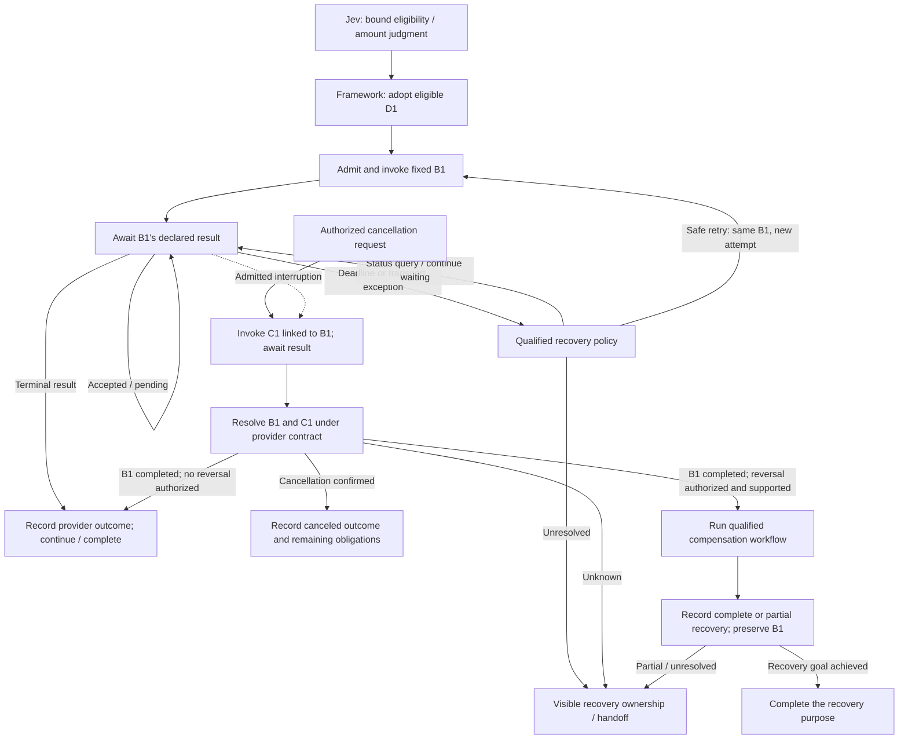

# NGA Runtime Primitives and API Capability Contracts

> Date: 2026-10-30.
> Status: architecture proposal and adversarial acceptance design; no runtime implementation or executed integration tests are claimed. Relevant AQ items remain OPEN.
> Established direction: invoke business capabilities, preserve provider authority, and use waiting as the normal continuation boundary. Cancellation or compensation is an explicit branch supported by native APIs or a qualified composition.
> Owner-established extensibility requirement: primitives must be configurable, importable and customer-extensible. The six families below are a default library, not a closed vocabulary or a requirement that all industry control semantics reduce to those six types. The extension mechanism proposed below remains open for discussion.
> Context: [working architecture](13-nga-architecture-v0.2.md), [control review](15-graph-loop-workflow-control-review.md), [discussion register](16-architecture-discussion-register.md), [business-system boundary](19-business-system-capability-boundary.md), and [task/decision/request identity](20-task-decision-request-identity.md).

## 1. Separate execution mechanism, capability promise and semantic judgment

NGA should supply a common execution contract that a Graph, a reusable Workflow and a bounded Agent Loop can all use. Following the owner's foundation constraint, [document 24](24-openjiuwen-reuse-and-evolution.md) maps these primitives onto openJiuwen Java's existing Workflow/Graph, Rails, tools, checkpoints and Runtime adapters. These are logical contracts, not instructions to build another execution engine. Specific versions, extension implementations and supporting mechanisms remain open.

- **Default primitive library** supplies transition admission, capability invocation, observation handling, waiting, timers and child scopes. Customers can configure these definitions, import reusable packages, compose new operators or supply qualified custom implementations.
- **Runtime kernel contracts** preserve identity, admitted authority, effective-state transitions, recovery and attributable history across built-in and imported implementations. Industry-specific control meaning belongs in extensible definitions rather than a closed list of kernel node types.
- **API capability contracts** state what an external operation means and what the provider guarantees about completion, retry, cancellation and reversal. Adapters map transport details into that contract without inventing guarantees.
- **Control operators** such as Retry, Cancel and Compensate compose primitives under capability-specific policies. They are first-class in the authoring model, but are not unconditional powers over an external system.
- **Jev and S2 ports** provide typed semantic judgments and work proposals. They use the same execution, identity and observation boundaries without acquiring transition or business-commit authority.

Normal execution remains **admit → invoke → await the declared result → consume it → continue**. A synchronous final response can satisfy the wait immediately. An asynchronous receipt may establish a longer wait. New evidence is recorded for the next declared decision boundary unless an explicit interruption policy admits another path.

## 2. Common identity and control envelope

Every consequential invocation/transition references the relevant task T1, decision question/revision J1/D1, business request B1, plan/workflow version, authorized principal and expected NGA state generation. Optional fields depend on the operation; a harmless status read does not require inventing a credit decision.

Keep attempt ATT1, child-call identity, wait identity/generation, timer identity, provider operation reference and observation identity distinct. A refreshed callback handle is not a new B1. A parent restart is not a new child. A cancellation or compensation request has its own operation identity linked to B1.

The envelope also binds the capability version, material parameters, governing policy, deadline/budget scope and audit references. Current authorization is checked where the action requires it; a historical grant is not permanent permission. Tenant/principal scope and response authentication remain part of correlation, not merely matching an identifier string.

These are logical fields and invariants, not mandated services, tables, tokens or wire schemas.

## 3. Default primitive families and customer extension

The following families are a proposed default package. Their names and implementation are not privileged substitutes for the common runtime contracts, and they do not exhaust the control primitives a customer may need.

| Primitive family | Inputs and result | Framework obligation |
| --- | --- | --- |
| **AdmitTransition** | Expected task/decision/plan/operation generation, proposed transition, dependencies and authority → admitted revision, existing result, hold or conflict. | Validate policy and arbitrate NGA-owned state changes. A graph edge is executable only through the admitted transition; neither a model nor a worker directly overwrites effective state. |
| **InvokeCapability** | Admitted operation, fixed material request, capability version and attempt scope → dispatch/attempt record and correlated observations. | Preserve request identity, check dispatch eligibility, and expose uncertainty if the dispatch/result boundary cannot be resolved. Admission records alone do not establish provider execution or non-execution. |
| **AcceptObservation** | Authenticated response/callback/query result, correlation, provider version/order where available and observed time → preserved raw evidence plus validated typed observation. | Handle early, duplicate and late results; reject wrong-scope observations and surface contradictions. Normalization cannot turn an acknowledgement into completion. |
| **Await** | Correlated operation/child, completion predicate, continuation generation and interruption policy → suspended continuation or an eligible wake event. | Preserve the wait across restarts, handle results arriving before suspension, and consume a continuation transition at most once per admitted generation. No model call is needed merely to remain waiting. |
| **Timer** | Timer identity, deadline or schedule, purpose, generation and owner → recorded scheduled/fired/canceled event. | Distinguish attempt timeout, wait deadline, polling schedule and task budget. Preserve their meaning across retries/restarts and record event order for replay. A timer cannot assert external failure. |
| **CallChild / Join** | Stable child-call identities, versioned workflow/loop, bounded authority/budget, completion and sibling handling policy → child scope and qualified joined result. | Resume existing children on redelivery; join required outcomes under a declared rule. A failed join or parent cancellation does not make siblings' external effects disappear. |

All families preserve attributable transition/observation history. Storage, scheduling, fencing and event-delivery mechanisms must eventually demonstrate these obligations, but no particular implementation is chosen here. At-most-once consumption of an NGA continuation is not a claim of exactly-once external execution; any resulting external call still needs B1's own capability contract.

Deterministic guards use typed observations and published policy. An edge that requires a semantic judgment refers to a qualified Jev result and its adoption policy. Do not ask a model to vote on whether a timer fired or an authenticated typed receipt says completed.

### 3.1 Configuration, import, composition and custom implementation

| Extension route | Customer-defined content | Runtime treatment |
| --- | --- | --- |
| **Configure a definition** | Parameters and policy bindings such as applicable calendar, timeout semantics, retry classes, completion predicate or approval roles. | Validate and bind a versioned configuration to the task/release. Changing business meaning is a revision, not an unnoticed parameter edit. |
| **Import a package** | Namespaced primitive definitions, capability contracts, workflow templates, semantic specifications, implementation references and dependencies. | Register the package as a candidate; validate/qualify and activate it under the publication policy, which may be automated. Import is not implicit execution or universal activation. |
| **Compose a new control primitive** | A reusable graph/workflow with its own inputs, typed outcomes, state/recovery semantics and constituent capabilities. | Expose the composite as a first-class primitive while preserving its child identities, observations and outstanding-effect obligations. |
| **Provide a custom implementation** | A new state machine, event/time interpretation or control algorithm implemented through a compatible handler or qualified external executor. | Bind its execution contract and implementation version. It need not be rewritten as a graph of the six defaults; it must expose enough control and evidence for its advertised guarantees. |

For example, a customer-defined **BusinessCalendarWait** could count only periods in a configured calendar, while **QuorumReview** could await approvals from a declared set of roles under an explicit counting rule. These are illustrative controls, not asserted industry requirements. Calendar versions, role policy and consumed events must be bound so their behavior remains explainable and replayable. Ordinary clock expiry is still a framework event; whether that event satisfies the extension's completion rule follows its admitted semantics.

The stable boundary is the execution contract: identity and authority cannot be silently reset, effective changes remain attributable, external effects go through qualified capabilities, and history/recovery promises are explicit. Customers may define additional internal states, public outcome types, predicates and event handlers. There is no requirement to squeeze every industry state into the default library's labels.

### 3.2 Logical extension package and execution contract

A package descriptor should declare the following, without choosing a file format, programming language, binary ABI or distribution service:

- **Identity and dependency resolution:** namespace/name, immutable release identity, compatible runtime contract, dependencies and implementation/configuration references. Resolve a concrete dependency set when admitting a release; do not silently override another primitive with the same display name.
- **Meaning and types:** purpose, applicability, input/configuration schema, event and output schemas, completion predicates and unsupported conditions. Describe both local continuation state and any claimed business outcome.
- **Execution behavior:** how to start or resume an identified invocation, accept a correlated event, expose/checkpoint progress and report completion or suspension. State required timer, observation and child-scope facilities. An external executor may expose a different binding with explicitly limited visibility.
- **Effects and model dependencies:** requested business capabilities, authorization scope, any Jev questions or S2 proposal ports, material evidence dependencies, and the applicable admission policy. Configuration alone does not grant new rights.
- **Recovery and replay:** retry/cancel/compensation support or explicit absence, checkpoint compatibility, retained observations and implementation artifacts, live-recovery ownership and replay coverage. Custom time/random/model/external inputs must be recorded or governed by a qualified reconstruction contract.
- **Qualification and lifecycle:** example traces and counterexamples, compatibility evidence, publication scope, active-invocation migration/retirement behavior and maintained ownership.

These are logical obligations, not mandatory method names or separate services. A handler may compute a proposed transition and request framework effects; an integrated executor may instead expose a qualified status/event contract. The host must actually enforce the declared authority/effect boundary, or explicitly narrow its assurance to the trusted integration model. Registration metadata alone does not establish isolation or enforcement.

An imported API description supplies useful interface information but does not automatically establish waiting, cancellation or compensation guarantees. Missing execution semantics need explicit completion/qualification before tasks rely on them; unrelated supported capabilities can still be used under their narrower contracts.

### 3.3 First-class use in Graph, Workflow and model planning

Graph nodes and Workflow steps should resolve **primitive type + bound version + configuration**, including customer namespaces. Imported definitions carry typed ports, control/event semantics and lifecycle handlers, so they are more than labels on a generic tool-call box. A composite can be inspected as a subgraph where available; a custom implementation declares its actual trace/replay boundary.

Jev consumes any semantic specification explicitly declared by the extension. S2 can discover admitted definitions, select/configure them, compose a candidate primitive or propose an implementation. Publishing or invoking that candidate still follows the relevant admission contract; no mandatory human review is introduced unless the customer's policy requires it. Neither model may infer missing cancellation guarantees from a primitive's name.

The kernel uses the resolved contract and admitted transitions; it does not need banking, manufacturing or other industry-specific branches hardcoded into its scheduler. Extending one customer's catalog does not automatically expose that capability or its permissions to another scope.

### 3.4 Versioning, three-state lifecycle and extension counterexamples

Development imports/authors and qualifies definitions. Runtime binds exact primitive/configuration/dependency versions and executes their declared control behavior. Operations observes usage and failures, manages compatibility/retirement and proposes improved packages. Management maintains the catalog; control admits activation and transitions; runtime executes; the user plane explains the primitive's real status. Evolution connects these activities without silently replacing live semantics.

A suspended invocation resumes the version/configuration it actually bound, unless an explicit compatible migration is admitted. Installing a new package does not redirect its old callbacks, change its business calendar or restart its deadline. Retirement must account for active work and retained replay requirements; disabling new invocations does not itself erase the implementation or outstanding obligations of old ones.

The following supplement the P01-P20 execution cases; they are proposed checks, not executed tests:

| ID | Extension challenge | Required behavior / positive counterpart |
| --- | --- | --- |
| X01 | A customer needs a control state unavailable in the six defaults | Admit a qualified custom primitive with typed states/handlers; the default vocabulary must not prevent the extension. |
| X02 | An imported primitive shares a display name with a built-in or another customer | Resolve namespace and bound version explicitly; no silent override or cross-scope publication. |
| X03 | A business-calendar configuration changes while a wait is suspended | Preserve the bound version or admit migration; new invocations can use the new calendar without rewriting old elapsed time. |
| X04 | A custom handler performs an unrecorded external write | Enforce the admitted capability boundary or expose an unsupported assurance; registering the handler does not make the effect idempotent or auditable. |
| X05 | An imported API schema claims rollback without execution evidence | Mark the guarantee unqualified; accept a tested native or composite recovery contract when it supplies the missing semantics. |
| X06 | A package upgrade changes checkpoint layout or removes a dependency | Resolve compatibility/migration/retirement for active invocations; do not resume old state with arbitrary latest code. |
| X07 | Custom code reads live time or calls a model during historical replay | Use recorded/qualified replay inputs and preserve effect isolation; disclose narrower replay coverage when reconstruction is unsupported. |
| X08 | S2 imports a candidate and immediately uses its expanded privileges | Separate candidate import, activation and scoped invocation; automatic publication remains possible under the customer's existing policy. |

## 4. Minimum API capability contract

The catalog must describe execution semantics, not just an endpoint name and parameter schema. A missing capability is declared unsupported; silence is not evidence of support.

| Contract dimension | Required declaration |
| --- | --- |
| **Meaning and ownership** | Capability identity/version, provider and target scope, business purpose, intended effect, permitted callers and any delegated semantic decision authority. |
| **Input and binding** | Required inputs/evidence/decision artifacts, material-field equivalence, parameter conflict rules, preconditions and what remains immutable across attempts. |
| **Result semantics** | Typed outputs and errors; distinction between received/accepted/pending, terminal outcomes and unresolved status. Declare whether failure can leave partial effects. A generic error is not proof of no effect. |
| **Completion and observation** | What satisfies completion; synchronous final result, polling, callback or other supported route; operation references, event authentication/correlation, version/order and status-lookup consistency. |
| **Idempotence and replayed responses** | Key scope, provider/operation/principal binding, deduplication window, same-key/different-payload behavior and duplicate-result semantics. A client-generated key alone supplies no server guarantee. |
| **Time** | Caller response/wait deadlines versus any provider execution deadline, status availability and expiry, polling limits and meaningful liveness signals. A heartbeat is not a completion receipt. |
| **Retry** | Which outcomes permit redelivery, why it is safe, request continuity, limits, delays and handling after the guarantee window. Identify the owner of retry budgets across adapters and nested workflows. |
| **Cancellation** | Supported phase, invocation and confirmation mechanism, authority, cancellation-versus-completion semantics, and what effects may remain. Unsupported cancellation is explicit. |
| **Reversal / compensation** | Native operation or qualified composite, target recovery outcome, prerequisites and irreversible effects, original-result linkage, partial-failure behavior and recovery evidence. |
| **Lifecycle and audit** | Contract/release compatibility for active calls, retained evidence and access, provider audit references, recovery ownership and limits on replay visibility. |

A provider may support only a subset. That can still be usable for tasks whose completion/recovery requirements fit that subset. If a task requires a guarantee the integration cannot deliver, resolve the mismatch before the consequential call rather than silently promising a stronger service.

The adapter can reconcile transport differences, combine supported observations and implement qualified protocols. It cannot claim cancellation, idempotence or atomic rollback merely because its local interface exposes those names. A composite may add useful guarantees only when its actual protocol and component contracts establish them.

### 4.1 Keep independent state dimensions visible

| Dimension | Illustrative states; not a frozen enumeration |
| --- | --- |
| NGA execution/wait | Ready, suspended, resumed, deadline reached, recovery handed off. |
| Delivery attempt | Not dispatched, dispatched, response received, delivery/result uncertain. |
| Provider operation | Accepted, pending, completed, rejected, canceled, unresolved, or provider-specific partial outcome. |
| Recovery | Not requested, cancellation requested, cancellation confirmed, compensating, compensated, partially compensated, recovery unresolved. |

For example, a wait can have reached its deadline while the provider operation remains pending. An original operation can be completed and subsequently compensated. A task canceled by its user can still own an outstanding cancellation/reconciliation obligation. Do not compress all of these into a single success/failed/canceled flag.

Last arrival is not automatically the most authoritative observation. Apply the provider's declared ordering/revision contract; a late pending event cannot silently erase a confirmed terminal result. Corrections or contradictions remain attributable events. If the provider supplies insufficient ordering/evidence, report the ambiguity rather than invent a sequence.

### 4.2 Small contract fixtures for qualification

These are proposed simulated fixtures, not claims about an existing bank API or mandatory capability tiers. Their properties are independent and can be combined only under a declared contract.

| Fixture | Declared public behavior | What NGA must demonstrate |
| --- | --- | --- |
| **F1: synchronous terminal response** | Successful response contains the final business outcome; retry safety and cancellation are separately declared. | Complete the correlated wait immediately, without an extra model loop; a lost response follows the actual retry/status contract. |
| **F2: asynchronous application** | Submission returns an operation reference and pending state; a supported status/event route supplies the terminal result. | Preserve B1 across suspension/restart, keep accepted separate from approved/declined, and avoid resubmission while polling. |
| **F3: native cancellation** | A separate cancel request can be accepted; confirmation states whether the original operation was canceled or completed first. | Track C1 and B1 separately and choose the declared outcome path without assuming cancellation always wins. |
| **F4: composite compensation** | Qualified component capabilities can achieve a specified recovery condition; some steps can fail after others succeed. | Preserve each completed step and recover unfinished compensation, with a truthful complete/partial result. |
| **F5: no qualified reversal** | Forward operation is available, but no native or composed path establishes the required reversal goal. | Reject tasks that require that guarantee before dispatch; still allow tasks explicitly permitting the irreversible operation. |

## 5. Waiting, timeout, retry, cancellation and compensation

| Behavior | Framework-controlled execution | Capability-dependent promise | Model participation |
| --- | --- | --- | --- |
| **Wait** | Correlate observations, suspend/resume, preserve the continuation and process configured interruption. | Which response is authoritative and sufficient for completion; how it can be obtained. | None for a typed status. Jev may judge a separately delegated meaning in the returned business content. |
| **Timeout** | Fire the correct timer and route to the published timeout handler; preserve B1. | Whether the provider has its own execution deadline or can report termination. | None for elapsed time. S2 may propose an admitted recovery plan when predefined handlers do not settle the task. |
| **Retry** | Classify under policy, check eligibility/budgets, schedule another ATT for the same B1, and retain history. | Safe redelivery, idempotence scope/window, or authoritative evidence that a new attempt is safe. | Normally none. S2 cannot reclassify a business refusal as transient simply to seek a preferred outcome. |
| **Cancel** | Stop new local dispatch as admitted; invoke the qualified cancellation capability and await its outcome. | Whether cancellation is supported and what confirmation actually guarantees. | A user or published policy can trigger it. S2 may propose it; Jev is needed only for an explicitly semantic triggering condition. |
| **Compensate** | Execute an admitted native/composite recovery procedure, retain progress, and recover partial failures. | Achievable recovery outcome, required authority and supported component operations. | S2 may choose or compose an admissible procedure. Jev can evaluate a declared semantic applicability/goal question; neither invents an inverse or confirms unobserved effects. |

### 5.1 Time and response races

Record a completion predicate and a deadline policy when admitting the wait. Keep an attempt's response timeout separate from the overall operation/task deadline; a retry can have a new attempt timer without resetting the total budget. A restart does not start the original deadline again. Explicitly authorized extensions are recorded revisions.

If a response arrives before the wait suspends, retain it so the wait can complete immediately. If a timer and response compete, the framework arbitrates its local continuation using the admitted generation and recorded event order. The timer winning locally does not invalidate a later authentic business result. Such a result still updates B1's observation/recovery record but must not awaken an obsolete continuation twice.

If the business contract requires completion before an external cutoff, local receipt order alone cannot establish it. Use the provider's declared evidence for that cutoff or expose the unsupported guarantee. Historical replay delivers recorded timer and observation events; it does not use today's wall clock or fetch current provider state.

### 5.2 Safe retry and status inquiry

Retry is a policy-controlled repetition of one operation, not a loop back to task creation or model adoption. Preserve B1 and material parameters; create another attempt only while the qualified retry contract, current authority and total budgets allow it.

A status query is a separate read linked to B1, not another submission. A pending response normally means continue waiting or schedule a bounded status check. A terminal business rejection follows the business-outcome path. Ambiguous transport failure can use a supported idempotent retry or status/reconciliation route; it does not require status lookup before every retry if the provider already promises safe redelivery.

State retry ownership across the framework, child workflow and adapter. Hidden retries in several layers can multiply calls, outlive the task budget or continue after local cancellation. Disable, bound or expose those attempts under one effective budget/accounting contract; the physical layer that performs them remains an implementation choice.

### 5.3 Cancellation is a conversation with the provider

Stopping a wait or a local worker is not canceling a remote operation. Cancel(B1) creates a separate linked operation C1; a retry of cancellation preserves C1. A receipt for C1 is not necessarily confirmation that B1 cannot complete.

Consume the provider's declared resolution when completion and cancellation cross. If B1 completed first and cancellation is unavailable, report that outcome and enter compensation only if the original request or current authority actually permits it. Do not turn every canceled task into an automatic reversal. If the provider gives contradictory or insufficient evidence, retain the unresolved state and its recovery owner rather than letting a model choose which event is true.

Canceling a parent can stop future child dispatch, request cancellation of active children, or hand off recovery under its scope policy. It must still account for outstanding effects and required results. The process need not remain resident, but the obligation cannot vanish.

### 5.4 Compensation is an admitted workflow with a measurable outcome

A compensation plan binds the original operation(s), known completed effects, target recovery condition, allowed APIs, dependencies, authority and step-specific recovery rules. Distinguish original success from later compensation; preserve both records.

In a multi-step workflow, compensate the effects that actually occurred and account for any still-in-flight steps. Do not assume every earlier node succeeded or reverse the drawn node order mechanically. Some compensations can be independent; others have explicit ordering or prerequisites. Compensating everything and compensating nothing are both possible errors.

Each compensating effect has a stable identity linked to its original step and recovery intent. On restart, resume unfinished recovery; do not repeat confirmed compensation as a new operation. If a compensation step times out, its own Await/Retry/Cancel contract applies. Partial recovery remains visible and has an assigned continuation/resolution owner.

Two concurrent user/control requests for the same reversal must resolve the existing recovery intent or a declared conflict, rather than manufacture two independent compensations. A genuinely different recovery goal requires its own admitted decision/plan and compatibility checks.

## 6. Graph and Workflow expression

Graph expresses dependency/control paths; Workflow packages a versioned procedure with inputs, outputs, completion, authority and recovery contracts. A workflow can be represented as a graph, or a graph node can invoke another qualified workflow engine. Both must expose the common execution semantics. A drawn graph is not itself an enforcement boundary.

| Concept | Graph expression | Workflow expression |
| --- | --- | --- |
| Capability invocation | Typed operation node with admitted B1 and result ports. | Capability-call step with fixed input and contract version. |
| Waiting | Suspend point or event edge bound to a specific operation and generation. | Await clause/step with completion and interruption policy. |
| Timeout | Typed timer/deadline event and explicit recovery edge. | Declared timeout handler; distinct from provider rejection/cancellation. |
| Retry | Bounded control operator returning to the same operation attempt boundary. | Retry policy on the call or a named recovery subworkflow, with one effective budget. |
| Cancellation | Explicit interrupt path to a cancellation operation and outcome handling. | Scope cancellation handler, with child and outstanding-effect obligations. |
| Compensation | Explicit recovery subgraph referencing actual prior effects. | Qualified compensation workflow with progress and partial-failure recovery. |
| Decision | Jev observation node plus the appropriate framework adoption/guard boundary. | Typed delegated judgment step whose result is consumed under policy. |
| Open investigation | Bounded S2/Agent Loop node with declared capabilities and outputs. | Child investigation workflow/loop returning a proposal, not bypassing execution contracts. |

These can be authoring conveniences rather than separate runtime services or literal nodes. A declarative retry clause need not appear as several boxes in a diagram, but its identity, budget and outcomes must remain observable and enforceable. An API call hidden inside an Agent Loop is still subject to the same contract.

### 6.1 Credit workflow: the ordinary path and explicit recovery

Assume only the established fixture: the eligibility/amount question is delegated to Jev, its admitted basis yields USD 50,000, and an exposed capability accepts the qualified application. No internal credit ledger or risk implementation is modeled.

The pending self-edge denotes suspended/event-driven waiting or scheduled observation, not busy polling, resubmission or another Jev call. A retry does not readopt D1; it rechecks dispatch eligibility for B1. The cancellation path stops a conflicting success continuation through the admitted scope policy while still consuming authentic provider results. A cancellation request before B1 could be dispatched can be handled locally; the provider conversation is needed once external execution is possible.

### 6.2 Composition obligations

Before admitting a graph/workflow or an S2 patch, verify compatible input/result contracts, protected decision dependencies, effect identity, deadlines/budgets and all termination/recovery paths. A join policy declares whether it needs all results, a qualified subset, or a first eligible result. Losing branches still own any operations they started; selecting a winner does not cancel their effects.

A nested workflow reports its outstanding operations and recovery ownership in addition to its local completion. A wrapper cannot label a child safely canceled merely because the child runner stopped. A compensation subworkflow cannot claim stronger recovery than its actual component protocol establishes. Required reversibility is checked before forward execution; permitted irreversible steps must be explicitly admitted under the task contract.

An S2 patch can reorganize eligible future work but cannot remove a wait, reset an operation key/budget, ignore an active child or silently reinterpret a response. Live reusable-definition changes use the release/migration path; operations already dispatched keep their actual contract and history.

## 7. Model and framework control boundaries

| Question | Owner of the answer / action |
| --- | --- |
| Did a timer fire, did a signed/correlated result arrive, is this the same B1, is this attempt permitted? | Framework and validated capability/policy contract; deterministic controls. |
| Does this evidence satisfy a business-defined semantic condition? | Jev under a bound question/specification, with framework-controlled consumption/adoption. |
| Which registered workflow fits a semantically described case? | Jev can provide a qualified applicability judgment; S2 may propose candidates; the framework admits the actual choice. |
| How can an unresolved task be investigated or a supported recovery path composed? | S2 proposes within available capabilities; Jev may judge specified semantic subquestions; framework checks admission and execution constraints. |
| Did the external business operation complete, cancel or compensate? | Provider receipts/status under the capability contract, recorded by the framework. Models cannot replace missing authoritative evidence. |
| May a new capability definition or recovery workflow become reusable? | Management/control release contract with its qualification evidence; model-generated code or prose is a candidate. |

Use Jev where meaning must be resolved consistently, including declared process judgments if useful. Do not reduce it to advisory decoration, but do not put it on every graph edge either. S2 need not participate on a fully specified normal path. Unknown provider status and semantic uncertainty are different exception categories with different resolution routes.

## 8. Adversarial acceptance cases

These are proposed tests for a future implementation. Each must include positive cases that make progress; a controller that indefinitely holds everything does not satisfy the design.

| ID | Counterexample | Required behavior / positive counterpart |
| --- | --- | --- |
| P01 | A final response arrives before Await is installed | Retain/correlate it and continue once; a delayed valid response wakes the preserved wait normally. |
| P02 | Duplicate or contradictory callbacks arrive | Duplicates do not repeat continuation; conflicting authoritative data is surfaced rather than overwritten or voted on by a model. |
| P03 | Timer and final response race | Arbitrate the local generation, preserve the late business truth and prevent duplicate or conflicting continuations for that generation. |
| P04 | Worker restart or retry resets the total deadline | Resume the original timer/budget scope; a new attempt timer cannot grant a fresh total budget. |
| P05 | Transport success is only business acceptance | Keep waiting for the declared terminal result; a synchronous final response completes immediately. |
| P06 | A terminal credit refusal enters a technical retry loop | Follow the business-outcome path; transient outcomes with a qualified safe retry path can still retry. |
| P07 | Acknowledgement is lost after a possible effect | Use supported idempotent retry/status recovery with B1; a weaker provider contract does not acquire a new key as a workaround. |
| P08 | Adapter, child and parent each retry independently | Enforce one effective attempt/deadline budget and expose hidden attempts; allow bounded legitimate recovery. |
| P09 | Authority is revoked while waiting | Block newly unauthorized actions and preserve observation/recovery ownership; do not relabel the customer ineligible. |
| P10 | Cancellation and original completion cross | Apply the provider's declared outcomes; cancel requested is not cancel confirmed, and compensation needs separate authority. |
| P11 | The UI stops waiting or a parent exits | Retain external-operation/recovery obligations; an explicit qualified handoff can release the local worker. |
| P12 | A provider lacks cancel/reverse but S2 invents an inverse | Reject unsupported execution; admit a qualified composite when its actual API protocol achieves the recovery goal. |
| P13 | Two actors request the same reversal | Resolve the shared recovery intent/conflict; a repeated request must not apply compensation twice. |
| P14 | Compensation step two fails after step one succeeds | Preserve completed recovery, resume the unfinished part under stable identities, and expose partial status. |
| P15 | First-success join abandons a sibling with an in-flight write | Account for and recover the sibling; legitimate parallel read-only branches can still finish efficiently. |
| P16 | An S2 graph patch removes the wait or resets B1 | Reject the bypass; allow a future-work reordering that preserves obligations and active state. |
| P17 | Recovery switches provider or material parameters | Re-admit the actual change and resolve original effects; same textual key is not a cross-provider guarantee. |
| P18 | Jev is asked to infer external completion from an explanation | Use authoritative API evidence for completion; Jev remains usable for a separately defined semantic question. |
| P19 | Replay uses today's timers, responses or live dispatch | Use recorded observations/event order in isolation; qualified live recovery is a separate authorized mode. |
| P20 | An API contract changes while a workflow is suspended | Preserve the actual binding/history and use declared compatibility/migration; do not silently parse an old response under new meanings. |

Additional fixture traces must cover a crash between admitted dispatch and result recording, early/late events, lookup returning uncertain absence, and mixed completed/in-flight forward steps before compensation. These refine P01/P03/P07/P14 rather than asserting a specific transaction or queue implementation.

## 9. Three states, four planes and evolution

| Lifecycle state | User plane | Runtime plane | Management plane | Control plane |
| --- | --- | --- | --- | --- |
| Development | Review task promises, user-visible wait/cancel/recovery outcomes. | Exercise adapters, model ports and execution primitives with fixtures. | Define capability/Workflow contracts, semantic specifications and versions. | Qualify guarantees, allowed compositions, authority and admission policies. |
| Runtime | Submit intent; view separate decision/request/recovery status; request supported interruption. | Invoke, await, observe, execute admitted child/model work. | Resolve pinned definitions and declared applicability. | Admit transitions/effects, arbitrate races, enforce identity/authority/budgets and recovery ownership. |
| Operations | Review outcomes, challenges and authorized recovery actions. | Resume qualified recovery and isolated replay. | Maintain compatibility, deprecation and candidate improvements. | Govern holds, recovery handoffs, migration and release promotion. |

Agent evolution integrates these cells: observed wait/retry/compensation cases inform candidates, qualification and subsequent releases. It cannot silently retune live deadlines, expand cancellation authority, change historical response semantics or turn an isolated replay into execution.

## 10. Open decisions and engineering sequence

Recommended starting point: build the common execution and extension contracts before choosing an engine. Qualify a default primitive, a configured/imported industry control and a custom implementation with an additional state/event model. Exercise them with one synchronous and one asynchronous capability fixture, then native cancellation, composite compensation and unsupported reversal. All are simulated or contract-scoped until connected-provider evidence exists. Include the Jev judgment boundary and one bounded S2 investigation path without making model calls mandatory for deterministic control.

Remaining choices:

1. **Wait admission and interruption:** completion predicates, deadline kinds, late-result handling, evidence intake and which policies can interrupt each scope (AQ-01/AQ-04/AQ-11/AQ-15).
2. **Capability qualification:** required versus optional guarantees, weak integrations, retry-budget ownership, cancellation semantics and proof of composite recovery outcomes (AQ-12/AQ-13/AQ-18).
3. **Composition:** Graph/Workflow interoperability, nested join/cancellation obligations and the permitted envelope for runtime S2 composition (AQ-07/AQ-08/AQ-10).
4. **Semantic participation:** which applicability/recovery questions are delegated to Jev and what S2 can propose when no registered path fits (AQ-05/AQ-06/AQ-09).
5. **Lifecycle:** evidence retention, recovery handoff, suspended-work compatibility and qualification of improved definitions (AQ-14/AQ-16/AQ-17).
6. **Customer extension:** the minimal kernel contract, package descriptor, custom-handler/executor binding, namespace/scope resolution and conformance/migration requirements. Extensibility is required; these mechanisms remain proposals (AQ-08/AQ-10/AQ-13/AQ-16/AQ-18).

No programming language, workflow engine, graph storage, event broker, timer backend, protocol, model-serving topology or numerical timeout/retry policy is selected. The primitive grouping and public API names above are proposals, not a final SDK.

## 11. External checks, without a technology selection

- [AWS service integration patterns](https://docs.aws.amazon.com/step-functions/latest/dg/connect-to-resource.html) distinguish receiving a response from waiting for a job or callback; their documented cancellation limits illustrate why local orchestration status cannot substitute for provider confirmation. This is a concrete reference, not a choice of Step Functions or its limits for NGA.
- [AWS Builders' Library on idempotent APIs](https://aws.amazon.com/builders-library/making-retries-safe-with-idempotent-APIs/) supports explicit caller request identity and provider-side duplicate handling. NGA's proposed contract still needs each integration's actual scope and guarantees.
- [Microsoft's Compensating Transaction pattern](https://learn.microsoft.com/en-us/azure/architecture/patterns/compensating-transaction) supports domain-qualified compensation with retained progress and recovery, rather than assuming a universal inverse. NGA uses that distinction while leaving provider internals opaque.
