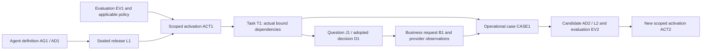

# NGA Core Objects and Cross-Plane Handoff Contracts

> Date: 2026-10-30.
> Status: concrete logical-contract proposal and illustrative traces; not an implemented schema, actual deployment or executed acceptance report. AQ items remain OPEN.
> Established boundaries: agent evolution integrates three lifecycle states and four planes; customer primitives are extensible; NGA calls business capabilities; the provider owns its domain records and execution.
> Basis: [integrated review](22-integrated-lifecycle-and-plane-review.md), [runtime/extension contracts](21-runtime-primitives-and-capability-contracts.md), [identity analysis](20-task-decision-request-identity.md), and [discussion register](16-architecture-discussion-register.md).

## 1. Object model and the authority split

Use four core object families: **AgentDefinition**, **ReleaseManifest**, **Task** and **OperationalCase**. Add an explicit **ActivationBinding** between a release and its eligible task scope. Evaluation records, decisions, business requests and observations are referenced supporting objects rather than fields that can be overwritten to summarize away their history.

The distinction is essential: a release describes immutable content; activation describes where and when that content may be used. One release can be active for one customer scope and unqualified or withdrawn for another. A global `published=true` on the release cannot express that contract.

Names and fields below describe information obligations, not database tables, REST routes, message formats or mandatory microservices. The four planes are responsibility boundaries; they are not four permission roles or four copies of the state.

## 2. Core object contracts

### 2.1 AgentDefinition: maintained business capability and behavior

| Logical field | Meaning and ownership |
| --- | --- |
| `agent_id`, `definition_revision`, `owner_scope` | Stable agent identity plus a particular definition revision and owning customer/organization namespace. |
| `business_objective`, `task_completion_contract` | Intended useful outcome, supported task scope, and what completion/refusal/waiting mean. Owned by the accountable business authority, maintained through management capabilities. |
| `delegated_judgments` | Questions NGA may decide, semantic specification references, result types and adoption-policy requirements. Existing IT decisions remain with their provider unless explicitly delegated. |
| `capability_requirements` | Needed business APIs and their effect, authority, completion and recovery requirements; unsupported guarantees remain explicit. |
| `behavior_refs` | Model/readout, prompts where used, evidence/context policy, Workflow/Graph/Loop definitions, default/customer primitive definitions and interaction/status mapping. |
| `configuration_contract` | Configurable fields, admitted ranges or selection rules, namespace/dependency resolution and which changes require a new revision. No credential values are embedded in the definition. |
| `qualification_plan` | Required fixtures and business/consistency/recovery comparisons, expected distinctions and declared supported scope. Thresholds are supplied through the relevant agreed policy, not invented here. |
| `authorship_and_lineage` | Author, accountable owner, prior revision, change rationale and originating case/candidate references. |

**Lifecycle:** an editable draft has an expected revision/generation. Sealing creates an immutable definition revision. Editing its material meaning creates another draft/revision; it does not alter releases or tasks already bound to the sealed one. Abandonment/deprecation metadata preserves the underlying record while required by active work or retention.

Management accepts authorized draft edits and records/seals artifacts. Control enforces the applicable access/publication contract, but need not perform a separate global round trip for every editor keystroke. A sealed definition is not automatically executable and does not confer the API permissions it requests.

### 2.2 ReleaseManifest: exact compatible content and supporting evidence

| Logical field | Meaning and ownership |
| --- | --- |
| `release_id`, `agent_id`, `definition_ref` | L1 belongs to AG1 and identifies sealed AD1. |
| `artifact_bindings` | Exact resolved model/readout, semantic, workflow, primitive implementation/configuration, adapter, context and interaction definitions actually proposed for use. Material content and retrievable artifacts accompany integrity references; a digest alone is not replay content. |
| `dependency_closure`, `runtime_requirements` | Compatible resolved dependencies, checkpoint/configuration expectations and required executor capabilities. A manifest may reference independently deployed components. |
| `supported_scope`, `capability_assumptions` | Where the release has been assessed and what public API contracts it relies on. Assumptions do not grant provider or caller rights. |
| `qualification_records` | Associated evaluation records keyed to immutable tested manifest identity, fixture/version and limitations; judgments of suitability refer to target scope and governing policy. These records are outside the sealed manifest content. |
| `change_lineage`, `compatibility_notes` | Previous release, candidate/case references, preserved or intentionally changed behavior, and available migration/recovery compatibility evidence. |
| `custodian`, `retention_and_retirement_refs` | Maintainer and plans for active dependencies, audit/replay availability and eventual retirement. |

Seal the manifest before the evaluation that claims to qualify it. A material dependency change creates L2 and needs evidence applicable to L2; it cannot reuse EV1 as though EV1 tested the modified manifest. Evaluation records can accumulate without mutating the tested release content.

The release view combines sealed manifest content with separately associated evaluation and lifecycle records. Adding EV1, an activation receipt or retirement metadata does not change the content EV1 tested or create a circular manifest/evaluation identity. Updates to associated records remain attributable and cannot replace the sealed artifacts or raw evaluation evidence.

Distinguish **candidate recorded**, **evaluation completed**, **suitability assessed for a scope**, **activated for a scope**, and **retired under a retention plan**. Evaluation completion does not imply passing or activation. Suitability is not an unconditional global boolean: a different scope, policy or capability assumption can require additional evidence.

Management maintains the manifest and raw qualification references. It cannot make a release effective merely by editing a catalog label. A failed or inconclusive run remains part of the evidence rather than being replaced with a success summary.

### 2.3 ActivationBinding: scoped permission to select a release

| Logical field | Meaning |
| --- | --- |
| `activation_id`, `agent_id`, `binding_scope` | ACT1 names the controlled agent/customer/workload selection scope. Overlapping selectors require a declared resolution rule. |
| `release_ref`, `release_content_ref` | Exact L1 to which the admitted activation applies. |
| `expected_binding_generation`, `new_generation` | The current binding expected by the command and the resulting effective generation, preventing silent competing publication. |
| `effective_conditions` | Admitted time/selection/readiness conditions, rollout scope and any expiry or withdrawal conditions. |
| `active_task_policy` | What happens to existing tasks: preserve their binding, migrate through an identified procedure, hold, or another explicitly supported disposition. |
| `authorization_basis` | Requesting principal, publication authority, applicable control-policy version, evaluation/compatibility evidence and decision rationale. |
| `activation_state`, `transition_history` | Requested/pending readiness or scheduling, effective, draining/withdrawn, with the actual transition receipts and previous binding. These labels are illustrative; their meanings must remain distinct. |

Control admits activation using **currently authoritative policy and permissions**, not a permissive policy bundled by the candidate itself. Where readiness is required, accepting the request produces pending activation until the requirement is established. It does not justify displaying the release as effective immediately.

Before a pending or scheduled activation actually becomes effective, recheck its expected binding generation and applicable current authority/policy/readiness. An earlier acceptance does not reserve unlimited future permission or allow a stale publication to overwrite a newer effective binding.

New task admission resolves an authoritative eligible binding/generation. Catalog, routing and UI views can be projections, but a stale projection cannot independently authorize a new task under a superseded binding. The implementation must qualify its consistency/freshness mechanism; this design does not assume every replica changes atomically.

Existing tasks retain their actual release/configuration unless an explicit task migration is admitted. Withdrawal can stop new admissions without undoing previous work. Changing routing, stopping execution, migrating a wait and compensating an external effect are separate actions.

### 2.4 Task: identified work, actual bindings and completion obligations

| Logical field | Meaning and owner of the evidence |
| --- | --- |
| `task_id`, `owner_scope`, `caller_ref`, `intent_ref` | T1's admitted intent and access scope; duplicate create/resume requests resolve it under the identity contract. |
| `objective_and_completion`, `material_input_revisions` | The promised task outcome and admitted input/amendment history. Same customer or text alone does not establish the same task. |
| `activation_ref`, `release_ref`, `actual_dependency_refs` | ACT1/L1 and definitions/configuration actually consumed, including admitted later migrations. |
| `task_generation`, `execution_mode`, `run_refs` | Current controlled task generation and separately identified runs; live execution, historical replay and candidate evaluation have different effect authority. A restart does not create new business intent. |
| `decision_refs`, `plan_refs` | J1/D1 and any D2, plan revisions and supporting evidence; model observations remain distinct from adopted results. |
| `operation_refs`, `provider_application_refs` | B1, attempt histories, provider identities and raw/validated observations. NGA task identity is not automatically the provider application identity. |
| `wait_timer_child_refs` | Bound continuation, timer, custom-primitive and child-workflow state needed to resume under the actual contract. |
| `authority_and_budget_refs` | Applicable scopes and limits, current enforcement references and historical evidence; pinned content does not preserve revoked rights. |
| `completion_and_recovery` | Task progress, local decision status, provider outcomes and outstanding recovery obligations, with named logical ownership or an admitted handoff. |

An illustrative progression is **admitted → running ↔ waiting/resolving → completed**. Completion follows the task's declared promise, not worker exit. An explicitly closed or handed-off task must preserve outstanding external-operation obligations and their receiving owner. A provider refusal can complete an application-processing task; a timeout cannot be relabeled as that refusal.

Control owns the effective NGA transition contract; runtime produces actual model, tool and event observations. Neither management nor a console operator can directly set T1's provider outcome to approved, canceled or compensated. A supported correction is a new attributable operation/event, not a historical rewrite. Conflicting provider evidence remains explicit until resolved under the capability contract.

### 2.5 OperationalCase: evidence, attribution and improvement lineage

| Logical field | Meaning |
| --- | --- |
| `case_id`, `owner_scope`, `reporter_and_owner` | CASE1's identity, visibility scope, source and accountable handling owner. |
| `related_refs` | Affected agents, release/activation/task/decision/request records and provider references. One case may concern many tasks; those tasks retain their identities. |
| `reported_symptom`, `observed_evidence` | Separate user reports, preserved observations and any missing/unavailable evidence. |
| `attribution_hypotheses`, `findings` | Distinguish proposed causes from supported findings; preserve revisions, contributor and evidence links. |
| `impact_and_scope` | What is actually observed, what remains uncertain and which populations/time periods are covered. No invented effect estimate or counterfactual outcome. |
| `recovery_refs`, `change_candidates` | Immediate task recovery and reusable changes tracked independently. Creating a case does not authorize either. |
| `evaluation_and_release_refs` | Candidate evaluation, activation and subsequent observations relevant to resolution. |
| `resolution_criteria`, `resolution_history` | Agreed case closure/reopening basis and retained unresolved obligations. |

A proposed lifecycle is **reported → triaged → investigated → action/review → resolved, no-change or explicitly deferred**, with reopening preserved. Case closure does not prove every related task succeeded or every operation was reversed. Closing the issue must not orphan recovery obligations.

Management maintains the case record under scoped permissions. Raw task/provider evidence remains attributable to its source. S2 can propose attribution or a fix; Jev can judge a defined semantic question. Neither turns a complaint into an established defect or a training label by itself. Dataset/label admission follows its own evidence and authority contract.

## 3. Management versus control: concrete authority boundaries

| Action | Management responsibility | Control responsibility / remaining authority |
| --- | --- | --- |
| Edit a definition or import a package | Store an authorized draft/candidate, namespace, dependencies and owner intent. | Enforce applicable edit/import scope; no implicit live execution or privilege expansion. |
| Seal a definition/manifest | Preserve exact content and lineage; register the sealed candidate. | Apply required sealing/admission policy where applicable; sealing alone grants no activation. |
| Run qualification | Supply the exact candidate and comparison plan; retain genuine outputs. | Admit the evaluation mode, data/effect scope and resources; runtime produces results. Management cannot replace failed observations. |
| Activate or withdraw a release | Propose scope, rollout and active-task treatment; show the resulting status. | Validate publication authority, current policy, evidence, compatibility and expected generation; issue the authoritative activation/withdrawal receipt. |
| Change a control policy | Maintain a new policy candidate with its author and rationale. | Evaluate authority under the currently effective governance policy; the proposed policy cannot authorize itself. Initial governance authority is an explicit deployment prerequisite. |
| Display task or release status | Provide projections with source binding/generation or freshness metadata as needed. | Supply effective transition evidence; stale display data does not grant execution authority. |
| Pause, resume, cancel or compensate | Submit a typed operational request and preserve its references. | Admit the action under current authority; runtime invokes supported capabilities; the provider confirms external outcomes. |
| Modify past business facts | Preserve correction proposals and source evidence. | No plane gains permission to falsify historical facts. Qualified new observations/corrective business operations preserve the old record. |

The requesting person/service may have several roles; four planes do not require four different people or mandatory human approval. The authoritative permission is attached to the principal, action, object and scope, not to whichever screen or component sent the command. Separation of author/publisher roles is a configurable governance policy, not assumed universally here.

Control applies authorized business and governance meaning; it does not invent lending rules or silently substitute its own model judgment. Management can publish permitted policy proposals through that contract. This keeps policy configurable while preserving an identifiable source of effective authority.

## 4. Handoff envelopes and observable outcomes

### 4.1 Common command and observation information

| Command information | Required meaning |
| --- | --- |
| `command_id`, action and scoped caller | Stable identity for one requested transition; authenticated principal and any delegation are checked independently of the caller's plane label. |
| Target and expected generation | Object/revision being changed and the state the requester relied on; mismatches produce a conflict or explicitly permitted resolution, not last-writer-wins publication. |
| Material payload and dependency references | Exact proposed content/selection, linked intent/case/evaluation and contract versions. Same command ID with different material intent is a conflict. |
| Execution/publication scope and policy references | Desired scope, mode, validity and required evidence. The caller's references do not replace resolution of currently authoritative policy. |
| Correlation and outcome references | Parent/cause, transition receipt, resulting generation and any asynchronous work/wait reference. |

Command receipt, admission, effective transition and external completion are distinct outcomes. Responses expose the appropriate state: recorded, pending, effective/completed within its declared boundary, rejected, conflict or unresolved. The exact wire enumeration remains open.

A duplicate unchanged command returns its original receipt/work reference and, separately, current status. It does not repeat activation/effects or regain revoked permission. Access to those records still requires current authorization. A genuine new intent can receive its own command identity under the task/operation identity rules.

Observations are a separate evidence path: producer/provider, operation/invocation reference, authenticated source, actual content/artifact reference, source version/order where available and observed time. They can inform a transition but are not authority-bearing commands merely because they contain words such as approved. Preserve raw and normalized forms where required for the claimed audit scope.

### 4.2 Seven handoff families from document 22

| Handoff | Material request | Checks and responsible boundary | Receipt / durable result |
| --- | --- | --- | --- |
| **RegisterCandidate** | Agent/definition revision, sealed content or authorized draft, package dependencies, owning scope and change rationale. | Management records under edit/import authority; validate identity and expected draft generation. No activation implied. | Candidate/definition/release reference, recorded generation and qualification gaps. |
| **EvaluateCandidate** | Sealed manifest, fixture/comparison version, data/effect mode, evaluation policy and resource scope. | Control admits the job; runtime executes; management retains raw observations, tested content identity and limits. | Evaluation-run identity and pending/result records; completed execution is not a pass or release activation. |
| **ActivateRelease** | L1, target binding scope, expected binding generation, qualification references, rollout/readiness and active-task policy. | Control checks current publication authority, policy applicability, exact tested dependencies and scope compatibility. | ACT1 or pending/rejected/conflict receipt; effective binding generation only when conditions hold. |
| **StartOrResumeTask** | Intent/task reference, authorized caller, material inputs, objective and completion contract. | Resolve the eligible activation and task identity; control admits T1 or returns the existing task/conflict. | T1, actual binding and initial/current state; restart does not resolve latest and create new business requests. |
| **AdmitAndObserveWork** | A proposed transition/action with expected task generation, or a separately typed observation linked to its invocation. | Control validates transition eligibility/authority; runtime executes admitted work and supplies genuine observations. Provider outcomes retain their own authority. | Decision/plan/operation/continuation receipt or conflict, plus observation records. Commands and facts remain distinguishable within this interface family. |
| **OperateTask** | Target task/B1, typed requested action, expected relevant generation, recovery intent and qualified procedure. | Control checks current rights, actual request phase and supported capability; runtime executes/awaits it. | Linked recovery operation and pending/confirmed/partial/unresolved outcome; no direct status editing. |
| **RecordCaseAndProposeChange** | Report/evidence references, attribution hypothesis, ownership, proposed changed artifact and intended distinction. | Management records scoped case/candidate lineage; control separately admits any evaluation, live action or publication. | CASE1 and candidate/recovery references, with evidence/claim status; no automatic training label or activation. |

These handoffs may be implemented in one application or through multiple processes. The contract requires attributable effective transitions and coherent observations; it does not prescribe one centralized service call for every local step.

## 5. Publication sequence and its failure boundaries

1. Management seals AD1 and L1. The exact artifacts to be evaluated are known.
2. An authorized EvaluateCandidate command starts EV1 in its declared evaluation scope. Runtime produces evidence; management retains it without modifying its conclusions.
3. A publication request names L1, EV1, target scope SCOPE1, expected binding generation G0 and treatment of existing tasks. Required owner reviews may be evidence under the configured policy, but no universal human step is added.
4. Control checks the caller's publication authority and current governance policy, suitability of the actual evidence for L1/SCOPE1, compatibility and any readiness conditions. Missing conditions yield pending/hold/rejection as declared.
5. Control commits ACT1 at G1 when eligible. Management's catalog, runtime task-admission view and user-facing status reference that same receipt. If another publication changed G0 first, the stale request cannot silently overwrite it.
6. New T1 is admitted against the eligible ACT1/L1. Running tasks remain on their bound versions unless a separately admitted migration changes their dependency history.

If the activation response is lost, repeating the same command resolves ACT1; it does not create another independent activation. If a UI cache still shows the old binding, task admission uses the qualified effective binding rather than trusting the display. If the publication request reaches control after authority revocation, a candidate's stored permission claim cannot authorize it.

No atomic transaction across all views, executors and provider systems is assumed. Implementations must demonstrate the promised activation/admission consistency and state any bounded-staleness behavior. A physical deployment rollback and a business compensation remain separate even if triggered by the same incident.

### 5.1 Concrete logical command/receipt examples

These are illustrative values in format-neutral notation. The examples assume an authenticated principal whose existing publication authority covers the requested action and scope; a self-declared caller field is not authorization.

| Command/event | Material content | Expected response under the stated conditions |
| --- | --- | --- |
| `ActivateRelease PUB1` | Target `(AG1, SCOPE1)`; expected generation `G0`; release `L1`; evidence `EV1`; active tasks retain their binding. | If checks/readiness hold: receipt for `ACT1`, effective generation `G1`, exact `L1` and scope. If readiness is pending: a pending work/activation reference, not an effective-generation claim. |
| Redeliver `PUB1` unchanged | Same target, release and material publication intent. | Original receipt/work reference plus separately labeled current status; no second activation. |
| Reuse `PUB1` with `release=L2` | Command identity is unchanged but material intent differs. | Payload conflict; not a publication retry. |
| `ActivateRelease PUB2` after ACT1 | Still expects `G0`, even if its caller has publication permission. | Generation conflict or an explicitly admitted resolution path; permission does not silently overwrite `G1`. |
| New authorized `PUB3` | Target `(AG1, SCOPE1)`; expected `G1`; `L2` with applicable `EV2` and active-task policy. | When its own checks hold: `ACT2/G2`; existing T1 keeps its actual binding unless a separate admitted migration applies. |

## 6. Credit fixture: development through evolution

Everything in this section is an illustrative design trace, not a report of existing bank APIs, measured model behavior or executed tests. Reuse the established rule/evidence conventions only within their specified scope. Assume a qualified Jev model and an API that explicitly accepts the delegated judgment artifact; otherwise the provider-owned judgment arrangement from document 19 applies.

### 6.1 Define and qualify AG1 / AD1 / L1

The illustrative agent AG1 assists an identified unsecured-credit application. Its task promises preparation, a delegated eligibility/amount judgment, permitted submission and reporting of the provider's terminal application outcome. It does not promise disbursement or maintain a credit ledger.

Business authors supply semantic specification R1 and evidence contract EC1. In the covered fixture, assets of 40 million in the specified unit, no required recent overdue condition and no historical veto produce USD 50,000. A covered low-asset fixture yields USD 10,000; a qualifying historical veto yields refusal. Missing evidence or undefined meaning follows the stipulated unresolved path. These examples do not fill unspecified banking conventions by inference.

AD1 references Jev/readout M1, Workflow WF1, waiting primitive PWait1, provider contract API1, evidence policy EC1 and interaction/status definition UI1. PWait1 can be a customer-imported implementation under the common contract; no industry-specific timer is imposed by this example. Sealed L1 resolves their actual versions and configurations.

EV1 is the planned qualification run for this exact manifest: valid grant/refusal, unresolved evidence, duplicate/resume, accepted-versus-terminal status, waiting/recovery and declared extension behavior. Actual run evidence would be required by the publication policy; this document supplies the trace and proposed checks rather than claiming EV1 ran successfully.

### 6.2 Admit scoped publication

For the illustrative continuation, suppose the required qualification and publication conditions have been met. Management proposes L1 for scope SCOPE1 with expected binding G0. An authorized publisher may request this through the user or management API; the screen used is irrelevant to its permission.

Control produces ACT1/G1 after checking the applicable policy and evidence. The published view points to ACT1. Copying L1 into another customer's catalog or changing its display label would not make it active there. That scope needs its own eligible activation and authority.

### 6.3 Run T1 / D1 / B1 and wait normally

| Trace item | Bound content / observable result |
| --- | --- |
| T1 admission | Intent I1, scope SCOPE1, ACT1/G1, L1/AD1 and the promised terminal application outcome. |
| J1/D1 | R1 + EC1 + actual evidence E1/reference time + M1; Jev's typed observation is adopted under the declared policy as eligibility with USD 50,000. |
| B1 admission | Qualified API1 operation, fixed material application input and required D1 artifact, target/principal and request identity. |
| Provider acceptance | Provider reference APP1 and accepted/pending observation OBS1. T1 becomes waiting; this is not approval or completion. |
| Waiting | PWait1/version/configuration, correlated completion predicate, timers and continuation are retained. No default model reevaluation or replacement request is started. |
| Terminal response | OBS2 confirms the provider's actual terminal application outcome. In the example it is approval; the workflow would also handle terminal refusal. |
| Task closure | Record the provider outcome and complete the application-processing promise. Do not infer disbursement or any additional effect. |

Runtime supplies the observations; control admits/records the relevant NGA transitions; management exposes the bound references; the user plane reports what actually happened. The provider's own total-limit/risk checks remain internal.

### 6.4 Operational case CASE1: distinguish a presentation defect from a decision defect

Consider a separate adversarial branch: a user reports that, while B1 was only accepted/pending, the UI displayed approved. The framework's recorded OBS1 still says pending and its wait remains active. This is an illustrative defect to investigate, not a default behavior or a claim about the current implementation.

Management records CASE1 linked to T1, L1, UI1, OBS1, the displayed output and the report time. S2 may propose hypotheses. Compare the actual provider observation, normalization, controlled task state and presentation rule. If evidence identifies UI1's mapping as the cause, record that finding; do not call Jev inconsistent or alter D1 to explain the wrong display.

The immediate handling preserves B1 and its wait, supplies an accurate current status through an authorized view/action, and retains evidence of the earlier misleading display. It does not cancel, retry or compensate B1 merely because the display was wrong. If a distinct business recovery is actually requested, OperateTask applies its own scope and API contract.

### 6.5 Improve the reusable definition and release L2

Create AD2/L2 with corrected interaction mapping UI2 and CASE1 lineage. Keep R1, M1, WF1, PWait1 and API1 unchanged unless the evidence supports another change. This is an interaction/integration improvement candidate, not automatic model retraining.

EV2 compares the corrected behavior for pending, terminal approval, terminal refusal, timeout and cancellation-requested-versus-confirmed observations, including duplicates and late events. It also checks that B1's decision/effect paths remain unchanged. Historical replay of L1/UI1 reproduces the recorded history; reevaluation with UI2 is explicitly a candidate comparison and may differ in the intended display.

After the required evidence and policy conditions hold, control can admit ACT2/G2 for new task selection. Existing T1 retains its actual dependencies unless an explicit compatibility/migration policy authorizes a view or implementation update. Even a view-only update is attributable and cannot rewrite what the user previously saw. ACT2 does not resend B1 or change a completed business outcome.

CASE1 closes only against its recorded resolution criteria and follow-up evidence, or remains open/deferred with an owner. Publishing L2 alone is not proof of improved real outcomes. Any unresolved task recovery remains separately owned. The complete path crosses development, publication, execution, operations and evolution without giving any plane unrestricted authority over the others' facts.

## 7. Cross-object and authority counterexamples

These are proposed acceptance cases, not executed checks:

| ID | Challenge | Required behavior / valid counterpart |
| --- | --- | --- |
| C01 | Management edits a dependency after EV1 | Material change creates a new manifest and applicable qualification; unchanged L1 can retain its genuine evidence. |
| C02 | Catalog sets L1 to published without ACT1 | No new task authority follows; an admitted activation can become effective normally. |
| C03 | Same L1 is used in two customer scopes | Separate applicable authority/bindings; valid reuse is possible without cross-scope permission inheritance. |
| C04 | Two publishers both rely on G0 | Admit the valid generation transition and expose conflict for stale publication; do not silently choose the last writer. |
| C05 | Activation receipt is lost | Same command resolves the original ACT1/result; changed material content under that command is a conflict. |
| C06 | Publication is accepted but readiness is incomplete | Report pending, not effective; recheck generation and current authority/conditions before later activation. |
| C07 | Candidate includes a policy granting its own author publish rights | Apply the currently authoritative governance contract; a properly authorized policy change remains possible. |
| C08 | UI or routing cache points to a withdrawn binding | Task admission checks the qualified effective binding/generation; stale display cannot authorize new execution. |
| C09 | Operator marks B1 canceled in a case record | Preserve actual provider status; an authorized supported cancellation uses its own operation and confirmation. |
| C10 | Task restart resolves the newest release | Resume actual L1/primitive/configuration or an explicit migration; new tasks may legitimately use L2. |
| C11 | A complaint becomes a model training label automatically | Keep report, hypothesis and evidence separate; qualified label admission can occur through its own process. |
| C12 | S2's confident diagnosis replaces raw EV1 or OBS1 | Preserve observations and attributed hypotheses; supported findings may lead to a new candidate. |
| C13 | Release withdrawal is treated as undoing B1 | Change eligible routing/active-task treatment only; any business correction has separate authority and API guarantees. |
| C14 | CASE1 closes while an external recovery remains unresolved | Retain a named recovery owner/handoff and truthful status; case bookkeeping cannot erase the obligation. |
| C15 | Historical replay uses UI2 and claims to reconstruct UI1 | Use original dependencies for historical fidelity; mark candidate reevaluation and its intended divergence separately. |
| C16 | The same person authors and publishes through different planes | Check actual policy and permissions, not plane labels; allow the combination where authorized and enforce separation where explicitly required. |

## 8. Decisions still open and next verification boundary

The main proposed refinement is **immutable definition/release content plus separately scoped activation**, with controlled task history and evidence-based cases. The owner has requested these contracts be made concrete; that request is not a claim that every field, state name or mechanism above is already approved.

To close the related AQ items, settle:

1. Logical object identifiers, required versus optional fields, draft/seal behavior and retention/reference obligations.
2. Scope/selector conflict rules, activation readiness and the promised freshness of task admission versus status projections.
3. Which principals may author, assess, activate, intervene and change governance policy; separation and automatic approval rules where applicable.
4. Compatible active-task/view migration, withdrawal and outstanding recovery ownership.
5. Case attribution/resolution and evaluation evidence needed for the first end-to-end fixture.

The next verification step is a contract fixture exercising commands, observations and expected state/receipt changes, with the positive and adversarial branches above. It can be designed independently of a particular storage engine, queue, network API, package format, workflow runtime or model-serving technology. No such implementation is claimed in this document.
