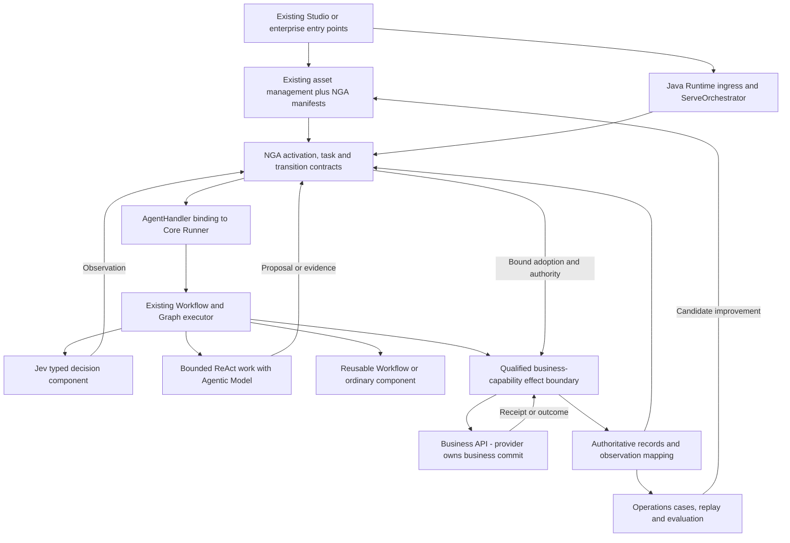

# NGA on openJiuwen — Reuse Boundaries and Incremental Evolution

> Date: 2026-10-30.
> Owner-established constraints: openJiuwen remains the engineering foundation; analyze the public Java implementation first; reuse existing components and capabilities, and keep necessary extensions componentized and pluggable.
> Status: source-backed architecture review and proposed integration path. No upstream build, runtime experiment, compatibility test or NGA integration implementation is claimed.
> Context: original V0 [brief](05-architecture-brief-and-decisions.md) and [diagrams](06-architecture-diagrams-md.md), current [V0.2](13-nga-architecture-v0.2.md), [primitives](21-runtime-primitives-and-capability-contracts.md), [integrated lifecycle](22-integrated-lifecycle-and-plane-review.md), and [core objects/handoffs](23-core-objects-and-plane-handoffs.md).

## 1. What is settled, and what this review proposes

**NGA evolves openJiuwen through reusable components and explicit contracts.** The graph engine, agent loop, tool infrastructure, persistence integration and workbench should start from openJiuwen's existing capabilities. NGA owns the meaning and enforcement of its decision, identity, authority, effect and evolution contracts; owning a contract does not require writing every component that implements it.

Settled requirements:

- Preserve the openJiuwen foundation and use its public Java line as this review's implementation reference. This narrows earlier statements that all runtime choices were open.
- Retain agent evolution across development/runtime/operations and user/runtime/management/control planes. These dimensions are logical responsibilities, not twelve services or four replacement platforms.
- Preserve decision consistency, request/effect idempotence, replay and audit, business API ownership, and configurable/importable/customer-extensible primitives.
- Prefer existing capabilities; necessary NGA development must have explicit component interfaces and replacement boundaries.

Proposed mechanisms, still subject to discussion and verification:

- Map NGA's admitted execution graph onto existing openJiuwen Workflow/Graph facilities, with bounded ReAct activity only where useful.
- Integrate Jev through a typed decision component and service adapter, separately from generative model invocation.
- Add a small set of NGA semantic/control components around the existing execution path; reuse existing stores, catalogs, authorization infrastructure and UI where qualified.
- Preserve one execution owner per scope. NGA controls eligibility and committed business-facing transitions; openJiuwen executes admitted work. Do not introduce a second scheduler that independently advances the same workflow.
- Extend through supported interfaces first. A missing public extension point may justify a narrow upstream contribution; a long-lived fork or second engine needs specific evidence, not a general preference.

The public snapshots below are analysis baselines, not a production version selection. Actual deployment and artifact compatibility must be pinned before implementation.

## 2. Versioned evidence baseline

The source review follows the repositories' public default development branches at the time of inspection. Commit identifiers, rather than moving branch names or README examples, identify the evidence.

| Repository | Inspected revision | Evidence and limits |
| --- | --- | --- |
| openJiuwen Java Core | `develop`, `46673c69333a702d74923ca03caf7e0649132286` | Root reactor POM is `0.1.17`, with `core`, `retrieval`, and `memory` modules. The README still illustrates `0.1.12` and an older directory layout. Use the pinned POM/source, not that example, for compatibility analysis. [POM][core-pom], [README][core-readme]. |
| openJiuwen Java Runtime | `develop`, `a6d6216f29914105c29565ff34054da3aff6d6f4` | POM revision `0.1.4` references Core `0.1.17`. Agent Server is delivered under `service`; Runtime Manager remains planned. Matching version declarations are not an executed compatibility result. [POM][runtime-pom], [scope][runtime-readme]. |
| openJiuwen Studio | `studio-2.0-dev`, `5d5ef53bdd15f88cb9b96bcabe028f4e27d62f95` | Current architecture documents an Angular console, Java manager, Python runtime and Python builder; Beta5 removed earlier Java execution modules. It is not automatically a Java Core/Runtime frontend. [Architecture][studio-architecture]. |

Python Core is a sibling implementation, not evidence that Java has every Python feature. Studio is included to identify reuse opportunities and integration discontinuities, not to prescribe a wholesale Studio upgrade or runtime switch.

Evidence labels used below: **source inspected** means the named implementation/interface was read; **documented** means an upstream architecture statement; **proposed** means NGA's interpretation or required extension. An unverified NGA guarantee is not a claim that the upstream product cannot implement it.

## 3. What openJiuwen already supplies

| Area | Current evidence | NGA implication |
| --- | --- | --- |
| Workflow and Graph | **Source inspected:** `Workflow` exposes component registration, ordinary/conditional connections and sub-workflow invocation. `WorkflowComponent` registers an executable node. `PregelGraph` builds nodes, edges, branches and barrier groups into a compiled executor. [Workflow][workflow], [component][component], [PregelGraph][pregel]. | Reuse graph execution and composition. NGA adds admitted graph versions, typed decision boundaries and binding validation; a new graph executor is not the default work item. |
| Agent Loop and Workflow coexistence | **Source inspected:** current `singleagent.agents.ReActAgent` provides model calls, tool execution, interrupt/resume handling and workflow-related interruption handling. `AbilityManager` carries tools, workflows and agents. [ReActAgent][react], [AbilityManager][ability]. | Keep bounded generative work inside the existing loop. Reuse workflow invocation where its child identity and recovery behavior satisfy NGA contracts; every node need not contain a loop. |
| Rail extensions | **Source inspected:** `AgentRail` has invocation, model, tool and task-iteration hooks. `AbilityManager` runs tool execution through Rails and applies input rewrites before actual execution. [AgentRail][rail], [execution path][ability]. | Rails are useful for context binding, observation and checks. The final admitted effect payload must still be checked after all permitted rewrites. A hook name is not proof of complete mediation or tamper resistance. |
| Tool invocation | **Source inspected:** `Tool.invoke` supports input preparation, lifecycle callbacks, the actual invocation and output transformation. [Tool][tool]. | Reuse tool/provider integrations behind a qualified business-capability wrapper. Preserve raw observations separately from presentation transformations. Cover direct workflow/tool/remote invocation paths as well as ReAct. |
| Persistence and recovery | **Source inspected:** Checkpointer has agent/workflow/graph state and step-cursor hooks. The factory supports provider registration/discovery and defaults to in-memory storage without an installed alternative. Recovery consults a hook for leftover running work and otherwise returns a lost classification. [Checkpointer][checkpointer], [factory][checkpointer-factory], [recovery][step-recovery]. | Reuse the persistence SPI and recovery entry points. Explicitly select/configure durable storage and test restart behavior. A lost engine step cannot decide whether an external business operation failed. |
| Step journal | **Source inspected:** StepJournal provides append/replay/retention operations, but its contract permits loss of the audit tail and requires storage failures not to interrupt execution. [StepJournal][step-journal]. | Useful operational telemetry; insufficient as the sole authoritative record for decision adoption or effect dispatch. NGA needs a qualified durable commit path for consequential records, using existing persistence where possible. |
| Service integration | **Documented and interface inspected:** Java Runtime's path is controller → ServeOrchestrator → AgentHandler → Core Runner. AgentHandler has query/stream and request-resource lifecycle methods. [Runtime][runtime-readme], [AgentHandler][handler]. | Preserve ingress/orchestrator/handler responsibilities. Add task/activation binding at these boundaries without making controllers bypass the orchestrator or treating a conversation as a business task. |
| External-call controls | **Source inspected:** ExternalCallExecutor accepts retry eligibility, retry/timeout policy and a callable; ExternalRetryPolicy defaults to zero retries. Rails also supports callback-requested retries. [Executor][external-executor], [retry policy][external-retry], [Rails][rails]. | Configure existing mechanisms under one declared operation policy and budget. Nested retries must preserve B1 and its payload and must not multiply independent retry budgets. Local timeout/interrupt remains distinct from provider cancellation. |
| Workbench assets | **Documented:** Studio supplies agent/workflow authoring and management, resource management, interaction and publication-related surfaces; its deployment crosses Java and Python. [Studio architecture][studio-architecture]. | Reuse screens/assets/services after validating the selected Java execution bridge. Existing publication and version records require mapping to L1/ACT1, not assumption of equivalence. |
| Evolution tooling | **Source inspected:** Java Core has a case/prediction evaluator interface and an EvolutionStore for skill evolution records. [Evaluator][evaluator], [EvolutionStore][evolution-store]. | Reuse applicable evaluation and artifact-handling components. These are not automatically NGA's cross-plane improvement lifecycle, Jev consistency protocol, case adjudication or release authority. |

## 4. Corrections to V0 and our later drafts

V0 already says it enhances openJiuwen, does not create a new platform, and reuses enterprise identity and external package conventions. Retain that intent. Preserve 05/06 as source snapshots; their original implementation claims and uniqueness claims remain unverified in NGA.

| Finding | Adversarial challenge | Required correction |
| --- | --- | --- |
| R01 — An abstract framework can become an accidental replacement platform | Documents 13–23 name many useful objects and primitives; implementing a new engine, registry and UI for each would defeat the base constraint. | Add an explicit reuse mapping before implementing a logical contract. Define the smallest NGA extension after inspecting the existing capability. |
| R02 — Java ecosystem components do not automatically form one current Java stack | Selecting today's Studio and Java Runtime together may combine incompatible execution/publish paths. | Version the Studio-to-Java bridge and its serialized workflow, asset, session and result mappings. Do not infer compatibility from the shared project name. |
| R03 — V0's compiled graph is not a business authorization boundary | A compiled executor can still run an unqualified tool, mutable resource or rewritten payload. Source-level graph compilation alone does not prove immutable admitted meaning. | Bind executable artifacts and allowed transitions to a release; validate final effect arguments and authority at dispatch. Graph freezing and authorization are separate obligations. |
| R04 — “Deterministic control” can incorrectly exclude useful Jev decisions | If only handwritten rule code may affect an outcome, Jev becomes a decorative score. If Jev can directly jump or execute, control is lost. | Jev supplies the substantive typed semantic judgment within its delegated scope; published policy and framework validation govern adoption, allowed transitions and effects. |
| R05 — A conversation, engine checkpoint or A2A task may be mistaken for T1 | One conversation can contain several tasks; recovery can create another engine attempt for the same T1/B1. | Maintain explicit mappings among conversation, T1, decision question/revision, B1, engine run/child scope and external receipt. Reuse native identifiers without making them equivalent by naming. |
| R06 — Observability can be mistaken for mandatory audit evidence | StepJournal can lose a tail by design; callbacks can run after the operation has already completed. | Persist decision/adoption/request intent through the qualified authoritative path before effects. Retain observed receipts and recovery obligations. Export telemetry as a projection; do not change a best-effort callback contract into an implicit transactional promise. |
| R07 — Recovery mechanisms can be mistaken for external rollback | Restart recovery, a local interrupt or session reset says nothing conclusive about the business provider's state. | Preserve B1, wait/query under its capability contract, and distinguish engine status from provider outcome. Cancel/compensate requires supported business capabilities. |
| R08 — “Pluggable” can become a bypass or migration promise | A custom Rail rewrites an approved amount; a new Checkpointer loads an incompatible snapshot; an optimizer replaces an active artifact. | Qualify extensions against shared authority/identity/effect contracts, pin the actual implementation, and make live migration explicit. Pluggability does not grant arbitrary authority or checkpoint interchangeability. |

## 5. Reuse allocation and bounded NGA development

Use this order: **reuse as supplied → configure → adapt/compose → contribute a missing extension upstream → implement an isolated NGA-specific component**. Reuse is judged by semantic fit, maintenance and operational cost, not by the fewest new lines or largest dependency inventory.

| Responsibility | Preferred route | NGA-specific contract or remaining evidence |
| --- | --- | --- |
| Graph scheduling, branching, joins and nested workflows | Reuse Workflow/PregelGraph and existing components. | Release/plan binding, admissible edges, child identity and model-observation consumption. |
| Generative reasoning and workflow discovery/invocation | Configure ReAct and registered capabilities; use Rails where applicable. | Bounded scope, proposal/adoption separation, request continuity and escalation behavior. |
| Jev inference and readout | Adapt a model service through a typed Workflow component or registered capability. | Specification/evidence/model/readout references, typed result, unknown handling and consistency qualification. Do not force logits/readout through a chat-message parser merely to fit an LLM interface. |
| Business API calls | Compose existing Tool/REST/MCP/remote adapters behind a qualified effect boundary. | B1 identity, frozen normalized payload, outcome mapping, idempotency retention, supported wait/query/cancel/compensation. Transport protocol alone is insufficient. |
| Await, timers and restart continuation | Reuse Checkpointer/session/recovery facilities and available scheduling/event infrastructure. | Durable subscription/correlation/deadline, restart redelivery, duplicate handling and one completion transition. This review has not established a complete durable timer service. No sleeping thread is presumed to satisfy this contract. |
| Identity, access, secrets and policy execution | Integrate enterprise services and existing Runtime adapters; retain V0's no-new-identity-platform principle. | Scoped principal/authority mapping, delegation limits, revocation and final effect enforcement. A model does not issue its own permission. |
| Decision adoption, effective activation and request continuity | Extend existing persistence/services with small NGA contract components. | D1/B1/ACT1 transitions and conflict checks; commit/recovery protocol across execution checkpoints and authoritative records. A separate database or service is not mandated. |
| Audit and replay | Reuse storage, observability and checkpoint infrastructure through evidence adapters. | Complete required records, preserved artifacts/observations, retention, integrity, access and isolated replay. A trace ID alone is not a replay basis. |
| AgentDefinition and ReleaseManifest | Reuse Studio/catalog artifacts and version references with additive metadata or companion manifests. | Complete immutable dependency binding, compatibility digest and independent qualification records. Avoid cloning catalogs already present. |
| ActivationBinding | Integrate existing publish/routing operations with the effective activation contract. | Scope, generation conflict, readiness, authority and command/receipt identity. A catalog's “published” flag is not enough evidence. |
| OperationalCase and agent evolution | Reuse issue/case workflows, evaluation tools and artifact stores. | Attributed problem → hypothesis → candidate → independent evaluation → controlled promotion → measured outcome. Reuse an enterprise case system if suitable. |
| Customer primitive packages | Map to existing components, Rails, tools, providers and workflow composition. | Versioned primitive semantics, declared custom states/events, resource scope and qualification. The six default primitive families are not a closed type system. |

A new component proposal should name its existing-component alternative, demonstrated contract gap, extension interface, state owner, failure behavior, compatibility/exit path and acceptance case. This is an engineering record, not a new mandatory human approval ceremony. Componentization can be a library, module or adapter in the existing process; it does not imply microservices.

## 6. Proposed composition and control ownership

This is a proposed responsibility view, not a deployment diagram or evidence that today's Studio invokes Java Runtime without an adapter. Existing Checkpointer/storage support the execution path; the integration must reconcile their checkpoints with NGA's authoritative transitions. It must not assume two independent writes are atomic or infer external failure from either store's lag.

**Graph, Agent Loop and Workflow are composable execution forms on the existing base.** A Workflow is an authored reusable execution unit; Graph is its execution/dependency representation; an Agent Loop is an adaptive computation that can occupy a bounded node or child scope. They are not three mandatory nested engines. A node can simply validate data, call Jev, execute a capability, wait, join, or call a child workflow.

For a semantic branch, use the sequence **capture basis → Jev observation → validate/adopt → select allowed transition**. The graph router consumes the recorded admitted result. Do not rerun Jev invisibly in a branch callback each time the scheduler reexamines an edge. Purely mechanical branches need no Jev call. S2 may identify a suitable registered workflow or propose a new plan; the framework binds the version and authority before execution. S2 does not install a new executable graph from generated text during an existing task without admission.

| Participant | May do | May not do |
| --- | --- | --- |
| Jev / S1 | Produce typed judgments about evidence, routing conditions, completeness or a delegated business decision under the bound specification. | Grant credentials, change rules, commit D1/B1, publish a version, or directly select an unadmitted effect. |
| Agentic Model / S2 | Investigate, request evidence, propose plans, select candidate capabilities/workflows, explain results and suggest revisions. | Rewrite adopted D1 or frozen B1, treat timeout as business failure, or promote its own candidate to production. |
| NGA contract components | Validate basis/authority/version, admit transitions and effects, preserve identities, apply wait/retry/recovery policy and maintain attributable records. | Invent missing business conventions, duplicate provider-internal banking logic, or report an unobserved external outcome as fact. |
| openJiuwen execution components | Schedule and execute admitted nodes/loops, manage sessions/context, invoke wrapped tools and support continuation through qualified storage. | Acquire business authority solely because work is runnable or a callback returned successfully. |
| Business provider | Apply its domain rules and commit/report its own business outcome through qualified APIs. | Be assumed to support cancellation, compensation or duplicate suppression unless the actual API contract supports them. |

### 6.1 Proposed extension interfaces

These are logical ports, not claims that upstream already publishes these names or a frozen Java API:

| Port | Required input/output | Likely integration surface |
| --- | --- | --- |
| Task/release binding | Principal/scope, intent identity, L1/ACT1 and generation → T1 plus execution binding/receipt. | Runtime orchestrator/AgentHandler composition and existing management services. |
| Typed judgment | J1, basis/specification/model/readout refs and permitted output type → observation with provenance/unknown state. | WorkflowComponent or registered capability with a Jev service adapter. |
| Adoption/transition | Expected state/generation, proposal/observation refs and current authority → committed D1/transition receipt or explicit conflict. | NGA semantic/control module using a qualified existing persistence service. |
| Business effect | T1/D1/B1, normalized operation/payload digest and permission → provider receipt/outcome or unresolved status. | Tool wrapper and Runtime outbound adapters; the final check follows any argument transformation. |
| Wait/recovery | B1, external correlation, event predicate/deadline and continuation binding → one attributable continuation or declared unresolved/recovery state. | Workflow component plus checkpoint/recovery/event/scheduling adapters. |
| Evidence/replay | Required record/artifact refs and mode → durable evidence receipt, faithful reconstruction, or explicit missing-evidence result. | Existing storage/telemetry exports with a qualified authoritative record path. |

Each implementation declares supported versions and capabilities, context propagation, state ownership, error/status mapping, cancellation scope, effect/replay behavior and replacement constraints. Replacing a tool adapter cannot alter B1's business meaning. Replacing a Checkpointer cannot silently migrate running tasks. Imported handlers can add industry states/events but cannot override core identity or authority guarantees.

## 7. One whole, three states and four planes on the existing base

| Plane | Development | Runtime | Operations |
| --- | --- | --- | --- |
| User | Reuse authoring and simulation surfaces; add business semantics, Jev outcomes and primitive configuration. | Reuse task interaction; distinguish proposal, adopted decision, pending provider response and business outcome. | Reuse case/review views; expose factual lineage and authorized recovery actions. |
| Management | Reuse catalogs/versioned assets; associate NGA definitions, manifests and qualification evidence. | Resolve the exact assets bound to ACT1/L1/T1; mutable aliases do not replace pinned content. | Maintain cases, retained artifacts, release history and improvement candidates. |
| Control | Enforce candidate evaluation isolation and release compatibility/admission. | Enforce effective activation, task/decision/effect transitions and operation policy at qualified boundaries. | Enforce intervention, revocation, isolated replay and promotion under current authority. |
| Runtime | Reuse Core/Runtime to execute simulations/evaluations with effects isolated. | Reuse Runner, Workflow/Graph, ReAct, tools, sessions and configured persistence. | Execute replay, diagnosis and authorized recovery; provide observations to cases/evaluations. |

Studio Manager is a product module; management plane is a responsibility. A controlled publication handler can be hosted in that module while performing a control-plane function. Likewise, a Rail runs inside a worker but does not become an independent authorization root. No plane's location or UI label grants privileges.

The seven handoffs in document 23 retain their meanings. Existing interfaces may carry them through adapters: RegisterCandidate and EvaluateCandidate attach to current asset/evaluation flows; ActivateRelease adds scoped effective binding; StartOrResumeTask binds Runtime requests; AdmitAndObserveWork connects graph/tool execution with authoritative records; OperateTask uses qualified intervention capabilities; RecordCaseAndProposeChange connects operations to development. A protocol mapping must preserve each command/receipt and fact boundary, not merely rename endpoints.

### Credit fixture through the complete lifecycle

1. **Develop:** maintain AG1/AD1 and the reviewed credit specification R1 using existing authoring/catalog capabilities. Explicitly resolve currency, precedence and undefined cases; do not reinterpret the example into a new bank-wide credit system. Register the Jev component, bounded S2 evidence workflow, business API wrapper and waiting primitive.
2. **Qualify and publish:** create L1 binding actual openJiuwen artifacts, graph/components, models, R1, API1 and primitive configuration. Existing evaluation tooling may execute EV1, but use NGA's useful-consistency and recovery cases. Management proposes; control admits scoped ACT1/G1. A Studio publication result must be mapped and checked, not presumed equivalent.
3. **Start and reason:** Runtime admission maps the interaction to T1, with independent conversation/run identifiers. Existing Graph runs evidence preparation; S2 can request missing evidence. Jev evaluates J1 against the fixed basis. A valid USD 50,000 observation under the reviewed rule becomes D1 only through the adoption contract; unresolved inputs follow declared handling.
4. **Invoke and wait:** a wrapped tool validates the final operation and amount, then dispatches B1 under the qualified API. The provider retains all internal credit constraints. The graph waits for the declared result; an acceptance receipt is not approval. Any transport retry keeps B1 and its normalized payload. New evidence is retained for the next declared boundary unless an admitted interruption applies.
5. **Complete or recover:** a correlated terminal provider observation advances T1 through the controlled transition. A restart uses the pinned implementation and recorded identity. A local lost step, timeout or canceled stream does not fabricate provider refusal or cancellation. Supported cancellation/compensation is a separate admitted business operation.
6. **Operate:** CASE1 links the actual task, decision, request, observations and UI behavior. Historical replay consumes recorded observations with business writes disabled. For the earlier “accepted displayed as approved” example, investigate the status mapping rather than automatically retraining Jev or canceling B1.
7. **Evolve:** fix the supported cause in AD2/L2, reuse evaluation infrastructure and admit ACT2 only under current publication policy. Existing T1 keeps L1 or an explicit qualified migration. Withdrawing ACT1 changes future eligibility, not the provider's completed effect.

## 8. Incremental evolution and rollback boundaries

| Stage | Additive work on openJiuwen | Exit evidence | Rollback / continuity |
| --- | --- | --- | --- |
| E0 — Pin and map | Select compatible Core/Runtime artifacts, identify the actual Studio/enterprise entry path, public extension points and existing storage/identity assets. Map V0 concepts to actual APIs. | Recorded dependency/artifact matrix, ingress and tool-path inventory, baseline behavior and checkpoint/serialization boundaries. | No production mutation is implied by this review. Preserve the existing deployment baseline. |
| E1 — Bind and observe | Add task/release/decision/request correlation and preserved basis/receipt metadata around existing workflows; build isolated replay fixtures. | Existing behavior remains attributable; identities survive restart/resume; required evidence is distinguished from best-effort telemetry. | Optional observational features can be disabled without deleting history. Do not advertise stronger guarantees before enforcement exists. |
| E2 — Govern one complete path | Add typed Jev component, adoption/effect wrappers and qualified wait/recovery for one credit fixture. Shadow decisions have no production effects; promotion to governed execution is explicit. | Positive and adversarial cases below, including useful approval/refusal, unknown handling, final payload binding and crash/retry recovery. | New admissions can revert to a qualified prior release. Already governed tasks remain pinned or explicitly migrated; never silently remove their enforcement. |
| E3 — Connect authoring, release and operations | Map Studio/enterprise assets to manifests and scoped activation; add cases, replay and candidate evaluation using existing services. | The full lifecycle in section 7, including stale publish/readiness conflicts and the UI-defect improvement case. | Preserve old asset readers and in-flight release support for the agreed retention period. Release withdrawal is not business rollback. |
| E4 — Broaden extension coverage | Import/configure customer primitives, integrate additional capabilities and contribute reusable missing public hooks upstream. | Compatibility and conformance suite for each supported base/adapter/primitive combination, including nested work and upgrade behavior. | Independent component rollback where qualified; checkpoint/data migration is explicit and reversible only where demonstrated. |

These stages prioritize evidence, not dates or a compulsory large platform rebuild. Model serving may remain a separate service regardless of the Java execution base. Storage, transport, policy tooling and packaging choices remain open within the foundation and compatibility constraints.

For waiting in particular, first prove what the selected openJiuwen configuration already supplies. If durable event/timer behavior is incomplete, add a bounded adapter to available enterprise infrastructure or a suitable existing component. Do not introduce a second workflow owner for the same T1 merely to obtain a timer. The missing guarantee and ownership handoff must be explicit.

## 9. Proposed adversarial acceptance cases

No cases below were executed in this review. They complement I01–I18, P01–P20, X01–X08, D01–D12 and C01–C16 in documents 20–23.

| ID | Challenge | Required behavior and useful counterpart |
| --- | --- | --- |
| OJ01 | Same conversation contains two tasks; one task is resumed from another execution attempt. | Preserve distinct task intents and stable T1/D1/B1 where appropriate; normal interaction remains usable. |
| OJ02 | A branch callback is evaluated twice during recovery. | Consume the same admitted decision for the same basis; a declared new basis can produce a linked new revision. |
| OJ03 | A Rail rewrites USD 50,000 to USD 60,000 after an earlier check. | Final dispatch rejects mismatch or requires a separately admitted revision; the unchanged authorized request succeeds. |
| OJ04 | A workflow, direct tool call or remote child bypasses ReAct Rails. | Every governed effect path still reaches a qualified boundary; permitted read-only/local computation need not take a central round trip. |
| OJ05 | StepJournal loses its last events or a trace exporter is unavailable. | Required adoption/request evidence remains durable or the consequential transition is not admitted; telemetry outage alone need not stop unrelated computation. |
| OJ06 | Provider accepted B1 but the worker crashes before its checkpoint/receipt is saved. | Restore the known intent and use the provider's qualified wait/query/idempotent retry contract; never create B2 merely because the checkpoint lagged. Test the no-dispatch crash counterpart too. |
| OJ07 | Rail retry, outbound retry and task recovery all activate. | One declared operation budget and fixed B1/payload; no retry multiplication. A safe transient failure can recover normally. |
| OJ08 | Timeout, stream disconnect, session reset or local recovery reports lost. | Preserve the distinction from provider outcome; verify retained evidence before any cleanup. A confirmed provider result can close the wait. |
| OJ09 | Duplicate/late events arrive after a durable wait or deadline resumes. | Correlate to the original wait/request, arbitrate one continuation and record the others without repeating the effect. Include restart while waiting. |
| OJ10 | Studio publishes an incompatible graph or updates an alias during T1. | Reject incompatible activation; preserve pinned T1 dependencies. A qualified new release can serve new tasks. |
| OJ11 | An imported primitive or Checkpointer changes state format or resumes using newer code. | Require declared compatibility/migration or retain the old implementation; do not claim arbitrary hot replacement. |
| OJ12 | An evolution optimizer replaces a skill used by an active release. | Produce a new candidate artifact with lineage, evaluate and activate under policy; preserve original content for active tasks and replay. |

Measure successful useful outcomes, decision consistency/discrimination, duplicate-effect behavior, audit completeness, recovery, latency and cost together. A framework that refuses every operation has not met the objective.

## 10. Remaining decisions and next engineering artifact

The openJiuwen foundation and reuse/pluggability requirements are settled; the following implementation decisions remain open:

1. Which tested public Java Core/Runtime artifact pair and which Studio/enterprise adapter form the first baseline? Development-branch inspection alone does not select a production release.
2. Which existing persistence path can enforce adoption, B1 intent and ACT generation, and how does it reconcile with execution checkpoints without duplicate authority or an assumed cross-store transaction?
3. Which tool/remote paths can enforce final payload binding and authority, including after Rail transformations? Which paths require a public upstream hook or resource-side integration?
4. What are the selected base's actual durable wait/timer/restart guarantees, and which remaining parts need existing infrastructure adapters?
5. Which Studio authoring/publication mappings, primitive packaging format and active-task migration policy satisfy the first complete lifecycle?

The next engineering artifact should be an **openJiuwen integration contract fixture**: actual API-to-port mapping, pinned dependency manifest, one credit workflow with Jev/Agentic boundaries, simulated provider responses, and the OJ acceptance cases. Keep it separate from project 1's model research protocol. This document defines that scope; it does not claim the fixture has been implemented or tested.

## 11. Pinned upstream sources

All links below identify the inspected public source snapshots. Capability claims above link to their specific evidence; proposed NGA mechanisms are explicitly labeled as such.

[core-pom]: https://github.com/openJiuwen-ai/agent-core-java/blob/46673c69333a702d74923ca03caf7e0649132286/pom.xml
[core-readme]: https://github.com/openJiuwen-ai/agent-core-java/blob/46673c69333a702d74923ca03caf7e0649132286/README.md
[workflow]: https://github.com/openJiuwen-ai/agent-core-java/blob/46673c69333a702d74923ca03caf7e0649132286/core/src/main/java/com/openjiuwen/core/workflow/Workflow.java
[component]: https://github.com/openJiuwen-ai/agent-core-java/blob/46673c69333a702d74923ca03caf7e0649132286/core/src/main/java/com/openjiuwen/core/workflow/WorkflowComponent.java
[pregel]: https://github.com/openJiuwen-ai/agent-core-java/blob/46673c69333a702d74923ca03caf7e0649132286/core/src/main/java/com/openjiuwen/core/graph/PregelGraph.java
[react]: https://github.com/openJiuwen-ai/agent-core-java/blob/46673c69333a702d74923ca03caf7e0649132286/core/src/main/java/com/openjiuwen/core/singleagent/agents/ReActAgent.java
[ability]: https://github.com/openJiuwen-ai/agent-core-java/blob/46673c69333a702d74923ca03caf7e0649132286/core/src/main/java/com/openjiuwen/core/singleagent/AbilityManager.java
[rail]: https://github.com/openJiuwen-ai/agent-core-java/blob/46673c69333a702d74923ca03caf7e0649132286/core/src/main/java/com/openjiuwen/core/singleagent/rail/AgentRail.java
[rails]: https://github.com/openJiuwen-ai/agent-core-java/blob/46673c69333a702d74923ca03caf7e0649132286/core/src/main/java/com/openjiuwen/core/singleagent/rail/Rails.java
[tool]: https://github.com/openJiuwen-ai/agent-core-java/blob/46673c69333a702d74923ca03caf7e0649132286/core/src/main/java/com/openjiuwen/core/foundation/tool/Tool.java
[checkpointer]: https://github.com/openJiuwen-ai/agent-core-java/blob/46673c69333a702d74923ca03caf7e0649132286/core/src/main/java/com/openjiuwen/core/session/checkpointer/Checkpointer.java
[checkpointer-factory]: https://github.com/openJiuwen-ai/agent-core-java/blob/46673c69333a702d74923ca03caf7e0649132286/core/src/main/java/com/openjiuwen/core/session/checkpointer/CheckpointerFactory.java
[step-recovery]: https://github.com/openJiuwen-ai/agent-core-java/blob/46673c69333a702d74923ca03caf7e0649132286/core/src/main/java/com/openjiuwen/core/session/checkpointer/step/StepCheckpointRecoveryService.java
[step-journal]: https://github.com/openJiuwen-ai/agent-core-java/blob/46673c69333a702d74923ca03caf7e0649132286/core/src/main/java/com/openjiuwen/core/session/checkpointer/step/StepJournal.java
[runtime-pom]: https://github.com/openJiuwen-ai/agent-runtime-java/blob/a6d6216f29914105c29565ff34054da3aff6d6f4/pom.xml
[runtime-readme]: https://github.com/openJiuwen-ai/agent-runtime-java/blob/a6d6216f29914105c29565ff34054da3aff6d6f4/README.md
[handler]: https://github.com/openJiuwen-ai/agent-runtime-java/blob/a6d6216f29914105c29565ff34054da3aff6d6f4/service/agent-service-spec/src/main/java/com/openjiuwen/service/spec/spi/AgentHandler.java
[external-executor]: https://github.com/openJiuwen-ai/agent-runtime-java/blob/a6d6216f29914105c29565ff34054da3aff6d6f4/service/agent-service-adapters/agent-service-adapters-common/src/main/java/com/openjiuwen/service/adapters/common/external/ExternalCallExecutor.java
[external-retry]: https://github.com/openJiuwen-ai/agent-runtime-java/blob/a6d6216f29914105c29565ff34054da3aff6d6f4/service/agent-service-adapters/agent-service-adapters-common/src/main/java/com/openjiuwen/service/adapters/common/external/ExternalRetryPolicy.java
[studio-architecture]: https://github.com/openJiuwen-ai/agent-studio/blob/5d5ef53bdd15f88cb9b96bcabe028f4e27d62f95/docs/en/explanation/architecture-overview.md
[evaluator]: https://github.com/openJiuwen-ai/agent-core-java/blob/46673c69333a702d74923ca03caf7e0649132286/core/src/main/java/com/openjiuwen/agentevolving/evaluator/BaseEvaluator.java
[evolution-store]: https://github.com/openJiuwen-ai/agent-core-java/blob/46673c69333a702d74923ca03caf7e0649132286/core/src/main/java/com/openjiuwen/agentevolving/checkpointing/EvolutionStore.java
