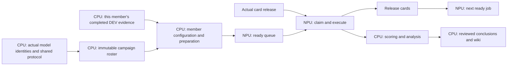

# RC1 CPU and NPU execution contract

Owner instruction, 2026-11-06: maximize useful NPU occupancy and keep CPU preparation, scoring, analysis and publication asynchronous. Continue using engineering-base-rc1.

| Plane | Work | Resource rule |
| --- | --- | --- |
| CPU preparation | Resolve configured inputs, reuse accepted data/image/model identities, prepare immutable run configuration and launch prerequisites | Finish before placing the job in the NPU ready queue; acquire no NPU resource |
| NPU execution | Load the prepared model and run configured training or inference | Claim only when the job can execute; release on terminal execution before CPU statistics |
| CPU consumption | Compute scores, compare baselines, inspect cases, review and publish conclusions | Consume saved outputs asynchronously; do not delay unrelated NPU successors |

Keep dependencies only for actual artifact production, physical resource release, or a substantive user decision. Keep pending preparation outside the executable NPU queue. Queue count must distinguish planned, CPU-preparing, NPU-ready, running and terminal jobs. A planned job is not ready work and a running container is not proof of full hardware utilization.

Reuse accepted datasets, image digests and engineering implementation under fixed identities. Do not repeat full dataset, checkpoint or source hashing for every member or polling tick. Complete expensive checks in CPU preparation once per changed input; reuse their bound receipts while inputs remain unchanged. At launch retain the cheap exact-run configuration and live resource ownership checks. Changed inputs invalidate the affected preparation, not every experiment. Do not change evaluation populations, arithmetic or held-out access rules to optimize scheduling.

The target dependency graph is:

The DEV evidence edge applies where the frozen experiment protocol requires it. It does not require a favorable result, all-family DEV completion, comparison prose, or a new user approval. A genuine numerical or instrument contradiction remains a blocker for affected work. Final all-family reporting can wait for all members without delaying any otherwise ready member's inference.

For this fixed twelve-member campaign, freeze the roster once all actual terminal adapter identities exist. Keep each member's subsequent DEV completion and review in immutable member evidence at a predeclared path, outside the shared roster. This removes the all-DEV barrier while preserving the fixed campaign and each member's own prerequisites. Record preparation, resource release, claim and scoring times separately to distinguish CPU delays from card availability; do not infer throughput gains from a graph alone.

Current implementation status (2026-11-06, 16:59 UTC): the replacement source has passed bounded review and is staged on 175. Its core preparation, member DEV evidence and identity reuse checks have passed. Two final integration checks remain: the twelve-member collector-to-consumer route, and the final dispatcher/host route showing that the next job claims the same chip while the previous job is still being scored on CPU. Those checks run independently on CPU. The replacement has not been activated; the live materializer still has its previous all-member barrier. Existing NPU runs continue on their accepted implementation. Source staging and a planned graph are not evidence of a running TEST queue.

The operational graph is maintained locally in `.local/releases/engineering-base-rc1/evidence/current-execution/ACTIVE-EXPERIMENT-GRAPH.json`, with explicit CPU and NPU planes. Live monitoring remains script-driven at 600-second cadence or completion events. Publish experiment conclusions on the remote wiki; keep process records local.

Resource admission follows `planned → CPU-preparing → ready → NPU-running → inference-terminal/released`; CPU scoring and publication follow a separate branch. Only `ready` work can claim a chip. A CPU worker waiting for evidence or a callback owns no NPU allocation. The next ready job waits only for actual resource availability, never for its predecessor's scoring, report, or baseline discussion. Any exceptional cross-plane decision dependency must name the decision and the specific affected tasks; it must not become an all-queue barrier.
