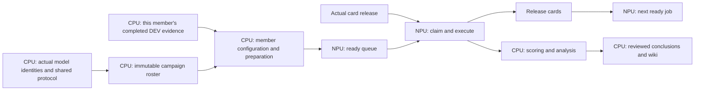

# RC1 CPU and NPU execution contract

Owner instruction, 2026-11-06: maximize useful NPU occupancy and keep CPU preparation, scoring, analysis and publication asynchronous. Continue using engineering-base-rc1.

| Plane | Work | Resource rule |
| --- | --- | --- |
| CPU preparation | Resolve configured inputs, reuse accepted data/image/model identities, prepare immutable run configuration and launch prerequisites | Finish before placing the job in the NPU ready queue; acquire no NPU resource |
| NPU execution | Load the prepared model and run configured training or inference | Claim only when the job can execute; release on terminal execution before CPU statistics |
| CPU consumption | Compute scores, compare baselines, inspect cases, review and publish conclusions | Consume saved outputs asynchronously; do not delay unrelated NPU successors |

Keep dependencies only for actual artifact production, physical resource release, or a substantive user decision. Keep pending preparation outside the executable NPU queue. Queue count must distinguish planned, CPU-preparing, NPU-ready, running and terminal jobs. A planned job is not ready work and a running container is not proof of full hardware utilization.

Reuse accepted datasets, image digests and engineering implementation under fixed identities. Do not repeat full dataset, checkpoint or source hashing for every member or polling tick. Complete expensive checks in CPU preparation once per changed input; reuse their bound receipts while inputs remain unchanged. At launch retain the cheap exact-run configuration and live resource ownership checks. Changed inputs invalidate the affected preparation, not every experiment. Do not change evaluation populations, arithmetic or held-out access rules to optimize scheduling.

The target dependency graph is:

The DEV evidence edge applies where the frozen experiment protocol requires it. It does not require a favorable result, all-family DEV completion, comparison prose, or a new user approval. A genuine numerical or instrument contradiction remains a blocker for affected work. Final all-family reporting can wait for all members without delaying any otherwise ready member's inference.

For this fixed twelve-member campaign, freeze the roster once all actual terminal adapter identities exist. Keep each member's subsequent DEV completion and review in immutable member evidence at a predeclared path, outside the shared roster. This removes the all-DEV barrier while preserving the fixed campaign and each member's own prerequisites. Record preparation, resource release, claim and scoring times separately to distinguish CPU delays from card availability; do not infer throughput gains from a graph alone.

Runtime status belongs in the operational graph and remote wiki, not this reusable execution contract. The graph must bind each state to its observation time and evidence. Keep scientific acceptance separate from NPU execution completion: a completed inference is no longer a ready or running job while its CPU review remains pending. Neither accepted results nor scheduled CPU workers establish current full-card utilization.

The first dispatcher exited before claiming any chip because `python -P` excluded the sibling module directory. Its failed attempt was retained; the retry uses explicit `PYTHONPATH=<runtime>/host:<runtime>:<accepted-host-stage>` for the dispatcher and inherited supervisor processes. Production source bytes are unchanged. Reuse the environment-preserving relaunch scripts after reconciling existing process identities and terminal markers. The deployed release root is `/mnt/cephfs/xingchao/experiments/jev/engineering-base-rc1/test-ready-runtime`; its accepted source is preserved under `tools/functional_test/rc1_ready/`.

The operational graph is maintained locally in `.local/releases/engineering-base-rc1/evidence/current-execution/ACTIVE-EXPERIMENT-GRAPH.json`, with explicit CPU and NPU planes. Live monitoring remains script-driven at 600-second cadence or completion events. Publish experiment conclusions on the remote wiki; keep process records local.

Resource admission follows `planned → CPU-preparing → ready → NPU-running → inference-terminal/released`; CPU scoring and publication follow a separate branch. Only `ready` work can claim a chip. A CPU worker waiting for evidence or a callback owns no NPU allocation. The next ready job waits only for actual resource availability, never for its predecessor's scoring, report, or baseline discussion. Any exceptional cross-plane decision dependency must name the decision and the specific affected tasks; it must not become an all-queue barrier.

A completed four-chip predecessor must not require its entire former group to remain free after successors start. The first deployed callback retained that group-wide live-free condition, preventing chip 3 from filling once chips 0–2 were occupied. Its historical terminal/release evidence was verified and the discharged dependency was replaced by the existing per-chip resource callback through configuration. Only five prepared, unclaimed waiting supervisors were reconciled; active NPU runs and model/scoring sources were unchanged.

## Dependency and reuse rules for subsequent configurations

Represent CPU preparation, NPU execution and CPU consumption as separate nodes. Each NPU node points to its own prepared artifact; a shared completed acceptance is a reused input, not a job to rerun. Do not attach all-family analysis or publication to individual inference. Distinguish data dependencies from resource serialization: a previous job releasing a chip need not have a successful score or published conclusion for an independent ready job to use it.

Before dispatch, preparation resolves dataset locations, model/adapter identity, immutable configuration, accepted release receipts and any protocol-required member evidence. Pending preparation owns no cards. After claim, run model loading and the configured accelerator work; do not start prerequisite locking, dataset construction or full acceptance audits there. Release accelerator ownership before downstream numerical reconstruction and baseline discussion.

Reuse is keyed by the actual image, source, data and model identities. An unchanged input reuses its accepted receipt; a changed input or concrete integrity contradiction triggers only the affected check on CPU. Cheap launch identity, terminal and resource-ownership checks remain necessary. A new model's first actual backward/update fixture is new functional work, not repeated acceptance of the existing release.

Measure useful accelerator execution, claim-to-start delay, release-to-next-start delay and ready-queue depth separately. Container occupancy alone does not demonstrate full utilization. Keep the existing event-driven/600-second script monitoring; a planning-document update does not warrant another device probe.

## Queue semantics

Classify every active node as CPU preparation, NPU execution, or CPU consumption. Keep artifact dependencies, physical resource requirements and named decision gates separate. An artifact that has already been prepared and accepted is an input reference, not another scheduled validation task. Only a genuine change to the experiment inputs or a concrete contradictory observation invalidates its affected receipt.

NPU admission ends CPU preparation: dataset construction, model lookup/download, package checks, configuration locking and protocol-required readiness finish before the claim. The ready queue contains executable work only. After claim, load the model and execute; do not hold a card for CPU scoring, baseline acceptance or publication. Model loading and necessary runtime memory checks remain part of device execution.

A substantive decision gate identifies its question, owner and affected successors explicitly. Independent work continues. True artifact dependencies remain necessary, such as a training checkpoint consumed by inference or a new configuration derived from an experiment result; generic report completion and all-family review are not execution dependencies.

For capacity planning, report ready work in chip-hours as well as job counts, and CPU preparation lag separately. Keep preparing independent successors while NPU jobs run. If ready work runs out, report the actual shortage; neither repeated validation nor duplicate runs count as useful occupancy. Monitor via existing completion events and the 600-second script cadence.

## H1 scheduling boundary

The H1 graph has two independent training branches (seeds 2 and 3), each followed by its own checkpoint binding and DEV inference. Training requires its exact runnable host configuration and training-scoped acceptance. A defect solely in the downstream DEV scorer, numerical comparison or report does not block otherwise prepared training. Keep the missing downstream work in the CPU queue and finish it before its own consumer is invoked. Conversely, an unverified training identity or a missing training input is a genuine preclaim blocker.

Checkpoint binding is CPU work between training and inference; it must not retain the training lease. DEV inference releases its lease before numerical scoring. The two-seed comparison waits for both actual outputs only on the CPU branch. No H1 job depends on publication of the current TEST results, and TEST results must not be used to tune H1. Reuse the fixed TRAIN/DEV data and same-seed baseline archive; do not rerun the baseline merely to fill cards.

For each prepared job, readiness means all of its own expensive prerequisites are complete. After claim, only model loading, necessary accelerator initialization and the registered model computation belong on the NPU path. Preparation, baseline locking, full hashing, scoring and report approval do not belong there. Real resource ownership remains checked at dispatch so independent processes cannot collide.
