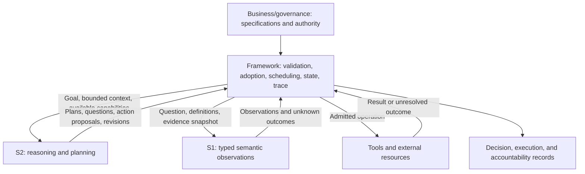

# NGA Overall Design

**Decision Idempotence, Traceability, and S1/S2 Control Boundaries**

> Status: conceptual design baseline for discussion; implementation and validation remain outstanding.
> Created: 2026-10-29. Scope clarified: 2026-10-30 (America/New_York).
> Decision status: Sections 1 and 3 record the agreed project scope, V0 direction, and established principles. Sections 4-9 develop the proposed logical design. Section 10 lists unresolved questions. No runtime, language, storage engine, protocol, or model architecture is selected here.

## 1. Purpose and scope

**NGA (Next Generation Agent) aims at decision and business-result idempotence, with traceability from evidence through adoption to execution.** Its scope includes a business-configurable decision model, an agent loop redesigned around System 1 (S1) and System 2 (S2) collaboration, and a concrete enterprise agent workbench.

The starting concern is that a generative agent loop can reconsider the same situation and produce a different plan or decision. NGA treats this as a system-design problem as well as a model-capability problem. It must preserve adaptation when facts or business rules change while preventing retries, recovery, or incidental wording from silently changing an already adopted decision.

### 1.1 Three projects

| Project | Responsibility | Outputs and boundary |
| --- | --- | --- |
| **1. Decision-model research and engineering** | Derive academic tasks from decision and business-result idempotence objectives; synthesize data; design and develop a Jev-like model. | Task definitions, data and evaluation protocols, reproduction baselines, trained models, and readout interfaces. Model consistency contributes to the business objective; a model alone cannot guarantee external-effect idempotence. |
| **2. S1 + S2 agent-loop redesign** | Use available Jev capabilities to redesign how judgment, reasoning, planning, adoption, execution, and recovery cooperate. | Collaboration mechanisms, logical contracts, runtime prototypes, and end-to-end evaluations. This project can begin before project 1's new model is ready. |
| **3. Enterprise agent workbench** | Build the enterprise product and manage business semantic specifications through knowledge engineering. | Task/capability management, semantic authoring and publication, execution and adoption workflows, exception resolution, and traceability/reconstruction. This project owns how human semantic gray areas become explicit, maintained conventions. |

Jev reproduction is part of project 1, serving as an engineering baseline and a controlled comparison. It does not determine the research objective. The research path is **business property → falsifiable task → data and evaluation → model design and training → system validation**.

These projects exchange requirements and evidence rather than form strict sequential completion gates. Project 1 supplies measured decision capabilities to project 2; project 2 supplies collaboration and runtime contracts to project 3. Project 3 returns governed semantic specifications, business cases, and operational failures to both. Research may start with reviewed, versioned task specifications before the workbench's knowledge tooling exists.

### 1.2 V0 continuity and evolution

The supplied enterprise design is NGA's V0 source baseline. Its capability contracts, bounded delegation, context provenance, and adoption/accountability ideas remain useful foundations. Their suitability is subject to adversarial review; preserving the source does not require retaining invalid assumptions.

The owner's three-state/four-plane framing supersedes the earlier three-view organization. The [V0.2 architecture](../achitecture%20design/13-nga-architecture-v0.2.md) develops that structure, and the [adversarial review](../achitecture%20design/14-v0-adversarial-review.md) identifies defects, missing contracts, and unvalidated hypotheses in V0 and our subsequent drafts. Concrete technologies remain open.

### 1.3 Three states, four planes, and agent evolution

- **States:** development, runtime, and operations are lifecycle/activity perspectives. They can coexist for different releases and tasks of the same logical agent.
- **Planes:** user, runtime, management, and control are responsibility perspectives. Each participates in every state; the runtime plane also performs development evaluation and operational replay.
- **Integrating whole:** agent evolution coordinates business intent, actual behavior/outcomes, reviewed candidate changes, evaluation, publication, rollout, and further observation across all four planes.

Evolution includes models, semantic specifications, knowledge/context, capabilities, graphs/workflows, interaction, and control contracts. It does not confer authority for silent changes to active tasks or history. Operations includes business value, adoption, quality, exceptions, and improvement, not just technical monitoring.

This document defines logical responsibilities and design questions. It does not amend frozen experiment protocols or claim an implemented NGA runtime.

## 2. Design basis and source boundaries

| Source | Contribution | Boundary |
| --- | --- | --- |
| [Survey, sections 2.2.1-2.2.5](../survey/02-propositions-and-core-logic.md) | Business-defined questions and levels; typed observations; within-question consistency, cross-question discrimination, and accuracy floors; thresholds and contracts. | These include the report's own constructs, not established literature guarantees. |
| [Consistency analysis](../survey/04-consistency-the-primary-metric.md) | Decision-level paired evaluation; sensitivity to presentation, precision, version, and context. | Exact-request repeatability does not establish business-semantic consistency. |
| [Business goals and S1/S2 positions](../survey/05-system-business-goal-and-positions.md) | Frequent business judgments, fast/slow cooperation, and workload-specific limits. | Calibration, unknown handling, and safe escalation need measurement. |
| [Research proposal](../proposal/00-research-proposal.md) and [work plan](../proposal/01-work-plan-four-directions.md) | Experimental rounds, gates, and alternative S1 integration positions. | Existing recommendations are not automatically final framework decisions. |
| Owner-supplied [V0 architecture brief](../achitecture%20design/05-architecture-brief-and-decisions.md) | Workbench V0 baseline: capability contracts, execution structure, authority attenuation, context isolation, adoption, and accountability. | Describes agent-festival, a separate design context. Its host platform and reported schemas are not NGA implementation evidence; its pending decisions remain pending. |
| Owner-supplied [V0 architecture diagrams](../achitecture%20design/06-architecture-diagrams-md.md) | Workbench V0 views of management, control, execution, and a task's path through them. | View-level continuity does not freeze topology, implementation, or S1/S2 integration. |

The two reference documents are preserved as supplied in the [architecture workspace](../achitecture%20design/README.md). Their unresolved decisions and implementation claims retain their original scope. The workspace also contains the [NGA architecture analysis](../achitecture%20design/07-nga-architecture-analysis.md), [V0.1 discussion draft](../achitecture%20design/08-nga-architecture-v0.1.md), and [updated diagrams](../achitecture%20design/09-nga-architecture-diagrams.md). These assume the required Jev-like capability is available and develop the S1/S2 collaboration without claiming model readiness or finalizing mechanisms.

The survey is a source of problem analysis, evidence, counterexamples, and research gaps. NGA does not equate reproducing published results with meeting its business objectives. New tasks must expose the missing properties and exclude shortcuts, rather than assume a literature recipe already solves the enterprise problem.

The source materials differ on scheduling authority: survey section 2.2.2 places it in S2, while the work plan recommends a deterministic controller for one integration position and leaves the choice open. This design distinguishes **planning proposals** from **runtime authority to make them effective**. Section 10 retains the concrete scheduling arrangement as an open question.

## 3. Established principles

These are the agreed direction and logical boundaries, not claims that the corresponding guarantees have already been achieved.

| ID | Principle | Consequence |
| --- | --- | --- |
| P1 | NGA pursues decision and business-result idempotence and traceability through three projects: decision models, S1 + S2 loops, and an enterprise workbench. | Model research and runtime design serve the enterprise objective; reproduction is part of project 1. |
| P2 | S1's central requirements are decision consistency and business-configurable development. | A business specification must affect the basis of judgment; equivalent cases should remain equivalent under that specification. |
| P3 | Semantic judgment, decision adoption, and execution are distinct. | A model output becomes effective only through an explicit framework-controlled adoption and execution process. |
| P4 | Business and governance authority defines criteria, permissions, and exception handling. | S1 and S2 cannot grant themselves authority or silently rewrite the effective rules. |
| P5 | Effective decisions must have identifiable evidence, rule, model, readout, and decision-policy versions. | Traceability follows the actual dependencies consumed by a decision. |
| P6 | Adaptation must be explicit. | Changes of evidence, rules, plans, or adopted decisions are represented as revisions with a recorded relationship to earlier versions. |
| P7 | The framework must distinguish semantic consistency, request idempotence, and action idempotence. | A cache, fixed threshold, or repeated model answer does not prove all three. |
| P8 | Evaluation must exclude degenerate solutions and measure useful behavior. | Every invariance target has a discrimination counterpart and an accuracy floor. |
| P9 | Concrete technology choices remain open. | Logical interfaces and acceptance requirements precede platform and implementation choices. |
| P10 | Semantic gray areas must not become implicit model discretion. Project 3 owns semantic-specification management through knowledge engineering. | Undefined conventions, conflicts, and coverage gaps require explicit treatment; S1/S2 cannot silently complete business policy. |
| P11 | The prior enterprise design is the V0 source baseline; its assumptions remain subject to adversarial review as NGA evolves. | Preserve source history and useful contracts, correct invalid assumptions, and version subsequent architectural changes. |
| P12 | Decision chains must be replayable and auditable, including consequential work inside loops and workflows. | Preserve executable definitions and consumed external/model observations as required; distinguish historical inspection, control replay, reevaluation, and live recovery. |
| P13 | NGA has development, runtime, and operations states; user, runtime, management, and control planes; agent evolution integrates and coordinates the four planes. | Do not equate a plane with a lifecycle time or reduce evolution to model tuning, monitoring, or an additional privileged plane. |

“Business-configurable” is a capability to validate, not a promise that every natural-language rule is immediately supported without engineering or training.

## 4. Goals: what must be stable and what must remain changeable

### 4.1 System properties

| Property | Intended meaning | Primary responsibility | Limit |
| --- | --- | --- | --- |
| Semantic decision consistency | Inputs equivalent under the same business question produce the same business decision despite irrelevant variation. | S1 capability plus the framework's decision operator. | Empirical across registered equivalence classes; correctness remains necessary. |
| Repeated-request idempotence | Repeating or recovering the same identified request reuses its adopted decision rather than silently reconsidering it. | Framework identity, adoption, and state management. | A changed request payload must not be accepted as the same unchanged request. |
| Action idempotence | Retrying one identified business operation does not duplicate its effect. | Framework and the external resource or tool. | Cannot be guaranteed universally by the framework without support or reconciliation at the execution boundary. |
| Traceability | Reconstruct which evidence and versions led to which observation, adoption, action, and outcome, and who was responsible. | Framework records and preserved artifacts. | Missing source snapshots cannot be repaired by a plausible model explanation. |
| Replayability | Inspect the historical chain and replay its control behavior from preserved definitions and consumed inputs without live effects. | Framework capture, versioned executable artifacts, and isolated replay adapters. | Missing artifacts limit supported replay; fresh model reevaluation is a separate operation. |
| Auditability | Examine the actual business basis, authority, transitions, effects, revisions, and evidence integrity. | Framework records plus workbench access, review, integrity, and retention controls. | A generated explanation or append-only label alone does not establish an adequate audit trail. |

**Business-result idempotence is the end-to-end objective across these properties:** repeating the same defined business operation must not silently alter its adopted outcome or create additional effects. Semantically equivalent cases should also receive consistent decisions, but they can still be distinct business operations; equivalence must not collapse two legitimate transactions into one. A stable but wrong result is not success.

A decision may legitimately change when a material fact or applicable business rule changes. That change must be visible and justified as a new evaluation or revision. Historical decisions remain identifiable.

### 4.2 Reconstruction, re-evaluation, and compensation

- **Historical reconstruction** applies the recorded decision policy to preserved observations and evidence references. It explains the original adoption without requiring fresh model inference or repeating external effects.
- **Executable control replay** runs preserved controller, graph/workflow, and operator versions with recorded nondeterministic model/tool/time/event inputs; it verifies transitions and intended effects in an isolated state namespace.
- **Re-evaluation** invokes an explicitly identified model/rule/evidence configuration and creates a separate result linked to the original. It never silently replaces history.
- **Recovery or compensation** handles interrupted or incorrect actions according to their business semantics. An irreversible action may require a corrective action rather than rollback.

Exact fresh-inference replay may depend on unavailable environments or numerical behavior. Preserving the observation actually used is therefore essential. Replay and test modes must not dispatch live side effects.

The [replay and audit contract](../achitecture%20design/12-replay-and-audit-contract.md) develops the information and acceptance requirements. The [Jev/agentic orchestration analysis](../achitecture%20design/11-jev-agentic-orchestration.md) compares loops, typed graphs, and executable workflow composition under those same requirements. These mechanisms remain proposed; replayability and auditability are established objectives.

## 5. Responsibilities and control authority

### 5.1 Responsibility matrix

| Participant | Owns | Produces | Does not acquire by model output alone |
| --- | --- | --- | --- |
| Business/governance authority, supported by project 3's knowledge engineering | Business criteria and semantic conventions, capability permissions, acceptance conditions, exception policies, and authorized overrides. | Reviewed, versioned specifications and policies, with owners and effective scope. | Model confidence cannot substitute for this authority. |
| S1 | Applying a supplied question and level definitions to the supplied evidence. | Typed observations, score distributions, supported unknown outcomes, and applicable diagnostics. | Permission to execute, publish rules, or change authoritative state. |
| S2 | Goal interpretation, task decomposition, reasoning, evidence requests, proposed plans, and proposed revisions. | Plans, question requests, action proposals, and explanations or revision rationales. | Permission to bypass adoption, increase its authority, or overwrite adopted records. |
| Framework | Contract validation, context delivery, invocation, adoption, runtime scheduling, state transitions, execution admission, recovery, and recording. | Effective decisions, admitted actions, execution states, and trace records. | Authority beyond the governing policy or capabilities actually granted. |
| Tools/external resources | Performing admitted operations and reporting outcomes. | Results, operation receipts, and reconciliation evidence where supported. | An assumed guarantee that every timeout means an operation failed. |

S1 and S2 describe logical capabilities; they do not prescribe two particular model deployments. The framework describes logical responsibilities, not a required monolith.

### 5.2 Planning versus runtime authority

The proposed boundary is:

- **S2 proposes the plan and changes to it:** what to do, which evidence to seek, and which capability to request next.
- **The framework decides whether and when a proposal becomes effective:** validate its contract, dependencies, current state, permission scope, and resource bounds, then dispatch it.
- **S1 supplies observations consumed by the registered decision policy:** it may inform routing, monitoring, or verification but cannot override an authorization denial.

Automatic adoption is allowed within the published policy. Human approval is required only where the business contract specifies it. Dynamic planning remains possible inside an admitted scope; changes beyond it require the applicable revision or admission process.

A human override also records its authority, basis, scope, and relationship to the original decision.

### 5.3 Logical interaction

The diagram shows responsibility boundaries. It does not select a loop, graph engine, messaging protocol, or physical topology.

### 5.4 Four-plane responsibilities across the lifecycle

| Plane | Main responsibility | Relation to S1/S2 and evolution |
| --- | --- | --- |
| **User** | Intent, authoring/review interaction, task status, approvals/challenges, and operational feedback. | Make behavior and evidence usable for business users, developers, and operators; submit changes through authorized contracts. |
| **Runtime** | Execute admitted models, skills, graphs, loops, workflows, tools, evaluations, and replays. | Produce actual judgments, proposals, observations, and outcome evidence in all three states. |
| **Management** | Maintain definitions, specifications, catalogs, ownership, versioned artifacts, candidates, and release lineage. | Bind compatible model/rule/workflow/operator versions and curated improvement evidence. |
| **Control** | Admit work and changes; enforce effective transitions, adoption, authority, budgets, effects, recovery, and lifecycle policy. | Preserve the authority and state boundaries while candidates are evaluated, promoted, rolled out, or withdrawn. |

These are logical responsibilities, not four required services. The framework spans the planes. Runtime workers perform admitted actions; control contracts determine which state changes and effects become effective. Management declarations and user requests do not bypass those contracts.

The [V0.2 matrix](../achitecture%20design/13-nga-architecture-v0.2.md) maps each plane to development, runtime, and operations. Agent evolution links release definitions, task/decision history, actual outcomes, reviewed cases, evaluations, and subsequent releases. It preserves historical decisions and defines treatment of active tasks explicitly.

Semantic judgment remains a model capability where appropriate; deterministic control cannot substitute for all business understanding. S1/S2 and Graph/Loop/Workflow choices remain proposals within this larger organization.

## 6. Proposed logical interfaces

These information requirements are a starting point for interface design, not a frozen API or serialization schema.

| Object | Required information | Producer/consumer boundary |
| --- | --- | --- |
| **Business judgment specification** | Question identity and version; terms, units and temporal conventions; level names, definitions and type; candidate-set semantics; precedence, coverage and exception rules; examples; supported scope; owner and effective scope. | Project 3's knowledge workflow supports authorized business publication; S1 reads; S2 can propose drafts or approved template instances; the framework validates and resolves versions. |
| **Capability contract** | Input/output obligations; required authority; effects; resource bounds; verification and approval requirements. | Capability authors declare; governance approves; framework admits; S2 plans against available capabilities. |
| **Evidence/context snapshot** | Source identity and retrievable version or preserved content; relevant time; visibility; provenance; distinction between source facts, reported history, and model inference. | Framework assembles from admitted sources; S1/S2 consume bounded views. |
| **Plan or plan revision** | Goal; requested capabilities; dependencies; question/template references; evidence needs; proposed actions; stop/exception conditions; relation to prior plan. | S2 or an authorized author proposes; framework validates, adopts, and schedules. |
| **Typed observation** | Question and input references; level-aligned values; unknown/invalid status where supported; model, renderer/readout, and numerical configuration versions. | S1 produces; framework validates and consumes; S2 may receive the admitted result. |
| **Adopted decision** | Adopted outcome; observation and evidence references; decision operator and threshold/calibration version; adoption basis and authority; revision links. | Framework records following the effective policy; later planning and execution reference it. |
| **Action and execution record** | Stable business-operation identity; adopted decision/plan dependency; target and parameters; authority used; attempts, receipts, outcome, and recovery/compensation links. | Framework dispatches; tools report; framework records and reconciles. |

The business judgment specification says **what a fact means under a rule**. The capability contract says **what a participant may do**. A semantic classification must not be treated as proof of authority.

S1 values are model observations. Their interpretation as calibrated probabilities or safe routing signals requires validation.

Questions generated by S2 should use approved, versioned templates and declared slots. New question definitions or changed decision semantics enter an explicit specification-version process. The exact allowed runtime variation remains open.

The current model proposal uses `boolean | nominal | ordinal` levels, `exclusive | stackable` candidate sets, and task definition → input → candidate branches. Existing experiments retain their registered rendering, operator, and threshold rules. This document introduces no replacement operator.

### 6.1 Knowledge engineering and explicit semantic boundaries

**Ownership is established; the workflow below is proposed.** Project 3 manages the conversion of human business requirements into maintained semantic specifications. The goal is to remove implicit discretion at the decision boundary, not to claim that all real-world uncertainty can be eliminated or that a model will detect every ambiguous case.

A specification should make the following explicit:

- Terms, measurement units, evidence sources, reference time, and time-window conventions.
- Predicate boundaries, rule precedence, exclusions, and the scope of each condition.
- Covered cases, declared defaults, conflicts, and cases requiring further definition.
- Output states and the permitted action for each; missing evidence or an undefined rule is not automatically a negative business answer.
- Examples and counterexamples, including boundaries, equivalent cases, competing rules, and unresolved cases.
- Ownership, review authority, version, effective scope, change rationale, and links to impacted tasks, datasets, and decisions.

A proposed lifecycle is **draft → identify gaps/conflicts → obtain the business owner's convention → validate with cases → publish a version → monitor and revise**. S2 may assist with drafts and counterexamples. Neither S2 nor a synthetic-data generator becomes the authority for an unstated convention. Full knowledge tooling belongs to project 3; project 1 still needs reviewed task semantics to generate defensible labels.

| Condition | Required distinction | Logical handling |
| --- | --- | --- |
| Ambiguous, conflicting, or uncovered specification | The business meaning is not settled. | Record a semantic issue for the authorized knowledge/business owner; apply only an already declared exception path. |
| Missing or conflicting evidence | The rule may be clear, but its facts are not established. | Request admissible evidence or use the published unresolved-case path. |
| Model cannot reliably apply a settled rule to supplied evidence | Capability is insufficient for this case. | Use a validated alternative, bounded S2 assistance, or review under the contract. |
| Invocation or execution failure | A technical result or external effect is unresolved. | Follow the framework's error/reconciliation path; do not reinterpret failure as a business judgment. |

These are logical distinctions, not a frozen status enumeration. Project 1 evaluates whether the model respects specified unresolved outcomes and decision boundaries; project 2 preserves and routes them; project 3 manages the conventions and resolution workflow. A confidence threshold alone cannot certify that a specification is complete.

The owner's illustrative credit rules show why this matters: assets above 30 million with no overdue loan in the past six months imply USD 50,000 credit; assets below 1 million imply USD 10,000; the historical "more than three months overdue" condition overrides both and denies credit. Turning this example into a task requires explicit asset units and valuation, the exact historical-overdue duration convention, time-window boundaries, and treatment of assets at the cutoffs or between the bands. The six-month condition was attached to the upper band, so it must not silently be added to the lower band. These gaps remain specification questions, not model-authored defaults or finalized lending policy.

## 7. Proposed adoption, execution, and recovery behavior

### 7.0 Business-system integration boundary

The proposed default is to invoke authorized business operations exposed by the owning enterprise IT system. That system retains its domain data, internal business/risk constraints and transaction commit authority. NGA governs its own task state, bound semantic judgments, local/delegated adoption and capability requests; an NGA adoption does not by itself establish external business approval or effect completion. A model-generated field update or generic CRUD interface is not a substitute for the business operation's enforcement contract.

An existing system may own the whole decision or explicitly delegate a qualified semantic question to NGA/Jev. Either arrangement requires a clear capability contract. NGA can replay its request/response control path; internal provider replay and audit remain a separate scope. See the [business-system capability boundary](../achitecture%20design/19-business-system-capability-boundary.md) for the proposal and its counterexamples.

### 7.1 Logical lifecycle

A typical path is **propose → observe/verify → assess → adopt → dispatch → confirm and record**. It may include further evidence gathering, rejection, escalation, or a revised plan. These are logical milestones rather than a selected state-machine implementation.

1. Identify the task/request, its material input, applicable specification, and available authority.
2. Resolve the evidence/context snapshot and effective versions.
3. Obtain an S2 plan where reasoning or planning is needed; direct contract-driven paths may omit S2.
4. Obtain S1 observations and any required independent checks.
5. Apply the registered decision policy and record the adoption or exception.
6. Admit and dispatch actions only when dependencies, current authorization, and execution conditions hold.
7. Wait for the declared API result using a correlated framework event/time primitive, then record and resume. A synchronous terminal response can satisfy the wait immediately; an asynchronous receipt can establish a longer wait. Preserve waiting across restarts without resubmission. Record incoming evidence for the next decision boundary unless an explicit interruption policy applies; timer expiry is not external failure or cancellation.

A high S1 score cannot relax permission, approval, or budget constraints. S2 explanations are recorded proposals, not replacements for missing evidence.

Cancellation or reversal is a separate requested/policy-authorized branch. Use the provider's native capability or an admitted composition of supported operations with explicit recovery outcomes, preconditions and partial-failure handling. Compensation need not restore the original state or be atomic. If no qualified path exists, declare reversal unsupported rather than writing business fields directly. See [waiting and recovery contracts](../achitecture%20design/20-task-decision-request-identity.md#4-normal-waiting-explicit-interruption-and-qualified-recovery).

### 7.2 Identity and duplicate handling

Distinguish an **NGA task T1**, a **decision question J1 and its revisions D1/D2**, and a **business-operation request B1**. Plans, runtime runs, model observations and transport attempts have their own records without automatically creating new business intent. Provider application identities are mapped explicitly rather than equated to NGA tasks.

- T1 binds an admitted objective, scope and completion promise. A task awaiting a terminal provider outcome cannot claim completion from a receipt alone; submission-only tasks declare their narrower boundary in advance.
- Repeated submission/resume resolves the same authorized task. Identical text or customer data alone cannot distinguish duplicate intent from a legitimate new task.
- New admitted material evidence or applicable rules create a new decision basis/revision, even when the answer is unchanged. Pure replanning and technical retries preserve the current decision basis; retries add attempt records.
- B1 binds one provider operation and fixed material parameters. A changed amount or required decision artifact cannot silently replace its payload under the same key. A new D2 does not itself authorize a new B2.
- Changes after dispatch preserve uncertainty until the provider's status/cancellation/amendment contract resolves it. Local holds do not establish that an external effect did not occur.
- Historical retrieval, current-status lookup, semantic consistency evaluation and live recovery are separate operations. Recorded result reuse does not prove model consistency; replay cannot trigger live effects.

See the [current AQ-01/AQ-02 analysis](../achitecture%20design/20-task-decision-request-identity.md) for definitions, phase-specific handling and eighteen proposed adversarial cases. Identity authority, materiality, retention, task amendments and provider recovery guarantees remain explicit contract choices, without requiring a design for business-system internals.

### 7.3 Concurrency and uncertain execution

The framework must prevent competing workers from independently adopting conflicting results or dispatching one operation as two first attempts. State validation and adoption require a defined concurrency contract; the implementation mechanism is open.

Dispatch intent, attempts, and external acknowledgement must remain distinguishable. If the process fails after an external action but before recording its acknowledgement, recovery first determines whether the effect occurred. An unresolved timeout is not an instruction to retry blindly.

If a resource cannot support deduplication or outcome lookup, the contract must state the weaker guarantee and provide a reconciliation, escalation, or compensation path.

### 7.4 Versions, permissions, and context

Historical reconstruction uses the original recorded versions. Live dispatch additionally checks current permission and execution preconditions. A historically adopted decision cannot preserve permission that has since been revoked.

The reference design suggests authority attenuation, bounded delegation, isolated drafts, controlled publication of intermediate results, and explicit adoption events. NGA should evaluate these as candidate mechanisms. Task trees, token formats, draft/seal/reveal protocols, and enforcement topology are not selected here.

Generated assertions remain marked as such. Replacing evidence, sharing previously isolated context, or consuming another model's conclusion creates a traceable dependency and may require a new evaluation.

## 8. Traceability and feedback

The trace should answer:

- Which business task, question, and rule version was being evaluated?
- Which evidence was actually supplied, from which sources, and with what time and visibility constraints?
- Which S1 observation and S2 proposal were consumed?
- Which decision policy, thresholds, approval, or override made the result effective?
- Which identity acted, which authority authorized it, and which accountable business principal owned the task?
- Which tool operation occurred, what outcome was confirmed, and what remains unresolved?
- Which later revision, correction, or compensation relates to the original result?

Observation, proposal, adoption, dispatch, acknowledgement, and outcome are separately identifiable events. Durable adopted history is preserved; corrections add explicit superseding records. The storage and tamper-evidence mechanisms remain open.

Traceability depends on observable evidence and recorded decisions; it does not require access to a model's private internal reasoning. Retention, permitted access, source availability, and the supported reconstruction period must be defined for each deployment.

Business outcomes can support evaluation and threshold review. Delayed, selective outcomes for a whole decision do not automatically supply causal labels for every intermediate S1 observation. Changes to model or decision-policy versions follow evaluation and publication controls rather than silent online mutation.

Project 3's resolved semantic issues can yield new specification versions and reviewed examples for project 1, and updated contracts for project 2. A later convention must not retroactively relabel historical decisions without an explicit re-evaluation. Synthetic labels need provenance back to the specification and labeling procedure; unreviewed generated answers are not business ground truth.

## 9. Validation approach

This section identifies acceptance questions. It sets no new numerical thresholds or equivalence classes and authorizes no run. Experiment-specific metrics, samples, splits, thresholds, and decision lines must be registered before measurement.

### 9.1 Model capability

Registry references below point to the report's [defect registry](../survey/02-propositions-and-core-logic.md), not to claims that the defects are repaired.

| Capability | Proposed comparison | Degenerate solution and counterpart | Registry rows |
| --- | --- | --- | --- |
| Business-semantic consistency | Paired decisions under registered equivalent inputs, neutral renaming, unrelated-question changes, and relevant perturbations. | A constant model appears stable; pair with changed-fact and changed-rule cases and an accuracy floor. | 1, 6, 9, 12, 16, 17 |
| Definition following | Same input under competing rule definitions and renamed labels, with rule-family holdouts. | Memorize label or generator patterns; require definition-sensitive changes and held-out rules. | 1, 3, 17 |
| Business configurability | Researcher-authored versus real business-authored specifications, including invalid or ambiguous drafts. | Engineer-only templates appear configurable; evaluate independent authors and held-out specifications. | 13, 17 |
| Unknown handling | Missing-evidence, conflicting-evidence, out-of-scope, and answer-present counterparts. | Abstain on everything; measure coverage, incorrect acceptance, and useful accuracy together. | 5, 14, 16 |
| Version robustness | Paired results across model/readout/precision changes with preserved evidence and rule versions. | Unchanged aggregate accuracy hides regressions; compare per-decision changes and threshold effects. | 7, 8, 12, 17 |

### 9.2 Framework and end-to-end behavior

Framework acceptance cases implement the system constraints in sections 3-8; they are not evidence that a model-registry row has been repaired.

| Case | Required observable behavior | Counterpart |
| --- | --- | --- |
| Duplicate request, including concurrent submissions | Reuse a consistent adoption or expose a defined pending/conflict state. | Changed material payload is detected rather than silently reused. |
| Crash and resume around adoption or dispatch | Preserve adopted history; prevent duplicate effects or expose the resource's weaker guarantee and recovery path. | A genuinely new authorized operation can still proceed. |
| Timeout after external completion | Reconcile the operation or stop in an explicit unresolved state. | An action known not to have executed can be retried under policy. |
| Rule/evidence change and permission revocation | Create a traceable revision; recheck live execution conditions. | Original history remains reconstructable. |
| Historical reconstruction | Recover the original adoption from preserved dependencies without live side effects. | Missing dependencies produce an explicit reconstruction limit. |
| S1/S2 integration | Compare success, cost per successful outcome, latency, recovery, and trace completeness against the agent-loop baseline. | Include appropriate deterministic/no-model controls and scenarios needing S2 adaptation. |

Reproduction must distinguish recipe replication, benchmark comparison, and native typed-readout reproduction. The current R0 erratum and R3 scope restrictions continue to apply; the 2026-10-30 experiment amendment withdrew the padding diagnosis and identified bf16 batch-composition noise as the outstanding comparison issue. G1/G2/G3 remain research gates, not proof of overall framework readiness.

### 9.3 Enterprise semantics and workbench acceptance

Project 3 must demonstrate that an ambiguous or incomplete draft cannot silently become effective decision policy, that declared unresolved cases follow their intended route, and that published conventions have an accountable owner and version. Changing a rule should expose affected tasks and evidence for review while preserving the original decisions. Include complete, valid specifications as counterparts so that rejecting every specification cannot pass.

Model and data work should test held-out rule families, competing definitions over the same state, and missing-rule versus missing-evidence cases. Data diversity must include business definitions, not just many examples from a fixed generator grammar. These are task-design requirements to take into the research process; the existing registered protocols are unchanged.

## 10. Open questions and decisions to make

These are unresolved. Examples are alternatives to evaluate, not selected defaults.

For their architectural refinement and a concrete discussion agenda, see the [architecture discussion register](../achitecture%20design/16-architecture-discussion-register.md). It maps O1–O12 to 18 open questions while preserving the broader program and model-research scope here; its recommendations are not decisions.

| ID | Question | Evidence or artifact needed |
| --- | --- | --- |
| O1 | What business scenario and operation scope define the first idempotence contract? | Concrete tasks, material facts, irreversible effects, failure/retry cases, and an accountable owner. |
| O2 | How much planning and scheduling may S2 change automatically within an admitted scope? | Compare adaptation, determinism, recovery, and review burden under explicit change envelopes. |
| O3 | Where does S1 first enter the system: monitoring, evidence selection, routing, intermediate-state evaluation, or final readout? | Workload-specific paired capability and end-to-end results; confidence alone is insufficient. |
| O4 | Which rules can be evaluated directly, which require decomposition or deterministic computation, and which require S2? | Executability categories and held-out counterexamples with accuracy floors; preserve semantic interpretation as an explicit capability under test. |
| O5 | What is the request/evaluation/action identity scheme, and when does a decision expire or reopen? | Business identity and version semantics, freshness requirements, and concurrent-change examples. |
| O6 | Which thresholds, unknown outcomes, escalation conditions, and human overrides apply? | Registered costs, validation data, coverage requirements, and risk-specific exception policies. |
| O7 | What execution structure and enforcement boundaries meet these contracts? | Failure and bypass cases for candidate loop/graph/workflow organizations, delegation, and resource admission. |
| O8 | What context can be shared, when, and with which provenance? | Cases comparing isolation, independent verification, controlled publication, and cooperative sharing. |
| O9 | What reconstruction period and artifact retention are required? | Availability, access, accountability, and reconstruction acceptance requirements. |
| O10 | Which implementation language, runtime, storage, model architecture, authorization mechanism, or protocol fits? | Business and interface decisions, integration constraints, and measured prototypes; choices remain open. |
| O11 | How should project 3 author, check, approve, publish, and revise semantic specifications? | Business-owner workflow, conventions and coverage examples, unresolved-case handling, change impact, and release/consumption contracts with projects 1 and 2. |
| O12 | Which V0 capability and S1 insertion point should anchor the first integrated iteration? | A bounded workbench workflow, available Jev capability evidence, explicit S1/S2/framework boundaries, and a comparison against the existing agent loop. |

Recording an answer requires its rationale, evidence, affected principles/interfaces, and version impact. Changes to registered experiments still follow their amendment process.

## 11. Next design artifact

Following the owner's clarification, first define a small general framework contract for case identity, bound decisions, plans, NGA-effective transitions and invocation of business capabilities. The owning business system remains responsible for its internal shared constraints and authoritative commits. Then challenge the integration with a small portfolio of explicitly scoped business fixtures. Do not require detailed banking semantics to be settled before continuing the architecture. See [framework logic and case coverage](../achitecture%20design/18-framework-core-and-case-coverage.md) and the proposed [business-system boundary](../achitecture%20design/19-business-system-capability-boundary.md).

For each selected fixture, describe the supplied judgment specification, capability contract, evidence, S2 plan, S1 observations, adoption conditions and intended operation. The credit example is one fixture; independent cases with shared constraints and a non-credit counterpart test whether the core is general. Use these to produce connected project 1 task/evaluation definitions, project 2 control traces, and project 3 workbench flows. A real deployment still needs approved domain semantics and integration evidence; hypothetical fixtures do not supply that approval.

Walk these fixtures through unchanged repetition, legitimate new cases, shared constraints, changed evidence, changed rule, concurrent submission, interrupted execution, revoked authority and reconstruction. Use the resulting conflicts to refine the logical interfaces before freezing schemas or choosing technologies.

