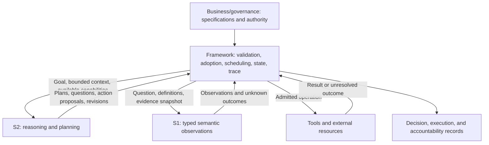

# NGA Overall Design

**Decision Idempotence, Traceability, and S1/S2 Control Boundaries**

> Status: conceptual design baseline for discussion; implementation and validation remain outstanding.
> Date: 2026-10-29 (America/New_York).
> Decision status: Section 3 records established principles. Sections 4-9 develop the proposed logical design. Section 10 lists unresolved questions. No runtime, language, storage engine, protocol, or model architecture is selected here.

## 1. Purpose and scope

**NGA (Next Generation Agent) aims to make business decisions stable under repeated processing and traceable from evidence through adoption to execution.** It combines a business-configurable System 1 (S1) decision capability, a System 2 (S2) reasoning and planning capability, and a framework that governs how proposals become effective decisions and actions.

The starting concern is that a generative agent loop can reconsider the same situation and produce a different plan or decision. NGA treats this as a system-design problem as well as a model-capability problem. It must preserve adaptation when facts or business rules change while preventing retries, recovery, or incidental wording from silently changing an already adopted decision.

The work connects three streams:

1. **Jev engineering reproduction:** reproduce and distinguish data, training, readout, and evaluation components; establish defensible reference baselines.
2. **Business-driven model redesign:** develop consistent judgments that follow business-authored definitions and support typed observations and unknown handling.
3. **S1 + S2 framework design:** organize reasoning, observation, adoption, execution, context, and feedback around explicit control boundaries.

These streams inform each other. A better isolated model score does not establish a better agent; framework requirements must also inform model experiments.

This document defines logical responsibilities and design questions. It does not amend frozen experiment protocols or claim an implemented NGA runtime.

## 2. Design basis and source boundaries

| Source | Contribution | Boundary |
| --- | --- | --- |
| [Survey, sections 2.2.1-2.2.5](../survey/02-propositions-and-core-logic.md) | Business-defined questions and levels; typed observations; within-question consistency, cross-question discrimination, and accuracy floors; thresholds and contracts. | These include the report's own constructs, not established literature guarantees. |
| [Consistency analysis](../survey/04-consistency-the-primary-metric.md) | Decision-level paired evaluation; sensitivity to presentation, precision, version, and context. | Exact-request repeatability does not establish business-semantic consistency. |
| [Business goals and S1/S2 positions](../survey/05-system-business-goal-and-positions.md) | Frequent business judgments, fast/slow cooperation, and workload-specific limits. | Calibration, unknown handling, and safe escalation need measurement. |
| [Research proposal](../proposal/00-research-proposal.md) and [work plan](../proposal/01-work-plan-four-directions.md) | Experimental rounds, gates, and alternative S1 integration positions. | Existing recommendations are not automatically final framework decisions. |
| Owner-supplied local reference: `achitecture design/05-architecture-brief-and-decisions.md` | Capability contracts, execution structure, authority attenuation, context isolation, adoption, and accountability. | Describes agent-festival, a separate design context. Its host platform and reported schemas are not NGA implementation evidence. |
| Owner-supplied local reference: `achitecture design/06-architecture-diagrams-md.md` | Views of management, control, execution, and a task's path through them. | Its concrete topology and mechanisms remain reference material. |

The two local reference documents are not bundled with this document. Their transferable design ideas are summarized here; their unresolved decisions and implementation claims are not imported as NGA commitments.

The source materials differ on scheduling authority: survey section 2.2.2 places it in S2, while the work plan recommends a deterministic controller for one integration position and leaves the choice open. This design distinguishes **planning proposals** from **runtime authority to make them effective**. Section 10 retains the concrete scheduling arrangement as an open question.

## 3. Established principles

These are the agreed direction and logical boundaries, not claims that the corresponding guarantees have already been achieved.

| ID | Principle | Consequence |
| --- | --- | --- |
| P1 | NGA's overall objective is an integrated S1 + S2 framework with decision idempotence and traceability. | Reproduction and model redesign serve the system objective. |
| P2 | S1's central requirements are decision consistency and business-configurable development. | A business specification must affect the basis of judgment; equivalent cases should remain equivalent under that specification. |
| P3 | Semantic judgment, decision adoption, and execution are distinct. | A model output becomes effective only through an explicit framework-controlled adoption and execution process. |
| P4 | Business and governance authority defines criteria, permissions, and exception handling. | S1 and S2 cannot grant themselves authority or silently rewrite the effective rules. |
| P5 | Effective decisions must have identifiable evidence, rule, model, readout, and decision-policy versions. | Traceability follows the actual dependencies consumed by a decision. |
| P6 | Adaptation must be explicit. | Changes of evidence, rules, plans, or adopted decisions are represented as revisions with a recorded relationship to earlier versions. |
| P7 | The framework must distinguish semantic consistency, request idempotence, and action idempotence. | A cache, fixed threshold, or repeated model answer does not prove all three. |
| P8 | Evaluation must exclude degenerate solutions and measure useful behavior. | Every invariance target has a discrimination counterpart and an accuracy floor. |
| P9 | Concrete technology choices remain open. | Logical interfaces and acceptance requirements precede platform and implementation choices. |

“Business-configurable” is a capability to validate, not a promise that every natural-language rule is immediately supported without engineering or training.

## 4. Goals: what must be stable and what must remain changeable

### 4.1 Four separate system properties

| Property | Intended meaning | Primary responsibility | Limit |
| --- | --- | --- | --- |
| Semantic decision consistency | Inputs equivalent under the same business question produce the same business decision despite irrelevant variation. | S1 capability plus the framework's decision operator. | Empirical across registered equivalence classes; correctness remains necessary. |
| Repeated-request idempotence | Repeating or recovering the same identified request reuses its adopted decision rather than silently reconsidering it. | Framework identity, adoption, and state management. | A changed request payload must not be accepted as the same unchanged request. |
| Action idempotence | Retrying one identified business operation does not duplicate its effect. | Framework and the external resource or tool. | Cannot be guaranteed universally by the framework without support or reconciliation at the execution boundary. |
| Traceability | Reconstruct which evidence and versions led to which observation, adoption, action, and outcome, and who was responsible. | Framework records and preserved artifacts. | Missing source snapshots cannot be repaired by a plausible model explanation. |

A decision may legitimately change when a material fact or applicable business rule changes. That change must be visible and justified as a new evaluation or revision. Historical decisions remain identifiable.

### 4.2 Reconstruction, re-evaluation, and compensation

- **Historical reconstruction** applies the recorded decision policy to preserved observations and evidence references. It explains the original adoption without requiring fresh model inference or repeating external effects.
- **Re-evaluation** invokes an explicitly identified model/rule/evidence configuration and creates a separate result linked to the original. It never silently replaces history.
- **Recovery or compensation** handles interrupted or incorrect actions according to their business semantics. An irreversible action may require a corrective action rather than rollback.

Exact fresh-inference replay may depend on unavailable environments or numerical behavior. Preserving the observation actually used is therefore essential. Replay and test modes must not dispatch live side effects.

## 5. Responsibilities and control authority

### 5.1 Responsibility matrix

| Participant | Owns | Produces | Does not acquire by model output alone |
| --- | --- | --- | --- |
| Business/governance authority | Business criteria, capability permissions, acceptance conditions, exception policies, and authorized overrides. | Published specifications and policies. | Model confidence cannot substitute for this authority. |
| S1 | Applying a supplied question and level definitions to the supplied evidence. | Typed observations, score distributions, supported unknown outcomes, and applicable diagnostics. | Permission to execute, publish rules, or change authoritative state. |
| S2 | Goal interpretation, task decomposition, reasoning, evidence requests, proposed plans, and proposed revisions. | Plans, question requests, action proposals, and explanations or revision rationales. | Permission to bypass adoption, increase its authority, or overwrite adopted records. |
| Framework | Contract validation, context delivery, invocation, adoption, runtime scheduling, state transitions, execution admission, recovery, and recording. | Effective decisions, admitted actions, execution states, and trace records. | Authority beyond the governing policy or capabilities actually granted. |
| Tools/external resources | Performing admitted operations and reporting outcomes. | Results, operation receipts, and reconciliation evidence where supported. | An assumed guarantee that every timeout means an operation failed. |

S1 and S2 describe logical capabilities; they do not prescribe two particular model deployments. The framework describes logical responsibilities, not a required monolith.

### 5.2 Planning versus runtime authority

The proposed boundary is:

- **S2 proposes the plan and changes to it:** what to do, which evidence to seek, and which capability to request next.
- **The framework decides whether and when a proposal becomes effective:** validate its contract, dependencies, current state, permission scope, and resource bounds, then dispatch it.
- **S1 supplies observations consumed by the registered decision policy:** it may inform routing, monitoring, or verification but cannot override an authorization denial.

Automatic adoption is allowed within the published policy. Human approval is required only where the business contract specifies it. Dynamic planning remains possible inside an admitted scope; changes beyond it require the applicable revision or admission process.

A human override also records its authority, basis, scope, and relationship to the original decision.

### 5.3 Logical interaction

The diagram shows responsibility boundaries. It does not select a loop, graph engine, messaging protocol, or physical topology.

## 6. Proposed logical interfaces

These information requirements are a starting point for interface design, not a frozen API or serialization schema.

| Object | Required information | Producer/consumer boundary |
| --- | --- | --- |
| **Business judgment specification** | Question identity and version; level names, definitions and type; candidate-set semantics; examples; supported scope; treatment of missing/conflicting evidence. | Business authors publish; S1 reads; S2 can propose drafts or approved template instances; the framework validates and resolves versions. |
| **Capability contract** | Input/output obligations; required authority; effects; resource bounds; verification and approval requirements. | Capability authors declare; governance approves; framework admits; S2 plans against available capabilities. |
| **Evidence/context snapshot** | Source identity and retrievable version or preserved content; relevant time; visibility; provenance; distinction between source facts, reported history, and model inference. | Framework assembles from admitted sources; S1/S2 consume bounded views. |
| **Plan or plan revision** | Goal; requested capabilities; dependencies; question/template references; evidence needs; proposed actions; stop/exception conditions; relation to prior plan. | S2 or an authorized author proposes; framework validates, adopts, and schedules. |
| **Typed observation** | Question and input references; level-aligned values; unknown/invalid status where supported; model, renderer/readout, and numerical configuration versions. | S1 produces; framework validates and consumes; S2 may receive the admitted result. |
| **Adopted decision** | Adopted outcome; observation and evidence references; decision operator and threshold/calibration version; adoption basis and authority; revision links. | Framework records following the effective policy; later planning and execution reference it. |
| **Action and execution record** | Stable business-operation identity; adopted decision/plan dependency; target and parameters; authority used; attempts, receipts, outcome, and recovery/compensation links. | Framework dispatches; tools report; framework records and reconciles. |

The business judgment specification says **what a fact means under a rule**. The capability contract says **what a participant may do**. A semantic classification must not be treated as proof of authority.

S1 values are model observations. Their interpretation as calibrated probabilities or safe routing signals requires validation.

Questions generated by S2 should use approved, versioned templates and declared slots. New question definitions or changed decision semantics enter an explicit specification-version process. The exact allowed runtime variation remains open.

The current model proposal uses `boolean | nominal | ordinal` levels, `exclusive | stackable` candidate sets, and task definition → input → candidate branches. Existing experiments retain their registered rendering, operator, and threshold rules. This document introduces no replacement operator.

## 7. Proposed adoption, execution, and recovery behavior

### 7.1 Logical lifecycle

A typical path is **propose → observe/verify → assess → adopt → dispatch → confirm and record**. It may include further evidence gathering, rejection, escalation, or a revised plan. These are logical milestones rather than a selected state-machine implementation.

1. Identify the task/request, its material input, applicable specification, and available authority.
2. Resolve the evidence/context snapshot and effective versions.
3. Obtain an S2 plan where reasoning or planning is needed; direct contract-driven paths may omit S2.
4. Obtain S1 observations and any required independent checks.
5. Apply the registered decision policy and record the adoption or exception.
6. Admit and dispatch actions only when dependencies, current authorization, and execution conditions hold.
7. Record confirmed or unresolved outcomes; resume, reconcile, or compensate under the contract.

A high S1 score cannot relax permission, approval, or budget constraints. S2 explanations are recorded proposals, not replacements for missing evidence.

### 7.2 Identity and duplicate handling

Use distinct identities for the business request, an evaluation revision, and a business operation.

- A repeated request with unchanged material input resolves to its existing adopted decision or known in-progress state.
- Reuse of a request identity with different material content is a conflict requiring an explicit revision, not an ordinary retry.
- An evaluation records its rule, evidence, model, readout, and decision-policy dependencies.
- An action identity follows the business operation. A new model version or evaluation must not automatically create a fresh operation that repeats the same effect.
- Semantic equivalence comes from the business question and its evaluation protocol. An arbitrary text hash or model-generated “equivalent” label does not establish it.

Identity scope, retention windows, material-field normalization, and revision rules require a concrete business scenario before they can be frozen.

### 7.3 Concurrency and uncertain execution

The framework must prevent competing workers from independently adopting conflicting results or dispatching one operation as two first attempts. State validation and adoption require a defined concurrency contract; the implementation mechanism is open.

Dispatch intent, attempts, and external acknowledgement must remain distinguishable. If the process fails after an external action but before recording its acknowledgement, recovery first determines whether the effect occurred. An unresolved timeout is not an instruction to retry blindly.

If a resource cannot support deduplication or outcome lookup, the contract must state the weaker guarantee and provide a reconciliation, escalation, or compensation path.

### 7.4 Versions, permissions, and context

Historical reconstruction uses the original recorded versions. Live dispatch additionally checks current permission and execution preconditions. A historically adopted decision cannot preserve permission that has since been revoked.

The reference design suggests authority attenuation, bounded delegation, isolated drafts, controlled publication of intermediate results, and explicit adoption events. NGA should evaluate these as candidate mechanisms. Task trees, token formats, draft/seal/reveal protocols, and enforcement topology are not selected here.

Generated assertions remain marked as such. Replacing evidence, sharing previously isolated context, or consuming another model's conclusion creates a traceable dependency and may require a new evaluation.

## 8. Traceability and feedback

The trace should answer:

- Which business task, question, and rule version was being evaluated?
- Which evidence was actually supplied, from which sources, and with what time and visibility constraints?
- Which S1 observation and S2 proposal were consumed?
- Which decision policy, thresholds, approval, or override made the result effective?
- Which identity acted, which authority authorized it, and which accountable business principal owned the task?
- Which tool operation occurred, what outcome was confirmed, and what remains unresolved?
- Which later revision, correction, or compensation relates to the original result?

Observation, proposal, adoption, dispatch, acknowledgement, and outcome are separately identifiable events. Durable adopted history is preserved; corrections add explicit superseding records. The storage and tamper-evidence mechanisms remain open.

Traceability depends on observable evidence and recorded decisions; it does not require access to a model's private internal reasoning. Retention, permitted access, source availability, and the supported reconstruction period must be defined for each deployment.

Business outcomes can support evaluation and threshold review. Delayed, selective outcomes for a whole decision do not automatically supply causal labels for every intermediate S1 observation. Changes to model or decision-policy versions follow evaluation and publication controls rather than silent online mutation.

## 9. Validation approach

This section identifies acceptance questions. It sets no new numerical thresholds or equivalence classes and authorizes no run. Experiment-specific metrics, samples, splits, thresholds, and decision lines must be registered before measurement.

### 9.1 Model capability

Registry references below point to the report's [defect registry](../survey/02-propositions-and-core-logic.md), not to claims that the defects are repaired.

| Capability | Proposed comparison | Degenerate solution and counterpart | Registry rows |
| --- | --- | --- | --- |
| Business-semantic consistency | Paired decisions under registered equivalent inputs, neutral renaming, unrelated-question changes, and relevant perturbations. | A constant model appears stable; pair with changed-fact and changed-rule cases and an accuracy floor. | 1, 6, 9, 12, 16, 17 |
| Definition following | Same input under competing rule definitions and renamed labels, with rule-family holdouts. | Memorize label or generator patterns; require definition-sensitive changes and held-out rules. | 1, 3, 17 |
| Business configurability | Researcher-authored versus real business-authored specifications, including invalid or ambiguous drafts. | Engineer-only templates appear configurable; evaluate independent authors and held-out specifications. | 13, 17 |
| Unknown handling | Missing-evidence, conflicting-evidence, out-of-scope, and answer-present counterparts. | Abstain on everything; measure coverage, incorrect acceptance, and useful accuracy together. | 5, 14, 16 |
| Version robustness | Paired results across model/readout/precision changes with preserved evidence and rule versions. | Unchanged aggregate accuracy hides regressions; compare per-decision changes and threshold effects. | 7, 8, 12, 17 |

### 9.2 Framework and end-to-end behavior

Framework acceptance cases implement the system constraints in sections 3-8; they are not evidence that a model-registry row has been repaired.

| Case | Required observable behavior | Counterpart |
| --- | --- | --- |
| Duplicate request, including concurrent submissions | Reuse a consistent adoption or expose a defined pending/conflict state. | Changed material payload is detected rather than silently reused. |
| Crash and resume around adoption or dispatch | Preserve adopted history; prevent duplicate effects or expose the resource's weaker guarantee and recovery path. | A genuinely new authorized operation can still proceed. |
| Timeout after external completion | Reconcile the operation or stop in an explicit unresolved state. | An action known not to have executed can be retried under policy. |
| Rule/evidence change and permission revocation | Create a traceable revision; recheck live execution conditions. | Original history remains reconstructable. |
| Historical reconstruction | Recover the original adoption from preserved dependencies without live side effects. | Missing dependencies produce an explicit reconstruction limit. |
| S1/S2 integration | Compare success, cost per successful outcome, latency, recovery, and trace completeness against the agent-loop baseline. | Include appropriate deterministic/no-model controls and scenarios needing S2 adaptation. |

Reproduction must distinguish recipe replication, benchmark comparison, and native typed-readout reproduction. The current R0 scorer erratum and R3 scope restrictions continue to apply. G1/G2/G3 remain research gates, not proof of overall framework readiness.

## 10. Open questions and decisions to make

These are unresolved. Examples are alternatives to evaluate, not selected defaults.

| ID | Question | Evidence or artifact needed |
| --- | --- | --- |
| O1 | What business scenario and operation scope define the first idempotence contract? | Concrete tasks, material facts, irreversible effects, failure/retry cases, and an accountable owner. |
| O2 | How much planning and scheduling may S2 change automatically within an admitted scope? | Compare adaptation, determinism, recovery, and review burden under explicit change envelopes. |
| O3 | Where does S1 first enter the system: monitoring, evidence selection, routing, intermediate-state evaluation, or final readout? | Workload-specific paired capability and end-to-end results; confidence alone is insufficient. |
| O4 | Which rules can be evaluated directly, which require decomposition or deterministic computation, and which require S2? | Executability categories and held-out counterexamples with accuracy floors. |
| O5 | What is the request/evaluation/action identity scheme, and when does a decision expire or reopen? | Business identity and version semantics, freshness requirements, and concurrent-change examples. |
| O6 | Which thresholds, unknown outcomes, escalation conditions, and human overrides apply? | Registered costs, validation data, coverage requirements, and risk-specific exception policies. |
| O7 | What execution structure and enforcement boundaries meet these contracts? | Failure and bypass cases for candidate loop/graph/workflow organizations, delegation, and resource admission. |
| O8 | What context can be shared, when, and with which provenance? | Cases comparing isolation, independent verification, controlled publication, and cooperative sharing. |
| O9 | What reconstruction period and artifact retention are required? | Availability, access, accountability, and reconstruction acceptance requirements. |
| O10 | Which implementation language, runtime, storage, model architecture, authorization mechanism, or protocol fits? | Decisions on O1-O9, integration constraints, and measured prototypes. |

Recording an answer requires its rationale, evidence, affected principles/interfaces, and version impact. Changes to registered experiments still follow their amendment process.

## 11. Next design artifact

Select one bounded business case and describe its judgment specification, capability contract, evidence snapshot, S2 plan, S1 observations, adoption conditions, and external operation.

Walk it through unchanged repetition, changed evidence, changed rule, concurrent submission, interrupted execution, revoked authority, and reconstruction. Use the resulting conflicts to refine the logical interfaces before freezing schemas or choosing technologies.

