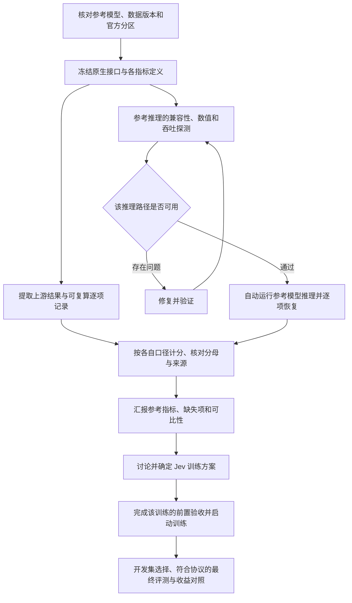

# 指令之间的逻辑、当前进度与实验执行次序

日期：2026-10-30。依据：D1–D7 完整答复，以及其后“自动驱动和执行还是要完成”“推理实验也是实验”的澄清。本文件补充 04，纠正将参考指标工作过度收窄为文献整理的理解，不修改实验预注册的指标、阈值和数据划分。

**阅读入口（截至 2026-10-30 17:31 UTC 已记录证据）：** Kev 三尺寸 × 五套原生 test 和 Nimble 七套原生 test 已完成限定范围独立验收；Open-Jev 公共 test 与其补测依赖队列仍在推进。共同测试 Typed Decisions 已完成 Kev 三尺寸的全量 token 预检和真实合成前向探测，以及 Nimble 全量 token 预检，尚未形成正式共同测试成绩。完整当前状态见第 4.1 节；第 4.2 节保留历史快照，不能把其中“运行中”“待启动”当成最新状态。

用户此轮要求的交付包含两条相互配合的工作线：一条是解释现状、决策与次序的本文件；另一条是持续运行的参考推理和自动执行。写完说明文件不代表实验交付已经完成。

**17:37 UTC 执行追加：** E26 三个 Kev 尺寸的共同测试正式任务及独立 CPU 验收器均已实际启动，分别使用 175 的 chip 0／4／5。核对时 0.8B 为 41／400 states，4B 为 10／400，9B 正完成全量 token 预检后进入前向；每尺寸最终覆盖 2,000 questions。下文 17:31 快照中的“待正式启动”由此更新，最终指标仍等待完整运行与验收。启动恢复保护的 9 项测试及 driver／独立验收链的 35 项测试通过，完整自动故障恢复仍有明确待办。

## 1. 当前结论

**当前应该继续实际推理实验和自动执行；先交付可追溯的参考测试指标，再讨论新的 Jev 训练方案。** 推理也是实验，工程验证也是实验，但它们回答的问题不同。暂停新增正式训练，不意味着暂停所有实验。

此前“先整理已发布结果，需要新推理再列缺口”的写法不充分：它允许只交文献表而遗漏用户要求的实际执行。现在明确，文献结果是参照，能运行的参考评测必须进入执行计划；不能用导出 JSON、启动监控或训练器验证代替模型推理。

## 2. 各条指令如何同时成立

| 指令 | 约束对象 | 对当前工作的作用 | 不应引申出的限制 |
| --- | --- | --- | --- |
| 原总目标：Qwen3.5 小于 10B 的训练优化与同测试集对比 | 最终研究交付 | 保留训练与收益验证目标 | 不能据此跳过 D1，立刻启动新正式训练 |
| D1：先参考指标，后训练讨论 | 阶段依赖 | 现在做参考模型的推理复测、分口径统计与比较 | 不是“只读文献”；不是“推理也要等训练讨论” |
| D2：暂时取消算力预算 | 资源上限 | 旧 24 小时约束不再生效；按依赖和资源实际占用排程 | 不取消吞吐优化、成本记录和其他任务资源所有权 |
| D3／D4／D7：真实业务暂不考虑 | 研究范围 | 用公开任务解释与业务目标相关的正确性、稳定性、校准及效率收益 | 不要求先取得真实业务数据、业务负责人或上线权限 |
| D5：接受原建议 | 研究设计 | 独立 seed 范围在读取该批结果前确定 | 不是现在自动冻结任意 seed 数，也不是看到结果后补有利 seed |
| D6：接受原建议 | 候选架构 | B 保留为候选：S1 过程监测，确定性 controller 生效 | 不把真实业务控制系统实施加到本阶段推理的前置依赖 |
| 自动驱动和执行仍须完成 | 执行方式 | 需要真实任务启动、恢复、结果产出及失败处置 | watchdog 只能监测，不能单独算作调度器已交付 |
| 推理实验也是实验 | 实验分类 | 推理纳入预注册、运行、记录、审查和完成统计 | 不能把“未训练”说成“未做实验”，也不能把正在跑的工程检查说成已完成参考推理 |
| 效率问题先修复 | 单个受影响任务的执行前提 | 大规模运行前做有界的正确性与吞吐探测；确认问题后先修复 | 不是等待所有训练工程问题解决才允许任何参考推理 |

“先汇报，再讨论”是阶段关系；“自动驱动”是执行方式；“暂不考虑真实业务”是范围约束。这三者并不冲突。

## 3. 真正的依赖顺序

不同模型的接口适配、文献指标核对和已就绪组合的推理可以并行；不必等待全部仓库盘点结束才开始首个可靠组合。某个模型失败应阻断其下游，不应无理由阻断其他独立评测。

已有可靠逐项预测能够支持不同公式时，优先复算，不为每个指标重复推理。模型权重、prompt、readout 或题目发生变化时，不能把旧预测当作新配置的结果。

参考 test 的结果可以帮助识别需要研究的缺陷，但不能作为后续新模型反复调参的依据。训练后的模型选择、温度和阈值选择仍使用开发集，最终 test 按预注册协议评估；参考模型之间的分数差不等于我们继续训练的收益。

**门禁按对象生效：** E3 仍约束相应 K0 证据的读取和采用；最终 test lock 仍约束尚未完成选择的 NGA 候选。它们不自动变成所有参考模型 test 的统一禁读条件。原生参考模型可以在自己的评测协议就绪后运行。训练器完整 suite 属于训练路径验收；共享组件确实被推理使用时，才把该组件的正确性列为对应推理依赖。

## 4. 目前完成了什么，还没完成什么

### 4.1 当前已形成的证据（截至 17:31 UTC）

这里的“完成”要求已取得对应结果和限定范围验收；预检、启动和自动等待分别登记。运行中的格不提前填最终成绩。

| 工作 | 已完成、运行中或待执行 | 下一步及结论边界 |
| --- | --- | --- |
| Kev 原生参考推理 E7／E9／E12／E20／E22 | 0.8B、4B、9B 三尺寸 × decision-v7、transfer-v4、hard-v1、documents-v1、devtools 五套 test，共 15 个组合均完成限定范围独立验收 | 已有 accuracy、Brier、ECE、NLL 等分口径结果；devtools full／release 分母分列。概率与上游有差异，不宣称所有指标数值复现 |
| Nimble 原生参考推理 E25 | 七套 test、1,884 行全部完成；152 个冻结文件覆盖 150 个必需依赖，独立重算通过，当前审查标记为 0 | E19／E21 因漏冻结 base config 的失败证据保留。不同于上游的成绩如实列出；缺上游逐题结果，尚不能定位翻转或归因硬件 |
| Open-Jev-2B／9B 公共 test | 各 10,356 行的推理及独立 CPU 后处理链已经启动；17:31 UTC 摘要分别为 9,746／10,356、5,895／10,356 行，尚无最终完整成绩 | 等待实际终态、完整覆盖、独立计分和保留容器退出证据。不能将公共投影写成原始完整 10,532 行 test |
| 原始 Open-Jev test 补测 E23／E24 | 五个原数据分区恢复并匹配 SHA256；176 行 test 缺失部分已导出；CPU 依赖队列已实际运行，分别等待各尺寸公共推理验收 | 自动转移对应资源并补推理，再按原位置／ID／内容合并成 10,532 行；各组件审查标记继续保留。OOD 15,920 行恢复不等于已经推理 |
| Typed Decisions：Kev E26 | 三尺寸均完成全 400 states／2,000 questions token 预检，最长 packed 836；17:19 UTC 记录三个尺寸真实合成双次前向 probe 完成 | probe 仅证明对应路径可执行与重复数值检查通过，不产生 test 成绩。正式推理仍按冻结配置、完整验收链与启动核查推进 |
| Typed Decisions：Nimble E28 | 17:18 UTC 完成全 400 states／2,000 field prompts 的 CPU 预检，最长 1,312 tokens，未超过原生 2,048 上限；全五字段 schema 保留 | 尚需真实前向／吞吐探测、逐项恢复与自动后处理、Nimble 专用独立验收，然后正式推理；未把 CPU 预检算成推理成绩 |
| 共同测试与 JEVal 口径审计 | 已固定 Typed Decisions 和 JEVal 数据身份、原生接口边界；已取得 JEVal 论文公式并识别模型版本与计分差异 | JEVal 精确 ECE 边界／confidence 取法仍缺原 test scorer；初始 Nimble 有 2,047 行超过原生 26 候选上限。不得静默换模型、截候选或变更分母 |
| 自动驱动与执行 | 已实际完成多批 detached 推理及自动独立后处理；E10 有受控 SIGKILL 续跑证据；E22 有依赖与资源转移启动证据，E24 在等待前置完成 | 当前是已交付部分闭环、继续扩展接口。E26／E28 的全量运行、跨接口恢复及新队列失败恢复仍应按实际证据验收，不能宣称全部自动化已完成 |
| 工程前提 E3／trainer suite | E3 CLEAN，结构化终态及容器退出码核对为 0；trainer suite 工程验证完成 | 只证明对应工程条件；不替代参考 test、训练采用门禁或最终收益结论 |
| 对抗审查与训练 | 指定 Astra 尚无实质审查意见；新的正式研究训练未启动 | 待审保持待审。先汇报参考差距，再讨论训练方案，之后实施与收益验证 |

已有本地 accuracy 的简明对照如下（单位 %）。它们来自不同任务，不能按列平均后当作统一能力或一致性结论；更多指标及温度／公式分表见[参考指标总表](../experiments/REFERENCE-TEST-RESULTS-2026-10-30.md)。

| 原生 test／统计人群 | Kev-0.8B | Kev-4B | Kev-9B |
| --- | ---: | ---: | ---: |
| decision-v7 clean，n=1,200 | 83.750000 | 86.500000 | 87.250000 |
| transfer-v4 clean，n=656 | 69.664634 | 83.841463 | 85.213415 |
| hard-v1，n=1,088 | 66.636029 | 80.330882 | 83.455882 |
| documents-v1，n=936 | 85.149573 | 90.277778 | 89.957265 |
| devtools release，n=1,071 | 63.678805 | 75.630252 | 79.178338 |

Nimble 七套 accuracy：MASSIVE-en 86.857143%、MASSIVE-de 84%、PAWS 82.8%、Civil Comments 70%、Aegis2 81.6%、SummEval relevance 48.75%、consistency 75%；各自分母及概率／score 指标见[Nimble 专表](../experiments/NIMBLE-REFERENCE-RESULTS-2026-10-30.md)。这些是参考模型复测，不是我们继续训练的增益。Kev-9B 的 hard／devtools 各一题差异已有[逐题定位](../experiments/KEV9-EXTENDED-ROW-COMPARISON-2026-10-30.md)，仍不凭近似分数推定硬件原因。

数据与方法的具体依据见 [E26](../wiki/E26-typed-common-reference-20261030.md)、[E28](../wiki/E28-typed-nimble-reference-20261030.md)、[共同测试预检](../experiments/COMMON-REFERENCE-EVALUATION-PREFLIGHT-2026-10-30.md)和[JEVal 原论文计分审计](../experiments/JEVAL-ORIGINAL-SCORER-AUDIT-2026-10-30.md)。本节没有用文献数、代码测试或合成 probe 填充尚未产出的正式测试结果。

### 4.2 历史快照与追加记录

以下内容按当时证据保留，仅供追溯；包括已经由后续执行解决的问题。

> 当时的执行补充（2026-10-30 16:45 UTC）：Kev 三尺寸 × 五套 test 全部完成推理和限定范围独立验收；Open-Jev 公共 test 仍运行。Nimble 原运行因冻结依赖遗漏未获验收，已启动全依赖冻结的新运行 E25。Open-Jev 176 行补测 E24 已准备、未启动。当时以此补充覆盖更早状态；现在以第 4.1 节为准。

> 2026-10-30 16:55 UTC 追加：E24 的组件审查标记传递已修复并经回归验证，CPU 自动队列已真实启动，等待各尺寸公共推理通过后接续 176 行补测；不再是“未启动队列”。Kev-9B 的两处逐题翻转已定位，见[逐题差异报告](../experiments/KEV9-EXTENDED-ROW-COMPARISON-2026-10-30.md)。共同测试的版本、候选宽度和原评分口径已形成[具体预检](../experiments/COMMON-REFERENCE-EVALUATION-PREFLIGHT-2026-10-30.md)，下一步执行 adapter 与完整长度检查，尚无共同测试结果。

> 17:07 UTC 验收补充：Nimble E25 的 1,884 行复跑及独立审计已全部完成，原生七子集指标已加入参考表，异常标记 0；原失败记录保留。E26 三个 Kev 尺寸全量 token 预检通过，正式共同推理尚待真实前向和完整验收流程测试。Open-Jev 公共推理与补测等待队列继续运行。

#### 16:36 UTC 历史快照

下表仅记录 16:36 UTC 的历史状态；后续完成状态见第 4.1 节。运行中只报已核对的心跳，不提前填最终成绩。

| 工作 | 当前证据与进度 | 剩余工作 |
| --- | --- | --- |
| Kev-0.8B 参考推理 E7 | decision-v7／transfer-v4 全量完成，共 2,204 问题；独立重算通过。clean accuracy 83.75%／69.664634% | 概率与上游有差异，继续保留差异及可比性限制 |
| Kev-4B 参考推理 E9 | 同样 2,204 问题完成；自动后处理产出 `COMPLETED_SCOPED`，输出哈希已核对。clean accuracy 86.50%／83.841463% | 没有上游逐题记录，不能把总分相同称为逐题相同 |
| Kev-9B 参考推理 E12 | 全部 2,204 问题完成；自动审计核对 71 个冻结文件及全部记录，终态、wrapper、两个容器退出均为 0。clean accuracy 87.25%／85.213415% | 保留概率差异和原始 T=1 分表；对应 chip 已释放，无需重复执行 |
| Open-Jev-2B E13／E14 | 原生接口探测及全量长度预检完成；10,356 行（hard 9,995／soft 361）、28,622 个候选提示，最长 724 tokens，无超长。修正驱动后冻结 90 个文件，15:44 UTC 在 175 chip 2 启动完整推理 | 16:36:08 UTC 摘要为 4,063／10,356 行；等待独立重算；公共投影不能冒称旧完整 10,532 行 test |
| Open-Jev-9B E17／E18 | 三类合成接口探测及同一 10,356 行长度预检完成；92 个文件冻结，175 chip 1 正在完整推理 | 16:35:58 UTC 为 2,498／10,356 行；两尺寸均有独立 CPU 等待器，完整终态后重算；实质审查仍待完成 |
| 初始 Nimble E16／E19 | 原始 revision 与七个 true-test 子集已恢复，哈希／IDs 匹配；1,884 行推理已完成 | E21 于 16:33:52 UTC 独立审计失败；正在诊断，不能记为已验收，也不重启原推理覆盖证据 |
| Kev 扩展 E20 | 三尺寸的 hard／documents 均完成并通过独立审计；accuracy 分别为 66.636029%／85.149573%、80.330882%／90.277778%、83.455882%／89.957265% | 0.8B 与 9B hard 各比发布值多答对 1 题；保留概率差异，不能称完全数值复现 |
| Kev devtools E22 | 队列已实际启动三尺寸；0.8B 完成 scoped audit，完整／release accuracy 为 63.653308%／63.678805% | 两种分母为 1,073／1,071；4B／9B 在 16:36 UTC 为 437／900、223／900 records，尚无最终成绩 |
| 原始 Open-Jev 数据 E23 | 五个原分区已恢复且 SHA256 匹配；完整 test 10,532、OOD 15,920；缺失 test 176／OOD 219 行已导出 | 数据恢复不是推理完成；须预注册补充推理与身份对齐合并，才能报告同分母完整 test |
| E3 与 trainer suite | 结构化终态及容器退出码已核对为 0；E3 为 CLEAN | 只证明对应工程前提，不证明参考复测全部完成或训练收益 |
| 自动执行 | E9／E12 与 E20 完成推理后自动审计；E10 实测 SIGKILL 续跑；E22 自动依赖检查、转移资源并启动三尺寸 | 初版队列任何异常会终止整个调度器，且不支持盲目重启；未启动单元需人工核查恢复，已有推理不被停止。跨接口恢复仍待验收 |
| 对抗审查 | 已有实质实现审查及修复，但指定 Astra 的尝试只返回规则确认 | 实质 Astra 审查仍未完成，不能登记为通过 |
| 新训练与收益 | 未启动新的正式研究训练；本阶段工作是参考推理与工程验证 | 参考汇报后讨论训练设计，之后才能产生新训练收益证据 |

本地复测的准确率一致只适用于逐项注明的对应分区；E20 的两个 hard 单元存在一题差异；Brier／ECE 并非全部一致。不用 Kev 不同尺寸之间的差值代表我们的训练收益。

以下为早期核查快照：175 上 `docker ps` 当时显示 `nga-r3-precondition` 和 `nga-trainer-suite` 仍在运行；监控摘要生成于 **2026-10-30 13:59:53 UTC**。容器运行状态不能代替终态标记或结果验收。

| 交付 | 已有事实 | 当前不能宣称 |
| --- | --- | --- |
| 参考指标报告 | 已形成文献／上游结构化结果汇总；覆盖多套 test、evaluation 与 holdout，并区分口径 | 不代表所有本地模型和测试集的交叉复测完成 |
| 来源库存与导出 | 已核对两套镜像，记录数据／模型目录、结果路径与哈希 | 模型目录数量不等于独立可运行 checkpoint 数；字段数量不等于有效指标数量 |
| 实际推理复测 | Kev-0.8B 原生 pointer head 两条开发记录探测已完成；`REFERENCE_PROBE_COMPLETE.json` 为 rc=0、records=2、test_metrics=false，wrapper 于 14:09:12 UTC 写入 rc=0；完整 test 与自动执行链仍在推进 | 两条开发记录不是 test 成绩，不能提前写全量复测或数值等价结论 |
| E3 与 trainer suite | 两个已有工程验证容器仍在运行 | 不能说已通过，也不能用它们充抵参考模型 test 推理 |
| 自动执行系统 | 已有 detached 入口、恢复机制和 watchdog 基础设施 | 尚未提交完整参考评测自动闭环的验收证据 |
| Jev 训练收益 | 已有研究和工程准备；当前先建立参考证据 | 尚无本阶段已验收的新训练收益结论 |

参考统计入口：[REFERENCE-TEST-RESULTS](../experiments/REFERENCE-TEST-RESULTS-2026-10-30.md)。历史全项目进度见 [03](03-status-decisions-and-next-plan-2026-10-30.md)，其旧训练优先和真实业务并行排期已由用户决定覆盖。

推理探测证据目录：`/mnt/cephfs/xingchao/experiments/jev/reference_inference/kev08_probe_20261030/`；固定容器 `nga-reference-kev08-probe` 已退出，exit_code=0。这项更新来自本次直接核对结构化终态与容器状态，不来自对运行意图的推断。

**2026-10-30 14:24 UTC 追加执行进展：** [E7](../wiki/E7-reference-kev-test-20261030.md) 已在 175 chip 1 启动原生 Kev-0.8B 正式参考推理，自动依次执行 decision-v7 与 transfer-v4。心跳已进入 decision-v7:test，逐项预测持续写入；两套完整分区合计 2,204 问题，clean 主表分母分别为 1,200／656。尚未完成，不提前报告总分。驱动已有输入哈希、逐项恢复校验、互斥锁、完整分母检查和终态发布；更广泛模型覆盖、故障恢复实测和结果审查仍待完成。同次核对 trainer suite 结构化终态为 exit_code=0、all_executed=true，容器已退出；这不替代 E3，也不改变新正式训练需在参考汇报和方案讨论后的顺序。

**2026-10-30 14:39 UTC 追加完成进展：** E7 两套推理均完成，终态和容器退出码为 0；独立校验器核查全部 1,940 records／2,204 questions、66 个冻结文件及主要指标重算。clean accuracy 为 83.75%／69.664634%，与发布值一致，但概率和 ECE 存在差异，详见 E7；不能宣称全部指标数值等价。E3 也已于 14:25:03 UTC 完成 CLEAN，必需步骤、冻结代码和本模型／跨模型反证已复核。完成后对应芯片已释放。更广泛参考模型评测、真实故障恢复实测和实质 Astra 审查仍在待办中，整体目标未完成。

**2026-10-30 16:40 UTC 验收问题补充：** Nimble 的 E21 失败已定位为运行前依赖清单漏记基座 `config.json`，并非已证实的模型推理或计分错误。保留 E19 和失败审计，另准备全依赖冻结的同协议复跑；不事后修改原清单，也不使用未验收分数讨论训练收益。

**16:42 UTC 执行追加：** Kev-4B devtools 完成独立验收，full／release accuracy 为 75.582479%／75.630252%；0.8B 与 4B 已完成第五套测试，9B 第五套仍运行。精确分母、两种温度的 Brier／ECE／NLL 见参考指标表。

## 5. 下一阶段具体任务与完成标准

| 顺序 | 任务 | 完成标准 |
| --- | --- | --- |
| 现在，持续 | 保留既有运行，核对其摘要、终态和证据 | 既不重复启动，也不把历史目录失败数当作新实验失败数 |
| 现在，可并行 | 建立参考模型 × 数据集 × split × 方法清单 | 每个单元有可运行／缺权重／缺题目／不适用等状态和理由；缺失不填零 |
| 已完成并保留 | Kev 三尺寸 × 五套原生 test，以及 Nimble 七套原生 test | 保存配置、逐项结果、独立重算及与上游差异；仅因新指标需要时从已保存预测复算，不无故重跑 |
| 正在执行 | Open-Jev-2B／9B 公共 test 及自动 CPU 验收；E24 补测依赖队列 | 各尺寸分别核对终态／逐项覆盖／独立计分，完成一条便推进其依赖，不等待无关模型 |
| 前置验收后自动执行，已登记 E24 | Open-Jev 原 test 缺失的 176 行补充推理 | 固定同 checkpoint／prompt／精度／温度；按原位置、ID 与内容哈希和公共预测精确合并，完整 10,532 行仅计一次；另列完整 OOD 队列，不混入 test |
| 下一批共同测试 | Typed Decisions 的 Kev／Nimble 正式推理与 Open-Jev 接口准备；JEVal 资格与计分约定 | 冻结全量身份、原生接口、指标和边界；通过各自探测与验收链后自动运行。unsupported／尚不可比单元明确列出，不隐藏缺口 |
| 运行前 | 正确性与效率探测 | 记录精度、样本、每 chip 吞吐、芯片数及 reserved memory；不能把开发探测写成全量成绩 |
| 路径就绪后 | 自动启动并完成推理 | 固定容器名、脱离会话运行、CephFS 日志／heartbeat／终态、逐项恢复、确切重启命令；不跳过失败单元伪造完成 |
| 每批完成后 | 计分、复核、报告 | 验证预期题目集合、重复／遗漏、无效回答分母、不同公式及来源；逐项读出能回溯总表 |
| 推理阶段持续 | 对抗审查与异常处置 | 异常 0／1、相同指标、小样本和来源冲突需诊断；Astra 需有实质意见，规则确认不算通过 |
| 参考交付后 | 训练方案讨论 | 基于已观察差距确定训练目标、数据、loss、readout、对照与 seed；具体方案不在本文件提前冻结 |

参考阶段的汇报门槛是：约定范围每个单元都有已验收结果，或明确的未完成／不适用及原因；同表写清 checkpoint、dataset／split、计分方法、分母、结果来源和可比性。不把无法得到的私有权重或原始 scorer 伪装成“已复现”。阶段汇报可以持续更新；进入训练讨论时必须把剩余缺口及其影响一起交给用户判断，不能以训练试跑替代这个讨论。

自动执行的验收要看依赖驱动与真实结果：不能仅定时轮询；也不能看到容器退出就当作成功。必须核对该任务的终态、预期产物和来源；恢复时防重复与资源冲突。工程验证可以包含合成数据或受控的权重更新测试，它们不等于新增正式研究训练。

## 6. 需要用户决策的内容

**目前仅有一个影响推理规模的范围问题：**“各参考模型在目前各个数据集上”是先完成文献对应组合和核心共同测试集，还是要求所有本地可运行参考模型与所有适用测试集的完整交叉评测？两者会改变队列长度，不改变推理已获授权这个事实。

已提出该问题，暂无答复；它是可选的范围扩展，不阻断当前文献对应组合。等待答复时，继续已有工程验证，以及文献明确对应、数据和模型可得的参考推理准备与执行，不停工。核心共同测试集 Typed Decisions 与 JEVal 已列出具体版本和样本集合；各模型仍须完成各自的资格检查、协议冻结和实际推理，不能把一个接口预检通过当成所有单元完成。

无需再次确认是否允许推理、是否继续自动执行、是否沿用 24 小时预算、是否马上接真实业务；这些已有明确指令。新的正式训练方案在参考汇报后讨论。缺少权重、私有题目或受限服务等实际障碍出现时，再就具体缺口说明能完成的范围，不能事先用假设性障碍拖延整个阶段。

### 6.1 已解决的决策与之后才需要决定的内容

D1–D4／D7 已明确当前顺序与范围；D5／D6 已接受既有建议，不重新请求同一授权。现在不需要决定训练超参数、真实业务接入、生产部署或预算上限。参考表具备可追溯数据后，再提交具体训练选项：优先补哪类缺陷、数据与 readout／loss 的对照、模型尺寸、预先确定的 seed，以及收益和退化的判据。那些选择属于下一阶段，不能由本轮参考 test 反复调参代替。

当前需主动处理的是证据缺口：上游逐题记录缺失时只报可核对的差异；指定 Astra 未给出实质评审时保持待审；运行中的格留空并给进度。不能把这些缺口全部转成需要用户批准的事项。
