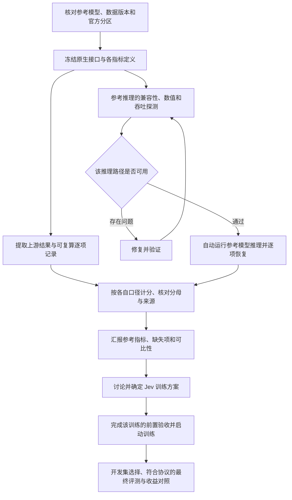

# 指令之间的逻辑、当前进度与实验执行次序

日期：2026-10-30。依据：D1–D7 完整答复，以及其后“自动驱动和执行还是要完成”“推理实验也是实验”的澄清。本文件补充 04，纠正将参考指标工作过度收窄为文献整理的理解，不修改实验预注册的指标、阈值和数据划分。

## 1. 当前结论

**当前应该继续实际推理实验和自动执行；先交付可追溯的参考测试指标，再讨论新的 Jev 训练方案。** 推理也是实验，工程验证也是实验，但它们回答的问题不同。暂停新增正式训练，不意味着暂停所有实验。

此前“先整理已发布结果，需要新推理再列缺口”的写法不充分：它允许只交文献表而遗漏用户要求的实际执行。现在明确，文献结果是参照，能运行的参考评测必须进入执行计划；不能用导出 JSON、启动监控或训练器验证代替模型推理。

## 2. 各条指令如何同时成立

| 指令 | 约束对象 | 对当前工作的作用 | 不应引申出的限制 |
| --- | --- | --- | --- |
| 原总目标：Qwen3.5 小于 10B 的训练优化与同测试集对比 | 最终研究交付 | 保留训练与收益验证目标 | 不能据此跳过 D1，立刻启动新正式训练 |
| D1：先参考指标，后训练讨论 | 阶段依赖 | 现在做参考模型的推理复测、分口径统计与比较 | 不是“只读文献”；不是“推理也要等训练讨论” |
| D2：暂时取消算力预算 | 资源上限 | 旧 24 小时约束不再生效；按依赖和资源实际占用排程 | 不取消吞吐优化、成本记录和其他任务资源所有权 |
| D3／D4／D7：真实业务暂不考虑 | 研究范围 | 用公开任务解释与业务目标相关的正确性、稳定性、校准及效率收益 | 不要求先取得真实业务数据、业务负责人或上线权限 |
| D5：接受原建议 | 研究设计 | 独立 seed 范围在读取该批结果前确定 | 不是现在自动冻结任意 seed 数，也不是看到结果后补有利 seed |
| D6：接受原建议 | 候选架构 | B 保留为候选：S1 过程监测，确定性 controller 生效 | 不把真实业务控制系统实施加到本阶段推理的前置依赖 |
| 自动驱动和执行仍须完成 | 执行方式 | 需要真实任务启动、恢复、结果产出及失败处置 | watchdog 只能监测，不能单独算作调度器已交付 |
| 推理实验也是实验 | 实验分类 | 推理纳入预注册、运行、记录、审查和完成统计 | 不能把“未训练”说成“未做实验”，也不能把正在跑的工程检查说成已完成参考推理 |
| 效率问题先修复 | 单个受影响任务的执行前提 | 大规模运行前做有界的正确性与吞吐探测；确认问题后先修复 | 不是等待所有训练工程问题解决才允许任何参考推理 |

“先汇报，再讨论”是阶段关系；“自动驱动”是执行方式；“暂不考虑真实业务”是范围约束。这三者并不冲突。

## 3. 真正的依赖顺序

不同模型的接口适配、文献指标核对和已就绪组合的推理可以并行；不必等待全部仓库盘点结束才开始首个可靠组合。某个模型失败应阻断其下游，不应无理由阻断其他独立评测。

已有可靠逐项预测能够支持不同公式时，优先复算，不为每个指标重复推理。模型权重、prompt、readout 或题目发生变化时，不能把旧预测当作新配置的结果。

**门禁按对象生效：** E3 仍约束相应 K0 证据的读取和采用；最终 test lock 仍约束尚未完成选择的 NGA 候选。它们不自动变成所有参考模型 test 的统一禁读条件。原生参考模型可以在自己的评测协议就绪后运行。训练器完整 suite 属于训练路径验收；共享组件确实被推理使用时，才把该组件的正确性列为对应推理依赖。

## 4. 目前完成了什么，还没完成什么

### 4.1 当前快照（2026-10-30 15:27 UTC）

下表覆盖后面的历史状态；历史条目保留，方便追溯进展。运行中只报已核对的心跳，不提前填最终成绩。

| 工作 | 当前证据与进度 | 剩余工作 |
| --- | --- | --- |
| Kev-0.8B 参考推理 E7 | decision-v7／transfer-v4 全量完成，共 2,204 问题；独立重算通过。clean accuracy 83.75%／69.664634% | 概率与上游有差异，继续保留差异及可比性限制 |
| Kev-4B 参考推理 E9 | 同样 2,204 问题完成；自动后处理产出 `COMPLETED_SCOPED`，输出哈希已核对。clean accuracy 86.50%／83.841463% | 没有上游逐题记录，不能把总分相同称为逐题相同 |
| Kev-9B 参考推理 E12 | 175 chip 1 正在执行；15:27:06 UTC 心跳为 decision-v7 1,007／1,176 records，1.8002 问题/s/chip，单 chip，reserved 31.1094 GiB | 完成 decision-v7 与 transfer-v4；自动后处理已启动并等待终态，随后独立审计与发布值比较 |
| Open-Jev-2B E13／E14 | 原生 choice／noul／score 合成接口探测完成；公共 test 校验为 10,356 行（hard 9,995／soft 361）；E14 已登记 | 正在实现全量驱动和原生长度预检；通过后执行全量。公共投影不能冒称旧完整 10,532 行 test |
| E3 与 trainer suite | 结构化终态及容器退出码已核对为 0；E3 为 CLEAN | 只证明对应工程前提，不证明参考复测全部完成或训练收益 |
| 自动执行 | E9 已实际完成“推理→终态检查→独立审计→文献对比”；E10 实测 SIGKILL 后逐项续跑成功；E12 后处理在等待上游 | 尚非所有模型的通用调度器。Open-Jev／Nimble 接口、跨模型队列及更广故障边界仍要完成 |
| 对抗审查 | 已有实质实现审查及修复，但指定 Astra 的尝试只返回规则确认 | 实质 Astra 审查仍未完成，不能登记为通过 |
| 新训练与收益 | 未启动新的正式研究训练；本阶段工作是参考推理与工程验证 | 参考汇报后讨论训练设计，之后才能产生新训练收益证据 |

本地复测的准确率一致仅限上述对应模型／同一 clean 分区；Brier／ECE 并非全部一致。不用 Kev 不同尺寸之间的差值代表我们的训练收益。

### 4.2 历史快照与追加记录

以下为早期核查快照：175 上 `docker ps` 当时显示 `nga-r3-precondition` 和 `nga-trainer-suite` 仍在运行；监控摘要生成于 **2026-10-30 13:59:53 UTC**。容器运行状态不能代替终态标记或结果验收。

| 交付 | 已有事实 | 当前不能宣称 |
| --- | --- | --- |
| 参考指标报告 | 已形成文献／上游结构化结果汇总；覆盖多套 test、evaluation 与 holdout，并区分口径 | 不代表所有本地模型和测试集的交叉复测完成 |
| 来源库存与导出 | 已核对两套镜像，记录数据／模型目录、结果路径与哈希 | 模型目录数量不等于独立可运行 checkpoint 数；字段数量不等于有效指标数量 |
| 实际推理复测 | Kev-0.8B 原生 pointer head 两条开发记录探测已完成；`REFERENCE_PROBE_COMPLETE.json` 为 rc=0、records=2、test_metrics=false，wrapper 于 14:09:12 UTC 写入 rc=0；完整 test 与自动执行链仍在推进 | 两条开发记录不是 test 成绩，不能提前写全量复测或数值等价结论 |
| E3 与 trainer suite | 两个已有工程验证容器仍在运行 | 不能说已通过，也不能用它们充抵参考模型 test 推理 |
| 自动执行系统 | 已有 detached 入口、恢复机制和 watchdog 基础设施 | 尚未提交完整参考评测自动闭环的验收证据 |
| Jev 训练收益 | 已有研究和工程准备；当前先建立参考证据 | 尚无本阶段已验收的新训练收益结论 |

参考统计入口：[REFERENCE-TEST-RESULTS](../experiments/REFERENCE-TEST-RESULTS-2026-10-30.md)。历史全项目进度见 [03](03-status-decisions-and-next-plan-2026-10-30.md)，其旧训练优先和真实业务并行排期已由用户决定覆盖。

推理探测证据目录：`/mnt/cephfs/xingchao/experiments/jev/reference_inference/kev08_probe_20261030/`；固定容器 `nga-reference-kev08-probe` 已退出，exit_code=0。这项更新来自本次直接核对结构化终态与容器状态，不来自对运行意图的推断。

**2026-10-30 14:24 UTC 追加执行进展：** [E7](../wiki/E7-reference-kev-test-20261030.md) 已在 175 chip 1 启动原生 Kev-0.8B 正式参考推理，自动依次执行 decision-v7 与 transfer-v4。心跳已进入 decision-v7:test，逐项预测持续写入；两套完整分区合计 2,204 问题，clean 主表分母分别为 1,200／656。尚未完成，不提前报告总分。驱动已有输入哈希、逐项恢复校验、互斥锁、完整分母检查和终态发布；更广泛模型覆盖、故障恢复实测和结果审查仍待完成。同次核对 trainer suite 结构化终态为 exit_code=0、all_executed=true，容器已退出；这不替代 E3，也不改变新正式训练需在参考汇报和方案讨论后的顺序。

**2026-10-30 14:39 UTC 追加完成进展：** E7 两套推理均完成，终态和容器退出码为 0；独立校验器核查全部 1,940 records／2,204 questions、66 个冻结文件及主要指标重算。clean accuracy 为 83.75%／69.664634%，与发布值一致，但概率和 ECE 存在差异，详见 E7；不能宣称全部指标数值等价。E3 也已于 14:25:03 UTC 完成 CLEAN，必需步骤、冻结代码和本模型／跨模型反证已复核。完成后对应芯片已释放。更广泛参考模型评测、真实故障恢复实测和实质 Astra 审查仍在待办中，整体目标未完成。

## 5. 下一阶段具体任务与完成标准

| 顺序 | 任务 | 完成标准 |
| --- | --- | --- |
| 现在，持续 | 保留既有运行，核对其摘要、终态和证据 | 既不重复启动，也不把历史目录失败数当作新实验失败数 |
| 现在，可并行 | 建立参考模型 × 数据集 × split × 方法清单 | 每个单元有可运行／缺权重／缺题目／不适用等状态和理由；缺失不填零 |
| 现在 | 优先原生 Kev 0.8B 的公开官方 test 路径 | 核实 checkpoint、pointer head、prompt、服务温度和计分实现；保留不同接口的区分 |
| 运行前 | 正确性与效率探测 | 记录精度、样本、每 chip 吞吐、芯片数及 reserved memory；不能把开发探测写成全量成绩 |
| 路径就绪后 | 自动启动并完成推理 | 固定容器名、脱离会话运行、CephFS 日志／heartbeat／终态、逐项恢复、确切重启命令；不跳过失败单元伪造完成 |
| 每批完成后 | 计分、复核、报告 | 验证预期题目集合、重复／遗漏、无效回答分母、不同公式及来源；逐项读出能回溯总表 |
| 推理阶段持续 | 对抗审查与异常处置 | 异常 0／1、相同指标、小样本和来源冲突需诊断；Astra 需有实质意见，规则确认不算通过 |
| 参考交付后 | 训练方案讨论 | 基于已观察差距确定训练目标、数据、loss、readout、对照与 seed；具体方案不在本文件提前冻结 |

自动执行的验收要看依赖驱动与真实结果：不能仅定时轮询；也不能看到容器退出就当作成功。必须核对该任务的终态、预期产物和来源；恢复时防重复与资源冲突。工程验证可以包含合成数据或受控的权重更新测试，它们不等于新增正式研究训练。

## 6. 需要用户决策的内容

**目前仅有一个影响推理规模的范围问题：**“各参考模型在目前各个数据集上”是先完成文献对应组合和核心共同测试集，还是要求所有本地可运行参考模型与所有适用测试集的完整交叉评测？两者会改变队列长度，不改变推理已获授权这个事实。

已提出该问题。等待答复时，继续已有工程验证，以及文献明确对应、数据和模型可得的参考推理准备与执行，不停工。核心共同测试集仍需在运行前列出具体版本和样本集合；不会把尚未确认的任意子集当成最终全覆盖。

无需再次确认是否允许推理、是否继续自动执行、是否沿用 24 小时预算、是否马上接真实业务；这些已有明确指令。新的正式训练方案在参考汇报后讨论。缺少权重、私有题目或受限服务等实际障碍出现时，再就具体缺口说明能完成的范围，不能事先用假设性障碍拖延整个阶段。
