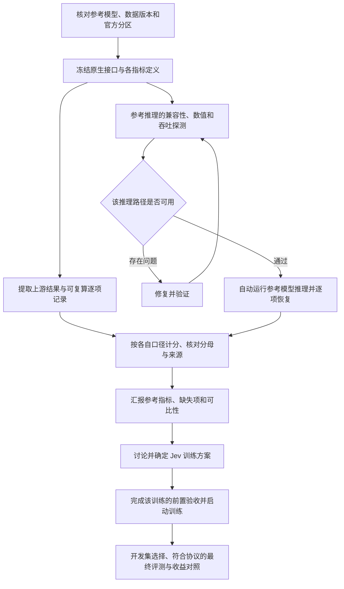

# 指令之间的逻辑、当前进度与实验执行次序

**2026-10-31 阅读说明：** 本文件的执行进度保留为 10 月 30 日 UTC 的历史记录；下文“当前”“运行中”“待审”均指各自截点。最新进度、已确认决策及下一阶段计划以 [06：当前任务现状](06-status-inference-first-2026-10-31.md) 为准。本文第 1–3 节的指令逻辑仍适用：推理也是实验，参考推理和自动执行继续，参考汇报后才讨论新的正式训练。

初版日期：2026-10-30；本次更新：2026-10-30 20:11 UTC（北京时间 10 月 31 日 04:11）。依据：D1–D7 完整答复，以及其后“自动驱动和执行还是要完成”“推理实验也是实验”的澄清。本文件补充 04，纠正将参考指标工作过度收窄为文献整理的理解，不修改实验预注册的指标、阈值和数据划分。

**当前阅读入口：** 参考推理和实验自动执行继续推进，新的正式训练仍排在参考指标汇报与方案讨论之后。Kev 三尺寸 × 五套原生 test、Nimble 七套原生 test、Open-Jev 两尺寸原始完整 test，以及 Typed Decisions 六模型均已取得本地结果和限定范围独立验收。当前另有 **4 项 JEVal 正式推理、2 项原始 OOD 推理**在运行；Open-Jev 两尺寸的 JEVal 全量推理尚未启动，因为候选分块没有通过预注册的数值等价检查。已有指定 Astra 的实质审查，但五项发现仍处于修复、验证与复审流程中，不能写成放行。

**本轮需要完成两份交付：** 一份是本文说明的任务逻辑、进度、决策和计划；另一份是仍在持续产生结果的推理与自动执行链。文件写完、代码测试通过或容器启动，都不能代替全量推理、计分和验收完成。当前没有需要用户重复批准才能继续的工程步骤；尚未答复的完整交叉评测范围保留为待定扩展，不阻断已明确的参考组合和共同测试。

**20:48 UTC 只读运行快照：** Kev-0.8/4/9 与 Nimble JEVal 分别为 9111/6403/6461/4994（各 11257），Open-Jev-2B/9B 原始 OOD 为 13618/9451（各 15920）；均仍在运行，数字只表示心跳进度，不是最终成绩。

**20:46 UTC 最新接续状态：** 三个 Kev 的新增强审计等待器 v7r2 已实际启动，迁移终态与 wrapper 均为 0，旧代失败证据保留；模型和 finisher 的 ID、StartedAt 均未改变。新等待器沿用经 Astra 限定复审的 waiter／auditor，启动器另以结构化 HTTP 404 修复 Docker 文本兼容问题，并通过 16 项测试。Nimble 新队列也已运行。当前仍是四项 JEVal、两项 OOD 模型推理持续进行，不能把控制器接续成功填成测试完成。E37 已补齐 detached CPU 准备／验收工具，35 项准备器与 10 项诊断测试通过，尚未占用芯片或执行诊断。

**20:45 UTC Nimble 接续补充：** 旧 Nimble CPU 调度器已在保存 ID、FinishedAt 和停止意图后停止；模型与 finisher 未停止。新的 CPU 准备容器实际退出 0，新的 23 文件队列计划通过逐文件哈希和接管身份核对后启动，20:44 UTC 已驱动同一 Nimble 推理达到 4,732/11,257。该过程是自动执行链的接续证据，不是模型完成或指标验收；完整 receipts、原生审计、增强审计和真实空闲芯片查询仍待完成。

**20:38 UTC v6 接续实测补充：** v6 的只读 dry check 通过，随后实际接续在 Kev-0.8B 旧 CPU waiter 上按固定脚本停止该 waiter，保留了 INTENT、旧容器 FinishedAt/EXIT 证据；模型和 finisher 未停止。新 waiter 因 Docker 不同版本的“容器不存在”错误文本匹配过严而拒绝启动，迁移终态为 rc=1，Kev-4B／9B 旧 waiter 未操作。该代次完整失败证据保留，不能把 v6 写成已部署；下一步修复启动器并用新代次从明确的旧中断证据接续。

**20:22 UTC 修订复审补充：** 指定 Astra 已对 auditor／waiter／v4 launcher 给出第二次实质意见，结论为暂不部署 v4。完整 manifest 与 valid_accuracy 修复已有局部正面核查，但又发现最终报告提交绑定、只读挂载检查、终态保留及三类恢复接缝共六项问题，正在按具体路径修复；v4 尚未部署，原模型继续运行。复审的外层进程超时，但完整最终消息已从有界事件诊断恢复，不能把运行器记为正常退出。详见[复审原文及证据边界](../experiments/ASTRA-JEVAL-WAITER-REREVIEW-2026-10-30.md)。资源检查还须覆盖实际设备进程；Docker 挂载检查通过不等于该项全部关闭。

19:00–19:58 UTC 的入口与追加记录（保留当时状态；当前状态见第 4.1 节）

**阅读入口（2026-10-30 19:00 UTC）：** Kev 三尺寸 × 五套原生 test、Nimble 七套原生 test、Open-Jev 两尺寸原始完整 test，以及 Typed Decisions 六模型共同测试均已有本地推理和限定范围独立验收。Open-Jev 原始 test 的审查标记仍保留。两尺寸原始 OOD 正式推理正在运行；JEVal 六模型全量资格检查完成，Kev-0.8B 已通过真实长输入探测并实际启动正式推理，Kev-4B 与 Kev-9B v2 的真实长输入探测也已核验通过，正在准备正式推理；Open-Jev 两尺寸和 Nimble 继续前向准入。尚无新训练收益或 Astra 实质放行。

**19:13 UTC 执行追加（北京时间 10 月 31 日 03:13）：** Kev-0.8B／4B／9B 的 JEVal 正式推理及独立 CPU 验收链均已实际运行，分别使用 chips 0／3／5。Kev-4B 的旧启动失败已定位为挂载顺序误拒，旧容器与记录保留，修正版独立探测通过后启动新的正式运行。Open-Jev-2B 的 JEVal 探测已验收；19:16 UTC 追加：9B 探测也已验收，Nimble 已在 chip 1 实际启动探测，尚待结果。下文 19:00 表保留为较早计数快照；完整 JEVal 与 OOD 最终成绩仍未产出。本次再次请求 Astra 实质审查，返回仍只有规则确认，不能算通过。

**19:27 UTC 审查修正：** Nimble 探测已验收，三个剩余模型正式配置已冻结、尚未启动。新的实质代码审查发现 Open-Jev 最长单输入探测没有覆盖候选批量的内存上界：已测 30×4,096，而另有 eligible 输入达到 255×2,156。其正式 JEVal 启动需先补候选分块的数值／内存验证；候选集合、输入长度和指标分母不变。三个 Kev 正式推理与两个 OOD 任务继续运行。同时增加外部独立验收，补齐 probe 输出 schema、完整 eligibility、必需执行文件和题型／来源异常标记检查；不修改活跃运行的冻结源码，不把验收漏洞写成已证明模型结果错误。本次是当前 Codex 的实质审查，仍非指定 Astra 放行。

**19:51 UTC 新证据：** 六个真实 JEVal probe 已完成 E35 增强验收（独立 CPU 重分词、输出 schema／logits／概率、冻结闭包和实际退出核对）；这不等于全量 test 验收。三个 Kev 的增强验收等待器已实际运行。E36 两尺寸 Open-Jev 的候选分块均能完成最坏批量，但原路径与分块路径概率分别出现约 0.01414／0.00000939 的差异，两路径自身重复差为 0，故均未通过原定纯效率等价门槛，不能填成“已准入”。保留失败，继续审查后续实现或明确不同数值配置的评测协议；不按 test 正确率调 batch，也不删去超大候选题。19:53 UTC 追加：Nimble 正式自动队列已实际启动模型推理和原生验收器，之后自动接续增强验收；四个模型的 JEVal 正式推理现已在运行。

**19:58 UTC 对抗审查更新：** 通过指定 `gpt-6-astra` 的独立只读 CLI 通道取得实质六文件审查，见 [Astra 报告](../experiments/ASTRA-JEVAL-REVIEW-2026-10-30.md)。发现两项高优先级问题（资源访问方式检查不全、最终验收缺逐题产物持续绑定）和三项恢复／异常标记缺口，正在修复并追加负例／真实中断验证。此前“尚无实质审查”只对应旧时间点；现在已有审查，但**尚未放行**。运行中模型继续保留，控制器与独立审计的修订将使用新冻结版本和显式接续，不改写已运行的源文件。

本轮原始 test 的自动依赖、补测与精确合并两尺寸均实际完成；E30 的 CPU worker／audit 双中断恢复也通过。已有完成结果与长任务并行推进，写完本文件不等于全部实验交付完成。旧追加状态可由 Git 历史和第 4.2 节追溯；以当前表和带时间戳的实验记录为准。

## 1. 当前结论

**当前应该继续实际推理实验和自动执行；先交付可追溯的参考测试指标，再讨论新的 Jev 训练方案。** 推理也是实验，工程验证也是实验，但它们回答的问题不同。暂停新增正式训练，不意味着暂停所有实验。

此前“先整理已发布结果，需要新推理再列缺口”的写法不充分：它允许只交文献表而遗漏用户要求的实际执行。现在明确，文献结果是参照，能运行的参考评测必须进入执行计划；不能用导出 JSON、启动监控或训练器验证代替模型推理。

## 2. 各条指令如何同时成立

| 指令 | 约束对象 | 对当前工作的作用 | 不应引申出的限制 |
| --- | --- | --- | --- |
| 原总目标：Qwen3.5 小于 10B 的训练优化与同测试集对比 | 最终研究交付 | 保留训练与收益验证目标 | 不能据此跳过 D1，立刻启动新正式训练 |
| D1：先参考指标，后训练讨论 | 阶段依赖 | 现在做参考模型的推理复测、分口径统计与比较 | 不是“只读文献”；不是“推理也要等训练讨论” |
| D2：暂时取消算力预算 | 资源上限 | 旧 24 小时约束不再生效；按依赖和资源实际占用排程 | 不取消吞吐优化、成本记录和其他任务资源所有权 |
| D3／D4／D7：真实业务暂不考虑 | 研究范围 | 用公开任务解释与业务目标相关的正确性、稳定性、校准及效率收益 | 不要求先取得真实业务数据、业务负责人或上线权限 |
| D5：接受原建议 | 研究设计 | 独立 seed 范围在读取该批结果前确定 | 不是现在自动冻结任意 seed 数，也不是看到结果后补有利 seed |
| D6：接受原建议 | 候选架构 | B 保留为候选：S1 过程监测，确定性 controller 生效 | 不把真实业务控制系统实施加到本阶段推理的前置依赖 |
| 自动驱动和执行仍须完成 | 执行方式 | 需要真实任务启动、恢复、结果产出及失败处置 | watchdog 只能监测，不能单独算作调度器已交付 |
| 推理实验也是实验 | 实验分类 | 推理纳入预注册、运行、记录、审查和完成统计 | 不能把“未训练”说成“未做实验”，也不能把正在跑的工程检查说成已完成参考推理 |
| 效率问题先修复 | 单个受影响任务的执行前提 | 大规模运行前做有界的正确性与吞吐探测；确认问题后先修复 | 不是等待所有训练工程问题解决才允许任何参考推理 |

“先汇报，再讨论”是阶段关系；“自动驱动”是执行方式；“暂不考虑真实业务”是范围约束。这三者并不冲突。

这里还要区分两种 controller：**实验执行 controller** 负责依赖、资源占用、启动、恢复和验收，现在就要完成并实际使用；**D6 的模型系统 controller** 是后续 S1／S2 研究的候选机制。实现前者不需要等后者的训练设计，也不意味着已验证后者的业务收益。

## 3. 真正的依赖顺序

不同模型的接口适配、文献指标核对和已就绪组合的推理可以并行；不必等待全部仓库盘点结束才开始首个可靠组合。某个模型失败应阻断其下游，不应无理由阻断其他独立评测。

已有可靠逐项预测能够支持不同公式时，优先复算，不为每个指标重复推理。模型权重、prompt、readout 或题目发生变化时，不能把旧预测当作新配置的结果。

参考 test 的结果可以帮助识别需要研究的缺陷，但不能作为后续新模型反复调参的依据。训练后的模型选择、温度和阈值选择仍使用开发集，最终 test 按预注册协议评估；参考模型之间的分数差不等于我们继续训练的收益。

**门禁按对象生效：** E3 仍约束相应 K0 证据的读取和采用；最终 test lock 仍约束尚未完成选择的 NGA 候选。它们不自动变成所有参考模型 test 的统一禁读条件。原生参考模型可以在自己的评测协议就绪后运行。训练器完整 suite 属于训练路径验收；共享组件确实被推理使用时，才把该组件的正确性列为对应推理依赖。

## 4. 目前完成了什么，还没完成什么

### 4.1 当前已形成的证据（20:11 UTC 汇总）

这里的“完成”要求已取得对应结果和限定范围验收；预检、启动和自动等待分别登记。运行中的格不提前填最终成绩。完成项以终态、独立报告和实际容器退出核对为依据；运行项用各自带时间戳的摘要，不能提前填最终分数。

| 工作 | 当前证据与进度 | 下一步及结论边界 |
| --- | --- | --- |
| Kev 原生参考推理 E7／E9／E12／E20／E22 | 0.8B、4B、9B × decision-v7、transfer-v4、hard-v1、documents-v1、devtools，共 15 个组合已完成限定范围独立验收 | accuracy、Brier、ECE、NLL 等分口径保留；devtools full／release 分母分列。不能宣称概率指标全部数值复现 |
| Nimble 原生参考推理 E25 | 七套 test、1,884 行完成；独立重算通过，审查标记 0 | E19／E21 的依赖冻结失败保留；缺上游逐题结果，不能归因差异 |
| Open-Jev-2B 公共及原始完整 test | 公共 10,356 行、缺失 176 行补测、原始 10,532 行精确合并均完成；完整 hard accuracy 94.634680%，expected accuracy 91.876577% | 状态为 `VERIFIED_ORIGINAL_TEST_REVIEW_REQUIRED`。完美子集／小样本标记及诊断保留；上游净少 8 个 hard 正确回答，不等于定位八次翻转 |
| Open-Jev-9B 公共与原始完整 test、E24 | 公共推理、176 行补测与完整 10,532 行合并均完成；原始 hard accuracy 97.511447%，上游 97.541310% | 保留公共 8 项与完整分区 8 项对应标记；净少 3 个 hard 正确回答，不作硬件或逐题翻转归因 |
| Typed Decisions：Kev E26 | 三尺寸各完成 400 states／2,000 questions，独立验收通过、审查标记 0；accuracy 45.95%／66.45%／68.05% | 原生温度与 T=1 的 KL／Brier／ECE 分表；这些是参考差异，不是我们的训练收益 |
| Typed Decisions：Nimble E28 | 18:27 更正：400 states／2,000 questions 与独立重分词／计分验收完成；accuracy 65.10%，审查标记 0 | 配置、终态、产物哈希与实际容器退出均已复核；见共同测试表 |
| Typed Decisions：Open-Jev E29 | 18:27 更正：2B／9B 各完成 2,000 questions 及独立验收，accuracy 58.25%／67.80%，审查标记 0 | 六模型共同测试现已齐全；保留原生独立候选提示与其他接口的差异 |
| JEVal 资格预检 E31 | 18:27 更正：Kev 三尺寸各 10,230 eligible／1,027 overlength；Nimble v2 为 8,006 eligible／998 overlength／2,253 unsupported，四项完整产物审计通过。Open-Jev 两尺寸各 9,704 eligible／1,553 overlength，全量产物审计也已通过 | Nimble v1 空 context 失败保留，v2 预注册修订后另跑；全 11,257 分母保留。资格检查没有模型 test 成绩 |
| JEVal 正式推理 E33／E34 | Kev-0.8B／4B v2／9B 与 Nimble 共四项在运行；Nimble 的模型和原生验收器已由队列自动启动。每项保留全 11,257 行及资格状态 | 分类分母 10,938，score 分母 319；eligible 与完整分母分开统计。尚无全量 JEVal 最终模型指标；ECE 约定明确标为本项目实现 |
| JEVal 增强 probe 审计 E35 | 六模型 probe 均完成独立 CPU 重分词、schema／logits／概率、冻结闭包、终态及实际退出核对 | 只认证六个真实 probe；不替代全量 test 或最大候选批量的内存准入 |
| Open-Jev 候选批量实验 E36 | 两尺寸均完成 20 次前向及终态核验，执行退出 0；分块与原路径概率最大差分别约 0.0141414／0.000009391，自身重复差均为 0，数值准入均为 false | 内存下降不能抵消数值等价失败。两尺寸原协议 JEVal 全量尚未启动；不放宽阈值、不删大候选题，也不按 test 标签选分块 |
| Open-Jev 后续诊断 E37 | 预注册、实现和 10 项 CPU 测试已准备；尚未冻结远程运行计划、未启动 NPU 前向 | 待合法可用芯片执行 no-op／元数据分层／层内存诊断；E37 本身不把 E36 的 false 改为 true |
| JEVal 文献计分审计 | 已固定数据身份、原生接口边界并取得论文公式；已识别模型版本、温度和计分差异 | 精确 ECE 边界／confidence 取法仍缺原 scorer；后续协议需明确复现范围，不能以近似实现冒称论文逐项复现 |
| Open-Jev 原始 OOD E32 | 18:27 更正：两个 15,920 行全量长度预检通过，最长 742 tokens；2B／9B 正式推理及独立 CPU 验收器已在 chips 4／2 启动 | 等待完整推理和独立计分；不能用 test 结果填充 OOD |
| 自动驱动与执行 | E24 两尺寸公共依赖→补测→合并、E30 CPU worker／audit 双中断恢复及 E34 队列接缝实测已有证据；Nimble 队列已实际驱动正式推理 | Astra 指出的 shell EXIT137、审计发布与终态之间等恢复接缝正在补强；旧证据不扩张为任意 NPU／主机故障认证。后续需以新冻结控制器接续并核验逐题证据后验收 |
| 工程前提 E3／trainer suite | E3 CLEAN、终态及容器退出 0；trainer suite 工程验证完成 | 不替代参考 test、训练采用门禁或最终收益结论 |
| 对抗审查与新训练 | 指定 gpt-6-astra 已对冻结六文件作实质审查，提出五项发现；修复和真实恢复验证正在推进，尚未完成复审放行。新的正式研究训练未启动 | 修复完整资源访问检查、逐题 receipt 持续绑定、两类恢复接缝与 valid_accuracy 异常检测；完成修订复审后才能形成该范围的放行结论 |

**20:11 UTC 实际运行快照（北京时间 10 月 31 日 04:11）：** 以下来自各运行的 `digest.md`，是进度而非最终测试成绩。JEVal 的计数包含逐题资格／状态记录，不能全部视为有效预测数；最终指标还须核对完整分母、有效分母和独立审计。每行芯片数均为 1，吞吐是各自当时的累计观测值，不是跨接口或硬件的公平排名。

| 运行 | 摘要时间 UTC | 已处理／预期 | q/s/chip | reserved memory（GiB） | 下一道完成条件 |
| --- | --- | ---: | ---: | ---: | --- |
| JEVal Kev-0.8B，chip 0 | 20:11:05 | 7,143／11,257 | 1.4133 | 13.5332 | 完整 receipts、终态、原生及增强独立计分、实际退出 |
| JEVal Kev-4B v2，chip 3 | 20:11:07 | 3,741／11,257 | 1.0941 | 31.4902 | 同上 |
| JEVal Kev-9B，chip 5 | 20:11:02 | 3,863／11,257 | 1.0201 | 53.3633 | 同上 |
| JEVal Nimble，chip 1 | 20:11:02 | 2,430／11,257 | 1.8370 | 18.7090 | 新冻结队列接续、完整 receipts、原生及增强验收 |
| Open-Jev-2B 原始 OOD，chip 4 | 20:11:15（心跳 20:11:02） | 9,320／15,920 | 1.5584 | 4.1465 | 完整 OOD 推理、独立计分、终态与实际退出 |
| Open-Jev-9B 原始 OOD，chip 2 | 20:11:15（心跳 20:11:06） | 6,403／15,920 | 1.1021 | 17.5879 | 同上 |

此快照从 175 只读取得。OOD 摘要位于对应 `_finish/digest.md`；直接运行目录没有同名摘要不是实验失败，也不是重启理由。已运行模型持续执行；控制器／审计修复应通过新冻结代次和显式身份接续，不改写原有冻结来源。

Kev-4B／Kev-9B v2 的已接受 probe 都覆盖 8,187 tokens 的最长 eligible 输入以及三类合成接口，各组重复前向差值为 0；它们证明该冻结路径可执行，不产生 JEVal test 分数。对应 `PROBE_REVIEW.json` 已记录核验范围。Kev-9B v1 的挂载顺序误拒证据保留，没有静默改写失败记录。

最新结果入口：[Typed Decisions 分口径表](../experiments/TYPED-REFERENCE-RESULTS-2026-10-30.md)、[Open-Jev 原始完整 test](../experiments/OPENJEV-ORIGINAL-TEST-RESULTS-2026-10-30.md)、[Open-Jev-2B 上游差异核查](../experiments/OPENJEV2-ORIGINAL-COMPARISON-2026-10-30.md)。预检和自动恢复的记录分别见 [E31](../wiki/E31-jeval-native-preflight-20261030.md)、[E30](../wiki/E30-typed-recovery-controller-20261030.md)。

本次运行状态证据位于 `/mnt/cephfs/xingchao/experiments/jev/reference_inference/`：`typed_{nimble,openjev2,openjev9}_inference_20261030_finish/digest.md`、`openjev9_test_20261030_finish/digest.md`、`openjev_original_test_queue_20261030/digest.md` 及各 `jeval_*_preflight_20261030/digest.md`。活动运行快照取自 `jeval_kev08_inference_20261030/digest.md`、`jeval_kev4_inference_20261030_v2/digest.md`、`jeval_kev9_inference_20261030/digest.md`、`jeval_nimble_inference_20261030/digest.md` 及 `openjev{2,9}_original_ood_20261030_finish/digest.md`。这些是有时间戳的观测，不保证读者打开文件时运行仍停留在相同计数。

已有本地 accuracy 的简明对照如下（单位 %）。它们来自不同任务，不能按列平均后当作统一能力或一致性结论；更多指标及温度／公式分表见[参考指标总表](../experiments/REFERENCE-TEST-RESULTS-2026-10-30.md)。

| 原生 test／统计人群 | Kev-0.8B | Kev-4B | Kev-9B |
| --- | ---: | ---: | ---: |
| decision-v7 clean，n=1,200 | 83.750000 | 86.500000 | 87.250000 |
| transfer-v4 clean，n=656 | 69.664634 | 83.841463 | 85.213415 |
| hard-v1，n=1,088 | 66.636029 | 80.330882 | 83.455882 |
| documents-v1，n=936 | 85.149573 | 90.277778 | 89.957265 |
| devtools release，n=1,071 | 63.678805 | 75.630252 | 79.178338 |

Nimble 七套 accuracy：MASSIVE-en 86.857143%、MASSIVE-de 84%、PAWS 82.8%、Civil Comments 70%、Aegis2 81.6%、SummEval relevance 48.75%、consistency 75%；各自分母及概率／score 指标见[Nimble 专表](../experiments/NIMBLE-REFERENCE-RESULTS-2026-10-30.md)。这些是参考模型复测，不是我们继续训练的增益。Kev-9B 的 hard／devtools 各一题差异已有[逐题定位](../experiments/KEV9-EXTENDED-ROW-COMPARISON-2026-10-30.md)，仍不凭近似分数推定硬件原因。

新增准入和审查证据见 [E35](../wiki/E35-jeval-hardened-artifact-audit-20261030.md)、[E36](../wiki/E36-openjev-candidate-batch-20261030.md)、[E37](../wiki/E37-openjev-batch-diagnostic-20261030.md)及 [Astra 实质审查](../experiments/ASTRA-JEVAL-REVIEW-2026-10-30.md)。

数据与方法的具体依据见 [E26](../wiki/E26-typed-common-reference-20261030.md)、[E28](../wiki/E28-typed-nimble-reference-20261030.md)、[共同测试预检](../experiments/COMMON-REFERENCE-EVALUATION-PREFLIGHT-2026-10-30.md)和[JEVal 原论文计分审计](../experiments/JEVAL-ORIGINAL-SCORER-AUDIT-2026-10-30.md)。本节没有用文献数、代码测试或合成 probe 填充尚未产出的正式测试结果。

### 4.2 历史快照与追加记录

以下内容按当时证据保留，仅供追溯；包括已经由后续执行解决的问题。

17:31–18:03 UTC 的旧入口、追加进展与状态表（已由 4.1 更新）

**阅读入口（截至 2026-10-30 17:31 UTC 已记录证据）：** Kev 三尺寸 × 五套原生 test 和 Nimble 七套原生 test 已完成限定范围独立验收；Open-Jev 公共 test 与其补测依赖队列仍在推进。共同测试 Typed Decisions 已完成 Kev 三尺寸的全量 token 预检和真实合成前向探测，以及 Nimble 全量 token 预检，尚未形成正式共同测试成绩。完整当前状态见第 4.1 节；第 4.2 节保留历史快照，不能把其中“运行中”“待启动”当成最新状态。

用户此轮要求的交付包含两条相互配合的工作线：一条是解释现状、决策与次序的本文件；另一条是持续运行的参考推理和自动执行。写完说明文件不代表实验交付已经完成。

**18:03 UTC 当前执行补充：** Open-Jev-2B 原始完整 test 的补测与精确合并已验收完成，见[完整结果与上游差异](../experiments/OPENJEV-ORIGINAL-TEST-RESULTS-2026-10-30.md)。Typed Decisions 的 Nimble、Open-Jev-2B／9B 均已通过真实前向探测并启动正式全量推理与独立 CPU 验收；18:01 UTC 摘要分别为 162／400、117／400、66／400 states，不能提前填最终分数。原生 Open-Jev-9B 公共 test 为 8,161／10,356 行。恢复 controller 的启动中断和验收接续、JEVal 全量资格预检仍在实现；尚无新训练、完整自动恢复认证或 Astra 实质放行。

**17:44 UTC 最新结果：** E26 三尺寸共同测试均完成全部 2,000 问题及独立验收，accuracy 45.95%／66.45%／68.05%，审查标记 0，见[分口径共同测试表](../experiments/TYPED-REFERENCE-RESULTS-2026-10-30.md)。Open-Jev-2B 公共 10,356 行也已完成，hard accuracy 为 94.917459%（分母 9,995），expected accuracy 为 93.004745%（分母 10,356）；保留完美子集与小样本两个审查标记，E24 已自动启动其 176 行补测。Open-Jev-9B 继续运行。以下较早快照保留追溯。

**17:37 UTC 执行追加：** E26 三个 Kev 尺寸的共同测试正式任务及独立 CPU 验收器均已实际启动，分别使用 175 的 chip 0／4／5。核对时 0.8B 为 41／400 states，4B 为 10／400，9B 正完成全量 token 预检后进入前向；每尺寸最终覆盖 2,000 questions。下文 17:31 快照中的“待正式启动”由此更新，最终指标仍等待完整运行与验收。启动恢复保护的 9 项测试及 driver／独立验收链的 35 项测试通过，完整自动故障恢复仍有明确待办。

#### 历史状态表（截至 17:31 UTC）

这里的“完成”要求已取得对应结果和限定范围验收；预检、启动和自动等待分别登记。运行中的格不提前填最终成绩。

| 工作 | 已完成、运行中或待执行 | 下一步及结论边界 |
| --- | --- | --- |
| Kev 原生参考推理 E7／E9／E12／E20／E22 | 0.8B、4B、9B 三尺寸 × decision-v7、transfer-v4、hard-v1、documents-v1、devtools 五套 test，共 15 个组合均完成限定范围独立验收 | 已有 accuracy、Brier、ECE、NLL 等分口径结果；devtools full／release 分母分列。概率与上游有差异，不宣称所有指标数值复现 |
| Nimble 原生参考推理 E25 | 七套 test、1,884 行全部完成；152 个冻结文件覆盖 150 个必需依赖，独立重算通过，当前审查标记为 0 | E19／E21 因漏冻结 base config 的失败证据保留。不同于上游的成绩如实列出；缺上游逐题结果，尚不能定位翻转或归因硬件 |
| Open-Jev-2B／9B 公共 test | 各 10,356 行的推理及独立 CPU 后处理链已经启动；17:31 UTC 摘要分别为 9,746／10,356、5,895／10,356 行，尚无最终完整成绩 | 等待实际终态、完整覆盖、独立计分和保留容器退出证据。不能将公共投影写成原始完整 10,532 行 test |
| 原始 Open-Jev test 补测 E23／E24 | 五个原数据分区恢复并匹配 SHA256；176 行 test 缺失部分已导出；CPU 依赖队列已实际运行，分别等待各尺寸公共推理验收 | 自动转移对应资源并补推理，再按原位置／ID／内容合并成 10,532 行；各组件审查标记继续保留。OOD 15,920 行恢复不等于已经推理 |
| Typed Decisions：Kev E26 | 三尺寸均完成全 400 states／2,000 questions token 预检，最长 packed 836；17:19 UTC 记录三个尺寸真实合成双次前向 probe 完成 | probe 仅证明对应路径可执行与重复数值检查通过，不产生 test 成绩。正式推理仍按冻结配置、完整验收链与启动核查推进 |
| Typed Decisions：Nimble E28 | 17:18 UTC 完成全 400 states／2,000 field prompts 的 CPU 预检，最长 1,312 tokens，未超过原生 2,048 上限；全五字段 schema 保留 | 尚需真实前向／吞吐探测、逐项恢复与自动后处理、Nimble 专用独立验收，然后正式推理；未把 CPU 预检算成推理成绩 |
| 共同测试与 JEVal 口径审计 | 已固定 Typed Decisions 和 JEVal 数据身份、原生接口边界；已取得 JEVal 论文公式并识别模型版本与计分差异 | JEVal 精确 ECE 边界／confidence 取法仍缺原 test scorer；初始 Nimble 有 2,047 行超过原生 26 候选上限。不得静默换模型、截候选或变更分母 |
| 自动驱动与执行 | 已实际完成多批 detached 推理及自动独立后处理；E10 有受控 SIGKILL 续跑证据；E22 有依赖与资源转移启动证据，E24 在等待前置完成 | 当前是已交付部分闭环、继续扩展接口。E26／E28 的全量运行、跨接口恢复及新队列失败恢复仍应按实际证据验收，不能宣称全部自动化已完成 |
| 工程前提 E3／trainer suite | E3 CLEAN，结构化终态及容器退出码核对为 0；trainer suite 工程验证完成 | 只证明对应工程条件；不替代参考 test、训练采用门禁或最终收益结论 |
| 对抗审查与训练 | 指定 Astra 尚无实质审查意见；新的正式研究训练未启动 | 待审保持待审。先汇报参考差距，再讨论训练方案，之后实施与收益验证 |

14:00–17:00 UTC 历史执行记录（由 4.1 覆盖，仅供追溯）

> 当时的执行补充（2026-10-30 16:45 UTC）：Kev 三尺寸 × 五套 test 全部完成推理和限定范围独立验收；Open-Jev 公共 test 仍运行。Nimble 原运行因冻结依赖遗漏未获验收，已启动全依赖冻结的新运行 E25。Open-Jev 176 行补测 E24 已准备、未启动。当时以此补充覆盖更早状态；现在以第 4.1 节为准。

> 2026-10-30 16:55 UTC 追加：E24 的组件审查标记传递已修复并经回归验证，CPU 自动队列已真实启动，等待各尺寸公共推理通过后接续 176 行补测；不再是“未启动队列”。Kev-9B 的两处逐题翻转已定位，见[逐题差异报告](../experiments/KEV9-EXTENDED-ROW-COMPARISON-2026-10-30.md)。共同测试的版本、候选宽度和原评分口径已形成[具体预检](../experiments/COMMON-REFERENCE-EVALUATION-PREFLIGHT-2026-10-30.md)，下一步执行 adapter 与完整长度检查，尚无共同测试结果。

> 17:07 UTC 验收补充：Nimble E25 的 1,884 行复跑及独立审计已全部完成，原生七子集指标已加入参考表，异常标记 0；原失败记录保留。E26 三个 Kev 尺寸全量 token 预检通过，正式共同推理尚待真实前向和完整验收流程测试。Open-Jev 公共推理与补测等待队列继续运行。

#### 16:36 UTC 历史快照

下表仅记录 16:36 UTC 的历史状态；后续完成状态见第 4.1 节。运行中只报已核对的心跳，不提前填最终成绩。

| 工作 | 当前证据与进度 | 剩余工作 |
| --- | --- | --- |
| Kev-0.8B 参考推理 E7 | decision-v7／transfer-v4 全量完成，共 2,204 问题；独立重算通过。clean accuracy 83.75%／69.664634% | 概率与上游有差异，继续保留差异及可比性限制 |
| Kev-4B 参考推理 E9 | 同样 2,204 问题完成；自动后处理产出 `COMPLETED_SCOPED`，输出哈希已核对。clean accuracy 86.50%／83.841463% | 没有上游逐题记录，不能把总分相同称为逐题相同 |
| Kev-9B 参考推理 E12 | 全部 2,204 问题完成；自动审计核对 71 个冻结文件及全部记录，终态、wrapper、两个容器退出均为 0。clean accuracy 87.25%／85.213415% | 保留概率差异和原始 T=1 分表；对应 chip 已释放，无需重复执行 |
| Open-Jev-2B E13／E14 | 原生接口探测及全量长度预检完成；10,356 行（hard 9,995／soft 361）、28,622 个候选提示，最长 724 tokens，无超长。修正驱动后冻结 90 个文件，15:44 UTC 在 175 chip 2 启动完整推理 | 16:36:08 UTC 摘要为 4,063／10,356 行；等待独立重算；公共投影不能冒称旧完整 10,532 行 test |
| Open-Jev-9B E17／E18 | 三类合成接口探测及同一 10,356 行长度预检完成；92 个文件冻结，175 chip 1 正在完整推理 | 16:35:58 UTC 为 2,498／10,356 行；两尺寸均有独立 CPU 等待器，完整终态后重算；实质审查仍待完成 |
| 初始 Nimble E16／E19 | 原始 revision 与七个 true-test 子集已恢复，哈希／IDs 匹配；1,884 行推理已完成 | E21 于 16:33:52 UTC 独立审计失败；正在诊断，不能记为已验收，也不重启原推理覆盖证据 |
| Kev 扩展 E20 | 三尺寸的 hard／documents 均完成并通过独立审计；accuracy 分别为 66.636029%／85.149573%、80.330882%／90.277778%、83.455882%／89.957265% | 0.8B 与 9B hard 各比发布值多答对 1 题；保留概率差异，不能称完全数值复现 |
| Kev devtools E22 | 队列已实际启动三尺寸；0.8B 完成 scoped audit，完整／release accuracy 为 63.653308%／63.678805% | 两种分母为 1,073／1,071；4B／9B 在 16:36 UTC 为 437／900、223／900 records，尚无最终成绩 |
| 原始 Open-Jev 数据 E23 | 五个原分区已恢复且 SHA256 匹配；完整 test 10,532、OOD 15,920；缺失 test 176／OOD 219 行已导出 | 数据恢复不是推理完成；须预注册补充推理与身份对齐合并，才能报告同分母完整 test |
| E3 与 trainer suite | 结构化终态及容器退出码已核对为 0；E3 为 CLEAN | 只证明对应工程前提，不证明参考复测全部完成或训练收益 |
| 自动执行 | E9／E12 与 E20 完成推理后自动审计；E10 实测 SIGKILL 续跑；E22 自动依赖检查、转移资源并启动三尺寸 | 初版队列任何异常会终止整个调度器，且不支持盲目重启；未启动单元需人工核查恢复，已有推理不被停止。跨接口恢复仍待验收 |
| 对抗审查 | 已有实质实现审查及修复，但指定 Astra 的尝试只返回规则确认 | 实质 Astra 审查仍未完成，不能登记为通过 |
| 新训练与收益 | 未启动新的正式研究训练；本阶段工作是参考推理与工程验证 | 参考汇报后讨论训练设计，之后才能产生新训练收益证据 |

本地复测的准确率一致只适用于逐项注明的对应分区；E20 的两个 hard 单元存在一题差异；Brier／ECE 并非全部一致。不用 Kev 不同尺寸之间的差值代表我们的训练收益。

以下为早期核查快照：175 上 `docker ps` 当时显示 `nga-r3-precondition` 和 `nga-trainer-suite` 仍在运行；监控摘要生成于 **2026-10-30 13:59:53 UTC**。容器运行状态不能代替终态标记或结果验收。

| 交付 | 已有事实 | 当前不能宣称 |
| --- | --- | --- |
| 参考指标报告 | 已形成文献／上游结构化结果汇总；覆盖多套 test、evaluation 与 holdout，并区分口径 | 不代表所有本地模型和测试集的交叉复测完成 |
| 来源库存与导出 | 已核对两套镜像，记录数据／模型目录、结果路径与哈希 | 模型目录数量不等于独立可运行 checkpoint 数；字段数量不等于有效指标数量 |
| 实际推理复测 | Kev-0.8B 原生 pointer head 两条开发记录探测已完成；`REFERENCE_PROBE_COMPLETE.json` 为 rc=0、records=2、test_metrics=false，wrapper 于 14:09:12 UTC 写入 rc=0；完整 test 与自动执行链仍在推进 | 两条开发记录不是 test 成绩，不能提前写全量复测或数值等价结论 |
| E3 与 trainer suite | 两个已有工程验证容器仍在运行 | 不能说已通过，也不能用它们充抵参考模型 test 推理 |
| 自动执行系统 | 已有 detached 入口、恢复机制和 watchdog 基础设施 | 尚未提交完整参考评测自动闭环的验收证据 |
| Jev 训练收益 | 已有研究和工程准备；当前先建立参考证据 | 尚无本阶段已验收的新训练收益结论 |

参考统计入口：[REFERENCE-TEST-RESULTS](../experiments/REFERENCE-TEST-RESULTS-2026-10-30.md)。历史全项目进度见 [03](03-status-decisions-and-next-plan-2026-10-30.md)，其旧训练优先和真实业务并行排期已由用户决定覆盖。

推理探测证据目录：`/mnt/cephfs/xingchao/experiments/jev/reference_inference/kev08_probe_20261030/`；固定容器 `nga-reference-kev08-probe` 已退出，exit_code=0。这项更新来自本次直接核对结构化终态与容器状态，不来自对运行意图的推断。

**2026-10-30 14:24 UTC 追加执行进展：** [E7](../wiki/E7-reference-kev-test-20261030.md) 已在 175 chip 1 启动原生 Kev-0.8B 正式参考推理，自动依次执行 decision-v7 与 transfer-v4。心跳已进入 decision-v7:test，逐项预测持续写入；两套完整分区合计 2,204 问题，clean 主表分母分别为 1,200／656。尚未完成，不提前报告总分。驱动已有输入哈希、逐项恢复校验、互斥锁、完整分母检查和终态发布；更广泛模型覆盖、故障恢复实测和结果审查仍待完成。同次核对 trainer suite 结构化终态为 exit_code=0、all_executed=true，容器已退出；这不替代 E3，也不改变新正式训练需在参考汇报和方案讨论后的顺序。

**2026-10-30 14:39 UTC 追加完成进展：** E7 两套推理均完成，终态和容器退出码为 0；独立校验器核查全部 1,940 records／2,204 questions、66 个冻结文件及主要指标重算。clean accuracy 为 83.75%／69.664634%，与发布值一致，但概率和 ECE 存在差异，详见 E7；不能宣称全部指标数值等价。E3 也已于 14:25:03 UTC 完成 CLEAN，必需步骤、冻结代码和本模型／跨模型反证已复核。完成后对应芯片已释放。更广泛参考模型评测、真实故障恢复实测和实质 Astra 审查仍在待办中，整体目标未完成。

**2026-10-30 16:40 UTC 验收问题补充：** Nimble 的 E21 失败已定位为运行前依赖清单漏记基座 `config.json`，并非已证实的模型推理或计分错误。保留 E19 和失败审计，另准备全依赖冻结的同协议复跑；不事后修改原清单，也不使用未验收分数讨论训练收益。

**16:42 UTC 执行追加：** Kev-4B devtools 完成独立验收，full／release accuracy 为 75.582479%／75.630252%；0.8B 与 4B 已完成第五套测试，9B 第五套仍运行。精确分母、两种温度的 Brier／ECE／NLL 见参考指标表。

## 5. 下一阶段具体任务与完成标准

任务按依赖推进，不以已取消的 24 小时算力预算倒推缩减范围。下表将已经结束的工作与真正待执行的工作分开，避免把旧待办重新运行。

| 顺序／状态 | 任务 | 完成标准与依赖 |
| --- | --- | --- |
| 已完成，保留证据 | Kev 三尺寸 × 五套原生 test；Nimble 七套原生 test；Open-Jev 两尺寸公共及原始完整 test；Typed Decisions 六模型 | 保存逐项结果、冻结配置、独立重算及上游差异。新公式能从已有预测计算时复算，不重复推理 |
| 已完成，保留边界 | JEVal 六模型 E31 全量资格清单；E24 两尺寸自动补测／合并；E30 CPU 双中断恢复 | 资格检查不算模型 test 成绩；CPU 恢复证据不扩张为任意 NPU／主机故障认证 |
| 现在，持续 | 保持四项 JEVal（Kev 三尺寸、Nimble）与两项 Open-Jev 原始 OOD 推理 | 用 digest 跟踪；等待完整 receipt／预期题目集合、终态、独立计分和实际容器退出。不因观测失败就重启模型 |
| 现在，优先修复 | 关闭 Astra 的五项发现 | 验证 Docker 资源访问方式、逐题 manifest 的持续绑定、队列 EXIT137 恢复、waiter 发布接缝恢复和 valid_accuracy 异常标记；单元负例与真实 CPU 中断证据分开记录 |
| 修复测试通过之后 | 新冻结版本接续 Nimble 队列及三套 Kev 增强验收等待器 | 核对原 controller 实际退出和保留证据；新代次认领确切原模型／finisher 身份，模型继续运行；不覆盖旧计划，不重复启动模型，不提前释放资源 |
| 修订产物冻结之后 | 指定 Astra 再次实质审查 | 交付修订源文件、测试与实际恢复证据供复审；保留原发现和处理记录。已有一次实质审查不等于新修订已获放行 |
| 资源释放且身份核验之后 | 执行 E37 Open-Jev 有界诊断 | 原生 no-op／重复／hook 一致性以及分层概率差和内存证据；不占用其他任务芯片，不改变 test 分母。该诊断不直接授予原协议全量准入 |
| 根据 E37 证据推进 | 修复 Open-Jev 原协议 JEVal 的内存路径，或明确追加不同数值配置的独立评测 | 原协议仍须满足自己的准入。任何 chunk 配置若另立协议，应声明 E36 已知差异及 test 暴露、单列结果，不能代替原协议完成格，也不能据 gold 选 batch／温度 |
| 推理持续期间 | 继续扩展自动执行链的真实失败处置证据 | 保留依赖驱动、逐项恢复、互斥资源、确切 relaunch、心跳及终态；完整推理与增强验收实际跑完才算相应链路完成 |
| 每批完成后 | 分方法计分、独立核验、更新指标总表 | 固定模型／数据／split；检查重复、遗漏、无效回答及分母。原生温度与 T=1、hard 与 expected、不同 Brier／ECE 公式分列 |
| 推理阶段持续 | 异常诊断及发布前核验 | 完美分数、小样本、相同指标及来源冲突保留标记并诊断；复审范围、模型结果范围和实际恢复范围分别写清，避免把代码审查扩张为全部结果认证 |
| 参考交付汇报 | 汇报当前范围的完整结果及可比性 | 对每个约定单元给已验收结果或具体缺口；说明原论文 scorer／模型不可得等限制及其影响 |
| 参考汇报之后 | 讨论 Jev 训练方案 | 基于已观察缺陷提交训练目标、数据、loss、readout、模型尺寸、对照与 seed 选项；此时才确定正式训练计划 |
| 训练方案确定后 | 正式训练、开发集选择与最终收益验证 | 预注册指标、反例与阈值；工程效率问题先处理。收益按正确性、稳定性、校准／拒绝、效率分别对照，避免以参考模型尺寸差冒充训练增益 |

参考阶段的汇报门槛是：约定范围每个单元都有已验收结果，或明确的未完成／不适用及原因；同表写清 checkpoint、dataset／split、计分方法、分母、结果来源和可比性。不把无法得到的私有权重或原始 scorer 伪装成“已复现”。阶段汇报可以持续更新；进入训练讨论时必须把剩余缺口及其影响一起交给用户判断，不能以训练试跑替代这个讨论。

自动执行的验收要看依赖驱动与真实结果：不能仅定时轮询；也不能看到容器退出就当作成功。必须核对该任务的终态、预期产物和来源；恢复时防重复与资源冲突。工程验证可以包含合成数据或受控的权重更新测试，它们不等于新增正式研究训练。

## 6. 需要用户决策的内容

**目前没有阻止继续执行的用户决策。** 已确认的文献对应组合、共同测试、工程修复、自动执行与结果验收继续推进。之前已提出的“是否扩展到所有适用模型 × 数据集的完整交叉评测”仍是未决范围项，本轮不重复提问，也不以此暂停既有任务；扩展会增加队列长度，不改变当前推理已获授权。

| 决策时点 | 内容 | 当前处理 |
| --- | --- | --- |
| 已决定 | D1 的参考指标优先；D2 取消预算；D3／D4／D7 不接真实业务；D5／D6 按既有建议 | 直接执行，不重复确认 |
| 待用户后续明确，当前不阻断 | 是否增加全部适用组合的完整交叉评测 | 先完成已明确的文献对应组合与 Typed Decisions／JEVal，共同表如实记录缺口 |
| 参考结果汇报之后 | Jev 优先补什么缺陷、训练数据和目标、对照方案、模型尺寸与 seeds、收益／退化判据 | 根据已验收参考差距给出具体选项，再讨论正式训练；当前不抢先启动新正式训练 |
| 出现具体协议取舍时 | 若原 Open-Jev 批量路径仍无法准入，是否把不同数值配置列为额外研究结果 | 先完成已授权的有界诊断与可审阅方案，保留原协议缺口；不把工程问题直接转交用户猜测原因 |

无需再次确认是否允许推理、是否继续自动执行、是否沿用 24 小时预算、是否马上接真实业务；这些已有明确指令。新的正式训练方案在参考汇报后讨论。缺少权重、私有题目或受限服务等实际障碍出现时，再就具体缺口说明能完成的范围，不能事先用假设性障碍拖延整个阶段。

### 6.1 已解决的决策与之后才需要决定的内容

D1–D4／D7 已明确当前顺序与范围；D5／D6 已接受既有建议，不重新请求同一授权。现在不需要决定训练超参数、真实业务接入、生产部署或预算上限。参考表具备可追溯数据后，再提交具体训练选项：优先补哪类缺陷、数据与 readout／loss 的对照、模型尺寸、预先确定的 seed，以及收益和退化的判据。那些选择属于下一阶段，不能由本轮参考 test 反复调参代替。

当前需主动处理的是证据缺口：上游逐题记录缺失时只报可核对的差异；指定 Astra 已给出五项实质发现，修复与复审未结束时保持待放行；运行中的格留空并给进度。不能把这些缺口全部转成需要用户批准的事项。
