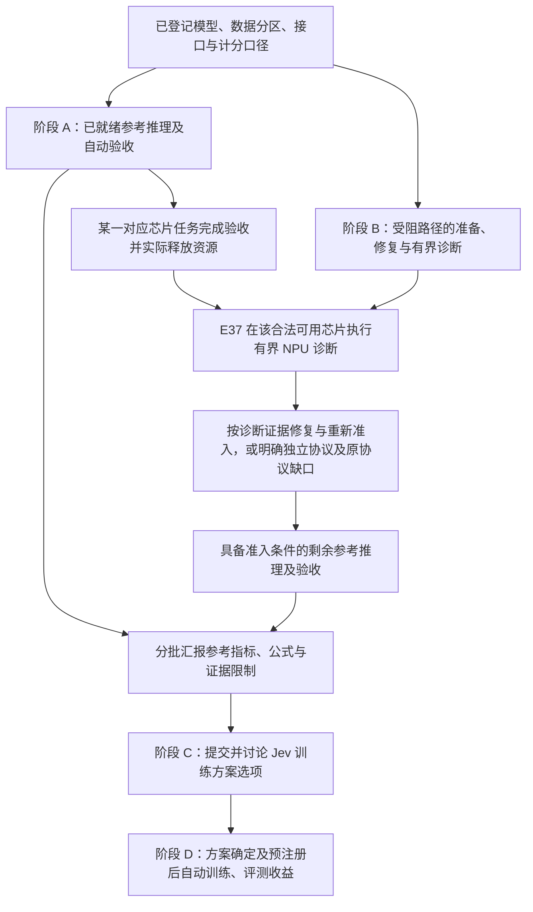

# 当前任务现状、决策边界与下一阶段计划

更新时间：2026-10-31。本文是面向项目负责人的中文状态说明。它解释当前指令之间的依赖关系、参考推理实验的实际进度、尚需用户决定的事项和下一阶段执行计划。它不修改任何实验预注册，不改变数据分区、指标公式、阈值或 test lock。

**运行进度固定截点：2026-10-30 21:03 UTC，即北京时间 2026-10-31 05:03。** 下文的运行计数只代表这一截点，不是实时状态；后续终态须由相应实验记录和独立验收确认。本文件和当前矩阵都是阶段性交接，不代表全部参考实验或自动执行链已经完成。

## 1. 当前阶段的结论

当前阶段的首要交付是**参考模型的实际 test 推理、分口径计分、独立验收和可追溯汇报**。用户要求“先汇报参考模型指标，再讨论训练方案”，不能理解成只整理论文表格：推理本身是实验，自动调度、断点恢复、计分、终态检查和独立验收也必须真实完成。

因此当前顺序是：

1. 冻结模型、checkpoint、数据 split、原生接口、温度和计分公式。
2. 对已经完成的参考组合核对报告、逐项 receipt、分母、来源和实际容器退出。
3. 对仍在运行的组合继续由 detached queue 自动驱动，按 heartbeat 观察，完成后执行独立审计和计分。
4. 将文献原值、上游逐项重算、本地新推理三类来源分开；不同公式、温度、分母、hard/soft 目标、Brier/ECE 定义分列。
5. 完成参考指标阶段汇报后，才提交 Jev 训练方案选项并讨论正式训练。
6. 训练方案确定、预注册和前置验收完成后，才启动新的正式训练；训练后的收益按正确性、稳定性、校准/拒答和效率分别验证。

D2 取消的是原先的 24 小时算力预算，不是实验记录、吞吐监测、资源所有权或数值准入。D3、D4、D7 暂缓真实业务和生产自动执行，但不暂停公开任务上的 Jev 方案收益验证，也不暂停**实验执行 controller** 的开发和实际使用。D6 中的 controller 是后续 S1/S2 模型系统候选机制，不能和当前负责启动、恢复、验收的实验队列混为一谈。

### 1.1 指令分别约束什么

| 指令 | 逻辑作用 | 现在执行的内容 | 后续依赖 |
| --- | --- | --- | --- |
| D1：先统计参考 test 指标，再讨论训练 | 阶段顺序 | 运行参考推理；同一文献存在不同算法时分别计分，保留原公式、温度、分母与来源 | 参考汇报提供决策输入，之后才讨论并确定新的正式训练方案 |
| D2：暂时取消算力预算 | 资源上限 | 不再用旧 24 小时预算限制任务；继续记录吞吐、显存、芯片占用与成本 | 仍遵守资源所有权、正确性和数值准入，不能占用未释放芯片 |
| D3／D4／D7：当前只做 Jev 方案及目标收益，真实业务暂不考虑 | 研究范围 | 以公开任务检验与目标有关的正确性、规则遵循、稳定性、校准和效率 | 不把真实业务接入或生产系统实施列为前置条件 |
| D5：按建议走 | 研究设计的前置登记 | 保留独立 seed 的设计要求 | 在读取相应训练批次结果前登记 seed 范围；不能看结果后追加有利 seed |
| D6：按建议走 | 候选架构选择 | 保留 B：S1 过程监测 + 确定性 controller + S2 版本化 slots，作为后续候选对照 | 不是已验证收益，也不是冻结为所有场景唯一架构；具体训练对照待 D1 汇报后讨论 |
| 自动驱动和执行必须完成 | 执行方式 | 现在完成并使用实验启动、依赖调度、恢复、验收及失败处置 | 按实际执行链逐项验收，不能用监控或代码存在代替完成 |
| 推理实验也是实验 | 实验范围的澄清 | 参考推理现在就做，并纳入预注册、运行记录、计分与审计 | 不需要等待训练方案讨论；推理完成仍不等于训练收益已证明 |

这些要求可同时满足：D1 规定先后，D2 调整资源上限，D3／D4／D7 限定范围，D5／D6 约束后续研究设计；两条补充要求明确当前推理与自动执行必须继续。

### 1.2 按任务依赖推进，不设全队列等待屏障

阶段 A 与 B 可并行。E37 的 NPU 执行只等待**它将使用的对应芯片**满足任务验收、allocation release 和实际空闲核验；不需要等所有 JEVal、OOD 或全部参考任务结束。其他模型的推理不受这一局部依赖阻断。参考表可分批更新；进入训练讨论时需交代全部已登记单元的结果或具体缺口及影响，不能把仍在运行的单元提前标为完成。

## 2. 已完成的参考结果

当前工作稿 [参考指标矩阵](../experiments/REFERENCE-BASELINE-MATRIX-2026-10-31.md) 已汇总 **30 个已形成结果的模型×数据集组合、58 个计分面板**。组合计数只看模型和数据集；面板还区分温度、子集和计分协议，同一预测可产生多个面板。发布前仍需完成限定范围的结果审查；矩阵导出器已完成相应结构化哈希、指标和报告分母核对，但不替代逐题重审计。

| 已形成结果的组别 | 模型×数据集组合 | 计分面板 | 展开方式 |
| --- | ---: | ---: | --- |
| Kev 原生 test | 15 | 36 | 3 个模型 × 5 套数据集；devtools 另分 full/release，全部保留两种温度 |
| Nimble 原生 test | 7 | 7 | 1 个模型 × 7 套子集，原生 T=1 |
| Open-Jev 原始完整 test | 2 | 4 | 2 个模型 × 1 套原始 test，各两种温度 |
| Typed Decisions 共同 test | 6 | 11 | 6 个模型 × 1 套共同 test；5 个模型各两种温度，Nimble 原生已是 T=1 |
| 合计 | **30** | **58** | 不是 58 次独立推理，也不是全部适用模型与数据集的完整交叉矩阵 |

此外，现有矩阵有 **8 个尚无最终验收分数的单元：6 个模型×JEVal + 2 个 Open-Jev×原始 OOD**。其中 4 项 JEVal 与 2 项 OOD 正在推理，另 2 项 Open-Jev JEVal 因数值准入阻塞；缺失指标保持 null，不按零分计入，也不计入上述 30 个已形成结果组合。

58 个本地计分面板不取代文献中其他方法、分区或计分口径。[参考 test 文献与上游结果总表](../experiments/REFERENCE-TEST-RESULTS-2026-10-30.md) 是这些方法的完整阅读入口；D1 要求按各自定义汇报，不能将问答 F1、case exact、macro/micro 等不同公式混成一个数。尚无本地对应值的列明确保留缺口，区分“文献/上游已有值”与“本地已完成同口径复算”；30 个已有结果组合不是模型与数据集全笛卡尔积完成的声明。

**历史证据边界：** 58 个面板不能笼统声称全部达到同一套新增发布门槛。其中 26 个面板的审计 SHA 已绑定成功 finisher 终态；28 个 Kev 旧版面板（Kev-0.8B 的 decision/transfer，以及三尺寸的 extended/devtools）只有推理终态中的报告 SHA、stamp 和审计指标一致性，没有绑定审计 SHA 的历史 finisher 终态，矩阵逐项标为 `absent_legacy_inline_audit`。另 4 个 Open-Jev 原始 test 面板采用既有 JOIN 计划/输出哈希绑定。旧版结果保留其原限定验收范围；现在计算审计文件 SHA 不会补造历史终态，也不能据此把缺口说成已关闭。

### 2.1 Kev 原生测试

Kev-0.8B、4B、9B 的 decision-v7、transfer-v4、hard-v1、documents-v1、devtools-v1 均已完成本地原生推理。devtools 的 full（1,073）与 release（1,071）分母分开。每个单元保留 native 温度和 raw T=1；accuracy、Brier、ECE10、NLL 不合并。已知的主要 native accuracy（clean/full 口径）包括：0.8B decision 83.750%、transfer 69.664634%、hard 66.636029%、documents 85.149573%；4B 分别为 86.500%、83.841463%、80.330882%、90.277778%；9B 分别为 87.250%、85.213415%、83.455882%、89.957265%。这些数字只描述参考模型表现，不是 Jev 训练收益。

### 2.2 Nimble 原生测试

初始 revision 的七个原文 test 子集已完成，共 1,884 条：MASSIVE en/de、PAWS、Civil Comments、Aegis2、SummEval relevance/consistency。总的七套 micro accuracy 只是描述性汇总，不能与包含 train/dev/validation 的混合总分比较。Nimble 的 one-hot multiclass Brier、Noul binary Brier、expected-score MAE、JSD/TV 分开保留；原生 test 使用 T=1。

### 2.3 Open-Jev 原始完整 test

2B/9B 的公共部分与缺失行已按原始身份合并为 10,532 行完整 test（hard 10,046、soft 486）。本地 hard accuracy 分别为 94.634680%（9,507/10,046）和 97.511447%（9,796/10,046）。expected accuracy、NLL、Brier、expected Brier、ECE15 使用各自预注册的全体行口径；native 温度与 raw T=1 分开。与上游差异分别是 hard 正确数少 8 和 3，不能据此声称硬件原因或逐题恰好翻转 8/3 题。上游 perfect-source、小样本和重复性限制保留在审查记录中。

### 2.4 Typed Decisions 共同测试

六个参考模型均完成 400 states/2,000 questions，并通过限定范围独立验收：Kev-0.8B 45.95%、Kev-4B 66.45%、Kev-9B 68.05%、Nimble 65.10%、Open-Jev-2B 58.25%、Open-Jev-9B 67.80%。原生温度和 raw T=1、KL、soft-gold Brier、ECE10 分开统计；Nimble 原生即 T=1。这里是共同公开任务上的概率读出比较，不等于各模型自家 test 的严格复现，也不直接证明训练机制。

## 3. 正在运行或尚未形成最终成绩的单元

以下为 **2026-10-30 21:03 UTC（北京时间 10 月 31 日 05:03）固定快照**。计数来自该截点的结构化进度摘要，表示已处理条目，不是最终成绩；JEVal 计数包含资格/状态记录，不能全部解释为有效预测。watchdog 的总运行项会混合历史工程任务与当前参考任务，因此不以其总数代替科学评测单元数。

| 正在推理的单元 | 已处理／预期 | 截点状态 |
| --- | ---: | --- |
| Kev-0.8B × JEVal | 10,227／11,257 | 运行中，尚无全量验收指标 |
| Kev-4B × JEVal | 7,285／11,257 | 运行中，尚无全量验收指标 |
| Kev-9B × JEVal | 7,285／11,257 | 运行中，尚无全量验收指标 |
| Nimble × JEVal | 6,447／11,257 | 运行中，尚无全量验收指标 |
| Open-Jev-2B × 原始 OOD | 15,446／15,920 | 运行中，尚无全量验收指标 |
| Open-Jev-9B × 原始 OOD | 10,770／15,920 | 运行中，尚无全量验收指标 |

各链路的下一步如下：

| 单元 | 当前状态 | 下一验收 |
| --- | --- | --- |
| Kev-0.8B/4B/9B × JEVal | 三个模型的正式推理由 v7r2 waiter 继续驱动，进度仍以 digest heartbeat 为准 | 全 11,257 receipt、native terminal、实际容器退出、独立审计和分口径计分 |
| Nimble × JEVal | 新 CPU queue 已接续原模型/finisher，旧 controller 停止证据保留 | 同上；另核对空闲设备查询成功后才释放资源 |
| Open-Jev-2B/9B × 原始 OOD | 两项 15,920 行推理继续运行 | 全量 terminal、独立计分和 OOD 专属分母 |
| Open-Jev-2B/9B × JEVal | 尚未启动全量正式 test | E36 候选分块 admission=false；先完成 E37 有界诊断或另立独立数值协议，不能用分块替代原协议 |

六个 Typed Decisions 结果虽已计算完成，仍需 bounded release review：结果包已完成使用 Python 标准库的独立重算，Astra 审查仍在进行，不能写成最终放行；审查的是结果发布证据，不扩张成训练收益结论。E37 代码及单测已通过条件审查，当前处于 staging（运行材料准备）阶段，尚未执行实际 NPU 前向；需等芯片 0–5 中任一对应芯片的原任务通过独立验收、完成 allocation release 并核验实际空闲后，才可按固定 detached 计划执行 16 forwards/model。它不等待其余全部任务结束。

## 4. 自动驱动、恢复和验收的完成定义

每个超过一分钟的任务必须使用固定容器名、CephFS 日志、heartbeat、结构化 terminal、实际 Docker exit、逐项 receipt、exact relaunch 命令和 item-level resume。queue controller 的接续只能在核对原模型/finisher 身份、旧 controller 的 FinishedAt/exit、计划哈希和挂载边界后进行；失败代次必须保留，不能覆盖或静默重试。

“容器还在运行”“准备器测试通过”“heartbeat 有进度”都不是最终成绩。只有预期集合完整、终态和 wrapper 一致、实际容器退出符合协议、独立审计核对来源/哈希/指标并无未处理异常时，才将该模型×数据集格标为已验收。watchdog 只提供 bounded digest；常规状态不读取 raw log，异常才按指针交给限定范围的诊断审查。

这是当前推进任务的完成标准，不是对所有历史产物追加“已经满足”的声明。第 2 节所列 28 个 legacy 面板仍保留审计 SHA 终态绑定缺口；其限定范围的已有结果与新链路的发布验收状态分开记录。导出器验证的是矩阵单元覆盖、报告分母和既有结构化绑定，不是重新核查所有原始逐题回执。

## 5. 需要用户决定的事项

当前没有阻止已授权参考推理和自动执行的用户决策。以下事项已决定，直接执行：

| 事项 | 已决定的含义 |
| --- | --- |
| D1 | 先完成参考 test 指标和分口径汇报，再讨论 Jev 训练；不启动新的正式训练抢跑。 |
| D2 | 暂时取消 24 小时算力预算；仍记录芯片、吞吐、显存和实际成本。 |
| D3/D4/D7 | 暂不接真实业务、业务标注、生产采纳和真实外部操作；公开任务用于证明与目标相关的收益。 |
| D5 | 按建议走：大尺寸 seed 数量在读取该批结果前登记；一个 seed 只能支持探索，不能支持跨 seed 稳定性。 |
| D6 | 按建议走：B 作为首个 S1 过程监测 + 确定性 controller + S2 版本化 slots 的候选对照，不冻结为所有场景唯一架构。 |

真正需要在下一阶段由你决定的是训练方案内容：优先补哪类已观测缺陷、训练数据和 readout/loss、规模、独立 seed 数、对照臂及收益/退化判据。该选择应在参考结果汇报后一次性提交可比较选项。若未来要扩大到全部模型×数据集交叉评测，也需要届时明确范围；它不阻断当前已登记组合。

完整交叉评测范围是此前保留的未决项，并非本轮新设的批准流程。D1–D7、当前参考推理及实验自动执行无需重复批准。若诊断后仍必须采用不同数值协议，先提供具体可审阅方案及差异证据，再讨论该协议取舍；当前继续完成已授权的诊断和已登记组合。

## 6. 下一阶段计划和门禁

### 阶段 A：完成参考实验交付

- 继续自动驱动四项 JEVal 与两项 OOD；只读 digest，直至真实 terminal。
- 对每个完成项执行 receipt manifest、实际 exit、report/audit/terminal hash、公式/温度/分母核对。
- 完成 Typed Decisions bounded release review，并更新统一参考基线矩阵。
- 处理 suspicious success、完美小样本、缺失/重复 receipt、来源冲突；异常保留，不通过改阈值消除。

阶段 A 的**阶段性汇报条件**是：每个已约定参考单元都有已验收数字，或明确的 pending/blocked 原因；各来源、公式、分母和可比性均可追溯。有 pending/blocked 时，只能称完成这一批汇报，不能称全部参考实验完成；未完成单元继续执行或诊断，受影响结论保持未决。不能用启动数量、代码单测或论文摘录替代。

### 阶段 B：解决受影响路径并完成剩余参考评测

- 与阶段 A 并行准备；对应单个芯片完成任务验收并真实释放后，即按 E37 计划执行 Open-Jev 有界诊断，无需等待全部任务完成；不得修改 E36 的 false admission。
- 若仍不能满足原协议，另立带数值差异说明的研究协议，原协议格保持 blocked；不按 gold 选择 batch、温度或题目。
- 继续补强 waiter/queue 的真实中断、EXIT137、发布绑定和资源访问证据；复审结果只作用于对应代码版本。

### 阶段 C：参考汇报后讨论 Jev 训练方案

基于阶段 A/B 的结果，提出若干可执行方案，至少列出目标缺陷、无约束最优解及 discrimination counterpart、数据和 split、loss/readout、模型规模、seed、训练成本记录、开发集选择、最终 test lock、拒答/校准和效率指标。训练收益必须与参考模型差异分开，不能把“更大模型分数更高”写成新训练收益。

这些是下一阶段方案应回答的问题，本文件不提前指定训练超参数。若届时尚有参考缺口，先交代它影响哪些比较和选择，由训练讨论明确可以支持的方案范围；不能用一个已汇报的部分结果自动代替 D1 的完整范围交接。

### 阶段 D：训练前置验收、自动训练和收益验证

方案确定后，完成冻结配置、数据和代码哈希、resume suite、资源分配和 wiki 预注册，再由 detached controller 启动训练。训练完成后执行独立开发集选择与正式 test，按正确性、稳定性、校准/拒答、效率和退化对照逐项报告。真实业务接入不属于本阶段出口。

### 6.1 要看到哪些收益，以及目前缺什么证据

下表是与用户目标相关的收益方向及缺口清单，不是已经成立的收益结论，也不是新的指标预注册。具体指标、阈值、缺陷注册表对应项和对照在参考汇报后的方案阶段确定；不变性目标必须配有区分性反例，避免常数回答或忽略输入取得假稳定。

| 收益方向 | 后续需要回答的问题 | 当前已有证据 | 当前证据缺口 |
| --- | --- | --- | --- |
| 正确性 | 在相同任务与可比评测条件下，继续训练能否提升正确决策且不造成不可接受退化？ | 已有 30 个组合的参考结果及分口径面板 | 尚无本方案训练前后对照、跨 seed 结果；JEVal/OOD 尚未全部验收 |
| 规则遵循 | 当任务定义、类型、候选约束或否定条件变化时，readout 是否遵循规则？ | Typed 共同任务及其类型分项、严格有效性检查 | 输出有效不等于语义规则遵循；尚缺本方案的约束反例与配对训练对照 |
| 配对稳定 | 对语义等价变化保持相同决策，对决定性变化又能正确区分吗？ | 现有公开任务输出可作为后续设计参考 | 汇总 accuracy 不能证明一致性；尚缺预注册等价类、decision-level paired protocol 及 discrimination counterpart 的训练收益证据 |
| 校准与拒答 | 概率是否可信，遇到未知、冲突或不支持输入时能否按预定规则拒答？ | Brier、ECE、NLL 等按定义分别保留，JEVal 有资格/不支持状态 | 不同公式不可直接平均；资格过滤不等于模型学会拒答，尚缺开发集阈值选择、覆盖与风险对照及训练效果 |
| 效率 | 在正确性和数值要求成立时，是否减少延迟、计算或显存，并支持可靠自动执行？ | 已有推理吞吐记录、恢复证据与 E36 数值差异诊断 | 尚无本方案同条件训练前后收益；E37 未执行 NPU，省显存不能抵消数值准入失败 |

### 6.2 公开 test 的设计暴露必须随训练评测披露

当前已读取公开 test 的参考分数，并可能据此识别训练方案需要解决的缺陷。这会形成**设计层面的 test 暴露**。后续训练报告必须写明哪些公开 test、结果和分析曾参与方案设计、何时冻结选择，以及其对结论范围的影响。继续用开发集选择模型、温度和阈值是必要约束，但不能把已经暴露的 test 恢复成“从未见过”的最终验证集。

若后续要声称对未见任务或未见分布的收益，需在方案讨论时明确相应独立留出证据和适用范围；不能只因没有直接用 test 样本训练，就省略设计暴露。当前公开 test 仍可用于按协议报告参考比较，但不把它自动升级为未见泛化证明。

## 7. 不能从当前证据推出的结论

- 参考模型 test 分数不是 Jev 训练收益；Typed Decisions 结果不是生产业务收益。
- JEVal 资格预检、E35 probe、E36/E37 诊断不是 JEVal 全量 test 成绩。
- 候选分块在 E36 中改变了概率，不能因省显存而替代原协议。
- 代码层 Astra 条件审查和单元测试不等于实际 NPU 诊断或最终发布放行。
- D2 取消预算不等于取消资源管理；D3/D4/D7 暂缓真实业务不等于暂停公开任务实验。

## 8. 复核入口

- [04：参考指标优先的用户决定](04-reference-test-first-decisions-2026-10-30.md)
- [05：指令逻辑与执行次序](05-instruction-order-and-execution-2026-10-30.md)
- [参考基线矩阵](../experiments/REFERENCE-BASELINE-MATRIX-2026-10-31.md)
- [参考 test 文献与上游结果总表：不同方法、公式及分区](../experiments/REFERENCE-TEST-RESULTS-2026-10-30.md)
- [Typed Decisions 结果](../experiments/TYPED-REFERENCE-RESULTS-2026-10-30.md)
- [JEVal 队列记录](../wiki/E34-jeval-serial-queue-20261030.md)
- [E37 诊断记录](../wiki/E37-openjev-batch-diagnostic-20261030.md)
