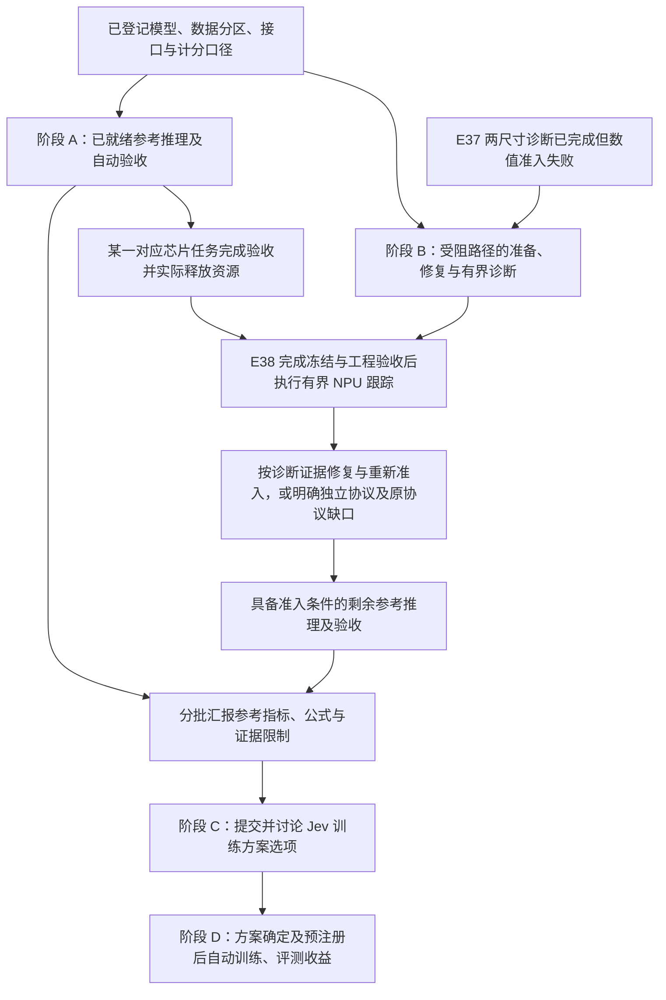

# 当前任务现状、决策边界与下一阶段计划

更新时间：2026-10-31。本文是面向项目负责人的中文状态说明。它解释当前指令之间的依赖关系、参考推理实验的实际进度、尚需用户决定的事项和下一阶段执行计划。它不修改任何实验预注册，不改变数据分区、指标公式、阈值或 test lock。

## 当前快照：先读这一页

本次快照核对时间：**2026-10-31 北京时间 07:15（UTC 2026-10-30 23:15）**。后续工程测试回报需独立验收后另记；不以中间测试数量滚动改写完成状态。

**当前已经索引 36 个有结果的模型×数据集组合；原登记范围内另有 2 个组合仍 blocked、指标为 null。** [参考结果增量表](../experiments/REFERENCE-BASELINE-INCREMENT-2026-10-31.md) 在旧 30 组合／58 面板快照之后新增 6 个组合：四个模型的 JEVal 与两个尺寸的 Open-Jev 原始 OOD。新增 6 个组合均完成实际 Astra **限定范围结果审查**，必要的文字勘误已追加，全部 flags 和分母限制保留。不同协议没有合并成一个总分或新的面板总数；36 个结果组合也不代表全部兼容模型×数据集的交叉评测完成。

**当前主阻塞是 Open-Jev 两尺寸在 JEVal 上的数值准入。** E37 诊断已经完成，但 `candidate_batch_admission=false`。E38 v2 的实际执行前审查为 **BLOCK**；v3 正在修复。独立 CPU 15/15 反例回归通过只是中间工程证据：v3 的固定镜像完整套件、实际 Astra 复审和 NPU 诊断均未完成。旧 v2 不启动，既有失败证据与 false admission 不改写。

**现在继续执行参考推理、必要诊断和自动执行链，不需要你重复决定。** D1 规定“先参考指标汇报、再训练方案讨论、再新的正式训练”的先后关系；它不禁止完成参考指标所需的推理实验、工程修复和自动驱动。D3／D4／D7 暂缓真实业务集成，公开任务上的目标收益验证仍属于 Jev 方案工作。已提出的交叉组合范围问题影响第一阶段出口与是否扩围，不阻塞已登记任务，也不把未回答当成同意扩围。

| 当前工作 | 最新已实证状态 | 尚未完成或不能推出的结论 |
| --- | --- | --- |
| 原先原生 test 与共同 Typed 结果 | 历史矩阵为 30 个组合／58 个计分面板；Typed 已完成实际 Astra 限定审查 | 28 个旧 Kev 面板没有绑定审计 SHA 的历史 finisher 终态；新的带日期 CPU 复核正在准备，不能补造历史绑定 |
| Kev-0.8B × JEVal | 原始 11,257 行，完整分类 accuracy **46.525873%**；推理、计分、强化审计及实际 Astra 限定审查均完成 | **6 flags** 保留，原审计状态不改成无条件通过；不能推导训练收益 |
| Nimble v1 × JEVal | 原始 11,257 行，完整分类 accuracy **49.314317%**；实际 Astra 限定审查及 unsupported 原因勘误完成 | **30 flags** 保留；2,253 unsupported = 2,047 候选超限 + 206 空 context；校准有效分母与 Kev 不同 |
| Kev-4B／9B × JEVal | 各 11,257 行；完整分类 accuracy **61.629183%／63.366246%**；独立 closeout 与新一轮实际 Astra 限定审查完成 | **8／7 flags** 保留；长度范围仅覆盖非空 state_tokens 的勘误已追加。helmet 有效 50/50，完整仅 50/200；不能当作全来源满分 |
| Open-Jev-2B／9B × 原始 OOD | 各 15,920 行；hard accuracy **86.028745%／91.978506%**；两尺寸实际 Astra 限定审查完成 | 2B 零主面板 flags 不覆盖全部 threshold 子格；9B **3 flags** 保留。hard 与 expected 分母不同，也不解除 JEVal 阻塞 |
| Open-Jev-2B／9B × JEVal | 两个原登记单元均 **blocked/null**；E37 两模型各 16 次前向与独立验收已完成 | E37 原始与 chunk8 概率仍有差异；三题无决策翻转不能放行完整 JEVal |
| E38 中间路径跟踪 | v2 实际 Astra **BLOCK**；v3 修复正在进行，独立 CPU 15/15 回归是当前中间证据 | v3 固定镜像完整套件、实际 Astra 复审、NPU 诊断和独立结果验收均待完成；不能以 CPU fixture 替代真实 checkpoint |
| 实验自动驱动与验收 | 已有真实 queue 接续、detached 推理、finisher、恢复和独立重算证据；新增六组合已形成结果闭环 | 全链完成仍需处理剩余两个组合、E38 与异常关闭；watchdog done 不等于科学准入，实验 controller 与后续 S1/S2 候选 controller 分开 |

**下一步并行推进两条工作：** 发布和解释已完成的分口径参考结果，并为旧 28 个 Kev 面板准备新的带日期 CPU 复核；同时修复并验收 E38 v3。E38 自身工程门禁通过、对应芯片合法释放且实际空闲后才进行 NPU 诊断。定位后根据证据修复并登记数值重新准入，准入通过才执行相应 Open-Jev JEVal。其他参考任务不等这条局部路径。训练方案讨论需先接收 D1 汇报及未决范围影响，新的正式训练随后才启动。

**历史阅读说明：** 第 2、3 节是 **05:03 历史固定快照**，第 9 节保存 05:09—06:51 等各次历史观察，其中包括 **05:59—06:02 历史监控材料**；当时的“仍在运行／待审查”不代表当前状态。当前结论以本页和第 6 节为准；旧矩阵及原始实验证据不被静默改写。

### 07:15 快照之后的带日期增量：E39 当前完整性复核完成

**E39 最新审查：实际 Astra 已完成，限定通过当前保存证据和28面板重算，三项文字澄清已追加。** [实际审查及原文](../experiments/ASTRA-LEGACY-KEV-DATED-REAUDIT-REVIEW-2026-10-31.md) 独立重算8,462回执、11,495问题，与旧矩阵最大差约1.11e-16。其直接核查8,930包内文件，不冒称重读77项包外依赖或全部30.9GB。未验证cache/restart或无人值守安全恢复；旧历史绑定仍保留，36结果／2blocked不变。原28面板零flags仍只是限定筛查，小子群满分与小样本限制继续披露。

**后续最新 E38 状态（本地 UTC 23:42 后）：新的实际 Astra 复审已完成，裁决仍为 BLOCK 两份 v4 计划。** [完整复审](../experiments/ASTRA-E38-EXECUTION-V3-REVIEW-2026-10-31.md) 确认旧主要反例修复，但指出首次前向意图记录的目录持久化链、native confidence 硬范围遗漏，以及固定镜像实际源码和审批时间来源证据未闭合。85/85 是对应冻结版本的工程测试事实，不等于复审放行；不得启动这些 v4 NPU 计划。下一步按新反例修复与补证后再冻结复审，E36/E37 false admission 和两项 JEVal blocked/null 保留。

此前同期工程更新（后被上条复审结论推进）：E38 修复已通过干净固定镜像 **85/85** 测试，两尺寸 **v4 CPU 冻结准备均完成**，新的实际 Astra 执行前复审正在运行；尚无复审放行、NPU 诊断或数值准入结论。上面的07:15工程状态保留为当时观察。

本段新增记录于本地UTC `2026-10-30T23:38:05.395478+00:00`，不覆盖上面的07:15历史快照。[E39新日期CPU复核](../experiments/LEGACY-KEV-DATED-REAUDIT-RESULTS-2026-10-31.md) 已完成旧28个Kev面板的当前证据重核：7个原运行、8,462条record回执、11,495个问题；8,952个文件前后完整重哈希一致，既定native/T1指标全部独立重算匹配，新容器真实exited/0。父会话已独立核验这些结果绑定和真实退出；另行实际 Astra 限定结果审查现已完成，结论及新增范围说明见上条，不沿用其他实验结论。

这补充的是**现在保存的证据完整且数学可重现**，不补造过去的finisher，不消除旧28面板的 `absent_legacy_inline_audit`。旧矩阵、指标与历史字段未改，36个有结果组合／2个blocked的计数也未增加。本轮限定面板/整套常量向量筛查无新flags，不代表所有子群或无污染结论。v1因175缺少本地仓库路径在审计前失败，v2改用同SHA的Ceph快照后完成；失败容器和终态保留，未运行NPU。

因此第6节A5由“准备中”推进到“当前CPU复核、父核验及实际Astra限定审查完成，文字澄清已追加”；E38与两项Open-JevJEVal的数值主阻塞不由E39解除。175与本地时钟约相差98秒，结果文件分别保留hostterminal/Docker时间和local记录时间。

## 1. 当前阶段的结论

当前阶段的首要交付是**参考模型的实际 test 推理、分口径计分、独立验收和可追溯汇报**。用户要求“先汇报参考模型指标，再讨论训练方案”，不能理解成只整理论文表格：推理本身是实验，自动调度、断点恢复、计分、终态检查和独立验收也必须真实完成。

因此当前顺序是：

1. 冻结模型、checkpoint、数据 split、原生接口、温度和计分公式。
2. 对已经完成的参考组合核对报告、逐项 receipt、分母、来源和实际容器退出。
3. 对具备准入条件的剩余组合由 detached queue 自动驱动；受阻组合先诊断、修复并重新准入，完成推理后执行独立审计和计分。
4. 将文献原值、上游逐项重算、本地新推理三类来源分开；不同公式、温度、分母、hard/soft 目标、Brier/ECE 定义分列。
5. 完成参考指标阶段汇报后，才提交 Jev 训练方案选项并讨论正式训练。
6. 训练方案确定、预注册和前置验收完成后，才启动新的正式训练；训练后的收益按正确性、稳定性、校准/拒答和效率分别验证。

D1 只约束参考汇报、训练讨论与新的正式训练的次序；推理实验、为它服务的工程诊断及自动驱动现在继续执行。D2 取消的是原先的 24 小时算力预算，不是实验记录、吞吐监测、资源所有权或数值准入。D3、D4、D7 暂缓真实业务和生产自动执行，但不暂停公开任务上的 Jev 方案收益验证，也不暂停**实验执行 controller** 的开发和实际使用。D6 中的 controller 是后续 S1/S2 模型系统候选机制，不能和当前负责启动、恢复、验收的实验队列混为一谈。

### 1.1 指令分别约束什么

| 指令 | 逻辑作用 | 现在执行的内容 | 后续依赖 |
| --- | --- | --- | --- |
| D1：先统计参考 test 指标，再讨论训练 | 阶段顺序 | 运行参考推理；同一文献存在不同算法时分别计分，保留原公式、温度、分母与来源 | 参考汇报提供决策输入，之后才讨论并确定新的正式训练方案 |
| D2：暂时取消算力预算 | 资源上限 | 不再用旧 24 小时预算限制任务；继续记录吞吐、显存、芯片占用与成本 | 仍遵守资源所有权、正确性和数值准入，不能占用未释放芯片 |
| D3／D4／D7：当前只做 Jev 方案及目标收益，真实业务暂不考虑 | 研究范围 | 以公开任务检验与目标有关的正确性、规则遵循、稳定性、校准和效率 | 不把真实业务接入或生产系统实施列为前置条件 |
| D5：按建议走 | 研究设计的前置登记 | 保留独立 seed 的设计要求 | 在读取相应训练批次结果前登记 seed 范围；不能看结果后追加有利 seed |
| D6：按建议走 | 候选架构选择 | 保留 B：S1 过程监测 + 确定性 controller + S2 版本化 slots，作为后续候选对照 | 不是已验证收益，也不是冻结为所有场景唯一架构；具体训练对照待 D1 汇报后讨论 |
| 自动驱动和执行必须完成 | 执行方式 | 现在完成并使用实验启动、依赖调度、恢复、验收及失败处置 | 按实际执行链逐项验收，不能用监控或代码存在代替完成 |
| 推理实验也是实验 | 实验范围的澄清 | 参考推理现在就做，并纳入预注册、运行记录、计分与审计 | 不需要等待训练方案讨论；推理完成仍不等于训练收益已证明 |

这些要求可同时满足：D1 规定先后，D2 调整资源上限，D3／D4／D7 限定范围，D5／D6 约束后续研究设计；两条补充要求明确当前推理与自动执行必须继续。

### 1.2 当前依赖：E37 已完成，E38 v3 修复与参考证据复核并行

阶段 A 与 B 可并行。E37 已完成；后续 E38 的 NPU 执行除自身准备与验收外，只等待**它将使用的对应芯片**满足任务验收、allocation release 和实际空闲核验；不需要等所有 JEVal、OOD 或全部参考任务结束。其他模型的推理不受这一局部依赖阻断。参考表可分批更新；进入训练讨论时需交代全部已登记单元的结果或具体缺口及影响，不能把仍在运行的单元提前标为完成。

## 2. 历史快照：05:03 已形成的参考结果

05:03 截点的工作稿 [参考指标矩阵](../experiments/REFERENCE-BASELINE-MATRIX-2026-10-31.md) 已汇总 **30 个已形成结果的模型×数据集组合、58 个计分面板**。组合计数只看模型和数据集；面板还区分温度、子集和计分协议，同一预测可产生多个面板。发布前仍需完成限定范围的结果审查；矩阵导出器已完成相应结构化哈希、指标和报告分母核对，但不替代逐题重审计。

| 已形成结果的组别 | 模型×数据集组合 | 计分面板 | 展开方式 |
| --- | ---: | ---: | --- |
| Kev 原生 test | 15 | 36 | 3 个模型 × 5 套数据集；devtools 另分 full/release，全部保留两种温度 |
| Nimble 原生 test | 7 | 7 | 1 个模型 × 7 套子集，原生 T=1 |
| Open-Jev 原始完整 test | 2 | 4 | 2 个模型 × 1 套原始 test，各两种温度 |
| Typed Decisions 共同 test | 6 | 11 | 6 个模型 × 1 套共同 test；5 个模型各两种温度，Nimble 原生已是 T=1 |
| 合计 | **30** | **58** | 不是 58 次独立推理，也不是全部适用模型与数据集的完整交叉矩阵 |

此外，该历史矩阵当时有 **8 个尚无最终验收分数的单元：6 个模型×JEVal + 2 个 Open-Jev×原始 OOD**。其中 4 项 JEVal 与 2 项 OOD 正在推理，另 2 项 Open-Jev JEVal 因数值准入阻塞；缺失指标保持 null，不按零分计入，也不计入上述 30 个已形成结果组合。

58 个本地计分面板不取代文献中其他方法、分区或计分口径。[参考 test 文献与上游结果总表](../experiments/REFERENCE-TEST-RESULTS-2026-10-30.md) 是这些方法的完整阅读入口；D1 要求按各自定义汇报，不能将问答 F1、case exact、macro/micro 等不同公式混成一个数。尚无本地对应值的列明确保留缺口，区分“文献/上游已有值”与“本地已完成同口径复算”；30 个已有结果组合不是模型与数据集全笛卡尔积完成的声明。

**历史证据边界：** 58 个面板不能笼统声称全部达到同一套新增发布门槛。其中 26 个面板的审计 SHA 已绑定成功 finisher 终态；28 个 Kev 旧版面板（Kev-0.8B 的 decision/transfer，以及三尺寸的 extended/devtools）只有推理终态中的报告 SHA、stamp 和审计指标一致性，没有绑定审计 SHA 的历史 finisher 终态，矩阵逐项标为 `absent_legacy_inline_audit`。另 4 个 Open-Jev 原始 test 面板采用既有 JOIN 计划/输出哈希绑定。旧版结果保留其原限定验收范围；现在计算审计文件 SHA 不会补造历史终态，也不能据此把缺口说成已关闭。

### 2.1 Kev 原生测试

Kev-0.8B、4B、9B 的 decision-v7、transfer-v4、hard-v1、documents-v1、devtools-v1 均已完成本地原生推理。devtools 的 full（1,073）与 release（1,071）分母分开。每个单元保留 native 温度和 raw T=1；accuracy、Brier、ECE10、NLL 不合并。已知的主要 native accuracy（clean/full 口径）包括：0.8B decision 83.750%、transfer 69.664634%、hard 66.636029%、documents 85.149573%；4B 分别为 86.500%、83.841463%、80.330882%、90.277778%；9B 分别为 87.250%、85.213415%、83.455882%、89.957265%。这些数字只描述参考模型表现，不是 Jev 训练收益。

### 2.2 Nimble 原生测试

初始 revision 的七个原文 test 子集已完成，共 1,884 条：MASSIVE en/de、PAWS、Civil Comments、Aegis2、SummEval relevance/consistency。总的七套 micro accuracy 只是描述性汇总，不能与包含 train/dev/validation 的混合总分比较。Nimble 的 one-hot multiclass Brier、Noul binary Brier、expected-score MAE、JSD/TV 分开保留；原生 test 使用 T=1。

### 2.3 Open-Jev 原始完整 test

2B/9B 的公共部分与缺失行已按原始身份合并为 10,532 行完整 test（hard 10,046、soft 486）。本地 hard accuracy 分别为 94.634680%（9,507/10,046）和 97.511447%（9,796/10,046）。expected accuracy、NLL、Brier、expected Brier、ECE15 使用各自预注册的全体行口径；native 温度与 raw T=1 分开。与上游差异分别是 hard 正确数少 8 和 3，不能据此声称硬件原因或逐题恰好翻转 8/3 题。上游 perfect-source、小样本和重复性限制保留在审查记录中。

### 2.4 Typed Decisions 共同测试

六个参考模型均完成 400 states/2,000 questions，并通过限定范围独立验收：Kev-0.8B 45.95%、Kev-4B 66.45%、Kev-9B 68.05%、Nimble 65.10%、Open-Jev-2B 58.25%、Open-Jev-9B 67.80%。原生温度和 raw T=1、KL、soft-gold Brier、ECE10 分开统计；Nimble 原生即 T=1。这里是共同公开任务上的概率读出比较，不等于各模型自家 test 的严格复现，也不直接证明训练机制。

## 3. 历史快照：05:03 正在运行或尚未形成最终成绩的单元

以下为 **2026-10-30 21:03 UTC（北京时间 10 月 31 日 05:03）固定快照**。计数来自该截点的结构化进度摘要，表示已处理条目，不是最终成绩；JEVal 计数包含资格/状态记录，不能全部解释为有效预测。watchdog 的总运行项会混合历史工程任务与当前参考任务，因此不以其总数代替科学评测单元数。

| 正在推理的单元 | 已处理／预期 | 截点状态 |
| --- | ---: | --- |
| Kev-0.8B × JEVal | 10,227／11,257 | 运行中，尚无全量验收指标 |
| Kev-4B × JEVal | 7,285／11,257 | 运行中，尚无全量验收指标 |
| Kev-9B × JEVal | 7,285／11,257 | 运行中，尚无全量验收指标 |
| Nimble × JEVal | 6,447／11,257 | 运行中，尚无全量验收指标 |
| Open-Jev-2B × 原始 OOD | 15,446／15,920 | 运行中，尚无全量验收指标 |
| Open-Jev-9B × 原始 OOD | 10,770／15,920 | 运行中，尚无全量验收指标 |

以下状态和下一步均是 05:03 当时的记录；Typed、E37、Kev-0.8B/Nimble JEVal 及 OOD 的后续状态以开头当前快照和第 9 节为准：

| 单元 | 当前状态 | 下一验收 |
| --- | --- | --- |
| Kev-0.8B/4B/9B × JEVal | 三个模型的正式推理由 v7r2 waiter 继续驱动，进度仍以 digest heartbeat 为准 | 全 11,257 receipt、native terminal、实际容器退出、独立审计和分口径计分 |
| Nimble × JEVal | 新 CPU queue 已接续原模型/finisher，旧 controller 停止证据保留 | 同上；另核对空闲设备查询成功后才释放资源 |
| Open-Jev-2B/9B × 原始 OOD | 两项 15,920 行推理继续运行 | 全量 terminal、独立计分和 OOD 专属分母 |
| Open-Jev-2B/9B × JEVal | 尚未启动全量正式 test | E36 候选分块 admission=false；先完成 E37 有界诊断或另立独立数值协议，不能用分块替代原协议 |

**05:03 历史状态：** 六个 Typed Decisions 结果虽已计算完成，当时仍需 bounded release review：结果包已完成使用 Python 标准库的独立重算，Astra 审查仍在进行，不能写成最终放行；审查的是结果发布证据，不扩张成训练收益结论。E37 代码及单测已通过条件审查，当前处于 staging（运行材料准备）阶段，尚未执行实际 NPU 前向；需等芯片 0–5 中任一对应芯片的原任务通过独立验收、完成 allocation release 并核验实际空闲后，才可按固定 detached 计划执行 16 forwards/model。它不等待其余全部任务结束。

## 4. 自动驱动、恢复和验收的完成定义

每个超过一分钟的任务必须使用固定容器名、CephFS 日志、heartbeat、结构化 terminal、实际 Docker exit、逐项 receipt、exact relaunch 命令和 item-level resume。queue controller 的接续只能在核对原模型/finisher 身份、旧 controller 的 FinishedAt/exit、计划哈希和挂载边界后进行；失败代次必须保留，不能覆盖或静默重试。

“容器还在运行”“准备器测试通过”“heartbeat 有进度”都不是最终成绩。只有预期集合完整、终态和 wrapper 一致、实际容器退出符合协议、独立审计核对来源/哈希/指标并无未处理异常时，才将该模型×数据集格标为已验收。watchdog 只提供 bounded digest；常规状态不读取 raw log，异常才按指针交给限定范围的诊断审查。

这是当前推进任务的完成标准，不是对所有历史产物追加“已经满足”的声明。第 2 节所列 28 个 legacy 面板仍保留审计 SHA 终态绑定缺口；其限定范围的已有结果与新链路的发布验收状态分开记录。导出器验证的是矩阵单元覆盖、报告分母和既有结构化绑定，不是重新核查所有原始逐题回执。

## 5. 需要用户决定的事项

当前没有阻止已授权参考推理和自动执行的用户决策。以下事项已决定，直接执行：

| 事项 | 已决定的含义 |
| --- | --- |
| D1 | 先完成参考 test 指标和分口径汇报，再讨论 Jev 训练；不启动新的正式训练抢跑。 |
| D2 | 暂时取消 24 小时算力预算；仍记录芯片、吞吐、显存和实际成本。 |
| D3/D4/D7 | 暂不接真实业务、业务标注、生产采纳和真实外部操作；公开任务用于证明与目标相关的收益。 |
| D5 | 按建议走：大尺寸 seed 数量在读取该批结果前登记；一个 seed 只能支持探索，不能支持跨 seed 稳定性。 |
| D6 | 按建议走：B 作为首个 S1 过程监测 + 确定性 controller + S2 版本化 slots 的候选对照，不冻结为所有场景唯一架构。 |

真正需要在下一阶段由你决定的是训练方案内容：优先补哪类已观测缺陷、训练数据和 readout/loss、规模、独立 seed 数、对照臂及收益/退化判据。该选择应在参考结果汇报后一次性提交可比较选项。D1 第一阶段的范围仍有一个已提出、待答的具体问题：以已登记组合为第一批交付，还是把所有兼容模型×数据集交叉组合纳入第一阶段。此项决定第一阶段出口和新增覆盖工作量；等待回答期间继续完成已登记任务，不重复提问，也不把未回答当默认同意扩围。

完整交叉评测范围是此前保留的未决项，并非本轮新设的批准流程；第一阶段是否全部完成须按该范围明确后判断。D1–D7、当前参考推理及实验自动执行无需重复批准。若诊断后仍必须采用不同数值协议，先提供具体可审阅方案及差异证据，再讨论该协议取舍；当前继续完成已授权的诊断和已登记组合。

## 6. 下一阶段计划和门禁

### 阶段 A：完成参考实验交付

- 新增四项 JEVal 与两项 OOD 均已完成实际 Astra 限定审查，汇报索引现为 36 个有结果组合。Kev-4B/9B 的长度表述勘误与 Kev-0.8B/Nimble 的原因勘误均已追加，6/30/8/7 及 OOD 0/3 主面板 flags 保留；不再把这六项列为运行或待审查。
- 对每个完成项执行 receipt manifest、实际 exit、report/audit/terminal hash、公式/温度/分母核对。
- Typed Decisions、四个 E33 JEVal 结果与两尺寸 OOD 均有各自实际 Astra bounded review；[增量索引](../experiments/REFERENCE-BASELINE-INCREMENT-2026-10-31.md) 已同步六项新结果，旧 30 组合／58 面板快照保持原样，剩余两个 Open-Jev JEVal 格为 blocked/null。
- 对缺少历史审计终态绑定的 28 个 Kev 面板，已只读盘点 7 个原运行、8,462 条 record 回执、11,495 个问题及保留的成功退出容器。下一步冻结新的 CPU 复核计划，对当前文件完整重哈希、独立重算并写新日期终态；原树只读，旧矩阵与 `absent_legacy_inline_audit` 不变。新的当前完整性证据不能补造历史 finisher。
- 处理 suspicious success、完美小样本、缺失/重复 receipt、来源冲突；异常保留，不通过改阈值消除。

阶段 A 的**阶段性汇报条件**是：每个已约定参考单元都有已验收数字，或明确的 pending/blocked 原因；各来源、公式、分母和可比性均可追溯。有 pending/blocked 时，只能称完成这一批汇报，不能称全部参考实验完成；未完成单元继续执行或诊断，受影响结论保持未决。不能用启动数量、代码单测或论文摘录替代。

### 阶段 B：解决受影响路径并完成剩余参考评测

- E37 两尺寸有界诊断已完成；E38 v2 被实际 Astra 审查 BLOCK，当前与阶段 A 并行修复 v3 的原生响应合同、逐事件 trace、同次读入哈希绑定和恢复语义。独立 CPU 15/15 回归只是中间证据；下一步须完成固定镜像完整套件、新 generation 冻结和实际 Astra 复审，再核对对应芯片释放/空闲，才执行真实 NPU 跟踪。无需等待全部参考任务，E36/E37 false admission 保持不变。
- 若仍不能满足原协议，另立带数值差异说明的研究协议，原协议格保持 blocked；不按 gold 选择 batch、温度或题目。
- 继续补强 waiter/queue 的真实中断、EXIT137、发布绑定和资源访问证据；复审结果只作用于对应代码版本。

### 阶段 C：参考汇报后讨论 Jev 训练方案

基于阶段 A/B 的结果，提出若干可执行方案，至少列出目标缺陷、无约束最优解及 discrimination counterpart、数据和 split、loss/readout、模型规模、seed、训练成本记录、开发集选择、最终 test lock、拒答/校准和效率指标。训练收益必须与参考模型差异分开，不能把“更大模型分数更高”写成新训练收益。

这些是下一阶段方案应回答的问题，本文件不提前指定训练超参数。若届时尚有参考缺口，先交代它影响哪些比较和选择，由训练讨论明确可以支持的方案范围；不能用一个已汇报的部分结果自动代替 D1 的完整范围交接。

### 阶段 D：训练前置验收、自动训练和收益验证

方案确定后，完成冻结配置、数据和代码哈希、resume suite、资源分配和 wiki 预注册，再由 detached controller 启动训练。训练完成后执行独立开发集选择与正式 test，按正确性、稳定性、校准/拒答、效率和退化对照逐项报告。真实业务接入不属于本阶段出口。

### 当前可执行工作表：依赖、产物和出口

这是依现有授权推进的任务顺序，不增加用户批准步骤。表中的验收是执行或科学证据条件；只有实质未决方案到达选择阶段，才向用户提交具体选项。

| 优先序 / 工作 | 依赖与可并行关系 | 必须交付的产物 | 出口条件 | 当前状态 |
| --- | --- | --- | --- | --- |
| A1：Kev-4B/9B JEVal 结果交付 | 不等 Open-Jev 修复；独立于旧 Kev08/Nimble 审查 | 每模型 11,257 receipts、原生/强化审计、actual exit、实际 Astra 审查、长度勘误 | 分数与全/有效分母可追溯，8/7 flags 与限定结论保留 | 已完成 bounded review；完整分类 61.629183%／63.366246% |
| A2：两尺寸 Open-Jev OOD 结果交付 | 各自完整推理及审计 | 各 15,920 行、hard/soft 分母、native/T1 与来源/题型面板、实际审查 | 限定结果可复核；3 个 9B flags 保留 | 独立闭环与实际 Astra 审查均完成 |
| A3：Kev-0.8B/Nimble JEVal 结果交付 | 全部 22,514 receipts 重哈希与有界异常诊断 | 指标、6/30 flags、unsupported 原因分项和实际 Astra 记录 | 勘误追加而不改冻结证据；保留分母与范围限制 | 已完成 bounded review 和原因勘误 |
| A4：统一参考汇报与缺口说明 | A1/A2/A3 已具结果；交叉覆盖待答不阻塞已登记工作 | 文献/上游/本地来源，公式、温度、分母、36 有结果/2 blocked 索引 | 原登记单元结果或缺口影响清楚；扩围不默认发生 | 六个新增组合均完成实际限定审查，旧矩阵不改写 |
| A5：旧 28 个 Kev 面板当前 CPU 复核 | 与 E38 并行；原运行树只读、不用 NPU | 新冻结 plan、逐文件 journal、完整哈希/独立重算、新 terminal 与 actual exit、wiki | 7 runs／8,462 records／11,495 问题／28 面板可复核，旧历史绑定不升级 | 只读范围盘点完成，新的实现与冻结计划准备中，尚无本轮复核结论 |
| B1：E38 v3 工程修复与复审 | v2 BLOCK；独立 CPU 15/15 仅作中间输入 | 修复合同/trace/读入绑定/恢复，固定镜像完整套件，新计划及实际 Astra 复审 | 固定版本完整工程证据和实际审查满足后才可启动 | v3 正在修复；完整镜像套件、实际复审均未完成 |
| B2：E38 实际 NPU 及验收 | B1 完成；仅等待将使用芯片实际释放/空闲，不设全队列屏障 | 两尺寸共 16 次前向、每题回执、首次观测差异位置、控制比较、terminal/EXIT 与独立复算 | 重复与 instrumentation 对照按既定 exact 条件；缺项/失败原样记录 | 尚未执行，不能以 CPU 测试替代 |
| B3：路径修复与数值重新准入 | B2 定位证据；不能由首个差异直接推断 kernel 因果 | 原始路径内存生命周期/计算修复候选、对照、正式登记的数值验收证据 | 满足原协议方可回到原格；如必须改数值协议，先写具体差异方案再讨论取舍 | 待定位，不改 E36/E37 false admission |
| B4：Open-Jev 两尺寸 JEVal | 对应模型路径获得所需数值准入 | 原登记完整推理、分母/覆盖记录、独立验收与结果 | 按原协议完成；独立新协议的结果另列，不能填成原协议通过 | 两格仍 blocked |
| C：提出训练方案并讨论 | D1 参考阶段汇报已交接，缺口影响明确 | 缺陷行、无约束最优解、区分性反例、数据/split、readout/loss、规模/seed/对照、收益与退化判据 | 用户讨论实质训练选择；在看该批结果前登记 seed，披露公开 test 设计暴露 | 尚未进入新的正式训练；不提前冻结超参 |
| D：自动训练及收益验证 | C 的方案确定与预注册，resume/数值/性能前置条件满足 | 固定代码/配置、detached controller、item-level resume、独立评测、每芯片效率和资源报告 | 正确性、配对稳定、校准/拒答、效率分别结论，失败与无效结果保留 | 后续阶段；真实业务接入不在出口内 |

资源释放须用当时 allocation ownership 与实时设备检查，不能用本文中的卡号或数分钟前的 free 状态直接分配。预算上限已取消，但仍记录单芯片吞吐、芯片数、reserved memory 和实际资源时间；记录这些不构成重新设置旧预算。

### 6.1 要看到哪些收益，以及目前缺什么证据

下表是与用户目标相关的收益方向及缺口清单，不是已经成立的收益结论，也不是新的指标预注册。具体指标、阈值、缺陷注册表对应项和对照在参考汇报后的方案阶段确定；不变性目标必须配有区分性反例，避免常数回答或忽略输入取得假稳定。

| 收益方向 | 后续需要回答的问题 | 当前已有证据 | 当前证据缺口 |
| --- | --- | --- | --- |
| 正确性 | 在相同任务与可比评测条件下，继续训练能否提升正确决策且不造成不可接受退化？ | 已有 36 个组合的参考结果；新增六项均完成实际限定审查 | 尚无本方案训练前后对照、跨 seed 结果；两项 Open-Jev JEVal 仍 blocked/null |
| 规则遵循 | 当任务定义、类型、候选约束或否定条件变化时，readout 是否遵循规则？ | Typed 共同任务及其类型分项、严格有效性检查 | 输出有效不等于语义规则遵循；尚缺本方案的约束反例与配对训练对照 |
| 配对稳定 | 对语义等价变化保持相同决策，对决定性变化又能正确区分吗？ | 现有公开任务输出可作为后续设计参考 | 汇总 accuracy 不能证明一致性；尚缺预注册等价类、decision-level paired protocol 及 discrimination counterpart 的训练收益证据 |
| 校准与拒答 | 概率是否可信，遇到未知、冲突或不支持输入时能否按预定规则拒答？ | Brier、ECE、NLL 等按定义分别保留，JEVal 有资格/不支持状态 | 不同公式不可直接平均；资格过滤不等于模型学会拒答，尚缺开发集阈值选择、覆盖与风险对照及训练效果 |
| 效率 | 在正确性和数值要求成立时，是否减少延迟、计算或显存，并支持可靠自动执行？ | 已有推理吞吐记录、恢复证据与 E36 数值差异诊断 | 尚无本方案同条件训练前后收益；E37 已实际执行并确认差异，E38 尚无 NPU 结果；省显存不能抵消数值准入失败 |

### 6.2 公开 test 的设计暴露必须随训练评测披露

当前已读取公开 test 的参考分数，并可能据此识别训练方案需要解决的缺陷。这会形成**设计层面的 test 暴露**。后续训练报告必须写明哪些公开 test、结果和分析曾参与方案设计、何时冻结选择，以及其对结论范围的影响。继续用开发集选择模型、温度和阈值是必要约束，但不能把已经暴露的 test 恢复成“从未见过”的最终验证集。

若后续要声称对未见任务或未见分布的收益，需在方案讨论时明确相应独立留出证据和适用范围；不能只因没有直接用 test 样本训练，就省略设计暴露。当前公开 test 仍可用于按协议报告参考比较，但不把它自动升级为未见泛化证明。

## 7. 不能从当前证据推出的结论

- 参考模型 test 分数不是 Jev 训练收益；Typed Decisions 结果不是生产业务收益。
- JEVal 资格预检、E35 probe、E36/E37 诊断不是 JEVal 全量 test 成绩。
- 候选分块在 E36 中改变了概率，不能因省显存而替代原协议。
- 代码层 Astra 条件审查和单元测试不等于实际 NPU 诊断或最终发布放行。
- D2 取消预算不等于取消资源管理；D3/D4/D7 暂缓真实业务不等于暂停公开任务实验。

## 8. 复核入口

- [04：参考指标优先的用户决定](04-reference-test-first-decisions-2026-10-30.md)
- [05：指令逻辑与执行次序](05-instruction-order-and-execution-2026-10-30.md)
- [历史参考基线矩阵](../experiments/REFERENCE-BASELINE-MATRIX-2026-10-31.md)
- [当前结果增量索引：36 有结果／2 blocked](../experiments/REFERENCE-BASELINE-INCREMENT-2026-10-31.md)
- [Kev-4B/9B 实际 Astra 审查及长度勘误](../experiments/ASTRA-JEVAL-KEV4-KEV9-REVIEW-2026-10-31.md)
- [E38 v2 BLOCK 审查原文](../experiments/ASTRA-E38-EXECUTION-REVIEW-2026-10-31.md)
- [参考 test 文献与上游结果总表：不同方法、公式及分区](../experiments/REFERENCE-TEST-RESULTS-2026-10-30.md)
- [Typed Decisions 结果](../experiments/TYPED-REFERENCE-RESULTS-2026-10-30.md)
- [JEVal 队列记录](../wiki/E34-jeval-serial-queue-20261030.md)
- [E37 诊断记录](../wiki/E37-openjev-batch-diagnostic-20261030.md)

## 9. 历史观察与带日期增量（不是当前任务清单）

本节保留每个观察时间点的原状态与后续进展。“待审查”“仍在运行”只对对应截点成立；当前摘要与可执行计划见本文开头及第 6 节。

### 2026-10-31 05:13 北京时间：Typed Decisions 结果审查完成

实际 `gpt-6-astra` 只读审查进程退出 0，核验 2,547 个清单文件、六模型共 2,400 条回执，并独立重算 11 个面板及题型/workflow 分项。1,485 次标量比较最大绝对差约为 9.992×10⁻¹⁶；未发现阻断限定指标发布的算术、完整集合或包内哈希问题。[完整审查与证据](../experiments/ASTRA-TYPED-RESULTS-REVIEW-2026-10-31.md) 保留了实际结论。

结论仅支持“保存快照中经独立复核的 Typed Decisions 参考指标”。Kev wire 与原 scorer 不兼容、不同家族的重分词/接口验收范围不同、包内缺少 finisher 容器自身的独立 Docker 退出记录、未重查外部权重及重新解码 Parquet等限制继续保留。它不批准正式训练，也不证明新的训练收益。

### 2026-10-31 05:09 北京时间：Open-Jev-2B 原始 OOD 验收完成

原始 OOD 的 15,920 行推理与独立审计完成，hard 15,446、soft 474；推理和 finisher 实际退出均为 0，审计为 `VERIFIED_SCOPED`、review flags 为 0。原生温度 hard accuracy 为 **86.028745%**，expected accuracy 为 **84.616890%**；两者使用不同定义及分母，不能混写。原生温度 Brier 为 0.246288900、ECE15 为 0.105578241；raw T=1 另列，未按 OOD 调温度。

该结果是固定 58 面板快照之后的新完成项，见 [E32 记录](../wiki/E32-openjev-original-ood-20261030.md)，不静默改写旧矩阵中的 pending 状态。其余三个 Kev 与 Nimble 的 JEVal、Open-Jev-9B OOD 仍待最终验收；两项 Open-Jev JEVal 仍受 E36 数值准入限制。E37 接续只在合法资源释放及自身工程门禁通过后执行，实际诊断状态见 E37 记录。

### 2026-10-31 05:17 北京时间：E37 2B 实际 NPU 诊断启动

E32 释放芯片 4 后，E37 的 CPU 全依赖准备在保留容器中实际退出 0，生成固定运行计划。主机检查此前因非 root 用户不可读 `/proc/1/root/proc` 而阻断；局部修订改用可读的主机/容器身份检查，主会话复核并通过 52 项相关测试，新版本另行冻结，未冒称已包含在旧 Astra 审查中。

主会话核对 CPU 实际退出、计划哈希、固定输入选择和资源映射后，诊断容器 `nga-e37-openjev2-20261031-v2` 在芯片 4 实际启动。此次仅执行预注册的 16 forwards/model 诊断；尚需真实终态和独立 CPU 验收，不能提前声称 no-op/profiling 数值一致，也不改变 E36 的失败准入或代表 Open-Jev JEVal 全量测试完成。执行中的后续记录以 [E37 wiki](../wiki/E37-openjev-batch-diagnostic-20261030.md) 为准。

随后该 2B 诊断已写入 `COMPLETE.json`，16/16 forwards、实际退出 0，`diagnostic_valid=true`。三组选定输入的原始重复、chunk 重复均保持精确一致；边界输入上的 no-op 和 passive-hook 对照也保持精确一致；但原始路径与 chunk 路径的概率最大差分别约为 0.014141、0.003515、0.002626，三组决策翻转为 0/3，`candidate_batch_admission` 仍为 false。独立 CPU 验收于北京时间 05:21 完成，核对 16 条回执、报告和终态哈希并重算比较，NPU 与验收容器实际退出均为 0。它确认了可复现的数值差异，却没有证明具体 kernel 原因，也不准许原 JEVal 全量运行；9B 同协议诊断继续按资源与计划门禁接续。

### 2026-10-31 05:36 北京时间：E37 两尺寸实际诊断与验收完成

9B 同样完成固定 16 次前向及独立 CPU 产物/比较验收；主会话另查 NPU 与验收容器实际退出均为 0。两尺寸合计 32 次前向，原始重复与 chunk 重复均精确一致，边界输入的 no-op、hook 对照精确一致。**诊断完成，原协议数值准入仍未通过。** [完整结果](../experiments/OPENJEV-BATCH-DIAGNOSTIC-RESULTS-2026-10-31.md) 并列内存、数值差异和验收证据。

| 固定输入 | 2B 原始 vs chunk8 最大概率差 | 9B 原始 vs chunk8 最大概率差 |
| --- | ---: | ---: |
| 9027，边界 | 0.014141415 | 0.000009391 |
| 4200，短输入 | 0.003514509 | 0.013869160 |
| 8409，长输入 | 0.002625892 | 0.003309272 |

每尺寸的决策翻转均为 0/3；这是三个按元数据预选输入上的诊断，不能据此推断完整测试集决策一致或概率差可忽略。尤其 9B 在边界输入差异小，却在短输入达到约 0.01387，不支持只看一个边界样本就放行。芯片 4 已在验收及真实空闲检查后释放。

下一步转为基于这份证据的原始路径内存/数值修复设计：保留原协议与原失败记录，定位具体受影响层和计算路径；若要改成不同数值配置，需先形成独立协议并说明可比性。该选择不能由“省显存”或三题未翻转自动决定。其他独立参考推理及验收继续；新的正式训练仍遵守 D1 的先后关系。

### 2026-10-31 05:49:51 北京时间：Kev-0.8B 与 Nimble JEVal 结果包完成核对

[JEVal 结果与旗标诊断](../experiments/JEVAL-REFERENCE-RESULTS-2026-10-31.md) 已记录两模型各 11,257 条 receipt。新的 CPU closeout 重新核对全部 **22,514** 个回执哈希及 terminal/report/config/audit 绑定，保留容器实际退出 0。全分类分母均为 10,938；Kev 正确 5,089，accuracy 46.525873%；Nimble 正确 5,394，accuracy 49.314317%。Brier/ECE 的有效分类分母分别为 9,911 和 7,694，score MAE 的有效分母分别为 319 和 312；不能跨分母合成一个总排名。

Kev 6 个 flags、Nimble 30 个 flags 均保留，状态仍为 `VERIFIED_HARDENED_SCOPED_REVIEW_REQUIRED`。已给出原生长度/候选数限制、小样本与零有效格的有界诊断。例如 Nimble CUAD 有效部分 31/31，并非整格完美：另有 169/200 条超长，全分母 accuracy 为 15.5%。诊断不抹掉旗标，未提供完成的 Astra E33 结论；Typed 的 Astra 审查不得用于替代。这是本地原生响应按登记公式测量，不是原论文 scorer 严格复现、配对一致性或训练收益。

### 2026-10-31 05:59–06:02 北京时间：监控重载核验与 E38 准备状态

[watchdog 重载核验](/mnt/cephfs/xingchao/experiments/jev/_watchdog/reload_terminal_markers_20261030T215915Z/verification.md) 对应 2026-10-30T21:59:16Z 的 digest。它确认 E37 两个 verifier 已识别为 done，Open-Jev-2B OOD 的推理/finisher 和 Kev-0.8B JEVal 的推理/finisher 终态被识别，同时 Kev hardened waiter 保留 `decide` 与 6 个 flags；历史失败仍显示 failed。修复状态识别不等于清除科学异常。

全局 digest 的 398 个 run 混合历史工程试验、失败重试与当前任务；309 done、43 failed 等不是“科学实验通过/失败数”。当前参考任务以对应单元证据判断。06:02:17/23 的两个 Kev waiter digest 分别为 9,815/11,257 和 9,799/11,257。Open-Jev-9B OOD 的 06:02:06 finisher digest 显示其推理容器 exited、stage complete、15,920/15,920；此处仅增加计算终态观察，尚未由本文核实独立审计闭环，因此没有新增已验收分数。

[E38 草案](../experiments/OPENJEV-PATH-TRACE-E38-2026-10-31.md) 与 [预运行记录](../wiki/E38-openjev-path-trace-20261031.md) 指定固定输入 4200、15 个候选、width 186，每尺寸 8 次前向。CPU 6/6 是固定镜像中随机 tiny 模型的 API、hook 清理和完整性测试；不是 2B/9B 实际 checkpoint，也不是 NPU 跟踪。driver/preparer/独立验收闭包仍需完成和冻结，然后按已授权范围推进真实诊断。第一处观测差异只能定位现象，不能直接证明具体 kernel 因果；E36/E37 的 `candidate_batch_admission=false` 不因 E38 编码进展改变。

### 2026-10-31 06:13 北京时间：Open-Jev-9B OOD 独立复核完成

[9B OOD 结果](../experiments/OPENJEV9-OOD-RESULTS-2026-10-31.md) 已逐项复核全部 15,920 条推理回执及长度回执，重算 native/T1 的总体与来源/题型面板，并核对保留推理和 finisher 容器实际 exited/0。hard 正确 14,207/15,446，accuracy **91.978506%**；全体 15,920 行 expected accuracy **90.413799%**。native NLL/Brier/expected Brier/ECE15 分别为 0.299676558/0.126747550/0.144078290/0.037592607，raw T=1 另列。closeout report SHA256 为 `99609f7b4571372ff8ec9586b87af680415f979b1dd0f879e7a684b171018b59`。

审计状态仍为 `VERIFIED_SCOPED_REVIEW_REQUIRED`，保留 3 个精确边界 flags：customer-control 的 hard 560/560，以及 agent_trace_observability 的 hard/expected 525/525。完整回执检查未发现缺失、重复 ID、恒定预测或计分错误；这不证明没有数据泄漏，也不构成 Astra 放行或训练收益。两尺寸原始 OOD 现均有独立核验数字，原 Open-Jev JEVal 数值阻塞仍保留。

E33 的新一轮实际 `gpt-6-astra` 只读审查于北京时间 06:08 启动，审查包含 22,667 个清单文件及两模型共 22,514 条回执。当前只有运行证据，待成功终态、实质审查全文及包哈希复核后再登记结论；不能预先将待审查数字标为无条件发布。

### 2026-10-31 06:25 北京时间：E33 Astra 审查完成并落实发布勘误

[实际 Astra 审查](../experiments/ASTRA-JEVAL-RESULTS-REVIEW-2026-10-31.md) 的 runner 和实际 CLI 子进程均退出 0；审查后 22,667 个清单文件的大小与 SHA-256 全部匹配，原始审查全文 SHA-256 为 `a2bbbd95d1627b1196347d0aaa5ce8a89009499e6cd80c9484abb55ee5d946f9`。独立逐题重算确认两模型指标、完整集合与 flags，结论为**修正原因表述后支持限定参考指标发布**。

必须修正的是冻结 closeout README 的解释：Nimble 的 2,253 条 unsupported 中，2,047 条是候选数超过 26，206 条是空 context（ARC challenge 95、ARC easy 111）；另有 998 条 overlength。仓库主表原先只写 unsupported，并无该错误归因，现在补充准确原因分项。原始预测、指标、6/30 flags 与冻结包不变，采用带日期的补充勘误；原 closeout 目录新增 `ERRATUM-20261031.md`，SHA-256 为 `73a81a296f3dc39acd61303023b671e2bea7f8ff342b33c8002db537d5781015`。

审查仍有限制：没有重新解码 Parquet、重分词、读取外部权重或重查实时 Docker；gold 重算基于带提取哈希绑定的 JSON，退出证据基于保存记录。它不批准训练，也不证明精确论文复现、配对一致性或真实业务收益。E38 工程与剩余参考验收继续推进。

### 2026-10-31 06:33 北京时间：OOD 发布审查完成；E38 冻结计划进入实际审查

[两尺寸原始 OOD 的实际 Astra 审查](../experiments/ASTRA-OPENJEV-OOD-RESULTS-REVIEW-2026-10-31.md) 于 06:29 完成，真实子进程退出 0，审查原文 SHA256 为 `cbea46b7695117328836dbca5745505c83d718819b5fa7c17ab0f912736c5bc9`。审查核对 63,759 个文件及两尺寸共 31,840 条推理、31,840 条长度回执，从保存 logits 独立重算 native/T1 总体、来源、题型和 coverage 子项，支持限定发布。2B 的零主面板 flags 不代表所有 coverage 子格没有精确边界；9B 三 flags、合成数据 group 相关性及训练污染未知均保留。

Kev-4B/9B JEVal 分别于 06:27:37 / 06:28:08 完成 11,257 条推理，实际推理与原生 finisher 均退出 0。强化审计和独立 closeout 尚在收尾；此前 Kev-0.8B/Nimble 的 Astra 结论不能覆盖这两个新结果。

E38 的 CPU 准备器修复了覆盖镜像 entrypoint 导致原生 Qwen 导入失败的问题，最终固定镜像测试 65/65 通过、无跳过。两份 detached CPU 准备任务实际退出 0，冻结了每模型 8 次前向的计划；2B/9B 的计划 SHA256 分别为 `14b95a2f9c4f8c25aecd46c01077d2f94045d926c43b0535abd6bbd5ee81662f`、`0f839e1153a968f81c8033ff2463c982648ffc8152e381ef369eda6303c198b5`。实际 Astra 执行前审查已启动，尚无放行结论或 NPU 运行。源代码现在会在 exact control 失败时显式保留 `trace_valid=false` 和 review flags，不能把 rc=0 当成科学诊断有效。E36 的 false admission 维持不变。

### 2026-10-31 06:51 北京时间：Kev-4B/9B 收尾完成；E38 v2 被实际审查阻断

[Kev-4B/9B JEVal 新结果](../experiments/JEVAL-KEV4-KEV9-RESULTS-2026-10-31.md) 已核对两模型共 22,514 条回执及实际容器退出，closeout 终态为 06:39:12、rc=0。正确数分别为 6,741/10,938 与 6,931/10,938；各有 9,911 个有效分类、319 个有效 score、1,027 条 overlength。8/7 个 flags 原样保留，helmet 的 50/50 只适用于有效部分，完整单元是 50/200；4B retrieval-en-e 的 100/100 同样只适用于有效部分，完整单元为 100/200。新两模型的实际 Astra 审查单独启动，不能沿用 Kev-0.8B/Nimble 的旧结论。

[E38 实际执行前审查](../experiments/ASTRA-E38-EXECUTION-REVIEW-2026-10-31.md) 已真实完成并归档，原文 SHA256 为 `702e9f6cd1b7e177d91e10c9fbd4a263a157d1839104b0abc219973ad98f6ced`，结论为 **BLOCK 两份 v2 计划**。它复现了：原生 chance-adjusted confidence / wire 重新归一化契约不兼容；全零概率、错误选择或 logits 不符仍可能通过；trace 逐事件实际顺序、dtype、布局没有被独立冻结；解析文件后才计算哈希存在单次替换竞态。此外，publication-gap 与不确定前向尝试的恢复语义需要明确，八份已提交回执不能自动证明累计只执行八次前向。

因此下一步先修复验证器、冻结逐事件合同、将解析与哈希绑定同一次文件读取，并补齐尝试记录和无新增前向的收尾恢复规则。独立回归测试将使用真实 E37 回答及上述畸形回执/文件替换反例；固定镜像复测、新 generation 冻结、重新实际审查后才允许按资源检查启动诊断。旧 v2 证据保持不变，没有启动 NPU，也没有改变 E36 false admission。

[原生内存静态候选草案](../experiments/OPENJEV-NATIVE-MEMORY-CANDIDATES-2026-10-31.md) 已独立核对真实输入形状和源码生命周期，发现末轮 `row/sub` clone 仍持有存储等可调查点。它仅给出保留原算术的生命周期候选和静态 payload，未证明真实峰值下降、单卡可装或数值一致；不替代 E38 诊断与后续准入实验。
