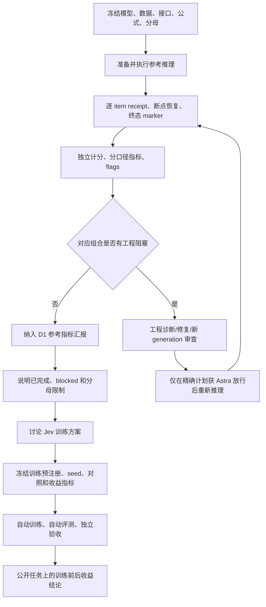

# 当前任务状态、推理实验闭环、决策事项与下一阶段计划

更新时间：2026-10-31。本文是给项目负责人的中文交接说明。它解释当前结果、各条指令之间的先后关系、推理实验的自动执行边界、需要决策的内容和下一阶段计划。本文不修改任何预注册的指标、数据分区、阈值或 test lock；它也不把尚未放行的结果写成科学结论。

本文把“推理也是实验”作为硬约束处理：一次推理只有在预注册、自动执行、可恢复、独立计分、终态验收和 wiki 记录全部完成后，才算正式实验。单独存在的 logits、report 或一个成功退出的容器，只能算中间产物。

## 先看结论

目前任务处于“参考模型推理结果基本成形，但还有两个登记组合被工程准入阻断”的阶段：

- 旧矩阵有 30 个模型×数据集组合、58 个计分面板；本轮新增 6 个组合，合计 **36 个有结果组合**。
- 仍有 **2 个 blocked/null 组合**：Open-Jev-2B × JEVal、Open-Jev-9B × JEVal。
- 新增 6 个组合都完成了实际 Astra 的限定范围结果审查；指标、分母和 flags 保留，不能写成无条件通过。
- E39 的 28 个历史 Kev 面板已完成当前 CPU 独立重算和有界 Astra 审查，最大差异约 `1.11e-16`；这证明当前保存证据可重建，不补造历史 finisher，也不证明无人值守恢复安全。
- E38 的固定镜像 CPU 工程套件 v7 已完成 **100/100、无 skip**；v7 exact plans 已获实际 Astra 指定范围 PASS。Open-Jev-2B 已完成 8/8 NPU 诊断 forward 和独立 CPU verifier；Open-Jev-9B 尚未启动，且两者都尚未完成 Open-Jev JEVal。
- 独立资源释放工具的旧 v4 版本被实际 Astra **BLOCK**；2B 的 chip 4 仍保持 allocation，未手工修改 `CHIP-ALLOCATION.json`。需要新 v7 绑定的 release 工具和独立审查后才能释放并串行启动 9B。
- 正式 Jev 训练尚未开始，训练收益尚未测量，真实业务和生产接入暂不属于当前范围。

因此，当前最正确的描述是：**推理实验的执行和审计正在进行，参考指标报告可以先形成增量版本；训练方案讨论必须排在参考结果汇报之后，正式训练必须排在训练方案预注册之后。**

## 1. 用户已经确定的范围

| 指令 | 已确定的含义 | 当前执行影响 |
| --- | --- | --- |
| D1 | 先汇报各参考模型在当前数据集测试集上的指标；文献有不同公式或算法时分开统计；统计后再讨论训练计划 | 当前优先级是参考推理、分口径计分和证据汇报；不能先用训练结果替代参考基线 |
| D2 | 暂时取消算力预算 | 不再以历史 24 小时限制任务；仍记录芯片数、每芯片吞吐、显存、实际占用和释放情况 |
| D3/D4/D7 | 暂不考虑真实业务、生产系统和业务标注；先制作 Jev 训练方案，并在公开任务上看到目标相关收益 | 当前收益指标是公开任务上的正确性、稳定性、校准/拒答和效率；不把模拟业务成功写成 G3 |
| D5 | 按建议执行 seed 设计 | 读取某批结果之前先登记 seed 数量和身份；不能看完结果后追加有利 seed |
| D6 | 按建议保留候选架构 | S1 监测、确定性 controller、S2 版本化 slots 是后续候选方案，不是已经验证的收益，也不是当前推理队列 controller 的冻结设计 |
| 自动驱动和执行 | 必须真正自动启动、恢复、计分、检查终态和验收 | 推理本身被视为实验；有结果文件但没有完整执行链，不能算正式完成 |

D1 规定的是**阶段顺序**，不是“停止所有推理工程”的指令。为得到参考指标，必要的推理、恢复、计分和准入修复可以现在继续；但新的正式训练不能提前开始。

## 2. 当前参考结果：不同口径分开报告

### 2.1 Kev 原生测试集：native 温度口径

Kev 的主表使用各 checkpoint 的原生 serving 温度；accuracy 是 question-weighted hard accuracy，Brier 是 one-hot multiclass Brier，ECE 是 top-confidence 的 ECE10，NLL 按记录 logits 计算。每个数据集的分母不同，不能跨数据集求平均。

| 模型 | 数据集 | n | accuracy | Brier | ECE10 | NLL |
| --- | --- | ---: | ---: | ---: | ---: | ---: |
| Kev-0.8B | decision-v7/clean | 1,200 | 83.750000% | 0.230501 | 0.018981 | 0.432025 |
| Kev-0.8B | transfer-v4/clean | 656 | 69.664634% | 0.396638 | 0.046375 | 0.673409 |
| Kev-0.8B | hard-v1/clean | 1,088 | 66.636029% | 0.459719 | 0.125548 | 0.862587 |
| Kev-0.8B | documents-v1/clean | 936 | 85.149573% | 0.244001 | 0.071009 | 0.491122 |
| Kev-0.8B | devtools-v1/full | 1,073 | 63.653308% | 0.442394 | 0.084400 | 0.778105 |
| Kev-0.8B | devtools-v1/release | 1,071 | 63.678805% | 0.442355 | 0.084701 | 0.778334 |
| Kev-4B | decision-v7/clean | 1,200 | 86.500000% | 0.186240 | 0.019310 | 0.349845 |
| Kev-4B | transfer-v4/clean | 656 | 83.841463% | 0.224157 | 0.016704 | 0.416391 |
| Kev-4B | hard-v1/clean | 1,088 | 80.330882% | 0.277583 | 0.084147 | 0.510299 |
| Kev-4B | documents-v1/clean | 936 | 90.277778% | 0.170655 | 0.100830 | 0.356801 |
| Kev-4B | devtools-v1/full | 1,073 | 75.582479% | 0.341848 | 0.077334 | 0.601769 |
| Kev-4B | devtools-v1/release | 1,071 | 75.630252% | 0.341743 | 0.077588 | 0.601792 |
| Kev-9B | decision-v7/clean | 1,200 | 87.250000% | 0.177666 | 0.027078 | 0.339478 |
| Kev-9B | transfer-v4/clean | 656 | 85.213415% | 0.198949 | 0.036219 | 0.370416 |
| Kev-9B | hard-v1/clean | 1,088 | 83.455882% | 0.233743 | 0.054294 | 0.425360 |
| Kev-9B | documents-v1/clean | 936 | 89.957265% | 0.151424 | 0.017013 | 0.297517 |
| Kev-9B | devtools-v1/full | 1,073 | 79.123952% | 0.309081 | 0.097420 | 0.570114 |
| Kev-9B | devtools-v1/release | 1,071 | 79.178338% | 0.309009 | 0.096861 | 0.570192 |

### 2.2 Kev 原生测试集：raw T=1 口径

raw T=1 与 native 温度是同一批保存推理的另一种计分方法，必须单独报告。accuracy 不变，但概率质量指标会改变。

| 模型 | 数据集 | n | accuracy | Brier | ECE10 | NLL |
| --- | --- | ---: | ---: | ---: | ---: | ---: |
| Kev-0.8B | decision-v7/clean | 1,200 | 83.750000% | 0.261037 | 0.100331 | 0.608459 |
| Kev-0.8B | transfer-v4/clean | 656 | 69.664634% | 0.416445 | 0.099264 | 0.737529 |
| Kev-0.8B | hard-v1/clean | 1,088 | 66.636029% | 0.435635 | 0.045529 | 0.810525 |
| Kev-0.8B | documents-v1/clean | 936 | 85.149573% | 0.249443 | 0.078571 | 0.575929 |
| Kev-0.8B | devtools-v1/full | 1,073 | 63.653308% | 0.455260 | 0.101733 | 0.799733 |
| Kev-0.8B | devtools-v1/release | 1,071 | 63.678805% | 0.455252 | 0.101601 | 0.800022 |
| Kev-4B | decision-v7/clean | 1,200 | 86.500000% | 0.210427 | 0.080424 | 0.486820 |
| Kev-4B | transfer-v4/clean | 656 | 83.841463% | 0.241839 | 0.085532 | 0.565516 |
| Kev-4B | hard-v1/clean | 1,088 | 80.330882% | 0.266842 | 0.048480 | 0.488188 |
| Kev-4B | documents-v1/clean | 936 | 90.277778% | 0.152239 | 0.043753 | 0.327754 |
| Kev-4B | devtools-v1/full | 1,073 | 75.582479% | 0.343588 | 0.071655 | 0.609042 |
| Kev-4B | devtools-v1/release | 1,071 | 75.630252% | 0.343650 | 0.071547 | 0.609270 |
| Kev-9B | decision-v7/clean | 1,200 | 87.250000% | 0.202317 | 0.075008 | 0.467006 |
| Kev-9B | transfer-v4/clean | 656 | 85.213415% | 0.216394 | 0.082492 | 0.464311 |
| Kev-9B | hard-v1/clean | 1,088 | 83.455882% | 0.240956 | 0.062900 | 0.451785 |
| Kev-9B | documents-v1/clean | 936 | 89.957265% | 0.165813 | 0.062541 | 0.412029 |
| Kev-9B | devtools-v1/full | 1,073 | 79.123952% | 0.295619 | 0.059792 | 0.564034 |
| Kev-9B | devtools-v1/release | 1,071 | 79.178338% | 0.295580 | 0.059480 | 0.564235 |

### 2.3 Nimble 原生测试集

Nimble 使用其原生 T=1 口径；其七个子集不能合并成一个与 Kev 相同定义的总分。除公共 hard 指标外，Nimble 的 binary Brier、score MAE、JSD/TV 也应按原任务定义保留。

| 子集 | n | accuracy | Brier | ECE10 | NLL |
| --- | ---: | ---: | ---: | ---: | ---: |
| massive-en-US | 350 | 86.857143% | 0.215612 | 0.069903 | 0.566445 |
| massive-de-DE | 350 | 84.000000% | 0.256619 | 0.081899 | 0.664881 |
| PAWS | 250 | 82.800000% | 0.279648 | 0.100160 | 0.541911 |
| Civil Comments | 300 | 70.000000% | 0.413404 | 0.135851 | 0.641568 |
| Aegis2 | 250 | 81.600000% | 0.289384 | 0.098642 | 0.568026 |
| SummEval relevance | 240 | 48.750000% | 0.676896 | 0.090175 | 1.305991 |
| SummEval consistency | 144 | 75.000000% | 0.419423 | 0.171724 | 0.905904 |

PAWS 的 Noul binary Brier 为 0.139824，Civil Comments 为 0.206702，Aegis2 为 0.144692；SummEval relevance 的 expected-score MAE 为 0.695520，consistency 为 0.567382。它们是 Nimble 原任务的独立分量，不能与多类 Brier 相加或平均。

### 2.4 Typed Decisions 共同测试

该表是 400 states、2,000 questions 的共同测试，不等于每个模型自家原生 test。serving 温度和 raw T=1 分开；accuracy 比较第一 argmax，KL/Brier/ECE10 使用概率分布。

| 模型 | 口径 | 温度 | n | accuracy | KL(q||p) | Brier | ECE10 |
| --- | --- | ---: | ---: | ---: | ---: | ---: | ---: |
| Kev-0.8B | serving | 2.3511 | 2,000 | 45.950% | 0.349523 | 0.195493 | 0.045770 |
| Kev-0.8B | raw T=1 | 1 | 2,000 | 45.950% | 0.498068 | 0.260309 | 0.155170 |
| Kev-4B | serving | 2.4061 | 2,000 | 66.450% | 0.223109 | 0.124565 | 0.089534 |
| Kev-4B | raw T=1 | 1 | 2,000 | 66.450% | 0.504515 | 0.201069 | 0.091401 |
| Kev-9B | serving | 2.1936 | 2,000 | 68.050% | 0.213790 | 0.116321 | 0.064928 |
| Kev-9B | raw T=1 | 1 | 2,000 | 68.050% | 0.519309 | 0.187225 | 0.091136 |
| Nimble-9B | native T=1 | 1 | 2,000 | 65.100% | 0.706028 | 0.254995 | 0.172864 |
| Open-Jev-2B | serving | 1.5188 | 2,000 | 58.250% | 0.410910 | 0.193817 | 0.081003 |
| Open-Jev-2B | raw T=1 | 1 | 2,000 | 58.250% | 0.659782 | 0.245028 | 0.159235 |
| Open-Jev-9B | serving | 1.8969 | 2,000 | 67.800% | 0.369436 | 0.147618 | 0.058202 |
| Open-Jev-9B | raw T=1 | 1 | 2,000 | 67.800% | 0.885942 | 0.224383 | 0.148582 |

### 2.5 Open-Jev 原始 OOD 测试

原始 OOD 表的全体分母为 10,532 行，其中 one-hot hard 行为 10,046；hard accuracy 只使用 one-hot 行，expected accuracy、NLL、Brier、expected Brier 和 ECE15 使用全体行。serving 与 raw T=1 是两种计分口径，不是两次推理。

| 模型 | 口径 | hard accuracy | expected accuracy | NLL | Brier | expected Brier | ECE15 |
| --- | --- | ---: | ---: | ---: | ---: | ---: | ---: |
| Open-Jev-2B | serving | 94.634680% | 91.876577% | 0.195622 | 0.076288 | 0.104339 | 0.012282 |
| Open-Jev-2B | raw T=1 | 94.634680% | 91.876577% | 0.213531 | 0.080689 | 0.108740 | 0.024150 |
| Open-Jev-9B | serving | 97.511447% | 94.686833% | 0.130801 | 0.039048 | 0.067098 | 0.007525 |
| Open-Jev-9B | raw T=1 | 97.511447% | 94.686833% | 0.138525 | 0.040875 | 0.068926 | 0.011593 |

后续增量的另一套原始 OOD 保存推理包含 15,920 行，因输入集合与旧 10,532 行矩阵不同，不能把两个分母混成一个总分。该增量的 hard accuracy 为 Open-Jev-2B **86.028745%**、Open-Jev-9B **91.978506%**；它们保留在 [参考增量索引](../experiments/REFERENCE-BASELINE-INCREMENT-2026-10-31.md) 中，不能替换旧矩阵。

### 2.6 JEVal 增量结果与当前缺口

JEVal 的分类有效分母为 9,911/10,938；每模型另有 1,027 条 overlength。score 任务分母为 319。这里的 ECE10 是当前本地实现约定，不宣称等于论文原始 scorer。

| 模型 | 分类正确/有效分母 | accuracy | Brier | ECE10 | score MAE | 状态 |
| --- | ---: | ---: | ---: | ---: | ---: | --- |
| Kev-0.8B | 5,089/10,938 | 46.525873% | 0.598302 | 0.163216 | 1.121768 | 有界参考，保留 6 flags |
| Nimble | 5,394/10,938 | 49.314317% | 0.433576 | 0.135361 | 0.842949（312/319 有效） | 有界参考，保留 30 flags；2,047 candidate-limit、206 empty-context |
| Kev-4B | 6,741/10,938 | 61.629183% | 0.436119 | 0.173661 | 0.914081 | 有界参考，保留 8 flags |
| Kev-9B | 6,931/10,938 | 63.366246% | 0.406847 | 0.109838 | 0.923337 | 有界参考，保留 7 flags |
| Open-Jev-2B | — | — | — | — | — | blocked/null，等待 E38 |
| Open-Jev-9B | — | — | — | — | — | blocked/null，等待 E38 |

这些指标已经完成对应的实际 Astra 限定审查，但“有界参考”只表示保存证据和指定范围内的计分可复核；不证明论文精确复现、无数据污染、paired consistency、训练收益或真实业务收益。

完整机器索引和公式见 [REFERENCE-BASELINE-MATRIX-2026-10-31.json](../experiments/REFERENCE-BASELINE-MATRIX-2026-10-31.json) 与 [REFERENCE-BASELINE-INCREMENT-2026-10-31.json](../experiments/REFERENCE-BASELINE-INCREMENT-2026-10-31.json)。

## 3. 当前任务进度和阻塞关系

| 工作包 | 已完成 | 当前状态 | 不能推出的结论 |
| --- | --- | --- | --- |
| 参考矩阵 | 36 个有结果组合、58 个旧面板、6 个新增组合已审查 | 可形成 D1 增量汇报；2 个组合仍缺结果 | 不能称所有兼容模型×数据集笛卡尔积已完成 |
| E39 历史 Kev 复核 | 8,462 receipts、11,495 questions、28 面板独立重算；最大差约 `1.11e-16` | 有界通过 | 不补造旧 finisher；不证明 cache/restart 安全 |
| E38 CPU 工程验证 | 固定镜像 v7：100/100、无 skip；真实 Qwen3.5/GDN 源码已导出 | 工程证据完成，不能放行 NPU | CPU fixture 不是参考 checkpoint，也不是 JEVal 数值结果 |
| E38 NPU 计划 | v4 两份计划已准备，芯片 4 未占用 | 实际 Astra BLOCK；新 generation 计划尚未生成 | 不得启动 v4；不得写 approval |
| E38 资源释放 | 独立 release 工具已做实际 Astra 审查 | BLOCK；没有真实 release | 不得修改分配表，不得释放芯片 4 |
| Jev 训练 | 训练方案草案和旧工程材料存在 | 正式训练未启动 | 尚无训练前后收益结论 |
| 真实业务 | 按 D3/D4/D7 暂不纳入 | 不作为前置条件 | 公开任务收益不能写成业务收益 |

E38 当前必须保持的硬事实是：旧 v2/v4 计划和失败审查原样保留；新修复应生成新的 plan/request 和新的审查包，不能在旧计划上静默修改。新 generation 至少要补齐：父目录持久化链、confidence `[0,1]` 完整边界、固定镜像实际源码闭包、启动时审批字节绑定；资源释放还要另行修复安全锁、代码字节执行、before-state 可信锚点、pending publication 恢复和退出代次绑定。

## 4. 各指令的内部逻辑和正确先后次序

### 4.1 依赖图



### 4.2 逐步解释

1. **先冻结测量对象。** 模型 checkpoint、数据 split、输入集合、原生接口、温度、计分公式、有效分母和 flags 规则必须先写入 plan/manifest。否则后面即使数字稳定，也不知道比较了什么。
2. **再执行参考推理。** 推理是实验，不是“准备工作”。它必须有固定镜像、固定容器名、CephFS 日志、heartbeat、逐 item 可恢复状态、精确 relaunch 命令和实际 Docker exit。
3. **然后做科学计分和工程验收。** receipt 是否完整、是否重复、是否错模型/错题集、终态是否存在、report/terminal 是否绑定、资源是否真的释放，都要由独立 verifier 检查。watchdog 的 done 只能表示进程结束，不能代替科学准入。
4. **遇到阻塞时，先修工程再继续。** E38 v4 被 Astra BLOCK，正确动作是保留旧证据、生成新 generation、重新做 CPU 套件和实际 Astra 审查；不是删掉 flags、手工补 report 或直接启动 NPU。
5. **参考指标阶段可以分批汇报。** 已完成的 36 个组合先按公式和分母汇报，两个 blocked/null 明确列出原因和影响。等 Open-Jev JEVal 完成后追加，不改写旧快照。
6. **参考汇报后才讨论训练计划。** 这一步是 D1 的硬顺序。训练方案讨论的输入是参考模型的实际结果和限制，而不是只看论文数字。
7. **训练讨论后先预注册，再自动训练。** 训练配方、seed、对照、目标指标、选择规则和恢复协议要在读取训练结果前固定；然后才启动训练和训练后评测。
8. **最后才判断 Jev 收益。** 收益必须是公开任务上的训练前后对照，并分别报告正确性、规则/定义稳定性、校准/拒答和效率；不能用业务叙述填补未完成的实验。

### 4.3 三种 controller 不能混淆

- **实验执行 controller**：当前必须实际工作，负责 queue、依赖、detached 启动、恢复、计分、终态和资源释放。
- **watchdog**：只读取日志、heartbeat、marker 和 report，生成 digest；不等于科学验收。
- **D6 的 S1/S2 controller**：后续 Jev/agent 系统候选架构，尚未验证收益，也不替代当前实验执行链。

### 4.4 指令优先级和不可跳过的状态机

用户的指令不是并列的待办事项，而是有约束关系的顺序。当前采用下面的解释：

| 顺序 | 指令或阶段 | 它允许我们做什么 | 它不能被解释成什么 |
| ---: | --- | --- | --- |
| 0 | 现状审计 | 检查已有结果、blocked 项、运行进程、代码和证据是否相互一致 | 不能把旧的 `done` 标记当成新的放行 |
| 1 | D1：先汇报参考指标 | 对已登记组合做分口径、分数据集、分分母的测试集统计；保留 blocked/null | 不能先用训练结果回答 D1，也不能把不同公式合成一个分数 |
| 2 | 推理实验执行 | 为缺失的参考组合准备并运行自动推理、恢复、计分和验收 | 不能把推理降级成训练前的非实验准备 |
| 3 | 工程准入门 | 对 exact plan、镜像源码闭包、资源绑定和自动执行链做独立审查 | CPU 套件通过不能替代 NPU 计划放行；Astra BLOCK 时不得启动 |
| 4 | D1 收口 | 明确每个登记组合的 result、blocked、not applicable 或未执行状态 | 不能为了“完整”临时扩展模型×数据集笛卡尔积 |
| 5 | 训练方案讨论 | 依据 D1 结果选择 Jev 训练对照、公开任务和收益指标 | 不能在参考结果尚未汇报前启动正式训练 |
| 6 | 训练预注册 | 登记 seed、对照、数据/代码 SHA、指标、阈值、恢复协议和采用规则 | 不能先看训练曲线再补 seed 或改选择标准 |
| 7 | 自动训练与自动评测 | detached 启动、heartbeat、断点恢复、独立验收，并在同一测试集比较前后结果 | 不能把公开任务收益写成真实业务收益，也不能只报 loss |

因此，D2 只移除了“算力预算”这一资源限制，不会移除第 2、3、4 步的质量门禁；D3/D4/D7 只缩小收益声明的范围，不会移除推理和训练的自动执行要求；D5/D6 分别约束训练统计设计和后续架构假设，也不会改变 D1 的先后次序。

当前 E38 已通过 exact-plan review 并完成 2B 的一次诊断执行，但仍位于资源释放门禁：`e38_execution_astra_20261031_v8` 已有真实 `CHILD_EXIT.json`、`COMPLETE.json`、`EXIT` 和 `review.md`，2B 的 8/8 forward 与独立 CPU verifier 均 exit 0；旧 release 工具仍被 Astra BLOCK，因此不能直接释放 chip 4 或启动 9B。

### 4.5 推理实验的自动状态转移

每个模型×数据集组合都要有独立的状态，不允许用同一模型的另一个数据集结果替代它。状态转移如下：

```text
REGISTERED
  -> PREPARED       固定 checkpoint、数据、公式、分母、代码和 request/plan SHA
  -> REVIEWED       exact plan 获得对应范围的独立放行
  -> RUNNING        detached 容器启动，heartbeat 和逐 item receipt 持续写入
  -> PAUSED         中断或资源异常；保留证据，不发布半成品
  -> RUNNING        从最后一个确定完成的 item 恢复
  -> FINISHED       Docker exit、wrapper EXIT、terminal marker 和 report 均齐全
  -> SCORED         独立计分，按预注册公式输出所有口径和分母
  -> ACCEPTED       receipt、模型身份、数据集合、终态、flags 和资源证据通过
  -> REPORTED       写入 D1 矩阵和 wiki；只追加版本，不覆盖历史快照
```

任一环节失败时只能转入 `BLOCKED` 或 `NEEDS_REVIEW`，不能直接跳到 `REPORTED`。`RUNNING` 和 `FINISHED` 是工程状态，`SCORED` 是计算状态，`ACCEPTED` 才是可用于科学汇报的状态；这几个词在报告中不能互换。2B 和 9B 还必须分别完成上述状态机，2B 的终态和资源释放通过后才允许启动 9B。

## 5. “推理实验也属于实验”的自动执行验收清单

每个超过一分钟的推理任务都必须具备以下证据，缺一项就只能称工程草稿或部分结果：

1. 运行前登记 purpose、hypothesis、模型、数据、公式、分母、seed/温度和预期 flags，并写入 wiki。
2. 记录实际代码、模型、数据、配置和 plan/request 的 SHA；启动前核对 parent review 和 exact bytes。
3. 使用固定容器名和 detached `docker run -d`；不使用 `--rm`；日志写到 CephFS；日志中有时间戳 heartbeat 和进度计数。
4. 以 item 粒度可恢复；中断后从最后一个确定完成项继续；不把没有 receipt 的 forward 当成可安全重试。
5. 保存精确 relaunch 命令、wrapper EXIT、终态 marker、report SHA 和实际 Docker exit；marker 是完成状态的来源。
6. watchdog 生成 digest，报告正常状态和 suspicious success（例如 0/1 完美率、所有 cell 相同、样本数不足）；原始长日志不直接由主会话读取。
7. 独立 verifier 重新核对 receipt、题目集合、模型身份、分母、公式、terminal 和 flags；结果失败时保留证据，不改写为成功。
8. 科学结果和资源释放分开验收。即便指标有效，也要在实际 NPU/CPU 退出、owner、空设备查询和 allocation 快照核对后才释放资源。
9. wiki 记录目的、设置、结果、限制和 verdict；所有更正使用带日期的追加说明，不能静默修改历史快照。

当前已有真实 queue、detached 推理、finisher、恢复和独立重算证据，但 E38 的完整链条尚未闭合；所以“自动驱动已经存在”不等于“所有登记推理都已完成”。

## 6. 仍需要用户决定的内容

### 6.1 需要确认的唯一范围问题：D1 第一批是否扩展到完整笛卡尔积

当前登记范围有 36 个有结果组合和 2 个 blocked/null 组合。尚未明确的是，第一批 D1 是否要再扩展为“所有兼容模型×所有数据集”的完整交叉组合。

**建议：不扩展。** 先把当前已登记的 38 个组合（36 个结果 + 2 个 blocked/null）收口并汇报；缺失组合明确写成“不适用、未登记或尚未执行”。原因是扩展笛卡尔积会改变任务边界、资源计划、数据适用性和计分分母，应该另立登记，而不是在结果出来后扩大范围。

### 6.2 需要确认的报告时点

**建议：现在先发布带 blocked/null 标记的 D1 增量报告，Open-Jev JEVal 完成后追加更新。** 这样不会让已完成的 36 个组合等待一个局部工程问题，也不会把两个缺失组合伪装成零分。更新时只追加新的日期和 SHA，不覆盖旧快照。

其他事项暂不需要新增用户确认：E38 只运行通过实际 Astra 精确审查的 new generation；训练先做方案和预注册；真实业务继续按 D3/D4/D7 暂停。

### 6.3 本轮需要用户明确的两个边界（如维持建议则无需改动）

下面两项不会阻塞当前已在运行的 Astra 审查，但会决定 D1 报告的封版方式：

1. **D1 范围**：是否按当前登记的 38 个组合收口（36 个已有结果 + 2 个 Open-Jev×JEVal blocked/null），不额外补齐完整模型×数据集笛卡尔积。建议维持“收口当前登记范围”。
2. **报告时点**：是否先发布带 `blocked/null` 标记的 36 组合增量报告，待 Open-Jev JEVal 通过 E38 后追加两个组合。建议维持“先增量、后追加”，并保留旧快照。

如果你希望采用不同边界，只需回复“扩展笛卡尔积”或“等待两个 JEVal 后再发 D1”；在收到明确改动前，执行按上述建议继续，不会把缺失项伪造成零分。

## 7. 下一阶段任务计划

### P0：冻结当前状态并交付 D1 增量说明

**现在进行。**

- 使用本文件和参考矩阵作为入口；保留 36/2 的计数、公式、分母、flags 和限制。
- 把 E39 的有界通过、E38 的 BLOCK、release 的 BLOCK 分开写，不用一个“完成率”概括。
- 不启动训练，不读取未准入的 Open-Jev JEVal，不改变旧快照。

出口：用户确认 D1 范围按当前登记矩阵收口，或明确要求扩展。

### P1：生成并审查新的 E38 target generation

**依赖：当前 v7 CPU 证据和修复源码。**

- 工程侧生成 Open-Jev-2B 和 Open-Jev-9B 两份新 plan/request；不能继续使用被 BLOCK 的 v4 计划。
- 生成新的 source manifest，包含固定镜像内实际 `modeling_qwen3_5.py`、`configuration_qwen3_5.py` 和 GDN 源码，以及全部 CPU 测试和逐项日志。
- 把 parent review SHA、request SHA、plan SHA、preparation terminal/EXIT、chip 4/no-device/network-none/原始 entrypoint 绑定到同一份 launch evidence。
- 用实际 `codex exec --model gpt-6-astra --sandbox read-only` 审查 exact plans；审查过程不能写 approval，不能启动 NPU。

出口：已完成。实际 Astra 对两份 v7 exact plan 给出指定范围 PASS；其 review 不包含实时资源、外部权重、JEVal 或训练收益授权。

### P2：按顺序完成 Open-Jev NPU 路径实验

**依赖：P1 exact-plan PASS、chip 4 owner/空闲实时核验。**

- 重新核对 allocation、Docker 容器、`npu-smi` 和 physical chip 4；不能只看分配文件里的 free。已完成 2B 的实时核验。
- detached 启动 2B，保存 NPU heartbeat、逐 forward receipt、trace、report、terminal、EXIT 和实际容器退出。已完成 8/8 forward，容器 exit 0。
- 独立 CPU verifier 读取 NPU 结果，验收 trace、分母、概率、flags、publication gap 和 generation binding。已完成，verifier exit 0。
- 结果关闭后再执行经过新审查的 release；旧 release 工具仍被 Astra BLOCK，当前不得自动释放或修改 allocation。
- 2B 完成并释放后，再串行启动 9B；不同时占用同一物理卡，也不把 2B 的结果身份复用于 9B。

出口：2B 已有独立终态、诊断 receipt/trace、独立 verifier 和 wiki 记录；资源释放证据尚未闭合。9B 必须等待新 release 工具审查和 2B 释放后再启动。

### P3：完成 Open-Jev JEVal 并更新参考矩阵

- 只使用通过 E38 准入的原生结果；严格区分 hard、expected、valid、overlength 和 score 分母。
- 使用 JEVal 已登记公式，若需要不同文献公式则并列输出，不事后改公式。
- 做独立计分和实际 Astra 限定审查；更新 `REFERENCE-BASELINE-INCREMENT`，不覆盖旧矩阵。

出口：原登记的 38 个组合都有“结果、blocked、not applicable 或未执行”的明确状态，D1 汇报可以完整解释。

### P4：正式完成 D1 参考结果汇报

交付内容：参考指标表、公式和温度说明、分母表、来源/代码/模型 SHA、flags、审查范围、尚未完成事项、不能推出的结论。

出口：先得到参考结果统计，再进入训练计划讨论；在此之前不启动新的正式训练。

### P5：讨论并冻结 Jev 训练方案

建议以 0.8B 为第一训练闭环：训练前 reference → 基座 K0 → Jev LoRA → 同一公开任务训练后评测；2B/4B/9B 作为后续规模阶梯。训练前登记：seed 数量、K1/K2 对照、数据和代码 SHA、主指标、稳定性指标、校准/拒答指标、效率字段、采用规则和失败处置。

D3/D4/D7 下，收益目标限定为公开任务上的目标相关收益；不把真实业务、生产动作或业务标注列入首批入口。

出口：方案和预注册冻结，自动训练任务具备可启动条件。

### P6：自动训练、评测和收益验收

- 按同一 detached、heartbeat、resume、terminal、独立 verifier 和 wiki 要求执行训练与评测。
- 每芯片报告 questions/s/chip、tokens/s/chip、芯片数、allocated/reserved GiB、峰值显存、step 长尾和有效工作量。
- 训练前后在同一测试集、同一公式和同一分母上比较；正确性、稳定性、校准/拒答和效率分开判断。
- 只有当 paired protocol、seed 身份、结果来源和终态都通过，才写“观察到 Jev 收益”或“未观察到收益”。

## 8. 当前不应该做的事情

- 不启动被实际 Astra BLOCK 的 E38 v4 计划。
- 不因为 CPU 100/100 就宣称 NPU 路径可用或 JEVal 已完成。
- 不因为 watchdog 显示 done 就跳过 receipt、独立计分、终态和资源验收。
- 不把 Open-Jev OOD、Typed Decisions、JEVal 和 Kev 原生 test 的不同分母合并成总分。
- 不用 upstream dev 结果冒充本地 test 结果，也不把上游 H100 速度当成 175 的性能结论。
- 不在 D1 参考结果汇报前启动新的 Jev 正式训练。
- 不把 D6 的候选 agent 架构写成已验证收益，不把公开任务结果写成真实业务收益。

## 9. 关键证据入口

- [参考矩阵机器索引](../experiments/REFERENCE-BASELINE-MATRIX-2026-10-31.json)
- [参考结果增量索引](../experiments/REFERENCE-BASELINE-INCREMENT-2026-10-31.json)
- [当前推理优先状态](06-status-inference-first-2026-10-31.md)
- [E38 路径跟踪 wiki](../wiki/E38-openjev-path-trace-20261031.md)
- [E38 实际 Astra 执行审查](../experiments/ASTRA-E38-EXECUTION-V3-REVIEW-2026-10-31.md)
- [E38 release-only 实际 Astra 审查](../experiments/ASTRA-E38-RELEASE-REVIEW-2026-10-31.md)
- [E39 当前 Kev 复核](../experiments/LEGACY-KEV-DATED-REAUDIT-RESULTS-2026-10-31.md)

